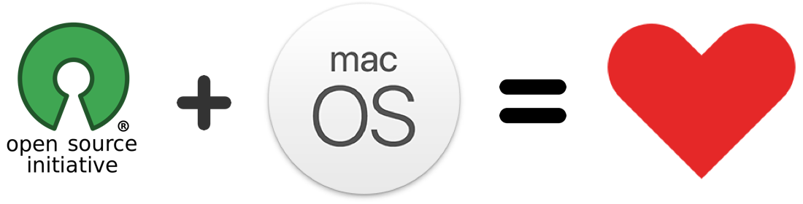

  
  
  
  <h1>Awesome macOS Open Source Applications</h1>
  
A curated list of open source applications for macOS

  

    
    
    
  

  

    
    
    
  

  <a href="#audio">Audio</a> •
  <a href="#backup">Backup</a> •
  <a href="#browser">Browser</a> •
  <a href="#chat">Chat</a> •
  <a href="#cryptocurrency">Crypto</a> •
  <a href="#database">Database</a> •
  <a href="#development">Dev</a> •
  <a href="#editors">Editors</a> •
  <a href="#graphics">Graphics</a> •
  <a href="#productivity">Productivity</a> •
  <a href="#utilities">Utilities</a>

List of awesome open source applications for macOS. This list contains a lot of native, and cross-platform apps. The main goal of this repository is to find free open source apps and start contributing. Feel free to [contribute](CONTRIBUTING.md) to the list, any suggestions are welcome!

To receive all new or popular applications you can join our [telegram channel](https://t.me/opensourcemacosapps).

## Support

Hey friend! Help me out for a couple of :beers:!  

## 📊 Statistics

| Metric | Count |
|--------|-------|
| 📱 Total Applications | 1293 |
| 📂 Categories | 49 |
| 🔝 Top Languages | Swift: 724 • TypeScript: 157 • Objective-C: 145 • JavaScript: 142 • Rust: 129 |

## Contents
- [Audio](#audio)
- [Backup](#backup)
- [Browser](#browser)
- [Chat](#chat)
- [Cryptocurrency](#cryptocurrency)
- [Database](#database)
- [Development](#development)
- [Git](#git)
- [iOS / macOS](#ios--macos)
- [JSON Parsing](#json-parsing)
- [Web development](#web-development)
- [Other development](#other-development)
- [Downloader](#downloader)
- [Editors](#editors)
- [CSV](#csv)
- [JSON](#json)
- [Markdown](#markdown)
- [TeX](#tex)
- [Text](#text)
- [Extensions](#extensions)
- [Finder](#finder)
- [Games](#games)
- [Graphics](#graphics)
- [IDE](#ide)
- [Images](#images)
- [Keyboard](#keyboard)
- [Mail](#mail)
- [Menubar](#menubar)
- [Music](#music)
- [News](#news)
- [Notes](#notes)
- [Other](#other)
- [Podcast](#podcast)
- [Productivity](#productivity)
- [Screensaver](#screensaver)
- [Security](#security)
- [Sharing Files](#sharing-files)
- [Social Networking](#social-networking)
- [Streaming](#streaming)
- [System](#system)
- [Terminal](#terminal)
- [Touch Bar](#touch-bar)
- [Utilities](#utilities)
- [VPN & Proxy](#vpn--proxy)
- [Video](#video)
- [Wallpaper](#wallpaper)
- [Window Management](#window-management)

## Applications
### 🎵 Audio (100)
- [[Un]MuteMic](https://github.com/CocoaHeadsBrasil/MuteUnmuteMic) - macOS app to mute & unmute the input volume of your microphone. Perfect for podcasters. — `Objective-C` `C`
- [akou](https://github.com/GeiserX/akou) - Records calls and meetings, transcribes them on-device with speaker labels, and lets Claude Code or Codex question a call over MCP. ([Website](https://geiserx.github.io/akou/)) — `TypeScript` `Rust`
- [Amical](https://github.com/amicalhq/amical) - AI dictation and note-taking app that types into any app and formats the text for the app you are in, with local Whisper or Parakeet models. ([Website](https://amical.ai)) — `TypeScript`
- [Audacity](https://github.com/audacity/audacity) - Free, open source, cross-platform audio software ([Website](https://www.audacityteam.org/)) — `C`
- [Audio Priority Bar](https://github.com/camguillory/Audio-Priority-Bar) - Native macOS menu bar app that automatically switches to your highest-priority connected headphones, speakers, and microphone. ([Website](https://github.com/camguillory/Audio-Priority-Bar)) — `Swift`
- [AudioAnchor](https://github.com/wata/AudioAnchor) - Menu bar app that keeps your sound output on the device you choose, like your AirPods, and switches it back whenever macOS moves it somewhere else. ([Website](https://github.com/wata/AudioAnchor)) — `Swift`
- [AudioEnhancerMAX](https://github.com/sev7enITA/AudioEnhancerMAX) - Audio editor with local processing, reviewable non-destructive edits, and traceable processing reports. ([Website](https://fabriziodegni.com/AudioEnhancerMAX/)) — `Python` `JavaScript`
- [AudioSync](https://github.com/yassersutojoyo/audiosync) - Play your Mac's audio on AirPlay, Google Cast and local speakers at once, with a delay per speaker so they stay in sync. — `Swift` `Rust`
- [AUHost](https://github.com/vgorloff/AUHost) - Application which hosts AudioUnits v3 using AVFoundation API. — `Swift`
- [Aural Player](https://github.com/kartik-venugopal/aural-player) - Aural Player is a audio player application for the macOS platform. Inspired by the classic Winamp player for Windows, it is designed to be to-the-point and easy to use. — `Swift`
- [AutoMute](https://github.com/yonilevy/automute) - Automatically mute the sound when headphones disconnect / Mac awake from sleep. ([Website](https://yoni.ninja/automute/)) — `Objective-C`
- [Background Music](https://github.com/kyleneideck/BackgroundMusic) - Background Music, a macOS audio utility: automatically pause your music, set individual apps' volumes and record system audio. — `C++`
- [BlackHole](https://github.com/ExistentialAudio/BlackHole) - BlackHole is a modern macOS virtual audio driver that allows applications to pass audio to other applications with zero additional latency. — `C`
- [Blurt](https://github.com/AssemblyAI/blurt) - Free, open-source dictation for macOS: hold a key, talk, and polished text lands in whatever app you're typing in. Powered by AssemblyAI speech-to-text (bring your own API key). ([Website](https://www.assemblyai.com/blurt)) — `Swift`
- [CAM](https://github.com/hanayik/CAM) - macOS camera recording using ffmpeg — `JavaScript`
- [Carbon](https://github.com/AlexDemzz/carbon) - Menu bar app that transcribes your meetings on device and saves each one as a Markdown file, with no bot and no cloud. ([Website](https://carbon.alexandrejoly.me)) — `Swift`
- [Clementine](https://github.com/clementine-player/Clementine) - Clementine is a modern music player and library organizer for Windows, Linux and macOS. ([Website](https://www.clementine-player.org/)) — `C++`
- [Cog](https://bitbucket.org/losnoco/cog/src) - Cog is an open source audio player for macOS. The basic layout is a single-paned playlist interface with two retractable drawers, one for navigating the user's music folders and another for viewing audio file properties, like bitrate. ([Website](https://cogx.org/)) — `Objective-C`
- [Dictámelo](https://github.com/sarrazola/dictamelo) - Voice dictation with downloadable local speech models, optional cloud providers and a configurable push-to-talk shortcut. ([Website](https://www.dictamelo.com/en)) — `Rust` `JavaScript`
- [Digisensus Recorder](https://github.com/Digisensus/digisensus-recorder) - Call recorder and bot-free AI meeting note taker for Zoom, Meet, Teams, FaceTime, WhatsApp and phone calls. ([Website](https://digisensus.com/call-recorder-mac/)) — `Swift`
- [Earnote](https://github.com/louiskl/Earnote) - Records lectures, meetings and calls, transcribes them locally with Whisper and writes structured notes with an on-device AI model. ([Website](https://earnote.dev)) — `Swift`
- [Earshot](https://github.com/Bouliw/earshot) - Live on-device transcription of any app you pick, with speaker names in Microsoft Teams. — `Swift`
- [EnviousWispr](https://github.com/saurabhav88/EnviousWispr) - Free on-device AI dictation for macOS with Whisper and Parakeet speech models on Apple Silicon. ([Website](https://enviouswispr.com/)) — `Swift`
- [eqMac2](https://github.com/bitgapp/eqMac) - System-Wide Equalizer for the Mac. — `C++`
- [Fader](https://github.com/pantafive/fader) - Menu bar volume mixer with per-app volume, one-click audio output switching, and Bluetooth headphone control. ([Website](https://fader.pantafive.dev)) — `Swift`
- [fre:ac](https://github.com/enzo1982/freac) - The fre:ac audio converter project. — `C++`
- [Glimpse](https://github.com/glimpse-hq/Glimpse) - Local dictation and meeting transcription with speaker labels, free and unlimited for dictation. ([Website](https://tryglimpse.cc/)) — `Rust` `TypeScript`
- [hark](https://github.com/PhantomYdn/hark) - Capture microphone, system or per-app audio and transcribe it on-device from a single native CLI. ([Website](https://github.com/PhantomYdn/hark)) — `Swift`
- [HomeRec](https://github.com/melissa-pereira-deel/home-rec) - Lightweight native macOS app for recording system audio as high-quality WAV files using ScreenCaptureKit. — `Swift`
- [iTunes-Volume-Control](https://github.com/alberti42/iTunes-Volume-Control) - This app allows you to control the iTunes volume using volume up and volume down hotkeys. — `Objective-C`
- [JackMate](https://github.com/zinc75/JackMate) - JackMate is a native macOS app to start, configure and patch the JACK audio server, with a visual patchbay, saved studios and a menu bar mode. ([Website](https://jackmate.app)) — `Swift`
- [jdsp4mac](https://github.com/Tekkiech/jdsp4mac) - Menu bar app that runs JamesDSP audio effects, including EQ, AutoEQ, convolver, crossfeed and ViPER-DDC, on all system audio. ([Website](https://github.com/Tekkiech/jdsp4mac)) — `Swift` `C`
- [jmc](https://github.com/jcm93/jmc) - jmc is new macOS media organizer. — `Swift`
- [Karaoke Forever](https://github.com/bhj/KaraokeEternal) - Host awesome karaoke parties where everyone can queue songs from their phone's browser. Plays MP3+G and MP4 with WebGL visualizations. ([Website](https://www.karaoke-eternal.com/)) — `JavaScript`
- [KeyEcho](https://github.com/ZacharyL2/KeyEcho) - Plays recorded mechanical keyboard sounds as you type. ([Website](https://keyecho.app)) — `Rust` `TypeScript`
- [Local Transcriber](https://github.com/teconomix/local-transcriber) - Menu bar app that records meetings and calls and transcribes them locally with Whisper and pyannote speaker recognition, with dictation into any app. ([Website](https://transcriber.teconomix.net)) — `Swift` `Python`
- [LocalRadio](https://github.com/dsward2/LocalRadio) - LocalRadio is software for listening to "Software-Defined Radio" on your Mac and mobile devices. — `Objective-C`
- [LosslessCut](https://github.com/mifi/lossless-cut) - The swiss army knife of lossless video/audio editing without re-encoding. ([Website](https://mifi.no/losslesscut/)) — `JavaScript`
- [Lowspeak](https://github.com/sventmueller/lowspeak) - Ultrafast native AI speech-to-text for every Mac app: hold fn, talk, let go. Free online with your own Groq key or offline with Whisper and NVIDIA Parakeet, written in Rust, 35 languages. — `Rust`
- [Lurar](https://github.com/lsjoberg/lurar) - Menu-bar parametric EQ for headphones. Loads the AutoEq catalog and applies it system-wide via Apple's Core Audio Process Tap — no virtual audio driver. ([Website](https://lurar.app/)) — `Swift`
- [LyricGlow](https://github.com/ateymoori/lyricglow) - macOS application displaying synchronized lyrics with animated word-by-word glow effects for Spotify, Apple Music, and YouTube Music. — `JavaScript`
- [Lyricism](https://github.com/lyc2345/Lyricism) - macOS app to show you lyric what currently iTunes or Spotify is playing. — `Objective-C` `Swift`
- [LyricsX](https://github.com/ddddxxx/LyricsX) - Lyrics for iTunes, Spotify and Vox. — `Swift`
- [Lyrimuse](https://github.com/Yudaotor/lyrimuse) - Word-synced desktop lyrics for Apple Music, Spotify, QQ Music, NetEase Cloud Music, Kugou and YouTube Music / Spotify Web in the browser, with translation, romanization and Last.fm scrobbling. ([Website](https://yudaotor.github.io/lyrimuse/)) — `Swift` `Go`
- [MacroSIP](https://github.com/HSMM/MacroSIP) - Native SIP softphone in the spirit of MicroSIP with multiple accounts, stereo M4A call recording, BLF quick keys, and LDAP/Contacts directory lookup. ([Website](https://github.com/HSMM/MacroSIP)) — `Swift` `C`
- [Minute](https://github.com/mraza007/minute) - Records meetings without a bot, transcribes them on-device with Whisper, labels speakers, and writes summaries and action items with a local LLM. ([Website](https://minutenotes.app)) — `Rust` `TypeScript`
- [MonitorControl](https://github.com/MonitorControl/MonitorControl) - Control your external monitor brightness, contrast or volume directly from a menulet or with keyboard native keys. — `Swift` `Objective-C`
- [Mooziac](https://github.com/shirkeharsh/mooziac) - Lightweight native macOS menu bar player for YouTube Music and local audio with trackpad gestures. ([Website](https://mooziac.pages.dev)) — `Swift`
- [Mous Player](https://github.com/bsdelf/mous) - Simple yet powerful audio player for BSD/Linux/macOS. — `C++`
- [MPV](https://github.com/mpv-player/mpv) - Lightweight, highly configurable media player. ([Website](https://mpv.io)) — `C`
- [NarrateClaude](https://github.com/nicedreamzapp/NarrateClaude) - Hands-free, on-device voice loop for talking to Claude Code: Apple speech recognition in, cloned-voice text-to-speech out, no cloud. ([Website](https://github.com/nicedreamzapp/NarrateClaude)) — `Swift` `Python` `Shell`
- [nastro](https://github.com/scaccogatto/nastro) - Terminal call recorder for macOS that captures system audio and mic (no bot joins the call) and transcribes on-device with speaker diarization, via TUI or headless CLI. ([Website](https://github.com/scaccogatto/nastro)) — `Go` `Swift`
- [NoiseBuddy](https://github.com/insidegui/NoiseBuddy) - Control the listening mode on your AirPods Pro in the Touch Bar or Menu Bar. — `Swift`
- [NoMicSwitch](https://github.com/marks-zyz/NoMicSwitch) - Pins the default audio input to the Mac's built-in microphone and locks the input volume, so AirPods never take it over. ([Website](https://github.com/marks-zyz/NoMicSwitch)) — `Swift`
- [OLIV](https://github.com/chayapats/oliv) - Push-to-talk dictation for Thai mixed with English that runs Typhoon Whisper and Gemma on-device with MLX and types English tech words in English instead of Thai script. ([Website](https://chayapats.github.io/oliv/)) — `Swift` `Rust`
- [Open Libary](https://github.com/jyxpi/open-libary) - Sample browser for music producers that searches your own sample folders, plays on select, drags into the DAW and keeps a license record for free CC0 and CC BY sounds. ([Website](https://github.com/jyxpi/open-libary)) — `Python` `JavaScript` `Objective-C`
- [OpenSpatial](https://github.com/dortanes/openspatial) - Spatial audio for any headphones that plays every app as 7.1 surround, with head tracking through the camera. — `Swift`
- [OpenVoiceFlow](https://github.com/shimoverse/openvoiceflow) - On-device voice dictation for macOS with local transcription and optional text cleanup. ([Website](https://openvoiceflow.com)) — `Swift` `Objective-C` `Python` `Shell`
- [ParrotFlow](https://github.com/znat/parrotflow) - Scriptable local dictation that uses the text on your screen to fix names, and your rules to format numbers, dates, and links. ([Website](https://parrotflow.io/)) — `Swift` `Python`
- [Petrichor](https://github.com/kushalpandya/Petrichor) - Offline music player for macOS with library management, smart playlists, synced lyrics and an equalizer. ([Website](https://petrichor.page)) — `Swift`
- [PitchTap](https://github.com/gkudva96/pitchtap) - Menu bar app that changes the key of any app's audio live, such as Spotify or Apple Music, without changing the tempo. — `Swift` `C++` `C`
- [Plainsay](https://github.com/conrader/plainsay) - Free MIT-licensed Mac dictation with on-device Whisper and Parakeet (Apple silicon, macOS 14+). ([Website](https://plainsay.app/)) — `Swift`
- [PlayStatus](https://github.com/nbolar/PlayStatus) - PlayStatus is a macOS app that allows the control of Spotify and iTunes music playback from the menu bar. — `Swift`
- [Plug](https://github.com/wulkano/Plug) - Discover and listen to music from Hype Machine. ([Website](https://www.plugformac.com/)) — `Swift`
- [Pulp](https://github.com/bazalp/pulp) - Audio Sample manager. — `Rust` `TypeScript`
- [QuietSpeech](https://github.com/harshtomar6/quietspeech) - Push-to-talk dictation for Apple silicon that types into any app using Apple's on-device speech recognition and Apple Intelligence, with no API key. Paid app; source under GPLv3 (macOS 26+). ([Website](https://quietspeech.app/)) — `Swift`
- [Qwen Scribe](https://github.com/VladUZH/qwen-scribe) - Private, local transcription and system-wide dictation for Apple Silicon, powered by Qwen3-ASR on MLX. ([Website](https://github.com/VladUZH/qwen-scribe)) — `Python` `Objective-C`
- [qwen-audio-agent](https://github.com/QwenAudio/qwen-audio-agent) - Full-duplex voice interface for AI coding agents. Talk to Claude Code, Codex, OpenCode and other ACP agents hands-free, with barge-in, spoken permission prompts, async task results read back, and a fully local wake word. ([Website](https://github.com/QwenAudio/qwen-audio-agent)) — `JavaScript`
- [Rekody](https://github.com/rekody/rekody) - Voice dictation CLI for macOS: hold a hotkey, speak, and on-device transcription types the text at the cursor in any app. ([Website](https://rekody.com)) — `Rust`
- [Reprise](https://github.com/nikiomori/reprise) - Call recorder that notices calls in Zoom, Meet, Teams, FaceTime and more, and records both sides, and the screen if you want, to plain files. — `Swift`
- [sbtfix](https://github.com/htsecurity/sbtfix) - Menu bar app to control Sony headphones: noise cancelling, ambient sound, Speak-to-Chat and battery. ([Website](https://github.com/htsecurity/sbtfix)) — `Swift`
- [Scope](https://github.com/billthefarmer/audiotools/tree/master/Scope/swift) - Audio Oscilloscope ([Website](https://billthefarmer.github.io/audiotools/)) — `Swift`
- [shairport-sync](https://github.com/mikebrady/shairport-sync) - macOS/Linux/FreeBSD/OpenBSD Airplay audio receiver. — `C` `C++`
- [ShazamScrobbler](https://github.com/ShazamScrobbler/shazamscrobbler-macos) - Scrobble vinyl, radios, movies to Last.fm. — `Objective-C`
- [Shiyin](https://github.com/juinwei7/Shiyin) - Meeting notes app that records Zoom, Meet and Teams without a bot, transcribes on-device with whisper.cpp, identifies speakers, and writes timestamped notes with your own Claude or ChatGPT. ([Website](https://shiyin.weibuilds.com)) — `Swift`
- [Songtide](https://github.com/dcoded-dev/songtide) - Native YouTube Music app with an equalizer, visualizer, synced lyrics, menu bar mini player and widget. ([Website](https://songtide.dcoded.dev)) — `Swift`
- [Sonora](https://github.com/sonoramac/Sonora) - Minimal, beautifully designed music player for macOS. — `Objective-C`
- [Spotify4BigSur](https://github.com/fabiusBile/Spotify4BigSur) - Spotify widget for Notification Center. — `Swift`
- [SpotMenu](https://github.com/kmikiy/SpotMenu) - Spotify and iTunes in your menu bar. — `Objective-C` `Swift`
- [SpotSpot](https://github.com/will-stone/SpotSpot) - Spotify mini-player for macOS. — `JavaScript`
- [StargateDAW](https://github.com/stargatedaw/stargate) - An all-in-one digital audio workstation (DAW) and plugin suite — `C` `Python`
- [Suohai](https://github.com/Sunnyyoung/Suohai) - Audio input/output source lock for macOS. — `Swift`
- [Tamka](https://github.com/piedol/tamka) - On-device dictation that runs NVIDIA's Parakeet speech models on the Neural Engine and types at the cursor in any app. ([Website](https://www.piedol.top/tamka/)) — `Rust` `Swift`
- [ThunderTalk](https://github.com/realAllenSong/ThunderTalk) - On-device voice input: press a key, speak Chinese or English, text lands at the cursor. Also transcribes links, reads aloud and composes songs. ([Website](https://realallensong.github.io/ThunderTalk/)) — `Python`
- [Tickeys](https://github.com/yingDev/Tickeys) - Instant audio feedback for typing. macOS version. — `Rust`
- [TICS](https://github.com/yestoall/tics) - Menu bar app that plays mechanical keyboard sounds as you type, and mouse sounds as you click, drag and scroll. ([Website](https://www.yestoall.com/tics/en)) — `Swift`
- [Tingo](https://github.com/tancheng33/tingo) - Local-first meeting notes: records any call, transcribes it and tells speakers apart on device, and writes minutes whose every point links back to the original audio, using the LLM you choose. ([Website](https://github.com/tancheng33/tingo)) — `Rust` `TypeScript` `Swift`
- [Toaster](https://github.com/StopBanning/toaster) - Listens to whatever is playing and writes it out as live Strudel code, with visuals that move to the music. ([Website](https://toaster.locust.lol)) — `JavaScript`
- [TTS](https://github.com/geragarazagh/tts) - Text to speech app that reads text aloud with the voices of macOS, Siri’s included, and saves it as MP3. ([Website](https://geragaraza.com/apps/tts/)) — `Swift`
- [Tuner](https://github.com/billthefarmer/ctuner) - Musical Instrument Tuner ([Website](https://billthefarmer.github.io/ctuner/)) — `Swift`
- [TypeAloud](https://github.com/hellotaotao/typealoud) - Hold-to-talk dictation that transcribes on-device with Qwen3-ASR and types the text at your cursor in any app, including mixed Chinese and English speech. ([Website](https://typealoud.app)) — `Rust` `JavaScript`
- [Vauta](https://github.com/MaquinaTech/Vauta) - Meeting notes that stay on your Mac: transcribes any call on device and writes cited minutes, decisions and tasks. ([Website](https://vauta.vercel.app/)) — `Swift`
- [Vespertine](https://github.com/szeremeta1/Vespertine) - Bit-perfect music player that switches the DAC to each track's native format, plays DSD, Dolby Atmos, TrueHD and DTS, and detects fake hi-res files. ([Website](https://szeremeta1.github.io/Vespertine/)) — `Swift` `C`
- [Vibe](https://github.com/cmicali/vibe) - Fast, minimal music file player with a seekable waveform, a turntable-style pitch fader, DJ FX, and bit-perfect output. ([Website](https://vibeplayer.app)) — `Objective-C`
- [Voicely](https://github.com/StulkovLD/Voicely) - Offline dictation into any app, call recording with speaker labels and audio/video file transcription, all on-device with a local speech model. ([Website](https://voicely.art)) — `Swift`
- [Voltip](https://github.com/sunerpy/voltip) - Push-to-talk dictation that inserts text at the cursor, with on-device or cloud speech recognition, optional AI polish, a personal dictionary and an Android phone that can act as the microphone. ([Website](https://voltip.firlab.app/)) — `Rust` `TypeScript`
- [Volumist](https://github.com/jpdominguez/volumist) - Menu bar mixer with per-app volume, output, EQ and leveling, and automatic lowering during calls. ([Website](https://github.com/jpdominguez/volumist)) — `Swift` `C`
- [waveSDR](https://github.com/getoffmyhack/waveSDR) - macOS native desktop Software Defined Radio application using the RTL-SDR USB device. — `Swift`
- [Wavo](https://github.com/vladkens/wavo-app) - Free dictation that doesn't slow your Mac down: it runs on the Neural Engine, keeps your voice off the cloud, and types what you say wherever you're typing. No webview. — `Rust`
- [WhisperDrop 2](https://github.com/Zer0codestuff/whisperdrop-2) - Local transcription of audio, video, YouTube and meetings with Whisper or Parakeet, plus dictation into other apps. ([Website](https://github.com/Zer0codestuff/whisperdrop-2)) — `Swift`

### 💾 Backup (12)
- [backy](https://github.com/vdbsh/backy) - Tiny multiprocessing utility for file backups. — `Go`
- [BitMatch](https://github.com/BitmatchApp/Bitmatch) - Offloads camera cards to several drives and verifies every copy with SHA-256 before the card is erased. ([Website](https://bitmatchapp.github.io)) — `Swift`
- [BorgBase/Vorta](https://github.com/borgbase) - Simple and Secure Offsite Backups ([Website](https://www.borgbase.com/)) — `Python`
- [FilesNest](https://github.com/moontechs/files-nest) - One-way, resumable sync of macOS Photos libraries to self-hosted or local storage. — `Swift` `Go`
- [hbkit](https://github.com/YordiLorenzo/hbkit) - Read and restore Synology Hyper Backup (.hbk) archives without a NAS, from the command line or a TUI. ([Website](https://hbkit.dev/)) — `Python`
- [Mackup](https://github.com/lra/mackup) - Keep your application settings in sync (macOS/Linux). — `Python`
- [P-Pass](https://github.com/hawkeye-xb/P-Pass) - Phones back up photos automatically to this Mac, with no account and no cloud storage. ([Website](https://p-pass.hawkeye-xb.com)) — `Rust` `TypeScript`
- [Retrova](https://github.com/jishnumahanta/retrova) - Read-only data recovery for drives that won't mount, with undelete, careful imaging and byte-for-byte verification of every copy. ([Website](https://retrova.jishnumahanta.in)) — `Python` `JavaScript`
- [shallow-backup](https://github.com/alichtman/shallow-backup) - Easily create lightweight documentation of installed applications, dotfiles, and more. — `Python`
- [Syncalicious](https://github.com/zenangst/Syncalicious) - Keeping multiple macOS preferences in sync can be painful, but it shouldn't be. — `Swift`
- [TimeMachineEjector](https://github.com/wata/TimeMachineEjector) - Menu bar app that ejects your Time Machine backup disk when a backup finishes and mounts it again when a scheduled backup is due. ([Website](https://github.com/wata/TimeMachineEjector)) — `Swift`
- [UrBackup](https://github.com/uroni/urbackup_backend) - UrBackup is Client/Server network backup for Windows, macOS and Linux. — `C++` `C`

### 🌐 Browser (24)
- [Beaker Browser](https://github.com/beakerbrowser/beaker) - Beaker is an experimental peer-to-peer Web browser. — `JavaScript`
- [Brave Browser](https://github.com/brave/brave-browser) - Brave browser for Desktop and Laptop computers running Windows, macOS, and Linux. — `JavaScript`
- [Brk](https://github.com/cyang2020/brk) - A native Swift and AppKit rebuild of the Arc browser on Chromium, with a Raycast-style command bar and AI on your own Claude Code or Codex and local models. ([Website](https://github.com/cyang2020/brk)) — `Swift`
- [BrowBro](https://github.com/tiagomoraes/browbro) - Keyboard-first macOS menu bar app to open clicked links in the right browser or profile. ([Website](https://browbro.tiagomoraes.cloud)) — `Swift`
- [Browser Cookie Bridge](https://github.com/apoorvdarshan/browser-cookie-bridge) - Transfer signed-in sessions between local Chromium browsers and ChatGPT Codex on macOS. ([Website](https://cookiebridge.apoorvdarshan.com)) — `Swift` `JavaScript`
- [Browserdoor](https://github.com/schowave/browserdoor) - Link picker that asks which browser, Chrome profile or Zen space a link should open in. — `Swift`
- [browserosaurus](https://github.com/will-stone/browserosaurus) - macOS tool that prompts you to choose a browser when opening a link. — `JavaScript`
- [camber](https://github.com/yuvrajangadsingh/camber) - Browser with Arc's sidebar, spaces, pinned tabs and command bar that imports your Arc spaces. ([Website](https://www.yuvrajangadsingh.com/camber)) — `JavaScript`
- [Chromium](https://chromium.googlesource.com/chromium/src/) - Chromium is an open-source browser project that aims to build a safer, faster, and more stable way for all users to experience the web. ([Website](https://www.chromium.org/)) — `JavaScript` `C++` `C`
- [Dao Browser](https://github.com/msgbyte/dao-browser) - An open-source Chromium-based, Arc-like browser for macOS with a content-first UI, BYOK AI, and MCP support. ([Website](https://dao.msgbyte.com)) — `C++` `TypeScript`
- [Finicky](https://github.com/johnste/finicky) - Always opens the right browser. — `Swift`
- [Firefox](https://hg.mozilla.org/mozilla-central/) - Fast, privacy aware browser from a non-profit. Runs on Windows, macOS and Linux. ([Website](https://www.mozilla.org/en-US/firefox/browsers/)) — `JavaScript` `Rust` `C++`
- [Helium](https://github.com/JadenGeller/Helium) - Floating browser window for macOS. — `Objective-C` `Swift`
- [LinkUnbound](https://github.com/rgdevment/LinkUnbound) - Browser picker that asks which browser or browser profile opens each link, with rules by site or by the app the link came from. ([Website](https://www.linkunbound.app/)) — `Rust` `TypeScript`
- [Meridian](https://github.com/Undermove/meridian-browser) - Open-source Arc-style browser built on Chromium with spaces, pinned tabs, a command bar, one-click import from Arc and Chrome, and a built-in MCP server for AI agents. ([Website](https://undermove.github.io/meridian-browser/)) — `C++` `TypeScript`
- [Min Browser](https://github.com/minbrowser/min) - A fast and efficient minimal web browser. ([Website](https://minbrowser.org)) — `JavaScript`
- [otter-browser](https://github.com/OtterBrowser/otter-browser) - Otter Browser aims to recreate the best aspects of the classic Opera (12.x) UI using Qt5. — `C++`
- [Pennywise](https://github.com/kamranahmedse/pennywise) - Pennywise opens any website or media in a small floating window that remains on top of all other applications. It's a great alternative to Helium. — `JavaScript`
- [Privacy Redirect for Safari](https://github.com/smmr-software/privacy-redirect-safari) - Redirect Twitter, YouTube, Reddit, Google Maps, Google Search, and Google Translate to privacy friendly alternatives. — `Swift`
- [Safari MCP](https://github.com/achiya-automation/safari-mcp) - Native Safari browser automation for AI agents on macOS, exposing 98 tools via AppleScript and JavaScript. — `JavaScript`
- [seb-mac](https://github.com/SafeExamBrowser/seb-mac) - Safe Exam Browser for macOS and iOS. — `C`
- [Switchboard](https://github.com/justadityaraj/switchboard-browser-picker) - Menu-bar browser picker that opens each link in the right browser, Chrome or Brave profile, or private window, with rules by site, URL or source app and built-in link cleanup. ([Website](https://dev.adityarajsingh.com/switchboard/)) — `Swift`
- [Vane](https://github.com/notnaki/vane) - Native WebKit browser with sidebar tabs, Spaces, and Split View, in early development for macOS 26 or later. ([Website](https://notnaki.github.io/vane/)) — `Swift`
- [Yalqen](https://github.com/YSamed/yalqen) - Chromium-based developer browser with vertical tabs, a keyboard-first command bar and built-in ad blocking. ([Website](https://yalqen.com)) — `TypeScript`

### 💬 Chat (32)
- [Adium](https://github.com/adium/adium) - Instant messaging application that can connect to XMPP (Jabber), IRC and more. ([Website](https://adium.im/)) — `C`
- [Beagle IM](https://github.com/tigase/beagle-im) - Powerful XMPP client with support for file transfer, VoIP and end-to-end encryption. ([Website](https://beagle.im/)) — `Swift`
- [ChitChat](https://github.com/stonesam92/ChitChat) - Native Mac app wrapper for WhatsApp Web. — `Objective-C`
- [Conduck](https://github.com/GigaDuckAI/conduck) - Native voice and text client for your self-hosted or BYO-key AI, with a menu bar companion, global hotkey and Screenshot & Ask. Same conversation on iPhone, iPad, Apple Watch and CarPlay. ([Website](https://conduck.com/)) — `Swift`
- [CoWork OS](https://github.com/CoWork-OS/CoWork-OS) - Open-source desktop AI agent for files, browser and chat-app tasks that works with your own API keys or local models through Ollama and MLX. ([Website](https://coworkosapp.com)) — `TypeScript`
- [Electronic WeChat](https://github.com/geeeeeeeeek/electronic-wechat) - Better WeChat on macOS and Linux. — `JavaScript`
- [Element](https://github.com/vector-im/element-web) - Element is a collaboration app (currently Electron) for the [Matrix](https://matrix.org/) protocol. — `JavaScript`
- [FinchGram](https://github.com/FinchGram/FinchGram) - Unofficial Telegram client built on TDLib, with a screenshot tool, WebDAV downloads and opt-in MCP access for AI assistants. ([Website](https://www.finchgram.com)) — `Rust`
- [Franz](https://github.com/meetfranz/franz) - Franz is messaging application for services like WhatsApp, Slack, Messenger and many more. — `JavaScript`
- [FutureOS](https://github.com/futuregene/future-os) - One AI agent everywhere you work - terminal, desktop, mobile, and IM bots driven by a single Rust backend. ([Website](https://future-os.cn)) — `Rust` `TypeScript`
- [Google Allo for Desktop](https://github.com/kelyvin/Google-Allo-For-Desktop) - Native macOS & Windows desktop app for Google Allo. — `JavaScript`
- [GroupMe](https://github.com/dcrousso/GroupMe) - Unofficial GroupMe App. — `JavaScript` `CSS`
- [JoeBro](https://github.com/joexk1/JoeBro) - Native AI workspace with a local Python backend. Chat, documents, memory, MCP tools and deep research, using local models or any API. ([Website](https://joexk1.github.io/joebro/)) — `Swift` `Python`
- [littleguys](https://github.com/herval/littleguys) - WhatsApp-style app for talking to your AI agents (OpenClaw, Hermes, Claude Code, Codex and any ACP agent). ([Website](https://www.littleguys.dev)) — `Rust` `TypeScript`
- [MessagesHistoryBrowser](https://github.com/glaurent/MessagesHistoryBrowser) - macOS application to comfortably browse and search through your Messages.app history. — `Swift`
- [Off Grid AI Desktop](https://github.com/off-grid-ai/OGAD) - Private on-device AI suite for Apple Silicon Macs: local LLM chat via llama.cpp, RAG search over your own data, MCP connectors, and Stable Diffusion image generation, with no account, no telemetry, and no cloud. ([Website](https://getoffgridai.co/)) — `TypeScript`
- [Onebox](https://github.com/stek765/OneBox) - Menu bar app that puts WhatsApp, Telegram, Slack, Discord, Proton Mail and LinkedIn in one panel, with regex notification filters and quiet hours. ([Website](https://github.com/stek765/OneBox)) — `JavaScript`
- [OnionShare](https://github.com/onionshare/onionshare) - Securely and anonymously share files, host websites, and chat with friends using the Tor network. ([Website](https://onionshare.org/)) — `Python` `JavaScript`
- [Orkas](https://github.com/Orkas-AI/Orkas) - Local-first multi-agent desktop application where a Commander coordinates specialist agents for research, coding, data analysis, documents, and media. ([Website](https://orkas.ai/)) — `TypeScript` `JavaScript` `CSS` `Python`
- [RocketChat](https://github.com/RocketChat/Rocket.Chat.Electron) - Free open source chat system for teams. An alternative to Slack that can also be self hosted. ([Website](https://www.rocket.chat/)) — `JavaScript`
- [Seaglass](https://github.com/neilalexander/seaglass) - A truly native [Matrix](https://matrix.org/blog/home/) client for macOS. — `Swift`
- [Signal Desktop](https://github.com/signalapp/Signal-Desktop) - Electron app that links with your Signal Android or Signal iOS app. — `JavaScript`
- [Swiftcord](https://github.com/SwiftcordApp/Swiftcord) - Native Discord client built in Swift & SwiftUI. Light on your RAM and CPU. — `Swift`
- [Tarn](https://github.com/Rishab87/tarn) - Private AI chat that picks a local model sized for your Mac and runs it offline. ([Website](https://tarn-ai.vercel.app)) — `Swift`
- [Telegram](https://github.com/overtake/TelegramSwift) - Source code of Telegram for macOS on Swift. — `Swift`
- [Telegram Desktop](https://github.com/telegramdesktop/tdesktop) - Telegram Desktop messaging app. — `C++`
- [Textual](https://github.com/Codeux-Software/Textual) - Textual is an IRC client for macOS. — `Objective-C`
- [Thunderbird](https://hg.mozilla.org/mozilla-central) - Backed by Mozilla, Thunderbird is an extensible email, newsfeed, chat, and calendaring client. ([Website](https://www.thunderbird.net/en-US/)) — `C++` `JavaScript` `Rust`
- [Torchat-Mac](https://github.com/javerous/TorChat-Mac) - TorChat for Mac is a macOS native and unofficial port of torchat. — `Objective-C`
- [TurboFieldfare](https://github.com/drumih/turbo-fieldfare) - Native ChatGPT-like Mac app running Google’s Gemma AI (26B-A4B MoE) privately on your device, even on low-end 8 GB M-series Macs. ([Website](https://github.com/drumih/turbo-fieldfare)) — `Swift` `Metal`
- [WhatsAppBar](https://github.com/aldychris/WhatsAppBar) - Send WhatsApp message from menu bar. — `Swift`
- [Wire Desktop](https://github.com/wireapp/wire-desktop) - Standalone Electron app for the chatapp Wire. — `JavaScript`

### 💰 Cryptocurrency (6)
- [Bitcoin Core](https://github.com/bitcoin/bitcoin) - Official Bitcoin Core software for running a full Bitcoin node. ([Website](https://bitcoincore.org/)) — `C++` `Python` `Shell`
- [Blave Agent](https://github.com/Blave-TW/blave-agent) - Desktop workspace where your own Claude Code or Codex writes trading strategies, backtests them and runs them live on crypto exchanges. ([Website](https://blave.org)) — `Python` `JavaScript`
- [CoinBar](https://github.com/adamwaite/CoinBar) - macOS menu bar application for tracking crypto coin prices. — `Swift`
- [Copay](https://github.com/bitpay/copay) - A secure bitcoin wallet platform for both desktop and mobile devices. — `TypeScript`
- [Crypto Bar](https://github.com/geraldoramos/crypto-bar) - macOS menu bar application built with Electron. — `JavaScript`
- [Float coin](https://github.com/kaunteya/FloatCoin) - Native menu bar app with floating window and support for many Exchanges. — `Swift`

### 🗄️ Database (22)
- [Bdash](https://github.com/bdash-app/bdash) - Simple SQL Client for lightweight data analysis. — `JavaScript`
- [Beekeeper Studio](https://github.com/beekeeper-studio/beekeeper-studio) - SQL editor and manager with support for SQLite, MySQL, MariaDB, Postgres, CockroachDB, SQL Server, and Amazon Redshift. ([Website](https://www.beekeeperstudio.io)) — `JavaScript`
- [BerryDB](https://github.com/berry-apps/berrydb-desktop) - Native macOS database management tool for PostgreSQL, MySQL, SQLite, Redis, and MongoDB without Electron bloat. ([Website](https://db.berryhub.app)) — `Swift`
- [DB Browser for SQLite](https://github.com/sqlitebrowser/sqlitebrowser) - SQLite database management GUI. — `C++`
- [DBeaver](https://github.com/dbeaver/dbeaver) - Universal database tool and SQL client. — `Java`
- [DbGate](https://github.com/dbgate/dbgate) - Database manager for MySQL, PostgreSQL, SQL Server, MongoDB, SQLite and others. Runs under Windows, Linux, Mac or as web application. ([Website](https://dbgate.org)) — `JavaScript` `TypeScript`
- [DBine](https://github.com/addlayer-io/dbine) - Database manager for 130+ SQL and NoSQL databases and cloud services, with notebooks, schema and data compare, and a local MCP server. ([Website](https://dbine.com)) — `Rust` `TypeScript`
- [gadak](https://github.com/midagedev/gadak) - Keeps Jira, Linear and Confluence in one local SQLite file you query with SQL, and is a tracker of its own with no account. ([Website](https://gadak.dev)) — `Go` `TypeScript`
- [Medis](https://github.com/luin/medis) - 💻 Medis is a beautiful, easy-to-use Mac database management application for Redis. — `JavaScript`
- [mongoDB.app](https://github.com/gcollazo/mongodbapp) - The easiest way to get started with mongoDB on the Mac. — `Swift`
- [MongoHub](https://github.com/jeromelebel/MongoHub-Mac) - Add another lightweight Mac Native MongoDB client. — `Objective-C` `C`
- [Postbird](https://github.com/Paxa/postbird) - PostgreSQL GUI client for macOS. — `JavaScript`
- [Postgres.app](https://github.com/PostgresApp/PostgresApp) - The easiest way to get started with PostgreSQL on the Mac. — `Swift`
- [Redis Desktop Manager](https://github.com/uglide/RedisDesktopManager) - Cross-platform open source database management tool for Redis ® — `C++`
- [redis-pro](https://github.com/cmushroom/redis-pro) - Redis management with SwiftUI. — `Swift`
- [Redis.app](https://github.com/jpadilla/redisapp) - The easiest way to get started with Redis on the Mac. — `Swift`
- [reventlou](https://github.com/b3z/reventlou) - Personal database as an information management system. — `TypeScript` `Swift`
- [Robo 3T](https://github.com/Studio3T/robomongo) - Robo 3T (formerly Robomongo) is the free lightweight GUI for MongoDB enthusiasts. — `C++`
- [Sequel Ace](https://github.com/Sequel-Ace/Sequel-Ace) - Sequel Ace is a fast, easy-to-use Mac database management application for working with MySQL & MariaDB databases. ([Website](https://sequel-ace.com/)) — `Objective-C`
- [Sequel Pro](https://github.com/sequelpro/sequelpro) - MySQL/MariaDB database management for macOS. — `Objective-C`
- [sqlectron](https://github.com/sqlectron/sqlectron-gui) - A simple and lightweight SQL client desktop/terminal with cross database and platform support. ([Website](https://sqlectron.github.io/)) — `TypeScript`
- [TablePro](https://github.com/TableProApp/TablePro) - Native macOS database client for MySQL, PostgreSQL, SQLite, MongoDB, Redis, and 15+ more. ([Website](https://tablepro.app)) — `Swift`

### 👨‍💻 Development (108)
- [Agent Teams AI](https://github.com/777genius/agent-teams-ai) - Desktop control center for coordinating autonomous AI coding agent teams across multiple providers. ([Website](https://agentteams.live)) — `TypeScript`
- [agent-manager](https://github.com/wainmann/agent-manager) - Terminal UI that runs Claude Code, Codex and other coding-agent CLIs side by side in persistent tmux sessions, with live status and diff review. ([Website](https://agent-manager.dev)) — `Go`
- [AgentBar](https://github.com/michalstrnadel/AgentBar) - Menu bar and notch status for AI coding agents (Claude Code, Codex, Cursor, Gemini CLI, Copilot CLI and others), with Allow and Deny for Claude Code, Codex and Copilot permission requests. ([Website](https://michalstrnadel.com/agentbar)) — `Swift` `JavaScript`
- [AI Juggler](https://github.com/figurehead-ai/AI-juggler) - Manage Claude Code and Codex sessions, accounts, usage limits, and resource usage in one local-first dashboard. ([Website](https://figurehead.ai/ai-juggler)) — `Rust` `TypeScript`
- [Alchemist Coder](https://github.com/Alekla0126/alchemist-coder) - Desktop app for Claude Code and Codex that shows every agent and subagent live, searches your coding-agent history and runs agents on local models. ([Website](https://coder.alekla.com)) — `TypeScript`
- [Anima](https://github.com/btangonan/anima) - Native macOS companion for Claude Code with per-project ASCII familiars, nim token economy, and cross-session watcher. Built with Tauri v2. ([Website](https://github.com/btangonan/anima)) — `Rust` `JavaScript`
- [Apache Netbeans](https://github.com/apache/netbeans) - Apache NetBeans is an IDE, Tooling Platform and Application Framework suitable for development in Java, JavaScript, PHP, HTML5, CSS, and more. ([Website](https://netbeans.apache.org/)) — `Java`
- [Blave Agent](https://github.com/Blave-TW/blave-agent) - Desktop workspace where your own Claude Code or Codex writes trading strategies, backtests them and runs them live on crypto exchanges. ([Website](https://blave.org)) — `Python` `JavaScript`
- [Brackets](https://github.com/brackets-cont/brackets) - Modern open-source code editor for HTML, CSS and JavaScript that's built in HTML, CSS and JavaScript. ([Website](https://brackets.io/)) — `JavaScript`
- [Brigade](https://github.com/gmpetrov/brigade) - Open-source app that runs a team of AI teammates for support, marketing, sales and code, each one Claude Code or Codex signed in with your own Claude or ChatGPT plan. ([Website](https://www.brigade.lol)) — `TypeScript` `Rust` `Swift`
- [Caprock](https://github.com/dspv/caprock) - Desktop app that runs Claude Code, Codex, OpenCode and Gemini CLI side by side and shows what every session and pull request costs, read from the agents' local logs. ([Website](https://caprock.dev)) — `Go` `TypeScript` `Rust`
- [CC Switch](https://github.com/farion1231/cc-switch) - Cross-platform desktop assistant for switching API providers in one click and managing MCP servers, skills and prompts for Claude Code, Codex, Gemini CLI, OpenCode and other AI coding agents. ([Website](https://ccswitch.io)) — `Rust` `TypeScript`
- [CCSwitcher](https://github.com/XueshiQiao/CCSwitcher) - Menu bar app to switch between multiple Claude Code accounts in one click and monitor their usage. ([Website](https://github.com/XueshiQiao/CCSwitcher)) — `Swift`
- [Claude Statistics](https://github.com/sj719045032/claude-statistics) - Native macOS menu bar app for monitoring Claude Code session usage, token costs, and Anthropic subscription limits in real time. ([Website](https://claudestatistics.vercel.app/)) — `Swift`
- [Clave](https://github.com/antasphere/clave) - macOS app for managing multiple Claude Code sessions in parallel, with split/grid layouts, session groups, SSH remote sessions, a git panel, and usage analytics. ([Website](https://github.com/antasphere/clave)) — `TypeScript`
- [Clipboard](https://github.com/Slackadays/Clipboard) - An easy-to-use clipboard manager with time saving features that work across all terminals. ([Website](https://GetClipboard.app)) — `C++`
- [Codealong](https://github.com/codealong/codealong) - Mac app that tracks every Claude Code, Codex, OpenCode, Antigravity and Cursor session on your machine, grouped by repo, worktree and PR, with notch and floating-bar approvals, automated draft PR reviews, and plan usage per account. ([Website](https://www.codealong.com)) — `Rust` `TypeScript`
- [CodeBurn](https://github.com/getagentseal/codeburn) - Menu bar app that shows what your AI coding tools cost, by project, model and task, across Claude Code, Codex, Cursor and 38 more. ([Website](https://codeburn.app)) — `TypeScript`
- [Codex Account Switcher](https://github.com/liuzhao1225/codex-account-switcher) - Native macOS menu bar app for switching multiple Codex Desktop and CLI accounts and monitoring weekly usage. ([Website](https://liuzhao1225.github.io/codex-account-switcher/)) — `Swift`
- [ColorSet](https://github.com/DigiDNA/ColorSet) - ColorSet is a macOS utility and framework allowing developers to manage custom interface colors with ease. ([Website](https://imazing.com/colorset)) — `Swift` `C#` `Objective-C`
- [ContainerDesk](https://github.com/MacHatter1/ContainerDesk) - Native SwiftUI workspace for Apple's container runtime, with live resource monitoring and an integrated terminal. ([Website](https://github.com/MacHatter1/ContainerDesk)) — `Swift`
- [DevCheck](https://github.com/iihao/devcheck) - Menu bar port map: see who holds a port, which project it belongs to, and why your server won't start. ([Website](https://github.com/iihao/devcheck)) — `Swift`
- [Device Hub Pro](https://github.com/gitemre/device-hub-pro) - Mirror, control and test Android emulators and phones, iOS simulators and iPhones side by side. ([Website](https://github.com/gitemre/device-hub-pro)) — `Swift`
- [Devie AI Quota Tracker](https://github.com/mathdevie/devie-ai-quota-tracker) - Dashboard and macOS menu bar for tracking AI subscription quotas in one place (Claude Code, Codex, Gemini CLI, GitHub Copilot, and Cursor). Supports multi-accounts, notifications, and session-timer start optimization. — `Rust` `TypeScript`
- [DevLint](https://github.com/csprasad/DevLint) - A lightweight app for formatting and correcting Swift syntax. — `Swift`
- [DevProjex](https://github.com/Avazbek22/DevProjex) - Cross-platform macOS codebase-context app for Intel and Apple Silicon, with GUI, TUI, CLI, live preview, redaction, and a built-in read-only MCP server. ([Website](https://github.com/Avazbek22/DevProjex)) — `C#`
- [DockTerm](https://github.com/munvard/dockterm) - Terminal workspace for Claude Code with one project per pane, a live sub-agent view, diff review and permission prompts that pop out of the notch. ([Website](https://github.com/munvard/dockterm)) — `TypeScript`
- [Dorothy](https://github.com/Charlie85270/Dorothy) - Desktop app to orchestrate multiple AI CLI agents simultaneously with automations, Kanban management, and remote control via Telegram. ([Website](https://dorothyai.app)) — `TypeScript`
- [Eclipse](https://github.com/eclipse-platform/eclipse.platform) - Eclipse is an open-source integrated development environment (IDE) used in computer programming, featuring a base workspace and an extensible plug-in system for customizing the environment. ([Website](https://www.eclipse.org)) — `Java`
- [FlowPeek](https://github.com/FlowPeek/flowpeek) - Previews the Mermaid diagram already on screen, read from a selection, the clipboard, the block under the pointer, or a file. ([Website](https://flowpeek.github.io/flowpeek/)) — `Swift`
- [Friday](https://github.com/splashxmoon/friday) - Free, open-source app that runs Claude Code, Codex, Cursor and other coding agents as one team, with a shared task board, a git worktree per agent, diff review with line notes, and a hand-off when one hits its usage limit. ([Website](https://www.tryfridaywork.com)) — `TypeScript`
- [Frink](https://github.com/benord-labs/frink) - Desktop-first, open-source (MIT) application for running parallel agents, and multi-step custom workflows triggered by schedules, webhooks or events from tools like Linear and Sentry, across your already-used providers. Workflows can include steps you write yourself in code, alongside agent, command and approval steps. ([Website](https://frink.dev)) — `TypeScript`
- [gadak](https://github.com/midagedev/gadak) - Keeps Jira, Linear and Confluence in one local SQLite file you query with SQL, and is a tracker of its own with no account. ([Website](https://gadak.dev)) — `Go` `TypeScript`
- [gas](https://github.com/gilador/gas) - Menu bar app and floating panel that show Claude Code, Codex and Grok plan usage limits and reset times. ([Website](https://github.com/gilador/gas)) — `Swift`
- [ghostty-designer](https://github.com/reemus-dev/ghostty-designer) - Visual editor for Ghostty terminal themes, colours, fonts and window settings, with every change previewed live in your open terminals. — `Rust` `TypeScript`
- [GitAhead](https://github.com/gitahead/gitahead/) - A graphical Git client designed to help you understand and manage your source code history. ([Website](https://gitahead.github.io/gitahead.com/)) — `C++` `C`
- [Gridfy](https://github.com/Slllava/gridfy) - Quickly calculate column widths and get correct results for your grid. ([Website](https://gridfy.astroon.pro/)) — `JavaScript` `TypeScript`
- [HarnessBridge](https://github.com/Larrtroffen/harnessbridge) - Open-source app for migrating AI coding-agent sessions between Claude Code, Codex, DeepSeek Harness, OMP, Qoder, and 40+ harnesses. ([Website](https://github.com/Larrtroffen/harnessbridge)) — `Swift`
- [Helicon](https://github.com/HarjjotSinghh/helicon) - Desktop GUI for Meta's Muse Code CLI with threads across projects, inline diffs, one-at-a-time approvals and usage costs. Unofficial, not affiliated with Meta. ([Website](https://helicon.sh)) — `TypeScript` `Rust`
- [Higgs](https://github.com/panbanda/higgs) - Dashboard and chat app for the Higgs inference server: runs MLX models on Apple Silicon behind OpenAI- and Anthropic-compatible APIs, routes to remote providers, and traces every request. ([Website](https://github.com/panbanda/higgs)) — `Rust` `TypeScript`
- [JustTags](https://github.com/kaphacius/just-tags) - JustTags in a macOS app for working with BERTLV EMV tags. ([Website](https://kaphacius.github.io/just-tags/)) — `Swift`
- [Kapitsa](https://github.com/nace-ai/kapitsa) - Native LLM inference engine for Apple silicon (Metal and the Neural Engine) that serves OpenAI- and Anthropic-compatible APIs and starts coding agents on a local model. — `C++`
- [KiCad](https://gitlab.com/kicad/code/kicad) - A software suite for electronic design automation. ([Website](https://www.kicad.org/)) — `C++` `C`
- [KinetAios](https://github.com/phinn/KinetAios) - Local-first multi-engine AI agent dashboard: run Claude Code, Codex, and a built-in ReAct engine side by side with shared cross-engine memory, MCP, and 40+ tools. ([Website](https://phinn.github.io/KinetAios/)) — `TypeScript`
- [Kiteline](https://github.com/hon6/kiteline) - Follow, reply to and approve Claude Code, Codex and OpenCode sessions running on your Mac from iPhone, iPad and Apple Watch. ([Website](https://tars.betac.cn/en/)) — `Swift` `Python`
- [Krill](https://github.com/craftowen/krill) - Native Rust workspace for running AI coding agents such as Claude Code and Codex in parallel Git worktrees, with terminal sessions that survive app restarts. ([Website](https://krill.page/en)) — `Rust`
- [KyttoMCP](https://github.com/heyitsjakub/KyttoMCP) - Manage MCP servers across Claude Desktop, Claude Code, Cursor, VS Code and Codex in one matrix, with health checks, a tool safety scan and local config backups. ([Website](https://kytto.jakubhecht.sk/)) — `Swift`
- [Layout Designer for UICollectionView](https://github.com/amirdew/CollectionViewPagingLayout) - A simple but powerful tool that helps you make complex layouts for UICollectionView. ([Website](https://apps.apple.com/nl/app/layout-designer/id1507238011?l=en&mt=12)) — `Swift`
- [LibreMerge](https://github.com/iagodpassos/libremerge) - Compare and merge files, folders, tables and images, 2-way and 3-way, with the WinMerge engine. ([Website](https://github.com/iagodpassos/libremerge)) — `C++`
- [Llamaport](https://github.com/smkamranqadri/llamaport) - Run local GGUF models with llama-server. Reads model headers directly for real quantisation and context length, shows the full launch command before starting, reports live token rates and memory pressure, and downloads models from Hugging Face with resume that survives a kill. ([Website](https://github.com/smkamranqadri/llamaport)) — `Rust` `TypeScript`
- [lmux](https://github.com/sooftware/lmux) - Lightweight native macOS terminal built on libghostty for running Claude Code and Codex sessions, with sidebar workspaces, splits and tabs, and live agent status in the sidebar. ([Website](https://lmux.dev)) — `Swift`
- [Loadout](https://github.com/migsilva89/loadout) - Inspects and manages the skills, slash commands, subagents, plugins and MCP servers that coding assistants load, with usage counts read from session logs. ([Website](https://loadout.migsilva.dev)) — `Swift`
- [LocationSimulator](https://github.com/Schlaubischlump/LocationSimulator) - Application to spoof your iOS or iPhoneSimulator location. ([Website](https://schlaubischlump.github.io/LocationSimulator)) — `Swift`
- [Lumilo](https://github.com/kotuke/lumilo) - Menu bar app that runs Splash or llama.cpp servers, shows memory and token speed, and downloads models from Hugging Face. ([Website](https://github.com/kotuke/lumilo)) — `Go`
- [Lunavect](https://github.com/lovach/Lunavect) - Menu bar app for Claude Code and Codex: live status of every session, weekly and five-hour usage limits, desktop widgets and activity statistics. ([Website](https://lovach.github.io/Lunavect/)) — `Swift`
- [M-Courtyard](https://github.com/Mcourtyard/m-courtyard) - Desktop app for fine-tuning LLMs on Apple Silicon Macs with zero code. Import documents, generate training datasets with AI, LoRA fine-tune, test, and export to Ollama — entirely offline. ([Website](https://github.com/Mcourtyard/m-courtyard)) — `TypeScript` `Rust` `Python`
- [mcpock](https://github.com/aka-kika/mcpock) - Menu bar app that checks every MCP server your AI agents use and shows which are broken, slow, waiting for a sign-in, or set up differently. ([Website](https://mcpock.com)) — `Swift`
- [Mercury CLI](https://github.com/Whq02/MercuryCLI) - Terminal coding agent that runs parallel sessions and delegates to crewmates in isolated git worktrees, on 22 model providers or local models. ([Website](https://mercury-cli.ai)) — `TypeScript`
- [MightyMouse](https://github.com/royherma/mightymouse) - Voice typing in any app with local Whisper, Claude Code and Codex agents that keep working while you're out, and your Mac on your phone. ([Website](https://getmightymouse.com)) — `TypeScript` `Swift`
- [mirroir-mcp](https://github.com/jfarcand/mirroir-mcp) - MCP server and CLI that lets AI agents see, tap, swipe and type on a real iPhone through iPhone Mirroring, with replayable test skills and no Developer Mode or Xcode. ([Website](https://mirroir.dev)) — `Swift`
- [Mocker](https://github.com/us/mocker) - Docker-compatible container CLI for macOS, built on Apple's Containerization framework. ([Website](https://github.com/us/mocker)) — `Swift`
- [mu](https://github.com/qybaihe/mu) - Coding agent with a CLI and a desktop app, in which a small, fast judge model makes routine decisions such as what enters the context and whether a command is safe. ([Website](https://usemu.dev)) — `TypeScript`
- [Mudroom](https://github.com/Kernel-Hunter/mudroom) - Runs coding agents in a Linux micro-VM on a copy-on-write clone of your project and lets you review and apply their changes like a pull request. ([Website](https://github.com/Kernel-Hunter/mudroom)) — `Swift`
- [Muster](https://github.com/josefchen/muster) - Menu bar app that monitors Claude Code, Codex and Cursor sessions, answers Claude Code and Codex permission prompts from alerts, and switches sessions with Option-Tab. ([Website](https://agentmuster.app)) — `Swift`
- [Muxflow](https://github.com/gal064/muxflow) - Remote-first tmux IDE for coding agents, with agent notifications, voice replies, screenshot paste over SSH, multi-host, ports, files and Git. ([Website](https://gal064.github.io/muxflow/)) — `Rust` `TypeScript`
- [Notepad++ for Mac](https://github.com/nextpad-plus-plus/nextpad-plus-plus-macos) - Native macOS port of the Notepad++ code editor — no Wine, no emulation; runs natively on Apple Silicon and Intel Macs. ([Website](https://nextpad.org)) — `C++` `Objective-C`
- [Novadeck](https://github.com/novadeck-org/novadeck) - Desktop terminal for running Claude Code, Codex and Antigravity side by side, with one Inbox for their questions and approvals. ([Website](https://novadeck.dev)) — `TypeScript`
- [Off Grid AI Desktop](https://github.com/off-grid-ai/OGAD) - Private on-device AI suite for Apple Silicon Macs: local LLM chat via llama.cpp, RAG search over your own data, MCP connectors, and Stable Diffusion image generation, with no account, no telemetry, and no cloud. ([Website](https://getoffgridai.co/)) — `TypeScript`
- [Oh My Android](https://github.com/ateymoori/oh-my-android) - Native control panel for the Android Emulator on macOS with ~48 one-click actions, Layout Inspector in dp, and TalkBack audit. ([Website](https://github.com/ateymoori/oh-my-android)) — `Swift`
- [Openbar](https://github.com/MF-DEEV/Openbar) - Puts Claude Code, Codex and other coding agent sessions in the notch, where you can allow tool calls with the diff in view, answer questions and send replies, plus an optional menu bar toolkit. — `Swift`
- [OpusBar](https://github.com/kushalBanda/OpusBar) - A cat in your menu bar that watches your Claude Code and Codex sessions: it takes on the state of the most urgent one, flags the session that needs you, and tracks plan limits and billing. ([Website](https://kushalbanda.com/opusbar/)) — `Swift`
- [Orca](https://github.com/stablyai/orca) - AI orchestrator that runs Codex, Claude Code, OpenCode or Pi side-by-side, each in its own git worktree and tracked in one place. ([Website](https://onorca.dev)) — `TypeScript`
- [Orchestrator](https://github.com/zachealy1/orchestrator) - macOS workspace for Codex with repository browsing, Kanban tasks, subagent inspection and local code review. ([Website](https://github.com/zachealy1/orchestrator)) — `TypeScript` `Rust`
- [Orkas](https://github.com/Orkas-AI/Orkas) - Local-first multi-agent desktop application where a Commander coordinates specialist agents for research, coding, data analysis, documents, and media. ([Website](https://orkas.ai/)) — `TypeScript` `JavaScript` `CSS` `Python`
- [Pake](https://github.com/tw93/Pake) - Turn any webpage into a lightweight desktop app with one command, built on Tauri and the system web view. ([Website](https://pake.run/)) — `Rust` `TypeScript`
- [Pasteboard Viewer](https://github.com/sindresorhus/Pasteboard-Viewer) - Inspect the system pasteboards. ([Website](https://sindresorhus.com/pasteboard-viewer)) — `Swift`
- [Perch](https://github.com/asafofer/perch) - Keyboard-first MacBook notch app for Claude Code, Codex, OpenCode and pi sessions: see what each did, answer from the notch, and jump back to the exact window or terminal pane. ([Website](https://perchapp.dev)) — `Swift` `JavaScript`
- [PlayPets](https://github.com/gaerae/playpets) - Desktop pets that chat with each other through the AI you choose, tend a garden in their own yard, and react to Claude Code, Codex and other coding agents. ([Website](https://playpets.gaerae.com/)) — `Rust` `JavaScript`
- [PR Cockpit](https://github.com/theolundqvist/pr-cockpit) - An extremely fast GitHub for reviewing pull requests: PRs open in about 20 ms. Keyboard-first, with a CLI for coding agents. ([Website](https://prcockpit.com)) — `TypeScript`
- [QuotaBar](https://github.com/RoketrP/QuotaBar) - Local-first macOS menu bar app for tracking OpenAI Codex usage limits, reset countdowns, and optional alerts. ([Website](https://roketrp.github.io/QuotaBar/)) — `Swift`
- [qwen-audio-agent](https://github.com/QwenAudio/qwen-audio-agent) - Full-duplex voice interface for AI coding agents. Talk to Claude Code, Codex, OpenCode and other ACP agents hands-free, with barge-in, spoken permission prompts, async task results read back, and a fully local wake word. ([Website](https://github.com/QwenAudio/qwen-audio-agent)) — `JavaScript`
- [reshelf](https://github.com/aka-kika/reshelf) - Catalogs open-source GitHub repos on shelves, clones them by category, and shows when a clone has updates to pull. ([Website](https://aka-kika.github.io/reshelf/)) — `Swift`
- [Rilmazafone](https://github.com/kageroumado/rilmazafone) - Design DMG installers on a WYSIWYG canvas and build exactly what you drew. ([Website](https://kagerou.glass/rilmazafone/)) — `Swift`
- [RunWisp](https://github.com/runwisp/runwisp) - Cron job manager and process supervisor with a terminal UI, web dashboard and a history of every run. ([Website](https://runwisp.com)) — `Go`
- [SeshBuddy](https://github.com/huangy7/seshbuddy) - Desktop workbench and session explorer for AI coding agents (Claude Code, OpenCode, Codex). ([Website](https://seshbuddy.huangy.top)) — `Rust` `Vue` `TypeScript`
- [Shark](https://github.com/SSBun/Shark) - Cursor IDE workspace manager for macOS. ([Website](https://ssbun.github.io/Shark)) — `Swift`
- [Solenta](https://github.com/currentbits/solenta) - Local-first desktop app for running coding-agent CLIs (Claude Code, Codex, Cursor, Kimi, Grok, OpenCode) with shared memory across sessions, a GitHub-issues planboard and one git worktree per thread. ([Website](https://solenta.app)) — `JavaScript` `TypeScript`
- [Spyhop](https://github.com/leeleelee3264/spyhop) - Board that shows every running Claude Code, Codex and OMP session with its progress as steps (done, now, next), putting sessions that wait for input on top. ([Website](https://leeleelee3264.github.io/spyhop/)) — `Python` `Swift`
- [Stackyard](https://github.com/AqibJavedZeepalm/stackyard) - Shows every installed SDK and toolchain version (Flutter, Node.js, Android SDK, Xcode simulators, Java, Python, .NET), which local projects use each one, and cleans up the ones nothing needs. ([Website](https://aqibjaved.dev/apps/stackyard/)) — `Dart`
- [Starcat](https://github.com/starcat-app/Starcat) - Native, local-first GitHub Stars manager that turns saved repositories into a searchable, AI-assisted knowledge base. ([Website](https://starcat.ink/)) — `Swift`
- [Stargazer Bar](https://github.com/jazzyalex/stargazer-bar) - Track one public GitHub repo's stars and release downloads from the menu bar. ([Website](https://jazzyalex.github.io/stargazer-bar/)) — `Swift`
- [Stringz](https://github.com/mohakapt/Stringz) - A lightweight and powerful editor for localizing iOS, macOS, tvOS, and watchOS applications. — `Swift`
- [Superagent](https://github.com/pungme/superagent-desktop) - Desktop app that gives coding agents like Claude Code and Codex a real browser to drive, an iOS Simulator to install and screenshot apps in, and a phone companion app for remote monitoring. ([Website](https://superagent.computer)) — `TypeScript` `Swift`
- [tern](https://github.com/your-moon/tern) - Native SSH client written in Rust on GPUI, with saved hosts, a command picker, SFTP browser, split panes, port forwards and encrypted sync. ([Website](https://tern.carrot-soft.tech)) — `Rust`
- [ThinkWatch Lite](https://github.com/ThinkWatchProject/ThinkWatch-Lite) - Local gateway for Claude Code, Codex and other AI coding clients, with upstream switching, per-request cost records and redaction of API keys before requests leave. ([Website](https://thinkwat.ch/lite/)) — `Rust` `TypeScript`
- [Threadlines](https://github.com/Threadlines/threadlines) - Desktop app for running coding agents like Claude Code, Codex, OpenCode and Cursor, with several agents in one thread, a Git worktree per thread, and pull requests, CI and a browser beside the chat. ([Website](https://www.threadlines.dev)) — `TypeScript`
- [Tintpad](https://github.com/sorkila/tintpad) - Hotkey launcher that opens your terminal at the right repo with a coding agent (Claude Code, Codex) already running. ([Website](https://tintpad.com)) — `Swift`
- [TokenTracker](https://github.com/xiufengsun/TokenTracker) - Local-first menu bar app and CLI that tracks AI token usage and estimated cost across Claude Code, Codex, Cursor, Gemini, Copilot and more without reading prompts. ([Website](https://www.tokentracker.cc)) — `Swift` `TypeScript`
- [TouchGrassBar](https://github.com/FabienGreard/TouchGrassBar) - Shows Codex and Claude limits, observed token usage, trends, and public friend rankings from the macOS menu bar. ([Website](https://touchgrassbar.com/)) — `Rust` `TypeScript`
- [Unterm](https://github.com/zhitongblog/unterm) - GPU-accelerated terminal that runs a local MCP server so AI coding agents can open panes, run commands and read the screen, and shows the state of agents running in its panes. ([Website](https://unterm.app)) — `Rust`
- [usage](https://github.com/aqua5230/usage) - macOS menu bar app that pins Claude Code, Codex, and Antigravity CLI quota and burn rate to the screen, read from local session files. ([Website](https://aqua5230.github.io/usage/)) — `Python`
- [Usagebar](https://github.com/betoxf/Usagebar) - Free native macOS menu bar app that shows Claude Code, Codex, Cursor, Kimi Code, z.ai and DeepSeek usage limits, plus when they reset. ([Website](https://bullfighterstudio.com/usagebar)) — `Swift`
- [utmapp](https://github.com/utmapp/) - Virtualization for other operating systems. ([Website](https://mac.getutm.app/)) — `Swift` `Objective-C`
- [Vesalius](https://github.com/haplollc/Vesalius) - On-device code graph for Claude Code with an MCP server, CLI, Mac app, and VS Code extension. ([Website](https://github.com/haplollc/Vesalius)) — `Swift`
- [Vigil](https://github.com/butterlatte-zhang/vigil) - Native terminal that runs manager-led trees of coding agents (Claude Code, Codex, OpenCode), with worker results rolling up as summaries while every node keeps its own TUI. ([Website](https://butterlatte-zhang.github.io/vigil/)) — `Swift`
- [Wavefunction](https://github.com/stoyan-stoyanov/wavefunction) - Open-source desktop coding agent with parallel chats, MCP connectors and any model: local, your own API keys or a ChatGPT sign-in. ([Website](https://www.wavefunction.si)) — `Python` `TypeScript` `Rust`
- [Yardlet](https://github.com/zzunkie/yardlet) - Native app for running Codex, Claude Code and other coding agent CLIs side by side in one window, using each agent's own sign-in and session history. ([Website](https://yardlet.app)) — `Swift`
- [YYLO CLI](https://github.com/yylo-dev/yylo) - Command-line orchestrator for coding agents with isolated task worktrees, Kanban task state, and a typed merge queue. — `TypeScript`

#### 📦 Git (27)
- [Cashew](https://github.com/dhennessy/OpenCashew) - Cashew macOS Github Issue Tracker. — `Objective-C` `C`
- [Git Interactive Rebase Tool](https://github.com/MitMaro/git-interactive-rebase-tool) - Full feature terminal based sequence editor for interactive rebase. ([Website](https://gitrebasetool.mitmaro.ca/)) — `Rust`
- [GitAhead](https://github.com/gitahead/gitahead/) - A graphical Git client designed to help you understand and manage your source code history. ([Website](https://gitahead.github.io/gitahead.com/)) — `C++` `C`
- [GitBlamePR](https://github.com/maoyama/GitBlamePR) - Mac app that shows pull request last modified each line of a file — `Swift`
- [Gitceps](https://github.com/ArturVah/gitceps) - A gym bro who pushes your code to the cloud every time you git push, and blocks pushes that contain passwords or API keys. ([Website](https://gitceps.app)) — `Swift` `Shell` `JavaScript`
- [Gitee](https://github.com/Nightonke/Gitee) - Gitee, macOS status bar application for Github. — `Objective-C` `Swift`
- [Github contributions](https://github.com/remirobert/Github-contributions) - GitHub contributions app, for iOS, WatchOS, and macOS. — `Swift`
- [GitHub Desktop](https://github.com/desktop/desktop) - Simple collaboration from your desktop. — `TypeScript`
- [GithubListener](https://github.com/ad/GithubListener) - Simple app that will notify about new commits to watched repositories. — `Swift`
- [GithubNotify](https://github.com/erik/github-notify) - Simple macOS app to alert you when you have unread GitHub notifications. — `Swift`
- [GithubStarsManager](https://github.com/AmintaCCCP/GithubStarsManager) - AI-powered, local-first app to organize your GitHub stars with auto-summaries, tags, semantic search, and release tracking. ([Website](https://gsm.aminta.top)) — `TypeScript`
- [Gitify](https://github.com/manosim/gitify) - Your GitHub notifications on your menu bar. ([Website](https://www.gitify.io/)) — `JavaScript`
- [GitSync](https://github.com/eonist/GitSync) - Minimalistic Git client for Mac. — `Swift`
- [GitUp](https://github.com/git-up/GitUp) - The Git interface you've been missing all your life has finally arrived. — `Objective-C`
- [GitX](https://github.com/gitx/gitx) - Graphical client for the git version control system. — `Objective-C`
- [GPM](https://github.com/mtgto/GPM) - macOS application for easily operating GitHub Projects. — `Swift`
- [LibreMerge](https://github.com/iagodpassos/libremerge) - Compare and merge files, folders, tables and images, 2-way and 3-way, with the WinMerge engine. ([Website](https://github.com/iagodpassos/libremerge)) — `C++`
- [osagitfilter](https://github.com/doekman/osagitfilter) - Filter to put OSA languages (AppleScript, JavaScript) into git, as if they where plain text-files. — `Shell` `Applescript`
- [PR Cockpit](https://github.com/theolundqvist/pr-cockpit) - An extremely fast GitHub for reviewing pull requests: PRs open in about 20 ms. Keyboard-first, with a CLI for coding agents. ([Website](https://prcockpit.com)) — `TypeScript`
- [PullBull](https://github.com/rustycamper/pullbull) - GitHub pull requests, issues and Projects boards in the menu bar. — `Swift`
- [Pullo](https://github.com/jordan-cod/pullo) - Your GitHub pull requests and Actions runs in the MacBook notch, with alerts when CI fails, a PR is approved or a review is requested. ([Website](https://pullo.jrdan.dev)) — `Swift`
- [Streaker](https://github.com/jamieweavis/streaker) - GitHub contribution streak tracking menubar app. — `JavaScript`
- [TeamStatus-for-GitHub](https://github.com/marcinreliga/TeamStatus-for-GitHub) - macOS status bar application for tracking code review process within the team. — `Swift`
- [teebe](https://github.com/klein-t/teebe) - Shows every git worktree across your repos, marks which ones a coding agent (Claude Code, Codex) is working in, and live-diffs the files they change. ([Website](https://teebe.io)) — `Swift`
- [Tempo](https://github.com/maoyama/Tempo) - Replace the Git CLI with a clear UI and AI assist. — `Swift`
- [Trailer](https://github.com/ptsochantaris/trailer) - Managing Pull Requests and Issues For GitHub & GitHub Enterprise. — `Swift`
- [Xit](https://github.com/Uncommon/Xit) - Xit is a graphical tool for working with git repositories. — `Swift`

#### 🔄 JSON Parsing (5)
- [j2s](https://github.com/zadr/j2s) - macOS app to convert JSON objects into Swift structs (currently targets Swift 4 and Codable). — `Swift`
- [JSON Mapper](https://github.com/AppCraft-LLC/json-mapper) - Simple macOS app to generate Swift Object Mapper classes from JSON. — `Swift`
- [JSON to Model class](https://github.com/chanonly123/Json-Model-Generator) - Template based highly customizable macOS app to generate classes from JSON string, supports many languages. — `Swift`
- [JSONExport](https://github.com/Ahmed-Ali/JSONExport) - Desktop application for macOS which enables you to export JSON objects as model classes with their associated constructors, utility methods, setters and getters in your favorite language. — `Swift`
- [JsonStudio](https://github.com/sundegan/JsonStudio) - Local-first JSON workspace for formatting, editing, diffing, converting, validating, and extracting JSON from logs. ([Website](https://jsonstudio.js.org/)) — `Rust` `TypeScript` `Svelte`

#### 🔧 Other Development (17)
- [Agent Standup](https://github.com/Atoll92/agent-standup) - Shows your Claude Code, Codex and Mistral Vibe sessions as a live, animated team call: who is working, stuck, or waiting for you, read from local session files. ([Website](https://agent-standup.com)) — `JavaScript`
- [AI Switcher](https://github.com/burakdede/aisw-desktop) - Switch Claude Code, Codex, Gemini CLI and Antigravity CLI accounts with named profiles, one-click contexts and per-repository rules. ([Website](https://aiswitcher.dev/desktop/)) — `TypeScript` `Rust`
- [AI Usage](https://github.com/neoromantic/ai-usage) - Menu bar app and CLI that show how much Claude Code, Codex and Grok quota is left on each machine and whether it lasts until the reset. ([Website](https://au.sergeybaus.com)) — `Go` `Swift`
- [Architect](https://github.com/abhiramshaji-cyber/Architect) - Ranks every function in a JS/TS codebase by importance, draws the call tree, and serves an architecture contract to coding agents over MCP. ([Website](https://github.com/abhiramshaji-cyber/Architect)) — `TypeScript`
- [Boop](https://github.com/IvanMathy/Boop) - A scriptable scratchpad for developers. ([Website](https://boop.okat.best)) — `Swift` `JavaScript`
- [ccx](https://github.com/aaronwong1999/ccx) - Menu bar app that hands a Claude Code session to Codex (and back) with the full context, so you keep working when one side hits its usage limit. ([Website](https://github.com/aaronwong1999/ccx)) — `Swift` `Python`
- [Cellar](https://github.com/tuhage/Cellar) - Homebrew manager for formulae, casks, and services that previews what brew will change before it runs. ([Website](https://github.com/tuhage/Cellar)) — `Swift`
- [ChefInspector](https://github.com/Yasumoto/ChefInspector) - Node and Attribute viewer for Chef — `Swift`
- [ContainerDesk](https://github.com/MacHatter1/ContainerDesk) - Native SwiftUI workspace for Apple's container runtime, with live resource monitoring and an integrated terminal. ([Website](https://github.com/MacHatter1/ContainerDesk)) — `Swift`
- [JET Pilot](https://github.com/unxsist/jet-pilot) - Open-source Kubernetes desktop client for working across clusters, namespaces and cloud accounts, with multi-cluster views, a resource graph, structured logs and a built-in kubectl terminal. ([Website](https://jet-pilot.app)) — `Rust` `TypeScript` `Vue`
- [Loadout](https://github.com/migsilva89/loadout) - Inspects and manages the skills, slash commands, subagents, plugins and MCP servers that coding assistants load, with usage counts read from session logs. ([Website](https://loadout.migsilva.dev)) — `Swift`
- [Loom](https://github.com/chaiwithcode/Loom) - Native read-only macOS menu-bar monitor for Codex, Claude Code and Antigravity sessions, repositories, lifecycle states and provider health. ([Website](https://chaiwithcode.github.io/Loom/)) — `Swift`
- [Lumovi](https://github.com/Lumovi/Lumovi) - Calm, fast Kubernetes dashboard for every cluster in your kubeconfig, with failing things first, every change's kubectl command, and a built-in MCP server for AI agents. ([Website](https://lumovi.dev)) — `TypeScript`
- [macho-browser](https://github.com/dcsch/macho-browser) - Browser for macOS Mach-O binaries. — `Objective-C`
- [MQTTX](https://github.com/emqx/MQTTX) - An elegant Cross-platform MQTT 5.0 desktop client. — `JavaScript` `TypeScript`
- [StoneSVN](https://github.com/firzen/StoneSVN) - Open-source SVN desktop client with working-copy switching, diff review, selective commits and local shelving. ([Website](https://stonesvn.github.io/en/)) — `Rust` `TypeScript`
- [vegvisir](https://github.com/ant4g0nist/vegvisir) - Browser based GUI for **LLDB** Debugger. — `JavaScript`

#### 🌍 Web Development (16)
- [aws-s3-uploader](https://github.com/RafalWilinski/s3-uploader) - Simple macOS app for uploading files to Amazon Web Services. — `JavaScript`
- [Corectl App for macOS](https://github.com/TheNewNormal/corectl.app) - Corectl App is a macOS Status bar App which works like a wrapper around the corectl command line tool corectld to control the server runtime process. — `Swift`
- [CoreOS VM](https://github.com/TheNewNormal/coreos-osx) - CoreOS VM is macOS status bar app which allows in an easy way to control CoreOS VM on your Mac. — `Objective-C`
- [Flock](https://github.com/flock-php/flock) - Native local development environment for PHP and Laravel with .test domains, HTTPS, databases and a mail catcher. ([Website](https://flockphp.com)) — `Swift` `Go`
- [HTTP Toolkit](https://github.com/httptoolkit/httptoolkit-desktop) - HTTP Toolkit is a cross-platform tool to intercept, debug & mock HTTP. ([Website](https://httptoolkit.com/)) — `TypeScript`
- [Insomnia](https://github.com/Kong/insomnia) - Insomnia is a cross-platform REST client, built on top of Electron. — `JavaScript`
- [iTunesConnect](https://github.com/trulyronak/itunesconnect) - macOS app to let you access iTunesConnect. — `Swift`
- [KubeMonitor](https://github.com/Daniel-Sanche/KubeMonitor) - KubeMonitor is a macOS app that displays information about your active Kubernetes cluster in your menu bar. — `Swift`
- [KubeSwitch](https://github.com/nsriram/KubeSwitch) - KubeSwitch lists the available kubernetes cluster contexts on the mac, in Mac's Menu bar. — `Swift`
- [Lantern](https://github.com/RoyalIcing/Lantern) - Dedicated Mac app for website auditing and crawling. — `Swift`
- [LocalSites](https://github.com/plan44/localSites) - Simple Menu Bar (Status Bar) App for macOS listing local Bonjour websites (as Safari 11 no longer has Bonjour Bookmarks). — `Swift`
- [nodeScratchpad](https://github.com/vsaravind007/nodeScratchpad) - Evaluate Nodejs/JS code snippets from Menubar. — `Swift`
- [Requestly](https://github.com/requestly/requestly) - A lightweight open-source API Development, Testing & Mocking platform ([Website](https://requestly.com)) — `JavaScript`
- [Rockxy](https://github.com/RockxyApp/Rockxy) - Open-source native macOS debugging proxy for inspecting HTTP, HTTPS, WebSocket, and GraphQL traffic. ([Website](https://rockxy.io)) — `Swift`
- [SimpleLocalize CLI](https://github.com/simplelocalize/simplelocalize-cli) - Open source tool for managing i18n keys in software projects. ([Website](https://simplelocalize.io)) — `Swift`
- [stts](https://github.com/inket/stts) - macOS app for monitoring the status of cloud services. — `Swift`

#### 📱 iOS / macOS (48)
- [AppBox](https://github.com/getappbox/AppBox-iOSAppsWirelessInstallation) - Tool for iOS developers to build and deploy Development, Ad-Hoc and In-house (Enterprise) applications directly to the devices from your Dropbox account. — `Objective-C`
- [AppIcons](https://github.com/kuyawa/AppIcons) - Tool for generating icons in all sizes as required by macOS and iOS apps. — `Swift`
- [AppStoreReviewTimes](https://github.com/arbel03/AppStoreReviewTimes) - Gives you indication about the average iOS / macOS app stores review times. — `Swift`
- [Asset Catalog Tinkerer](https://github.com/insidegui/AssetCatalogTinkerer) - App that lets you open .car files and browse/extract their images. — `Objective-C` `Swift`
- [Assets](https://github.com/e7711bbear/Assets) - Assets is a macOS app that manages assets for your development projects (Xcode, web, etc). — `Swift`
- [Attabench](https://github.com/attaswift/Attabench) - Attabench is a microbenchmarking app for macOS, designed to measure and visualize the performance of Swift code. — `Swift`
- [AVXCAssets Generator](https://github.com/angelvasa/AVXCAssets-Generator) - Takes path for your assets images and creates appiconset and imageset for you in just one click. — `Swift`
- [Board For GitHub](https://github.com/JustinFincher/BoardForGitHub) - Small application to monitor your GitHub project web page in a native macOS app :octocat:! — `Objective-C`
- [Brisk](https://github.com/br1sk/brisk) - macOS app for submitting radars. — `Swift`
- [calabash-launcher](https://github.com/xing/calabash-launcher) - iOS Calabash Launcher is a macOS app that helps you run and manage Calabash tests on your Mac. — `Swift`
- [Cleaner for Xcode](https://github.com/waylybaye/XcodeCleaner) - Cleaner for Xcode.app built with react-native-macOS. — `Objective-C`
- [Clendar](https://github.com/vinhnx/Clendar) - Clendar is an universal calendar app. Written in SwiftUI. ([Website](https://apps.apple.com/us/app/clendar-a-calendar-app/id1548102041)) — `Swift`
- [CocoaRestClient](https://github.com/mmattozzi/cocoa-rest-client) - Native Apple macOS app for testing HTTP/REST endpoints. — `Objective-C`
- [Corona Tracker](https://github.com/MhdHejazi/CoronaTracker) - Coronavirus tracker app for iOS & macOS with maps & charts. ([Website](https://coronatracker.samabox.com/)) — `Swift`
- [Device Hub Pro](https://github.com/gitemre/device-hub-pro) - Mirror, control and test Android emulators and phones, iOS simulators and iPhones side by side. ([Website](https://github.com/gitemre/device-hub-pro)) — `Swift`
- [DevLint](https://github.com/csprasad/DevLint) - A lightweight app for formatting and correcting Swift syntax. — `Swift`
- [FilterShop](https://github.com/KrisYu/FilterShop) - macOS App to explore CoreImage Filters. — `Swift`
- [IconGenerator](https://github.com/onmyway133/IconGenerator) - macOS app to generate app icons. — `JavaScript`
- [Iconizer](https://github.com/raphaelhanneken/iconizer) - Create Xcode image catalogs (xcassets) on the fly. — `Swift`
- [Iconology](https://github.com/liamrosenfeld/Iconology) - Edit icons and then export to Xcode, icns, ico, favicon, macOS iconset, or a custom collection. ([Website](https://apps.apple.com/us/app/iconology/id1463452867)) — `Swift`
- [Icons.app](https://github.com/SAP/macos-icon-generator) - App for macOS which is designed to generate consistent sized icons of an existing application in various states, jiggling (shaking) etc. — `Objective-C`
- [InjectionIII](https://github.com/johnno1962/InjectionIII) - overdue Swift rewrite of Injection. — `Objective-C` `Swift`
- [Input Source Pro](https://github.com/runjuu/InputSourcePro/) - Input Source Pro is macOS utility designed for multilingual users who frequently switch input sources. ([Website](https://inputsource.pro)) — `Swift`
- [iOS Images Extractor](https://github.com/devcxm/iOS-Images-Extractor) - iOS Images Extractor is a Mac app to normalize, decode, and extract images from iOS apps. — `Objective-C`
- [iSimulator](https://github.com/wigl/iSimulator) - iSimulator is a GUI utility to control the Simulator and manage the app installed on the simulator. — `Objective-C`
- [Knuff](https://github.com/KnuffApp/Knuff) - The debug application for Apple Push Notification Service (APNs). — `Objective-C`
- [LayerX](https://github.com/yuhua-chen/LayerX) - Intuitive app to display transparent images on screen. — `Swift`
- [Localizable.strings](https://github.com/cristibaluta/Localizable.strings) - Mac app to localize your iOS and macOS projects. — `Swift`
- [Localization Editor](https://github.com/igorkulman/iOSLocalizationEditor) - Simple macOS editor app to help you manage iOS app localizations by allowing you to edit all the translations side by side. — `Swift`
- [Localizations](https://github.com/e7711bbear/Localizations) - Localizations is an macOS app that manages your Xcode project localization files (.strings). — `Swift`
- [LocationSimulator](https://github.com/Schlaubischlump/LocationSimulator) - Application to spoof your iOS or iPhoneSimulator location. ([Website](https://schlaubischlump.github.io/LocationSimulator)) — `Swift`
- [Menubar Colors](https://github.com/nvzqz/Menubar-Colors) - macOS app for convenient access to the system color panel. — `Swift`
- [mirroir-mcp](https://github.com/jfarcand/mirroir-mcp) - MCP server and CLI that lets AI agents see, tap, swipe and type on a real iPhone through iPhone Mirroring, with replayable test skills and no Developer Mode or Xcode. ([Website](https://mirroir.dev)) — `Swift`
- [Notarize](https://github.com/macmade/Notarize) - Notarization status monitoring tool for macOS, supporting multiple developer accounts — `Swift`
- [PodsUpdater](https://github.com/kizitonwose/PodsUpdater) - macOS app which helps you manage dependency releases in your Podfile. — `Swift`
- [Prism](https://github.com/soma-intelligence/prism) - Health app that reads Apple Health and computes daily sleep, recovery, strain, stress, and energy scores on device. ([Website](https://somalabs.me/prism)) — `Swift`
- [ProfilesManager](https://github.com/shaojiankui/ProfilesManager) - Apple iOS/macOS Provisioning Profiles management,.provisionprofile, .mobileprovision files manager tool for mac. — `Objective-C`
- [PushNotifications](https://github.com/onmyway133/PushNotifications) - macOS app to test push notifications on iOS and Android. — `JavaScript`
- [quokka](https://github.com/dutradotdev/quokka) - Inspect and clean a USB-connected iPhone from the macOS terminal: storage, apps, media, syslog. No jailbreak. — `Rust`
- [ResignTool](https://github.com/InjoyDeng/ResignTool) - This is an app for macOS that can (re)sign apps and bundle them into ipa files that are ready to be installed on an iOS device. — `Objective-C`
- [Resizr](https://github.com/onurgenes/Resizr) - MacOS application for creating AppIcon for iOS and Android apps. — `Swift`
- [SmartPush](https://github.com/shaojiankui/SmartPush) - iOS Push Notification Debug App. — `Objective-C`
- [Stringz](https://github.com/mohakapt/Stringz) - A lightweight and powerful editor for localizing iOS, macOS, tvOS, and watchOS applications. — `Swift`
- [TransporterPad](https://github.com/iseebi/TransporterPad) - iOS/Android app deployment tool for macOS. — `Swift`
- [WWDC](https://github.com/insidegui/WWDC) - Unofficial WWDC app for macOS. — `Swift`
- [WWDC.srt](https://github.com/ssamadgh/WWDCsrt) - Powerful app for downloading subtitle for each WWDC session video since 2013 in (srt) format. — `Swift`
- [Xcodes.app](https://github.com/RobotsAndPencils/XcodesApp) - The easiest way to install and switch between multiple versions of Xcode. — `Swift`
- [xib2Storyboard](https://github.com/novemberfiveco/xib2Storyboard) - Tool to convert Xcode .xib to .storyboard files. — `Objective-C`

### ⬇️ Downloader (15)
- [App Downloader](https://github.com/yep/app-downloader) - Easily search and download macOS apps from the huge `homebrew cask` app catalog. — `Swift`
- [App Fair](https://github.com/App-Fair/App) - Find and install macOS apps from Homebrew Cask and Fairground App catalogs. ([Website](https://appfair.app)) — `Swift`
- [Applite](https://github.com/milanvarady/Applite) - User-friendly GUI app for Homebrew Casks. Install, update, and uninstall apps with a single click. ([Website](https://aerolite.dev/applite)) — `Swift`
- [Arroxy](https://github.com/antonio-orionus/Arroxy) - Video and audio downloader powered by yt-dlp, with a built-in browser, playlists, subtitles and download profiles. ([Website](https://arroxy.com/)) — `TypeScript`
- [Extream Download Manager](https://github.com/subhra74/xdm) - a powerful tool to increase download speeds up to 500% ([Website](https://subhra74.github.io/xdm/)) — `Java`
- [FileZilla](https://sourceforge.net/projects/filezilla/) - Free open-source FTP, FTPS, and SFTP client. ([Website](https://filezilla-project.org)) — `C++`
- [Get It](https://github.com/Kevin-De-Koninck/Get-It) - Native macOS video/audio downloader. Think of it as a youtube downloader that works on many sites. — `Swift`
- [Ketch](https://github.com/linroid/Ketch) - Download manager with parallel transfers, pause and resume, and support for HTTP, FTP and BitTorrent. ([Website](https://github.com/linroid/Ketch)) — `Kotlin`
- [MacYT](https://github.com/sameerbajaj/MacYT) - Native macOS app for downloading video and audio from any URL with format selection and SponsorBlock integration. ([Website](https://sameerbajaj.com/tools/macyt/)) — `Swift`
- [Motrix](https://github.com/agalwood/Motrix) - A full-featured download manager. ([Website](https://motrix.app/)) — `JavaScript`
- [Pillager](https://github.com/Pjirlip/Pillager) - macOS Video Downloader written in Swift and Objective-C. — `Objective-C` `Swift`
- [Shandian](https://github.com/chenmozhe008/shandian-download) - Native download manager for magnet links, torrents, ed2k, HTTP files and video sites (YouTube, Bilibili, Douyin and more) in one window, with a browser extension and stream-while-downloading. Chinese UI. — `Swift`
- [TBD](https://github.com/eliorpom-cmd/to-be-downloaded) - Native YouTube video and audio downloader built on yt-dlp, which a phone on the same Wi-Fi can drive. ([Website](https://tbd.yt/)) — `Swift`
- [udemy-downloader-gui](https://github.com/FaisalUmair/udemy-downloader-gui) - desktop application for downloading Udemy Courses. — `JavaScript`
- [YouTube Downloader for macOS](https://github.com/DenBeke/YouTube-Downloader-for-macOS) - Simple menu bar app to download YouTube movies on your Mac. I wrote this as a test project to learn more about app development on macOS. — `Swift`

### 📝 Editors (20)
- [AuroraEditor](https://github.com/AuroraEditor/AuroraEditor) - Lightweight Code Editor (IDE) for macOS. ([Website](https://auroraeditor.com)) — `Swift`
- [Backtickle](https://github.com/masud90/backtickle) - Markdown reader and editor with side-by-side preview, six flavors, math, Mermaid diagrams, citations and PDF/Word export. ([Website](https://masud90.github.io/backtickle/)) — `TypeScript` `Rust`
- [Chime](https://github.com/ChimeHQ/Chime) - An editor for macOS ([Website](https://www.chimehq.com/)) — `Swift`
- [CodeEdit](https://github.com/CodeEditApp/CodeEdit) - CodeEdit App for macOS – Elevate your code editing experience. Open source, free forever. ([Website](https://www.codeedit.app/)) — `Swift`
- [DartPDF](https://github.com/ben-milanko/dart-pdf) - Free PDF editor for macOS with annotations, form filling and signatures. ([Website](https://apps.apple.com/app/dartpdf/id6780083686?platform=mac)) — `Dart`
- [DevLint](https://github.com/csprasad/DevLint) - A lightweight app for formatting and correcting Swift syntax. — `Swift`
- [Downright](https://github.com/ezzy1630/Downright) - Native macOS Markdown reader and editor for ordinary files, with Quick Look, Finder thumbnails, source-preserving rendering, and safe review of external rewrites. ([Website](https://downright.cc/)) — `Swift`
- [Geany](https://github.com/geany/geany) - Geany is a powerful, stable and lightweight programmer's text editor that provides tons of useful features without bogging down your workflow. ([Website](https://www.geany.org/)) — `C` `C++`
- [Hem](https://github.com/Urannimo/hem) - Markdown viewer and editor with Quick Look previews, Mermaid and LaTeX. Edits the rendered page and saves only the blocks that changed. ([Website](https://hem.md)) — `Swift` `TypeScript`
- [LiteEdit](https://github.com/arietan/lite-edit) - Fast, native macOS code editor under 1 MB built with Swift and AppKit, no Electron. ([Website](https://arietan.github.io/lite-edit/)) — `Swift`
- [Liubai](https://github.com/echoVic/liubai) - Markdown editor that formats as you type and keeps your files as plain .md, with math, Mermaid diagrams, and PDF and Word export. ([Website](https://liubai.echovic.com/en/)) — `Go` `TypeScript`
- [Markout](https://github.com/maxmilian/markout) - Native Markdown editor with live preview, offline KaTeX math, Mermaid diagrams, and HTML/PDF export. ([Website](https://github.com/maxmilian/markout)) — `Swift`
- [mxMarkEdit](https://github.com/maxnd/mxMarkEdit) - A visual editor of Markdown document, tasks and tables. ([Website](https://github.com/maxnd/mxMarkEdit)) — `Free-Pascal`
- [Notepad++ for Mac](https://github.com/nextpad-plus-plus/nextpad-plus-plus-macos) - Native macOS port of the Notepad++ code editor — no Wine, no emulation; runs natively on Apple Silicon and Intel Macs. ([Website](https://nextpad.org)) — `C++` `Objective-C`
- [PuppyOne](https://github.com/puppyone-ai/puppyone-desktop) - A local-first workspace where you and your AI work on the same files. ([Website](https://www.puppyone.ai)) — `TypeScript`
- [Quill](https://github.com/hridaya423/quill) - Markdown editor where Claude Code, Codex or Cursor edits your draft in place, and you keep or revert each change. ([Website](https://quill.hridya.tech)) — `Swift`
- [Sarala](https://github.com/solancer/sarala) - WYSIWYG Markdown editor that renders in place with no preview pane, with Mermaid and D2 diagrams, math and offline voice typing. ([Website](https://sarala.solancer.com)) — `TypeScript` `Rust`
- [Splat](https://github.com/sventmueller/splat) - Markdown editor with a live, editable preview that turns edits in the preview into minimal changes to the source. ([Website](https://github.com/sventmueller/splat)) — `Rust`
- [Textus](https://github.com/CatVinci-Studio/Textus) - The next-generation Markdown editor and knowledge tool, made for writing with AI: math, tables, Mermaid diagrams, plugins, and an AI whose every edit is a suggestion, with cloud or local models. ([Website](https://textus.md)) — `TypeScript` `Rust`
- [Zed](https://github.com/zed-industries/zed) - Zed is an open source, high-performance, and multiplayer code editor ([Website](https://zed.dev)) — `Rust`

#### 📊 CSV (2)
- [Glim](https://github.com/NeoPanic/Glim) - Free, open-source macOS file viewer for Markdown, PDFs, images, JSON, CSV and source code in one workspace. ([Website](https://github.com/NeoPanic/Glim)) — `Rust` `Swift`
- [TableTool](https://github.com/jakob/TableTool) - A simple CSV editor for macOS. ([Website](https://apps.apple.com/app/table-tool/id1122008420)) — `Objective-C`

#### 📋 JSON (4)
- [Glim](https://github.com/NeoPanic/Glim) - Free, open-source macOS file viewer for Markdown, PDFs, images, JSON, CSV and source code in one workspace. ([Website](https://github.com/NeoPanic/Glim)) — `Rust` `Swift`
- [JSON Editor](https://github.com/fand/json-editor-app) - Dead simple JSON editor using josdejong/jsoneditor — `TypeScript`
- [JSON-Splora](https://github.com/wellsjo/JSON-Splora) - GUI for editing, visualizing, and manipulating JSON data. — `JavaScript`
- [JsonStudio](https://github.com/sundegan/JsonStudio) - Local-first JSON workspace for formatting, editing, diffing, converting, validating, and extracting JSON from logs. ([Website](https://jsonstudio.js.org/)) — `Rust` `TypeScript` `Svelte`

#### 📝 Markdown (38)
- [Backtickle](https://github.com/masud90/backtickle) - Markdown reader and editor with side-by-side preview, six flavors, math, Mermaid diagrams, citations and PDF/Word export. ([Website](https://masud90.github.io/backtickle/)) — `TypeScript` `Rust`
- [Coluracetam](https://github.com/kageroumado/coluracetam) - Markdown reader with Quick Look and thumbnail extensions, so .md files render on spacebar and in Finder. ([Website](https://kagerou.glass/coluracetam/)) — `Swift`
- [Downright](https://github.com/ezzy1630/Downright) - Native macOS Markdown reader and editor for ordinary files, with Quick Look, Finder thumbnails, source-preserving rendering, and safe review of external rewrites. ([Website](https://downright.cc/)) — `Swift`
- [Edmund](https://github.com/I7T5/Edmund) - Minimal, native macOS Markdown editor with live preview that works with your existing files, no vault. ([Website](https://edmund.md)) — `Swift`
- [Gingko](https://github.com/gingko/client) - Tree-structured markdown editor for macOS, Windows, and Linux. — `Elm`
- [Glim](https://github.com/NeoPanic/Glim) - Free, open-source macOS file viewer for Markdown, PDFs, images, JSON, CSV and source code in one workspace. ([Website](https://github.com/NeoPanic/Glim)) — `Rust` `Swift`
- [Hem](https://github.com/Urannimo/hem) - Markdown viewer and editor with Quick Look previews, Mermaid and LaTeX. Edits the rendered page and saves only the blocks that changed. ([Website](https://hem.md)) — `Swift` `TypeScript`
- [Imark](https://github.com/migsilva89/imark) - Markdown reader that keeps your comments inside the .md file, with a Quick Look extension, live reload, and a skill that lets coding agents open a document for review and wait for your notes. ([Website](https://imarkmd.com)) — `Swift`
- [JustMD](https://github.com/yuraist/just-md) - Native Markdown editor with hidden syntax, a rendered reading mode, and PDF export. ([Website](https://justmd.nuta.life/)) — `Swift`
- [linked](https://github.com/lostdesign/linked) - 🧾 Your daily journal app, diary or anything else to unclutter your mind. Let linked help you get focused by writing down what is in your mind on a daily basis. ([Website](https://uselinked.com)) — `JavaScript` `Vue` `CSS`
- [Liubai](https://github.com/echoVic/liubai) - Markdown editor that formats as you type and keeps your files as plain .md, with math, Mermaid diagrams, and PDF and Word export. ([Website](https://liubai.echovic.com/en/)) — `Go` `TypeScript`
- [Loam](https://github.com/Azilone/Loam.md) - Markdown notebook where every feature is a plugin, with notes kept as plain files on your disk. ([Website](https://loam.md)) — `Swift`
- [MacDown](https://github.com/MacDownApp/macdown) - Markdown editor for macOS. — `Objective-C`
- [Mark Text](https://github.com/marktext/marktext/) - Realtime preview markdown editor for macOS Windows and Linux. — `JavaScript`
- [markdown-quicklook](https://github.com/ruspg/markdown-quicklook) - Rendered Markdown Quick Look preview with syntax highlighting, YAML front matter, configurable fonts/colors, and a menu bar toggle. ([Website](https://github.com/ruspg/markdown-quicklook)) — `Swift`
- [MarkEdit](https://github.com/MarkEdit-app/MarkEdit) - MarkEdit is a free and open-source Markdown editor, for macOS. It's just like TextEdit on Mac but dedicated to Markdown. ([Website](https://markedit.app/)) — `Swift` `TypeScript`
- [Markout](https://github.com/maxmilian/markout) - Native Markdown editor with live preview, offline KaTeX math, Mermaid diagrams, and HTML/PDF export. ([Website](https://github.com/maxmilian/markout)) — `Swift`
- [Markup](https://github.com/oratis/Markup) - Reader-first, native macOS Markdown editor: renders notes like a web page and edits on demand, with a vault, backlinks, graph view and full-text search. — `Rust` `TypeScript`
- [MD QuickLook](https://github.com/armamut/md-quicklook) - Native Quick Look extension for Markdown with GFM, syntax highlighting, math, Mermaid diagrams and Finder thumbnails, without a web engine. ([Website](https://github.com/armamut/md-quicklook)) — `Swift` `Rust`
- [md-preview](https://github.com/vorojar/md-preview) - Ultra-lightweight Markdown preview app (~1MB binary) built with Rust, with offline syntax highlighting, dark mode, and cross-platform support. ([Website](https://vorojar.github.io/md-preview/)) — `Rust`
- [MiaoYan](https://github.com/tw93/MiaoYan) - Lightweight local-first Markdown notes app with split editor and preview, LaTeX, Mermaid and wikilinks. ([Website](https://miaoyan.app/)) — `Swift`
- [mxMarkEdit](https://github.com/maxnd/mxMarkEdit) - A visual editor of Markdown document, tasks and tables. ([Website](https://github.com/maxnd/mxMarkEdit)) — `Free-Pascal`
- [NoteGen](https://github.com/codexu/note-gen) - Local-first Markdown note-taking app that captures scattered information and organizes it into structured notes with AI. ([Website](https://notegen.top/)) — `TypeScript` `Rust`
- [NoteM](https://github.com/mikagosz/NoteM) - Native notes app that stores every note as a plain folder with Markdown inside, with no database and no account. ([Website](https://fractal8.eu/program?p=notem&lang=en)) — `Swift`
- [Notenik](https://github.com/hbowie/notenik-swift) - Note-taking app with many organizational options. ([Website](https://notenik.app)) — `Swift`
- [Obsidian plugins & themes](https://github.com/obsidianmd/obsidian-releases) - Community plugins list, theme list, and releases of Obsidian. ([Website](https://obsidian.md/)) — `JavaScript`
- [Oleafly](https://github.com/Oleafly/Oleafly) - Desktop editor for writing research papers, theses, reports and resumes in LaTeX, Typst and Markdown, with a built-in LaTeX engine and live PDF preview. ([Website](https://oleafly.com)) — `Rust` `TypeScript`
- [Pine](https://github.com/lukakerr/Pine) - A modern MacOS markdown editor. — `Swift`
- [Pinto Notes](https://github.com/pinto-notes/pinto-notes) - Apple Notes-style notes app that ChatGPT, Claude and other AI assistants can search and edit over MCP, with every AI edit highlighted and undoable. ([Website](https://pintonotes.com)) — `Swift`
- [QOwnNotes](https://github.com/pbek/QOwnNotes) - Plain-text file notepad and todo-list manager with markdown support and ownCloud / Nextcloud integration. ([Website](https://www.qownnotes.org/)) — `C++`
- [Quill](https://github.com/hridaya423/quill) - Markdown editor where Claude Code, Codex or Cursor edits your draft in place, and you keep or revert each change. ([Website](https://quill.hridya.tech)) — `Swift`
- [Quillite Markdown](https://github.com/liuhang798/quillite-markdown) - Lightweight, local-first Markdown reader and editor with live preview, visual diagrams, math, and multi-format export. ([Website](https://qm.ssssa.cn/)) — `Go` `JavaScript`
- [Sarala](https://github.com/solancer/sarala) - WYSIWYG Markdown editor that renders in place with no preview pane, with Mermaid and D2 diagrams, math and offline voice typing. ([Website](https://sarala.solancer.com)) — `TypeScript` `Rust`
- [Scrap](https://github.com/Anubhavdxt/scrap) - Menu bar scratchpad with a fixed set of pads kept as plain Markdown files, live Markdown styling and search across all pads. — `Swift`
- [Splat](https://github.com/sventmueller/splat) - Markdown editor with a live, editable preview that turns edits in the preview into minimal changes to the source. ([Website](https://github.com/sventmueller/splat)) — `Rust`
- [Textus](https://github.com/CatVinci-Studio/Textus) - The next-generation Markdown editor and knowledge tool, made for writing with AI: math, tables, Mermaid diagrams, plugins, and an AI whose every edit is a suggestion, with cloud or local models. ([Website](https://textus.md)) — `TypeScript` `Rust`
- [writui](https://github.com/aakashns/writui) - A terminal Markdown writing app with a local encrypted vault, automatic saving, and named versions. ([Website](https://writui.com)) — `Rust`
- [Zettlr](https://github.com/Zettlr/Zettlr) - A Markdown Editor for the 21st century. ([Website](https://www.zettlr.com/)) — `JavaScript` `TypeScript`

#### 📐 TeX (3)
- [BibDesk](https://sourceforge.net/projects/bibdesk/) - Use BibDesk to edit and manage your bibliography ([Website](https://bibdesk.sourceforge.io)) — `Objective-C`
- [Oleafly](https://github.com/Oleafly/Oleafly) - Desktop editor for writing research papers, theses, reports and resumes in LaTeX, Typst and Markdown, with a built-in LaTeX engine and live PDF preview. ([Website](https://oleafly.com)) — `Rust` `TypeScript`
- [Qilin Editor](https://github.com/qilin-editor/qilin-app) - Text editor for exact sciences with built-in KaTeX/AsciiMath support. — `JavaScript`

#### ✏️ Text (20)
- [AuroraEditor](https://github.com/AuroraEditor/AuroraEditor) - Lightweight Code Editor (IDE) for macOS. ([Website](https://auroraeditor.com)) — `Swift`
- [CotEditor](https://github.com/coteditor/CotEditor) - Lightweight Plain-Text Editor for macOS. — `Swift`
- [Downright](https://github.com/ezzy1630/Downright) - Native macOS Markdown reader and editor for ordinary files, with Quick Look, Finder thumbnails, source-preserving rendering, and safe review of external rewrites. ([Website](https://downright.cc/)) — `Swift`
- [Geany](https://github.com/geany/geany) - Geany is a powerful, stable and lightweight programmer's text editor that provides tons of useful features without bogging down your workflow. ([Website](https://www.geany.org/)) — `C` `C++`
- [LiteEdit](https://github.com/arietan/lite-edit) - Fast, native macOS code editor under 1 MB built with Swift and AppKit, no Electron. ([Website](https://arietan.github.io/lite-edit/)) — `Swift`
- [MacVim](https://github.com/macvim-dev/macvim) - Text editor for macOS. — `C`
- [Markout](https://github.com/maxmilian/markout) - Native Markdown editor with live preview, offline KaTeX math, Mermaid diagrams, and HTML/PDF export. ([Website](https://github.com/maxmilian/markout)) — `Swift`
- [MiaoYan](https://github.com/tw93/MiaoYan) - Lightweight local-first Markdown notes app with split editor and preview, LaTeX, Mermaid and wikilinks. ([Website](https://miaoyan.app/)) — `Swift`
- [micro](https://github.com/zyedidia/micro) - A terminal-based text editor that aims to be easy to use and intuitive, while also taking advantage of the capabilities of modern terminals. ([Website](https://micro-editor.github.io)) — `Go`
- [mxMarkEdit](https://github.com/maxnd/mxMarkEdit) - A visual editor of Markdown document, tasks and tables. ([Website](https://github.com/maxnd/mxMarkEdit)) — `Free-Pascal`
- [Nogrammerly](https://github.com/gaurabh-pei/nogrammerly) - On-device writing assistant that checks spelling, grammar and tone and rewrites text in any app, using Apple Intelligence. ([Website](https://github.com/gaurabh-pei/nogrammerly)) — `Swift`
- [Notepad++ for Mac](https://github.com/nextpad-plus-plus/nextpad-plus-plus-macos) - Native macOS port of the Notepad++ code editor — no Wine, no emulation; runs natively on Apple Silicon and Intel Macs. ([Website](https://nextpad.org)) — `C++` `Objective-C`
- [Notesnook](https://github.com/streetwriters/notesnook) - A fully open source and end-to-end encrypted note taking alternative to Evernote. ([Website](https://notesnook.com)) — `JavaScript` `TypeScript`
- [Noto](https://github.com/brunophilipe/noto) - Plain text editor for macOS with customizable themes. — `Swift`
- [reventlou](https://github.com/b3z/reventlou) - Personal database as an information management system. — `TypeScript` `Swift`
- [SubEthaEdit](https://github.com/subethaedit/SubEthaEdit) - General purpose plain text editor for macOS. Widely known for its live collaboration feature. — `Objective-C`
- [TextMate](https://github.com/textmate/textmate) - TextMate is a graphical text editor for macOS. — `Objective-C`
- [Tincta](https://github.com/CodingFriends/Tincta) - One-window text editor with syntax highlighting. ([Website](https://codingfriends.github.io/Tincta/)) — `Objective-C`
- [VimR](https://github.com/qvacua/vimr) - Refined Neovim experience for macOS. — `Swift`
- [writui](https://github.com/aakashns/writui) - A terminal Markdown writing app with a local encrypted vault, automatic saving, and named versions. ([Website](https://writui.com)) — `Rust`

### 🧩 Extensions (14)
- [AdGuard for Safari](https://github.com/adguardteam/adguardforsafari) - The most advanced ad blocking extension for Safari ([Website](https://adguard.com/en/welcome.html)) — `JavaScript`
- [BetterPiP](https://github.com/Capevace/BetterPiP) - Use native picture-in-picture with browsers such as Google Chrome for HTML5 videos. — `Swift`
- [Is It Private?](https://github.com/ffittschen/IsItPrivate) - A Safari Extension providing a toolbar icon that changes its visual appearance if Private Browsing is enabled. ([Website](https://florian.codes/projects/is-it-private/)) — `Swift`
- [Middleclick](https://github.com/artginzburg/MiddleClick-Ventura) - Emulate a scroll wheel click with three finger Click or Tap on MacBook trackpad and Magic Mouse — `C`
- [nef](https://github.com/bow-swift/nef-plugin) - This Xcode extension enables you to make a code selection and export it to a snippets. Available on Mac AppStore. ([Website](https://nef.bow-swift.io/)) — `Swift`
- [PageExtender](https://github.com/fphilipe/PageExtender.app) - Extend pages with your own CSS and JS files. — `Swift` `JavaScript`
- [PiPifier](https://github.com/arnoappenzeller/PiPifier) - PiPifier is a native macOS 10.12 Safari extension that lets you use every HTML5 video in Picture in Picture mode. — `Swift`
- [PiPTool](https://github.com/bfmatei/PiPTool) - Add the Picture-in-Picture Functionality to YouTube, Netflix, Plex and other video broadcasting services in macOS. — `JavaScript`
- [Privacy Redirect for Safari](https://github.com/smmr-software/privacy-redirect-safari) - Redirect Twitter, YouTube, Reddit, Google Maps, Google Search, and Google Translate to privacy friendly alternatives. — `Swift`
- [Sessions](https://github.com/AlexPerathoner/Sessions) - Safari extension to save your working sessions — `Swift`
- [Swimat](https://github.com/Jintin/Swimat) - Swimat is an Xcode plug-in to format your Swift code. ([Website](https://jintin.github.io/Swimat/)) — `Swift`
- [ThenGenerator](https://github.com/87kangsw/ThenGenerator) - Xcode Source Editor Extension for 'Then' — `Swift`
- [Ultra TabSaver](https://github.com/Swift-open-source/UltraTabSaver) - Ultra TabSaver is an open-source Tab Manager for Safari — `Swift`
- [Yape](https://github.com/leonspok/Yape) - Yet Another PiP Extension. Finds all HTML5 videos on a webpage and allows you to play them in Picture-in-Picture mode from the Safari toolbar. — `Swift`

### 🔍 Finder (25)
- [Burette](https://github.com/SergeiNikolenko/Burette) - Molecular workspace and Finder Quick Look extension for macOS: 3D structures, chemistry grids, and local workflow-artifact inspection. ([Website](https://burette-landing.vercel.app)) — `TypeScript` `Rust` `Swift`
- [cd to... ](https://github.com/jbtule/cdto) - Finder Toolbar app to open the current directory in the Terminal — `Objective-C`
- [Clipy](https://github.com/Clipy/Clipy) - Clipy is a Clipboard extension app for macOS. — `Swift`
- [CopyQ](https://github.com/hluk/CopyQ) - Clipboard manager with advanced features — `C++`
- [dupeGuru](https://github.com/arsenetar/dupeguru/) - dupeGuru is a tool to find duplicate files on your computer. It can scan using file names and file contents. ([Website](https://dupeguru.voltaicideas.net/)) — `Objective-C`
- [Duplicate Finder](https://github.com/powerwolf543/DuplicateFinder) - It's a useful tool that would help you to find all duplicate files which have the same names in the specific folder. — `Swift`
- [Finder Go](https://github.com/onmyway133/FinderGo) - macOS app and Finder Sync Extension to open Terminal, iTerm, Hyper from Finder. — `Swift`
- [FinderRight](https://github.com/funny-dog/FinderRight) - Finder extension that adds new file, open in terminal, copy path, and cut & paste to the right-click menu, featuring a beautiful, modern interface. ([Website](https://finderright.erhutech.com/)) — `Swift`
- [FiScript](https://github.com/Mortennn/FiScript) - Execute custom scripts from the MacOS context menu (CTRL+click) in Finder. — `Swift`
- [FolderForge](https://github.com/KeplSiv/FolderForge) - Customize macOS folders with colors, artwork, icons, reusable presets, and rule-based workspace styling. ([Website](https://folder-forge.vercel.app/)) — `Swift`
- [Folderglass](https://github.com/justadityaraj/folderglass) - Quick Look extension for folders: real size including subfolders, file-type breakdown, largest and newest files, git branch and status, and the README rendered inline. Also previews zip contents and Markdown. ([Website](https://dev.adityarajsingh.com/folderglass/)) — `Swift`
- [Kumquat](https://github.com/iandifilippo/Kumquat) - Convert or edit any file mid-drag: tap Shift and drop it on a ring of formats and tools. ([Website](https://iandifilippo.github.io/Kumquat/)) — `Swift`
- [Lokii](https://github.com/huangy7/lokii) - Sub-millisecond native instant file search tool for macOS powered by a Rust engine and AppKit. ([Website](https://lokii.huangy.top)) — `Swift` `Rust`
- [muCommander](https://github.com/mucommander/mucommander) - A lightweight, cross-platform file manager with a dual-pane interface. ([Website](https://www.mucommander.com/)) — `Java`
- [OpenInCode](https://github.com/sozercan/OpenInCode) - Finder toolbar app to open current folder in Visual Studio Code. — `Objective-C`
- [OpenInTerminal](https://github.com/Ji4n1ng/OpenInTerminal) - Finder Toolbar app for macOS to open the current directory in Terminal, iTerm, Hyper or Alacritty. — `Swift`
- [Preview3MF](https://github.com/cavoco/Preview3MF) - Quick Look extension that shows a 3D preview and Finder thumbnails for .3mf 3D-printing files. ([Website](https://cavoco.github.io/Preview3MF/)) — `Swift`
- [Quick Look plugins](https://github.com/sindresorhus/quick-look-plugins) - List of useful Quick Look plugins for developers. — `Objective-C` `C`
- [SaneClick](https://github.com/sane-apps/SaneClick) - Finder extension with 51+ right-click actions for file management, image conversion, and developer tools. ([Website](https://saneclick.com)) — `Swift`
- [Shark - Better Finder](https://github.com/andronasef/shark) - Native file manager with tabs, split panes, a built-in terminal, and hover previews. ([Website](https://shark.andronasef.com)) — `Swift`
- [Shuffle](https://github.com/WizenPainter/shuffle) - Fast, GPU-rendered file manager and Finder alternative built in Rust with GPUI, featuring dual panes, tabs, a fuzzy command palette, terminal mode, and theming. ([Website](https://shuffleapp.co)) — `Rust`
- [Strata Files](https://github.com/cristipufu/strata-files) - Fast, keyboard-first file manager and Finder alternative with instant search, live folder sizes, a disk usage map and dual pane. ([Website](https://stratafiles.app)) — `Swift`
- [Swivel](https://github.com/jonathanlotan/Swivel) - Menu bar app that opens a radial menu while you drag files in Finder, to convert, resize, compress or OCR them offline. ([Website](https://jonathanlotan.github.io/Swivel/)) — `Swift`
- [twistel](https://github.com/jonasnlt/twistel) - Menu bar app that converts and edits files from a ring menu while you drag them in the Finder, fully offline. — `Swift`
- [zoxide](https://github.com/ajeetdsouza/zoxide) - zoxide is a smarter cd command for your terminal. — `Rust`

### 🎮 Games (19)
- [0 A.D.](https://svn.wildfiregames.com/public/ps/trunk/) - Real-time strategy game of ancient warfare ([Website](https://play0ad.com)) — `C++`
- [Amazing Tic Tac Toe](https://github.com/Aries-Sciences-LLC/Tic-Tac-Toe) - Fun Tic Tac Toe game equipped with multiplayer (local and online) and leveled single player available on the App Store. ([Website](https://ariessciences.com/highlight?product=tic-tac-toe)) — `Swift` `Objective-C`
- [Battle for Wesnoth](https://github.com/wesnoth/wesnoth) - Turn-based tactical strategy game, featuring both single-player and online multiplayer combat. — `C++`
- [Boxer](https://github.com/alunbestor/Boxer) - The DOS game emulator that’s fit for your Mac. — `C++` `Objective-C`
- [Chess](https://opensource.apple.com/source/Chess/Chess-410.4.1/) - The chess app that comes with macOS. ([Website](https://www.apple.com/)) — `Objective-C`
- [Dolphin](https://github.com/dolphin-emu/dolphin) - Powerful emulator for Nintendo GameCube and Wii games. — `C++`
- [Dynamic Dark Mode](https://github.com/ApolloZhu/Dynamic-Dark-Mode) - Dynamic Dark Mode is the app you are looking for to power up Dark Mode on macOS Mojave and beyond. ([Website](https://apollozhu.github.io/Dynamic-Dark-Mode/)) — `Swift`
- [InputConfig](https://github.com/ryleighnewman/InputConfig) - Map game controllers, keyboards, mice, trackpads and MIDI devices to keys, clicks, scrolling, macros and system actions. ([Website](https://inputconfig.com)) — `Swift`
- [OpenEmu](https://github.com/OpenEmu/OpenEmu) - Retro video game emulation for macOS. — `Objective-C`
- [OpenRCT2](https://github.com/OpenRCT2/OpenRCT2) - Re-implementation of RollerCoaster Tycoon 2. — `C++`
- [Orbit Play](https://github.com/saawant12/orbit-play-ps5) - Remote Play client for jailbroken PS5 consoles that streams at home or over the internet without a PSN sign-in. ([Website](https://orbitplay.dev)) — `Python` `C` `Rust`
- [Pragma Chess](https://github.com/francescobianco/pragma-chess) - Chess database for studying, training and playing, with an engine that explains on the board why a move is good or bad. ([Website](https://yafb.net/pragma-chess/)) — `C++`
- [Quest for Duskara](https://github.com/Dbhardwaj99/Quest-For-Duskara) - Single-player island strategy game where you build a town, trade, raise an army, and conquer a 15-city archipelago. ([Website](https://dbhardwaj99.github.io/Quest-For-Duskara/)) — `Swift`
- [Sabaki](https://github.com/SabakiHQ/Sabaki) - An elegant Go/Baduk/Weiqi board and SGF editor for a more civilized age. ([Website](http://sabaki.yichuanshen.de)) — `JavaScript`
- [Screentendo](https://github.com/AaronRandall/Screentendo) - Turn your screen into a playable level of Mario. — `Objective-C`
- [Soju](https://github.com/BCD1210/soju) - Run Battle.net, Diablo II: Resurrected and Steam games on Apple Silicon Macs with a fully free Wine stack built from GPL sources; one-line installer. ([Website](https://github.com/BCD1210/soju)) — `Python` `Shell`
- [Stockfish](https://github.com/daylen/stockfish-mac) - Beautiful, powerful chess application. — `C++` `Objective-C`
- [Whisky](https://github.com/frankea/Whisky) - Native SwiftUI Wine wrapper for macOS with D3DMetal/DXVK backends and built-in launcher compatibility (Steam, Epic, EA App, Battle.net). Active community fork of the archived whisky-app/whisky. ([Website](https://github.com/frankea/Whisky)) — `Swift`
- [Widelands](https://github.com/widelands/widelands) - Widelands is a free, open source real-time strategy game with singleplayer campaigns and a multiplayer mode. The game was inspired by Settlers II™ (© Bluebyte) but has significantly more variety and depth to it. ([Website](https://www.widelands.org)) — `C++` `Python` `Lua` `JavaScript`

### 🎨 Graphics (25)
- [Aseprite](https://github.com/aseprite/aseprite) - Animated sprite editor & pixel art tool (Windows, macOS, Linux). — `C++` `C`
- [Blender](https://projects.blender.org/) - Blender is the free and open source 3D creation suite. It supports the entirety of the 3D pipeline: modeling, rigging, animation, simulation, rendering, compositing, motion tracking, and video editing. ([Website](https://www.blender.org)) — `C` `C++` `Python`
- [CaptuocrToy](https://github.com/sfragrance/CaptuocrToy) - Tool to capture screenshot and recognize text by online ocr apis. — `Swift`
- [ColorSet](https://github.com/DigiDNA/ColorSet) - ColorSet is a macOS utility and framework allowing developers to manage custom interface colors with ease. ([Website](https://imazing.com/colorset)) — `Swift` `C#` `Objective-C`
- [CrossGen](https://github.com/Bliveren/CrossGen) - Local-first AI image workspace for generating, editing, organizing, and reusing images through a desktop app, JSON CLI, and MCP-compatible agents. ([Website](https://www.corgnitor.com/products/crossgen)) — `TypeScript` `JavaScript`
- [FreeCAD](https://github.com/FreeCAD/FreeCAD) - FreeCAD is an open-source 3D parametric modeler ([Website](https://www.freecad.org/)) — `C++` `Python`
- [Gaphor](https://github.com/gaphor/gaphor) - Gaphor is the simple modeling tool for UML and SysML. ([Website](https://gaphor.org)) — `Python`
- [GifCapture](https://github.com/onmyway133/GifCapture) - Gif capture app for macOS. — `Swift`
- [Gifcurry](https://github.com/lettier/gifcurry) - Video to GIF maker with a graphical interface capable of cropping, adding text, seeking, and trimming. — `Haskell`
- [Gifski](https://github.com/sindresorhus/Gifski) - Convert videos to high-quality GIFs. — `Swift`
- [Graphis](https://github.com/Campfire7/graphis) - Generate images from text on Apple silicon with the open MOSS-Image model, running locally through a bundled mflux and MLX engine. ([Website](https://github.com/Campfire7/graphis)) — `Swift` `Python`
- [InfiniteCanvas](https://github.com/CleanCocoa/InfiniteCanvas) - Proof of concept Mac drawing application. — `Swift`
- [ItsPaint](https://github.com/joshlin2201/itspaint) - Focused paint and screenshot markup app. Step badges, pixelate, Instant Alpha. No account, no telemetry. ([Website](https://itspaintmac.com/)) — `Swift`
- [Krita](https://invent.kde.org/graphics/krita) - Krita is a cross-platform application for creating digital art files from scratch like illustrations, concept art, matte painting, textures, comics and animations. ([Website](https://krita.org/en/)) — `C++` `Python` `C`
- [LibreCAD](https://github.com/LibreCAD/LibreCAD) - LibreCAD is a free Open Source CAD application for Windows, Apple and Linux. Support and documentation are free from our large, dedicated community of users, contributors and developers. ([Website](https://librecad.org)) — `C++` `C`
- [LightTable](https://github.com/reville/lighttable-digital-darkroom) - Digital darkroom and RAW developer with physically modelled film stock simulation. ([Website](https://lighttable.app)) — `Python` `Rust` `Swift`
- [Lumela](https://github.com/tw4/lumela) - Cross-platform screenshot tool that blurs emails, card numbers, IPs and API keys with on-device OCR, then adds background, padding and shadow. — `Rust` `TypeScript`
- [macSVG](https://github.com/dsward2/macSVG) - macOS application for designing HTML5 SVG (Scalable Vector Graphics) art and animation with a WebKit web view. — `Objective-C`
- [Material Colors Native](https://github.com/BafS/Material-Colors-native) - Choose your Material colours and copy the hex code. — `Objective-C`
- [Nugget](https://github.com/cartesiancs/nugget-app) - Video editing software designed for motion effects and versatility. — `TypeScript`
- [Pencil2D Animation](https://github.com/pencil2d/pencil) - Pencil2D is an animation/drawing software for macOS, Windows, and Linux. It lets you create traditional hand-drawn animation (cartoon) using both bitmap and vector graphics. — `C++`
- [Phosphene AI](https://github.com/mrbizarro/Phosphene) - Open-source AI video studio running locally on Apple Silicon Macs, distinct from the Phosphene video wallpaper app. ([Website](https://phosphene.video/)) — `Python` `JavaScript`
- [ScreenToLayers for macOS](https://github.com/duyquoc/ScreenToLayers) - ScreenToLayers is a macOS application to easily capture your screen as a layered PSD file. — `Objective-C` `CSS`
- [SculptForge](https://github.com/islandmed/SculptForge) - Free, open-source digital sculpting app in the style of ZBrush, with SubTools, subdivision levels, sculpt layers, dynamic topology, voxel remesh, quad retopology, polypaint and map baking. ([Website](https://sculptforge.app/)) — `C++`
- [Siliconed](https://github.com/gwenn-ha-dev/Siliconed) - Local AI image generation and instruction-based image editing on Apple silicon, with Civitai LoRAs. ([Website](https://gwenn-ha-dev.github.io/Siliconed/)) — `Swift`

### 💻 IDE (16)
- [Apache Netbeans](https://github.com/apache/netbeans) - Apache NetBeans is an IDE, Tooling Platform and Application Framework suitable for development in Java, JavaScript, PHP, HTML5, CSS, and more. ([Website](https://netbeans.apache.org/)) — `Java`
- [AuroraEditor](https://github.com/AuroraEditor/AuroraEditor) - Lightweight Code Editor (IDE) for macOS. ([Website](https://auroraeditor.com)) — `Swift`
- [Brackets](https://github.com/brackets-cont/brackets) - Modern open-source code editor for HTML, CSS and JavaScript that's built in HTML, CSS and JavaScript. ([Website](https://brackets.io/)) — `JavaScript`
- [Cate](https://github.com/0-AI-UG/cate) - IDE built on an infinite zoomable canvas. Editor, terminal, browser, and AI agent panels float in a spatial workspace instead of tabs. ([Website](https://cate.cero-ai.com)) — `TypeScript`
- [CodeEdit](https://github.com/CodeEditApp/CodeEdit) - CodeEdit App for macOS – Elevate your code editing experience. Open source, free forever. ([Website](https://www.codeedit.app/)) — `Swift`
- [Eclipse](https://github.com/eclipse-platform/eclipse.platform) - Eclipse is an open-source integrated development environment (IDE) used in computer programming, featuring a base workspace and an extensible plug-in system for customizing the environment. ([Website](https://www.eclipse.org)) — `Java`
- [Geany](https://github.com/geany/geany) - Geany is a powerful, stable and lightweight programmer's text editor that provides tons of useful features without bogging down your workflow. ([Website](https://www.geany.org/)) — `C` `C++`
- [IntelliJ IDEA Community Edition](https://github.com/JetBrains/intellij-community) - IntelliJ IDEA is an integrated development environment written in Java for developing computer software ([Website](https://www.jetbrains.com/idea/)) — `Java`
- [LiveCode](https://github.com/livecode/livecode) - Cross-platform development IDE. ([Website](https://livecode.org/)) — `C`
- [Oni](https://github.com/onivim/oni) - Oni is a modern take on modal editing code editor focused on developer productivity. — `JavaScript` `TypeScript`
- [Vim](https://github.com/vim/vim) - ubiquitous text editor ([Website](https://www.vim.org/)) — `C` `Vim Script`
- [Visual Studio Code](https://github.com/Microsoft/vscode) - Code editor developed by Microsoft. — `TypeScript`
- [Volt](https://github.com/LeulAria/VOLT) - Open-source AI code editor built on VS Code (Code - OSS) that runs Claude Code, Codex, OpenCode and Kimi over ACP, with hunk-level keep/undo of agent edits. ([Website](https://getvolt.dev)) — `TypeScript`
- [VSCodium](https://github.com/VSCodium/vscodium) - VSCodium is a community-driven, freely-licensed binary distribution of Microsoft's VS Code with all telemetry removed. ([Website](https://vscodium.com/)) — `TypeScript`
- [Zed](https://github.com/zed-industries/zed) - Zed is an open source, high-performance, and multiplayer code editor ([Website](https://zed.dev)) — `Rust`
- [ZeroBraneStudio](https://github.com/pkulchenko/ZeroBraneStudio) - ZeroBrane Studio is a lightweight cross-platform Lua IDE with code completion, syntax highlighting, remote debugger, code analyzer, live coding, and debugging support for various Lua engines. — `Lua`

### 🖼️ Images (39)
- [APNGb](https://github.com/shgodoroja/APNGb) - macOS app which assembles and disassembles animated png files. — `Swift`
- [Arras](https://github.com/yashashwi-s/Arras) - Desktop photo widgets and editable collages with slideshows and adjustable layers. ([Website](https://tryarras.tech/)) — `Swift`
- [Convertino](https://github.com/hasanzadee/convertino) - Drag a file, tap Shift and drop it on a radial menu to convert or edit it: images, PDF, video, OCR and offline background removal. — `C#`
- [CrossGen](https://github.com/Bliveren/CrossGen) - Local-first AI image workspace for generating, editing, organizing, and reusing images through a desktop app, JSON CLI, and MCP-compatible agents. ([Website](https://www.corgnitor.com/products/crossgen)) — `TypeScript` `JavaScript`
- [Crunch](https://github.com/chrissimpkins/Crunch) - Insane(ly slow but wicked good) PNG image optimization. — `Python`
- [EXIF Hound](https://github.com/minimallyexceptional/exif-hound) - Inspect image EXIF metadata locally, map GPS-tagged photos, import KML and export CSV/JSON. — `TypeScript` `Rust`
- [ExifCleaner](https://github.com/szTheory/exifcleaner) - Remove image metadata with drag and drop, multi-core batch processing, and dark mode. ([Website](https://exifcleaner.com)) — `JavaScript`
- [Flameshot](https://github.com/flameshot-org/flameshot) - Powerful yet simple to use screenshot software. ([Website](https://flameshot.org)) — `C++`
- [Flipic](https://github.com/xmasdong/flipic) - Photo culling viewer for photographers: arrow-key paging through a folder, 100% focus check, XMP ratings Lightroom reads, on-device cleanup mode. ([Website](https://flipic.app/en/)) — `Swift`
- [Freehand](https://github.com/wddwycc/Freehand) - macOS Status Bar App for quick sketch. — `Swift`
- [Gimp](https://github.com/GNOME/gimp) - Gimp is GNU Image Manipulation Program. — `C`
- [Graphis](https://github.com/Campfire7/graphis) - Generate images from text on Apple silicon with the open MOSS-Image model, running locally through a bundled mflux and MLX engine. ([Website](https://github.com/Campfire7/graphis)) — `Swift` `Python`
- [IconCraft](https://github.com/gshipman223/IconCraft) - Give any app a custom name and icon, safely and reversibly, without changing the app underneath. ([Website](https://iconcraft.co)) — `Go` `JavaScript`
- [Iconology](https://github.com/liamrosenfeld/Iconology) - Edit icons and then export to Xcode, icns, ico, favicon, macOS iconset, or a custom collection. ([Website](https://apps.apple.com/us/app/iconology/id1463452867)) — `Swift`
- [ImageAlpha](https://github.com/kornelski/ImageAlpha) - Mac GUI for pngquant, pngnq and posterizer. — `Objective-C` `Python`
- [Imagine](https://github.com/meowtec/Imagine) - Imagine is a desktop app for compression of PNG and JPEG, with a modern and friendly UI. — `TypeScript`
- [Inkscape](https://gitlab.com/inkscape/inkscape) - Inkscape is a Free and open source vector graphics editor. ([Website](https://inkscape.org/)) — `C++`
- [InVesalius](https://github.com/invesalius/invesalius3/) - 3D medical imaging reconstruction software — `Python`
- [Katana](https://github.com/bluegill/katana) - Katana is a simple screenshot utility for macOS that lives in your menubar. — `JavaScript` `CSS`
- [Krita](https://invent.kde.org/graphics/krita) - Krita is a cross-platform application for creating digital art files from scratch like illustrations, concept art, matte painting, textures, comics and animations. ([Website](https://krita.org/en/)) — `C++` `Python` `C`
- [LightTable](https://github.com/reville/lighttable-digital-darkroom) - Digital darkroom and RAW developer with physically modelled film stock simulation. ([Website](https://lighttable.app)) — `Python` `Rust` `Swift`
- [LocalSR](https://github.com/HerRei/local-upscale) - Upscale, denoise and restore photos and videos on your own computer with current AI models. ([Website](https://herrei.github.io/localsr/)) — `Rust` `TypeScript` `Python`
- [Louppe](https://github.com/murlexander/louppe-media-culler) - Photo viewer and sorter for browsing JPEG and RAW folders without a library import, choosing keepers with the keyboard, and copying them to another folder. ([Website](https://louppe.eu/)) — `Swift`
- [LumaView](https://github.com/ixiehao/LumaView) - Minimal native image viewer for browsing folders, inspecting EXIF metadata, and reading multipage PDFs. ([Website](https://ixiehao.github.io/LumaView/en/)) — `Swift`
- [P-Pass](https://github.com/hawkeye-xb/P-Pass) - Phones back up photos automatically to this Mac, with no account and no cloud storage. ([Website](https://p-pass.hawkeye-xb.com)) — `Rust` `TypeScript`
- [Petalwheel](https://github.com/TheAlexRay/petalwheel) - Menu bar file converter: drag files, tap Shift and drop them on a wheel to convert images, audio, video and documents, compress, OCR, trim and annotate. — `Swift`
- [PhotoMiner](https://github.com/gergelysanta/photominer) - macOS app for finding and lost forgotten photos on your disks. — `Swift`
- [Photon](https://github.com/piedol/photon) - Screenshots, markup and screen recording from the menu bar, for macOS and Windows. ([Website](https://www.piedol.top/photon/)) — `Rust`
- [Pixtamer](https://github.com/heysidhant/pixtamer) - Batch convert, compress, resize and rename images into web-ready JPEG, PNG, WebP and AVIF, with responsive widths and presets. ([Website](https://sidhantsinha.com/apps/pixtamer)) — `Swift`
- [PrimeSnap](https://github.com/nivohavi/primesnap) - Menu bar app to capture, frame, annotate and redact screenshots, with on-device auto-redaction of emails and API keys. ([Website](https://github.com/nivohavi/primesnap)) — `Swift`
- [Redlamp](https://github.com/pdcgomes/redlamp) - Native raw photo editor in Swift and Metal that keeps Lightroom Classic's Develop workflow. ([Website](https://redlamp.app)) — `Swift`
- [Screen Capture](https://github.com/nasadunadu/screen-capture-macos) - Native, private-by-design macOS screenshot and scrolling long-capture utility with inline vector annotation and sticky-header/footer deduplication. ([Website](https://github.com/nasadunadu/screen-capture-macos/releases/latest)) — `Swift`
- [Screenbar](https://github.com/crilleengvall/Screenbar) - macOS menubar app for automating screenshots. — `Swift`
- [Seashore](https://github.com/robaho/seashore) - Easy to use macOS image editing application for the rest of us. — `Objective-C`
- [Shotnix](https://github.com/OMARVII/Shotnix) - Screenshot and screen recording app for the menu bar with annotation, pinned screenshots, scrolling capture, OCR, and a video editor. ([Website](https://shotnix.com/)) — `Swift`
- [Siliconed](https://github.com/gwenn-ha-dev/Siliconed) - Local AI image generation and instruction-based image editing on Apple silicon, with Civitai LoRAs. ([Website](https://gwenn-ha-dev.github.io/Siliconed/)) — `Swift`
- [Snap2Link](https://github.com/amys94fr/Snap2Link) - Capture a screen region with a hotkey and get a shareable Google Drive link in your clipboard. ([Website](https://snap2link.app)) — `Rust` `TypeScript`
- [TetherShot](https://github.com/apoorvdarshan/TetherShot) - Capture pixel-perfect iPhone screenshots from the macOS menu bar over USB or Wi-Fi. ([Website](https://tethershot.apoorvdarshan.com)) — `Swift`
- [WebPonize](https://github.com/1000ch/WebPonize) - WebPonize is a macOS App for converting PNG, JPEG, animated (or not) GIF images into WebP. — `Swift` `C`

### ⌨️ Keyboard (24)
- [AnnePro-mac](https://github.com/msvisser/AnnePro-mac) - macOS application for controlling AnnePro keyboard over bluetooth. — `Swift`
- [AURA Switcher](https://github.com/klbk/aura-switcher-app) - Fixes text typed in the wrong keyboard layout right after Space; double Shift converts the last word. A Punto Switcher alternative. ([Website](https://klbk.github.io/aura-switcher/)) — `Swift`
- [Cadenza](https://github.com/DragonKingIO/Cadenza-voice) - Local-first voice input for macOS. Hold a shortcut, speak, and text is typed at your cursor. No account, no telemetry. ([Website](https://dragonkingio.github.io/cadenza-site/)) — `Swift`
- [CmdIME](https://github.com/ShunmeiCho/cmd-ime) - Input source switcher that gives each input source its own key, such as Left Command for English and Right Command for Chinese. ([Website](https://github.com/ShunmeiCho/cmd-ime)) — `Swift`
- [CrossMacro](https://github.com/alper-han/CrossMacro) - A cross-platform macro recorder, player, editor, and text expansion tool. ([Website](https://github.com/alper-han/CrossMacro)) — `C#`
- [Fluor](https://github.com/Pyroh/Fluor) - Handy tool for macOS allowing you to switch Fn keys' mode based on active application. — `Swift`
- [Ghbdtn](https://github.com/skriptoff/Ghbdtn) - Menu bar app that fixes text typed in the wrong keyboard layout (English/Russian) with an Option+Command tap: converts the selection or the last word and switches the layout. — `Swift`
- [GokuRakuJoudo](https://github.com/yqrashawn/GokuRakuJoudo) - Karabiner-Elements configuration manager, rescue to bloated karabiner.json — `Clojure`
- [HyperCapslock](https://github.com/XueshiQiao/HyperCapslock) - Turn Caps Lock into a system-wide vim-style navigation and editing layer without losing its original function. ([Website](https://github.com/XueshiQiao/HyperCapslock)) — `Swift`
- [Input Source Pro](https://github.com/runjuu/InputSourcePro/) - Input Source Pro is macOS utility designed for multilingual users who frequently switch input sources. ([Website](https://inputsource.pro)) — `Swift`
- [JUMP](https://github.com/alvaldes/jump) - Keyboard-driven navigation that labels every clickable element so you can click, scroll and search any app without the mouse. ([Website](https://alvaldes.github.io/jump/)) — `Swift`
- [Karabiner](https://github.com/tekezo/Karabiner) - Karabiner (KeyRemap4MacBook) is a powerful utility for keyboard customization. — `C++` `Objective-C`
- [Karabiner-Elements](https://github.com/pqrs-org/Karabiner-Elements) - Karabiner-Elements is a powerful utility for keyboard customization on macOS Sierra (10.12) or later. — `C++` `Objective-C`
- [Kawa](https://github.com/hatashiro/kawa) - Better input source switcher for macOS. — `Swift`
- [Keyameleon](https://github.com/mastro993/keyameleon) - Menu bar app that gives each physical keyboard its own input source and switches to it automatically as you type. ([Website](https://keyameleon.app)) — `Swift`
- [Keycastr](https://github.com/keycastr/keycastr) - Keystroke visualizer. — `Objective-C`
- [KeyEcho](https://github.com/ZacharyL2/KeyEcho) - Plays recorded mechanical keyboard sounds as you type. ([Website](https://keyecho.app)) — `Rust` `TypeScript`
- [LangSwitcher](https://github.com/reg2005/langSwitcher) - Open-source keyboard layout text converter for macOS. ([Website](https://reg2005.github.io/langSwitcher/)) — `Swift`
- [NightKeys](https://github.com/fratayaydn/nightkeys) - Lights the MacBook keyboard backlight only when you type on the built-in keyboard. — `Swift` `Objective-C`
- [Rebind](https://github.com/Blinks44/rebind) - Remap keys, mouse buttons and trackpad gestures to shortcuts and system actions. ([Website](https://rebind.moduix.dev)) — `Swift`
- [Thor](https://github.com/gbammc/Thor) - Switch the right application ASAP. — `Swift`
- [TICS](https://github.com/yestoall/tics) - Menu bar app that plays mechanical keyboard sounds as you type, and mouse sounds as you click, drag and scroll. ([Website](https://www.yestoall.com/tics/en)) — `Swift`
- [Unshaky](https://github.com/aahung/Unshaky) - A software attempt to address the "double key press" issue on Apple's butterfly keyboard ([Website](https://unshaky.nestederror.com/)) — `Swift`
- [WindowCycle](https://github.com/WhiteMinds/window-cycle) - A focused macOS current-app window switcher with a visible panel. ([Website](https://github.com/WhiteMinds/window-cycle)) — `Swift`

### 📧 Mail (11)
- [apple-mail-mcp](https://github.com/parasxos/apple-mail-mcp) - Fast access to Apple Mail from the command line and AI clients (MCP). Sub-millisecond full-text search using Mail's own SQLite index, verified sends, reviewed bulk triage. ([Website](https://pypi.org/project/apple-mailbox-mcp/)) — `Python`
- [Aster Mail](https://github.com/Aster-Privacy/Aster-Mail) - Private, end-to-end encrypted email with post-quantum protection, PGP, aliases, and custom domains. ([Website](https://astermail.org)) — `TypeScript` `Rust`
- [Correo](https://github.com/amitmerchant1990/correo) - Menubar/taskbar Gmail App for Windows and macOS. — `JavaScript`
- [dejalu](https://github.com/dinhvh/dejalu) - Fast and Simple Email Client. — `C++` `Objective-C`
- [ElectronMail](https://github.com/vladimiry/ElectronMail) - Unofficial desktop app for ProtonMail and Tutanota end-to-end encrypted email providers. — `TypeScript`
- [GigaMail](https://github.com/adecubed/gigamail) - Mail client your AI agent can use, for Microsoft 365, Gmail and IMAP: nothing is sent until you approve it with Touch ID. ([Website](https://gigamail.ai)) — `Python` `JavaScript`
- [Mailspring](https://github.com/Foundry376/Mailspring) - 💌 A beautiful, fast and maintained fork of @nylas Mail by one of the original authors ([Website](https://getmailspring.com/)) — `JavaScript`
- [Rambox](https://github.com/ramboxapp/community-edition) - Cross Platform messaging and emailing app that combines common web applications into one. — `JavaScript` `CSS`
- [Rusty Inbox](https://github.com/karem505/rusty-inbox) - Fast, native email client with a Rust mail engine and a Qt 6 / QML interface: Smart Inbox, unified inbox, Undo Send and Send Later. ([Website](https://aboelmakarem.pro/apps/rusty-inbox)) — `Rust`
- [SimpleLogin](https://github.com/simple-login/mac-app) - Email Alias solution: protect your real email address. — `Swift`
- [Thunderbird](https://hg.mozilla.org/mozilla-central) - Backed by Mozilla, Thunderbird is an extensible email, newsfeed, chat, and calendaring client. ([Website](https://www.thunderbird.net/en-US/)) — `C++` `JavaScript` `Rust`

### 🏥 Medical (2)
- [InVesalius](https://github.com/invesalius/invesalius3/) - 3D medical imaging reconstruction software — `Python`
- [Prism](https://github.com/soma-intelligence/prism) - Health app that reads Apple Health and computes daily sleep, recovery, strain, stress, and energy scores on device. ([Website](https://somalabs.me/prism)) — `Swift`

### 📊 Menubar (277)
- [Abendrot](https://github.com/matthewrball/abendrot) - Free open-source Mac screen warmer that cuts nighttime blue light and warms every display around local sunset. ([Website](https://abendrot.app)) — `Swift`
- [Adrafinil](https://github.com/kageroumado/adrafinil) - Keeps your Mac awake only while AI agents are working, then lets it sleep normally. ([Website](https://kagerou.glass/adrafinil/)) — `Swift`
- [AgentBar](https://github.com/michalstrnadel/AgentBar) - Menu bar and notch status for AI coding agents (Claude Code, Codex, Cursor, Gemini CLI, Copilot CLI and others), with Allow and Deny for Claude Code, Codex and Copilot permission requests. ([Website](https://michalstrnadel.com/agentbar)) — `Swift` `JavaScript`
- [AI Usage](https://github.com/neoromantic/ai-usage) - Menu bar app and CLI that show how much Claude Code, Codex and Grok quota is left on each machine and whether it lasts until the reset. ([Website](https://au.sergeybaus.com)) — `Go` `Swift`
- [AIQuotaBar](https://github.com/yagcioglutoprak/AIQuotaBar) - Menu bar app that shows Claude, ChatGPT, Cursor and GitHub Copilot usage limits with reset countdowns and pace warnings. ([Website](https://yagcioglutoprak.github.io/AIQuotaBar/)) — `Python`
- [Airpass](https://github.com/alvesjtiago/airpass) - Status bar Mac application to overcome time constrained WiFi networks. — `JavaScript`
- [AirPoise](https://github.com/jaskirat1616/AirPoise) - Menu bar app that uses AirPods motion sensors for head-posture reminders and configurable head-gesture shortcuts. ([Website](https://airpoise.vercel.app/)) — `Swift`
- [AirStats](https://github.com/byrencheema/airstats) - Menu bar system monitor for CPU, memory, GPU, network, disk, battery, temperature, and processes, with a desktop widget. ([Website](https://airstats.app)) — `Swift`
- [Akku](https://github.com/jariz/Akku) - The missing macOS bluetooth headset battery indicator app. — `Swift` `Python` `Ruby`
- [Aman Disk](https://github.com/MidZai/aman_disk) - S.M.A.R.T. health, temperature history and performance test for your Mac's internal drives. ([Website](https://github.com/MidZai/aman_disk)) — `Swift`
- [Annotator](https://github.com/dorlugasigal/annotator) - Draw arrows, boxes, highlights, spotlight, zoom and blur over any app during demos, code reviews and lessons; marks stay editable. ([Website](https://getannotator.app)) — `Swift`
- [AnyBar](https://github.com/tonsky/AnyBar) - macOS menubar status indicator. — `Objective-C`
- [app-menu](https://github.com/barseghyanartur/app-menu) - The missing Applications Menu for macOS. — `Swift`
- [Arras](https://github.com/yashashwi-s/Arras) - Desktop photo widgets and editable collages with slideshows and adjustable layers. ([Website](https://tryarras.tech/)) — `Swift`
- [Atalaya](https://github.com/neural-beat/atalaya) - Watch and maintain Linux servers over SSH: live dashboard, Docker containers, systemd services, your own scripts, package updates and files over SFTP, with nothing installed on the server. ([Website](https://github.com/neural-beat/atalaya)) — `Swift`
- [Audio Priority Bar](https://github.com/camguillory/Audio-Priority-Bar) - Native macOS menu bar app that automatically switches to your highest-priority connected headphones, speakers, and microphone. ([Website](https://github.com/camguillory/Audio-Priority-Bar)) — `Swift`
- [AudioAnchor](https://github.com/wata/AudioAnchor) - Menu bar app that keeps your sound output on the device you choose, like your AirPods, and switches it back whenever macOS moves it somewhere else. ([Website](https://github.com/wata/AudioAnchor)) — `Swift`
- [AudioSync](https://github.com/yassersutojoyo/audiosync) - Play your Mac's audio on AirPlay, Google Cast and local speakers at once, with a delay per speaker so they stay in sync. — `Swift` `Rust`
- [AURA Switcher](https://github.com/klbk/aura-switcher-app) - Fixes text typed in the wrong keyboard layout right after Space; double Shift converts the last word. A Punto Switcher alternative. ([Website](https://klbk.github.io/aura-switcher/)) — `Swift`
- [AutoDoc](https://github.com/DuetDisplay/AutoDoc) - Private, local-first meeting notes with on-device transcription and AI summaries. ([Website](https://getautodoc.com/)) — `TypeScript` `Swift`
- [Awake](https://github.com/Illyism/awake) - Keep your MacBook awake with the lid closed on battery or power, with a Control Center toggle, Menu Bar timer, CLI, instant screen lock on lid close, and a thermal and battery guard. ([Website](https://il.ly/awake)) — `Swift`
- [Baa](https://github.com/selviarora/baa) - Menu bar app that finds and frees RAM your apps and AI agents left running, and warns you before you run out. ([Website](https://github.com/selviarora/baa)) — `Swift`
- [BannerHither](https://github.com/KJeon10/BannerHither) - Menu bar app that moves macOS notification banners to the display you are looking at: the screen under the mouse pointer, the screen of the active window, or a fixed display. ([Website](https://github.com/KJeon10/BannerHither)) — `Swift`
- [baRSS – Menu Bar RSS Reader](https://github.com/relikd/barss) - RSS & Atom feed reader that lives in the system status bar. — `Objective-C`
- [BarTranslate](https://github.com/ThijmenDam/BarTranslate) - A handy (native) menu bar translator app that supports Google Translate. ([Website](https://thijmendam.github.io/BarTranslate/)) — `Swift`
- [Better Resource Monitor](https://github.com/alexx855/better-resource-monitor) - Lightweight macOS menu bar monitor for CPU, memory, storage, GPU, and network usage. ([Website](https://better-resource-monitor.alexpedersen.dev/)) — `Rust` `TypeScript`
- [BlueNap](https://github.com/jorchford/BlueNap) - Sleeping Mac, Silent Bluetooth & Intelligent Auto-WiFi manager. ([Website](https://www.needai.top/app/bluenap)) — `Swift`
- [bodycam](https://github.com/omlahore/bodycam) - Menu bar app and CLI that record what AI coding agents do on your Mac, including the files and secrets they read. ([Website](https://omlahore.github.io/bodycam/)) — `Go` `Swift`
- [Bolo](https://github.com/a692570/bolo) - Voice dictation menubar app using Telnyx STT and LLM APIs. — `Python`
- [Boost](https://github.com/Kernel-Hunter/boost) - Menu bar app for memory and disk that shows what is really using your memory, keeps a week of history, pauses apps instead of quitting them, and only cleans caches that rebuild themselves. ([Website](https://kernel-hunter.github.io/boost/)) — `Swift`
- [Brink](https://github.com/StepanBlaha/Brink) - A notch on your screen edge that keeps your Notion pages and tasks one hover away. ([Website](https://brinknotch.site)) — `Swift`
- [Browser Cookie Bridge](https://github.com/apoorvdarshan/browser-cookie-bridge) - Transfer signed-in sessions between local Chromium browsers and ChatGPT Codex on macOS. ([Website](https://cookiebridge.apoorvdarshan.com)) — `Swift` `JavaScript`
- [Browserdoor](https://github.com/schowave/browserdoor) - Link picker that asks which browser, Chrome profile or Zen space a link should open in. — `Swift`
- [Bulchimbeon](https://github.com/s3onghyun/bulchimbeon) - Menu bar app that keeps the Mac awake only while AI coding agents are working, with lid-closed mode and heat and battery safeguards. ([Website](https://github.com/s3onghyun/bulchimbeon)) — `Swift`
- [Bye-AppQuit](https://github.com/designsbymuzeer/Bye-Mac-App) - A minimal native macOS app to quickly view and Bulk kill running processes. ([Website](https://github.com/designsbymuzeer/Bye-Mac-App)) — `Swift`
- [Cadenza](https://github.com/DragonKingIO/Cadenza-voice) - Local-first voice input for macOS. Hold a shortcut, speak, and text is typed at your cursor. No account, no telemetry. ([Website](https://dragonkingio.github.io/cadenza-site/)) — `Swift`
- [Candela](https://github.com/Rydersel/Candela) - Protects your displays from OLED burn-in and wear: panel health history, a checkup for defects, and the everyday brightness, volume, and scaling controls macOS leaves out. ([Website](https://candela.fyi)) — `Swift`
- [Carbon](https://github.com/AlexDemzz/carbon) - Menu bar app that transcribes your meetings on device and saves each one as a Markdown file, with no bot and no cloud. ([Website](https://carbon.alexandrejoly.me)) — `Swift`
- [CCSwitcher](https://github.com/XueshiQiao/CCSwitcher) - Menu bar app to switch between multiple Claude Code accounts in one click and monitor their usage. ([Website](https://github.com/XueshiQiao/CCSwitcher)) — `Swift`
- [ccx](https://github.com/aaronwong1999/ccx) - Menu bar app that hands a Claude Code session to Codex (and back) with the full context, so you keep working when one side hits its usage limit. ([Website](https://github.com/aaronwong1999/ccx)) — `Swift` `Python`
- [Chime 4 Breakfast](https://github.com/onekapisch/chime-4-breakfast) - Menu bar app that plays a sound, glows the screen edge or shows a banner when a Codex or Claude Desktop response finishes or needs your attention. ([Website](https://www.onekapisch.com/products/chime-4-breakfast/)) — `Swift`
- [ClamDown](https://github.com/delef/ClamDown) - Keeps coding agents running on a closed MacBook: drives the fans by CPU temperature, locks the screen, and lets the Mac sleep before the battery runs low or it gets too hot. ([Website](https://clamdown.app)) — `Swift`
- [Claude Accounts](https://github.com/jomonkj/claude-accounts) - Menu bar app that switches the Claude desktop app between your accounts with one click, without losing sessions. — `Swift` `Python`
- [Claude Statistics](https://github.com/sj719045032/claude-statistics) - Native macOS menu bar app for monitoring Claude Code session usage, token costs, and Anthropic subscription limits in real time. ([Website](https://claudestatistics.vercel.app/)) — `Swift`
- [Claude Usage](https://github.com/Bread-bang/claude-usage) - Menu bar app that shows your Claude Code usage — current session, weekly, Sonnet, and credits. ([Website](https://github.com/Bread-bang/claude-usage)) — `Swift`
- [Claude Usage Monitor](https://github.com/theDanButuc/Claude-Usage-Monitor) - Native macOS menu bar app that tracks Claude.ai usage with colour-coded icons and reset timers. ([Website](https://github.com/theDanButuc/Claude-Usage-Monitor)) — `Swift`
- [Claudoscope](https://github.com/cordwainersmith/claudoscope) - Menu bar app for Claude Code session analytics with real-time secret detection, config health linting, and token/cost tracking. ([Website](https://claudoscope.com/)) — `Swift`
- [ClearDisk](https://github.com/bysiber/cleardisk) - Visualize and clean developer caches to reclaim disk space on macOS. ([Website](https://bysiber.github.io/cleardisk)) — `Swift`
- [Clipbara](https://github.com/mobrava/Clipbara) - Paste-like clipboard manager with pinboards, Quick Look previews, search, and one-click copying. ([Website](https://github.com/mobrava/Clipbara)) — `Swift`
- [Clipboard Router](https://github.com/ibrolord/clipboard-router) - Native macOS clipboard manager with searchable history, text transforms, paste queues, reviewed actions, and an encrypted Vault. ([Website](https://ibrolord.github.io/clipboard-router-releases/)) — `Swift`
- [ClipFlow](https://github.com/praneeth552/clipflow) - Clipboard history manager for macOS with terminal-style navigation, image previews, and cursor-following popup. ([Website](https://github.com/praneeth552/clipflow)) — `Swift`
- [Clipward](https://github.com/ypankovych/clipward) - Private clipboard manager with AES-256 encrypted history, auto-clearing clipboard and support for every data type. Works on macOS 10.13+. ([Website](https://github.com/ypankovych/clipward)) — `Swift`
- [Clip’M](https://github.com/Frazer/clipM) - Clipboard manager with searchable history, previews, reusable snippets, and paste transformations. ([Website](https://frazer.github.io/clipM/)) — `Swift`
- [CloudyTabs](https://github.com/josh-/CloudyTabs) - Simple menu bar macOS application for displaying lists of your iCloud Tabs and Reading List. — `Objective-C`
- [Cluxo](https://github.com/kykim79/Cluxo) - Menu bar app that highlights your mouse cursor for screencasts, presentations, and pair programming. ([Website](https://github.com/kykim79/Cluxo)) — `Swift`
- [Cockpit](https://github.com/Yvsleyen00941/Cockpit) - Unified productivity heads-up display for macOS and iPadOS consolidating Calendar, Music, Notion, and Mail into a modular control surface. ([Website](https://yorben.me)) — `Swift`
- [CodeBurn](https://github.com/getagentseal/codeburn) - Menu bar app that shows what your AI coding tools cost, by project, model and task, across Claude Code, Codex, Cursor and 38 more. ([Website](https://codeburn.app)) — `TypeScript`
- [Codex Account Switcher](https://github.com/liuzhao1225/codex-account-switcher) - Native macOS menu bar app for switching multiple Codex Desktop and CLI accounts and monitoring weekly usage. ([Website](https://liuzhao1225.github.io/codex-account-switcher/)) — `Swift`
- [Command Reopen](https://github.com/Feng6611/mac-command-reopen) - Makes Cmd+Tab restore minimized and closed windows with zero permissions. ([Website](https://commandreopen.com/)) — `Swift`
- [Conduck](https://github.com/GigaDuckAI/conduck) - Native voice and text client for your self-hosted or BYO-key AI, with a menu bar companion, global hotkey and Screenshot & Ask. Same conversation on iPhone, iPad, Apple Watch and CarPlay. ([Website](https://conduck.com/)) — `Swift`
- [Convertino](https://github.com/hasanzadee/convertino) - Drag a file, tap Shift and drop it on a radial menu to convert or edit it: images, PDF, video, OCR and offline background removal. — `C#`
- [Copy 2FA](https://github.com/stanczykwyatt/copy-2fa) - Copies the newest 2FA code from Mail or Messages with one shortcut, and includes a Touch ID authenticator for TOTP and HOTP codes. ([Website](https://stanczykwyatt.github.io/copy-2fa/)) — `Swift`
- [Core-Monitor](https://github.com/offyotto/Core-Monitor) - Open-source macOS system monitor with menu bar stats, a full dashboard, optional fan control, and Touch Bar widgets. ([Website](https://github.com/offyotto/Core-Monitor)) — `Swift`
- [Crisp](https://github.com/didriksg/Crisp) - Menu bar app for external displays: HiDPI scaling, DDC brightness and volume, presets and virtual displays. ([Website](https://crispmac.app/)) — `Swift`
- [CrocApp](https://github.com/bakirgdev/CrocApp) - Native app for croc that sends files, folders and text to another device with a short code phrase, end-to-end encrypted. ([Website](https://crocapp.dev)) — `Swift` `Go`
- [Cumba](https://github.com/LJASP-studio/Cumba) - Turns the MacBook notch into a themeable panel with a mini player, widgets, and Claude Code and Codex permission prompts you can answer from the notch. ([Website](https://cumbanotch.com)) — `Swift`
- [Dantrolene](https://github.com/kageroumado/dantrolene) - Stops the screen from locking while on your home WiFi; locks normally on every other network. ([Website](https://kagerou.glass/dantrolene/)) — `Swift`
- [DatWeatherDoe](https://github.com/inderdhir/DatWeatherDoe) - Simple menu bar weather app for macOS written in Swift. — `Swift`
- [Dayside](https://github.com/ninondev/Dayside) - Menu bar world clock that paints each city's row in its real sky color and finds meeting times across time zones. — `Swift` `Rust`
- [Deckle](https://github.com/Kelvanic/deckle) - Subtle paper-grain texture overlay for the whole screen. Click-through menu bar app with 18 textures, global hotkey, and per-display control. ([Website](https://kelvanic.com/products/deckle/)) — `Swift`
- [Deploylight](https://github.com/andrewk17/deploylight) - Vercel and Cloudflare deploy status in your Mac menu bar. ([Website](https://deploylight.akim.workers.dev/)) — `Swift`
- [DevCheck](https://github.com/iihao/devcheck) - Menu bar port map: see who holds a port, which project it belongs to, and why your server won't start. ([Website](https://github.com/iihao/devcheck)) — `Swift`
- [Devie AI Quota Tracker](https://github.com/mathdevie/devie-ai-quota-tracker) - Dashboard and macOS menu bar for tracking AI subscription quotas in one place (Claude Code, Codex, Gemini CLI, GitHub Copilot, and Cursor). Supports multi-accounts, notifications, and session-timer start optimization. — `Rust` `TypeScript`
- [Dictámelo](https://github.com/sarrazola/dictamelo) - Voice dictation with downloadable local speech models, optional cloud providers and a configurable push-to-talk shortcut. ([Website](https://www.dictamelo.com/en)) — `Rust` `JavaScript`
- [DisplayMenu](https://github.com/Kwpolska/DisplayMenu) - Simple (bare-bones) macOS menubar extra to apply display presets. — `Swift`
- [DockPin](https://github.com/kangaroo-demo/DockPin) - Menu bar utility that helps keep the macOS Dock on a chosen display in multi-monitor setups. ([Website](https://kangaroo-demo.github.io/DockPin/)) — `Swift`
- [Double Shot](https://github.com/noahelhadedy/double-shot) - Keeps your Mac awake, with the lid closed too, for a set time or while AI coding agents are working, then lets it sleep. ([Website](https://github.com/noahelhadedy/double-shot)) — `Swift`
- [Dozer](https://github.com/Mortennn/Dozer) - Hide MacOS menubar items. — `Swift`
- [Dusty](https://github.com/yagcioglutoprak/dusty) - Menu bar disk cleaner that only deletes from a fixed allowlist and shows every path and size before removing anything. ([Website](https://toprak.sh/dusty/)) — `Swift`
- [Earshot](https://github.com/Bouliw/earshot) - Live on-device transcription of any app you pick, with speaker names in Microsoft Teams. — `Swift`
- [Easy Write](https://github.com/onekapisch/easy-write) - Menu bar app that translates and rewrites selected text in place with on-device Apple Intelligence, in a formal or informal tone. ([Website](https://www.onekapisch.com/products/easy-write/)) — `Swift`
- [EK Bridge](https://github.com/bereciartua/ek-bridge) - Menu bar app that lets AI agents such as Claude, Codex and Cursor use only the calendars and reminder lists you choose, over MCP, and asks you before each change. ([Website](https://github.com/bereciartua/ek-bridge)) — `Swift`
- [eul](https://github.com/gao-sun/eul) - macOS status monitoring app written in SwiftUI. — `Swift`
- [Fader](https://github.com/pantafive/fader) - Menu bar volume mixer with per-app volume, one-click audio output switching, and Bluetooth headphone control. ([Website](https://fader.pantafive.dev)) — `Swift`
- [FanPilot](https://github.com/zyvren/FanPilot) - Fan control and temperature monitor for Apple Silicon Macs, with Auto Boost rules, custom curves, a fail-safe helper and a CLI. — `Swift`
- [Featherbar](https://github.com/nim444/featherbar) - Featherweight menu bar system monitor showing CPU, RAM, power, and temperature in two color-coded lines. ([Website](https://crates.io/crates/featherbar)) — `Rust`
- [FixStat](https://github.com/Lapsely/fixstat) - Menu bar monitor and diagnostics for Mac repair technicians: per-model sensor names, battery cell data, SSD SMART, panic history and hardware tests. ([Website](https://lapsely.github.io/fixstat/)) — `Swift`
- [FlowPeek](https://github.com/FlowPeek/flowpeek) - Previews the Mermaid diagram already on screen, read from a selection, the clipboard, the block under the pointer, or a file. ([Website](https://flowpeek.github.io/flowpeek/)) — `Swift`
- [Frost](https://github.com/frostbar/frost) - Menu bar manager that shows icons hidden by the MacBook notch in a drop-down panel. — `Swift`
- [ftop](https://github.com/Nongfsq/ftop) - Floating system monitor for Apple Silicon that adapts its layout to any window size, showing per-core usage and frequency, GPU, memory pressure, and network. ([Website](https://github.com/Nongfsq/ftop)) — `Swift`
- [FunNotch](https://github.com/JoshuaT1105/FunNotch) - Puts the MacBook notch to work: media controls, a drag-and-drop file shelf, clipboard history, focus sessions that block sites and apps, and twelve configurable widgets. ([Website](https://funnotch.xyz)) — `Swift`
- [gas](https://github.com/gilador/gas) - Menu bar app and floating panel that show Claude Code, Codex and Grok plan usage limits and reset times. ([Website](https://github.com/gilador/gas)) — `Swift`
- [Ghbdtn](https://github.com/skriptoff/Ghbdtn) - Menu bar app that fixes text typed in the wrong keyboard layout (English/Russian) with an Option+Command tap: converts the selection or the last word and switches the layout. — `Swift`
- [Glance](https://github.com/glanceformac/glance) - Turns the MacBook notch into a live island with music and synced lyrics, Cinema mode that makes the screen and Touch Bar glow with Chrome video, Claude Code approvals, a teleprompter, a file shelf and keep awake. ([Website](https://glanceformac.vercel.app)) — `Swift`
- [Grayscale Mode](https://github.com/rkbhochalya/grayscale-mode) - Manage grayscale mode from menu bar. — `Swift`
- [Griasa](https://github.com/Stari-am/griasa) - Local-first meeting recorder that finds who promised what, with pre-meeting briefs, dictation and a read-only MCP server. ([Website](https://stari-am.github.io/griasa/)) — `Swift`
- [Grux](https://github.com/dotcomjack/grux) - AI agent that runs terminal sessions it can undo and reaches your mail, calendar, meetings, and files, using your own API key or a local model. ([Website](https://gruxai.com)) — `Swift`
- [gSwitch](https://github.com/CodySchrank/gSwitch) - macOS status bar app that allows control over the gpu on dual gpu macbooks. — `Swift`
- [Hangar](https://github.com/0fuz/hangar) - Menu bar launcher for one-click, toggleable terminal and app snippets. ([Website](https://github.com/0fuz/hangar)) — `Swift`
- [Hidden Bar](https://github.com/dwarvesf/hidden) - An ultra-light MacOS utility that helps hide menu bar icons — `Swift`
- [HideNotch](https://github.com/niklasravnsborg/HideNotch) - Paints the menu bar black on MacBooks with a notch, so the notch blends in, and can round the screen corners. ([Website](https://hidenotch.app)) — `Swift`
- [Holeberry](https://github.com/pedrovieira/Holeberry) - A native and modern macOS menu bar app to monitor and control your Pi-hole instances. ([Website](https://holeberryapp.com)) — `Swift`
- [Hop](https://github.com/antonyshakirov/hop) - Eighteen everyday tools in one menu bar panel: timer, time tracker, keep-awake, system monitor, clipboard history, file converter, window manager, torrents, archives, text recognition, screenshots with an editor, drawing over the screen, color picker, VPN switcher, app launcher, app uninstaller, keyboard lock and internet speed test. Native, offline, no telemetry. ([Website](https://hop.tools)) — `Swift`
- [horita](https://github.com/cordwainersmith/horita) - Menu bar app that counts down to your next meeting and joins Zoom, Meet and Teams calls in one click. ([Website](https://horita.app)) — `Swift`
- [Ice](https://github.com/jordanbaird/Ice) - Powerful menu bar manager for macOS ([Website](https://icemenubar.app/)) — `Swift`
- [iGlance](https://github.com/iglance/iGlance) - macOS System Monitor (cpu, memory, network, fan and battery) for the Status Bar. — `Swift`
- [ILoveNotch](https://github.com/niyamvora/ILoveNotch) - Turns the MacBook notch into a tray for media, files, calendar, reminders, notes, and timers. ([Website](https://github.com/niyamvora/ILoveNotch)) — `Swift`
- [inlaut](https://github.com/tobymarks/inlaut) - Menu bar dictation for German and English that runs a Parakeet model fully on-device and types at the cursor. ([Website](https://inlaut.de)) — `Swift`
- [Itsycal](https://github.com/sfsam/Itsycal) - A tiny calendar for that lives in the Mac menu bar. ([Website](https://www.mowglii.com/itsycal/)) — `Objective-C`
- [jdsp4mac](https://github.com/Tekkiech/jdsp4mac) - Menu bar app that runs JamesDSP audio effects, including EQ, AutoEQ, convolver, crossfeed and ViPER-DDC, on all system audio. ([Website](https://github.com/Tekkiech/jdsp4mac)) — `Swift` `C`
- [Keyameleon](https://github.com/mastro993/keyameleon) - Menu bar app that gives each physical keyboard its own input source and switches to it automatically as you type. ([Website](https://keyameleon.app)) — `Swift`
- [Kipimo](https://github.com/piedol/kipimo) - Menu bar system monitor with tools to clear caches, uninstall apps with their leftovers, find what fills the disk, review startup items and check for app updates. ([Website](https://www.piedol.top/kipimo/)) — `Rust`
- [Kiteline](https://github.com/hon6/kiteline) - Follow, reply to and approve Claude Code, Codex and OpenCode sessions running on your Mac from iPhone, iPad and Apple Watch. ([Website](https://tars.betac.cn/en/)) — `Swift` `Python`
- [Konverter](https://github.com/davidpraznik/Konverter) - Menu bar app that converts files and prepares images for the web by dragging them onto a radial wheel. — `Swift`
- [KubeContext](https://github.com/turkenh/KubeContext) - import, manage and switch between your Kubernetes contexts on Mac. — `Swift`
- [Kurenai](https://github.com/Lorder19/kurenai) - Clipboard history with search, saved snippet lists and a paste queue that pastes copied items one by one with Cmd+V. Skips passwords and keeps history encrypted. ([Website](https://lorder19.github.io/kurenai/)) — `Swift`
- [LanGuard](https://github.com/roypadina/LanGuard) - Wi-Fi off when wired LAN active, back on when unplugged. Edge-based, wake-aware, no admin required. ([Website](https://github.com/roypadina/LanGuard)) — `Swift`
- [LayoutKeeper](https://github.com/tumingke0/LayoutKeeper) - Remembers window layouts per external monitor and restores position, size and Space (macOS 26+) on reconnect, with DDC brightness keys on Apple Silicon. — `Swift`
- [Ledge](https://github.com/egemertbalcik/Ledge) - Turns the MacBook notch into a status area for now playing, a timer, your next meeting, weather, notes and Keep Awake. ([Website](https://ledgeapp.dev)) — `Swift`
- [LidAwake](https://github.com/Vladimir-Podgornyi/LidAwake) - Menu bar app that keeps your Mac awake, even with the lid closed, and stops by itself on overheating, low battery or a timer. ([Website](https://github.com/Vladimir-Podgornyi/LidAwake)) — `Swift`
- [LinkLiar](https://github.com/halo/LinkLiar) - Keep your MAC address random for privacy (intuitive GUI for ifconfig) ([Website](https://halo.github.io/LinkLiar/)) — `Swift`
- [Live Translator](https://github.com/umutcetinkaya/live-translator) - Real-time on-screen translation of any system audio (YouTube, podcasts, meetings) using OpenAI or Google Gemini. ([Website](https://github.com/umutcetinkaya/live-translator)) — `Python`
- [Local Transcriber](https://github.com/teconomix/local-transcriber) - Menu bar app that records meetings and calls and transcribes them locally with Whisper and pyannote speaker recognition, with dictation into any app. ([Website](https://transcriber.teconomix.net)) — `Swift` `Python`
- [Lockpaw](https://github.com/sorkila/lockpaw) - Covers the screen and keeps your Mac awake while AI agents, builds and downloads run, and glows when Claude Code, Codex or Gemini needs you. ([Website](https://getlockpaw.com)) — `Swift`
- [LockPlus](https://github.com/steiale/lockplus) - WireGuard and OpenVPN client with a kill switch that macOS itself enforces, built on Network Extension. ([Website](https://github.com/steiale/lockplus)) — `Swift`
- [LogoLight](https://github.com/Ark0N/LogoLight) - Menu bar app that turns off, dims or animates the illuminated Apple logo on the MacBook Pro with PROLED XDR Display. ([Website](https://logolight.app)) — `Swift`
- [Loom](https://github.com/chaiwithcode/Loom) - Native read-only macOS menu-bar monitor for Codex, Claude Code and Antigravity sessions, repositories, lifecycle states and provider health. ([Website](https://chaiwithcode.github.io/Loom/)) — `Swift`
- [Lowspeak](https://github.com/sventmueller/lowspeak) - Ultrafast native AI speech-to-text for every Mac app: hold fn, talk, let go. Free online with your own Groq key or offline with Whisper and NVIDIA Parakeet, written in Rust, 35 languages. — `Rust`
- [Lumilo](https://github.com/kotuke/lumilo) - Menu bar app that runs Splash or llama.cpp servers, shows memory and token speed, and downloads models from Hugging Face. ([Website](https://github.com/kotuke/lumilo)) — `Go`
- [Lunavect](https://github.com/lovach/Lunavect) - Menu bar app for Claude Code and Codex: live status of every session, weekly and five-hour usage limits, desktop widgets and activity statistics. ([Website](https://lovach.github.io/Lunavect/)) — `Swift`
- [Lurar](https://github.com/lsjoberg/lurar) - Menu-bar parametric EQ for headphones. Loads the AutoEq catalog and applies it system-wide via Apple's Core Audio Process Tap — no virtual audio driver. ([Website](https://lurar.app/)) — `Swift`
- [Lyrimuse](https://github.com/Yudaotor/lyrimuse) - Word-synced desktop lyrics for Apple Music, Spotify, QQ Music, NetEase Cloud Music, Kugou and YouTube Music / Spotify Web in the browser, with translation, romanization and Last.fm scrobbling. ([Website](https://yudaotor.github.io/lyrimuse/)) — `Swift` `Go`
- [Mac Monitor](https://github.com/Ahmadjondev/MacMonitor) - Lightweight menu-bar system monitor for RAM, CPU, network and disk that tracks memory pressure. — `Swift`
- [MAC-LIMPO](https://github.com/alexkads/MAC-LIMPO) - Menu bar disk cleaner for developers (Xcode, Docker, simulators, node_modules and 40+ caches) with a fast disk usage treemap in 2D and 3D. ([Website](https://alexkads.github.io/MAC-LIMPO/)) — `Swift`
- [MacFanPro](https://github.com/macfanpro/macfanpro) - Fan control for Apple Silicon Macs with a menu bar app, smart temperature curves and a CLI. ([Website](https://github.com/macfanpro/macfanpro)) — `Swift`
- [MacNTop](https://github.com/CorvidLabs/MacNTop) - macOS menu bar system monitor with retro CRT aesthetics. ([Website](https://github.com/CorvidLabs/MacNTop)) — `Swift`
- [MacroSIP](https://github.com/HSMM/MacroSIP) - Native SIP softphone in the spirit of MicroSIP with multiple accounts, stereo M4A call recording, BLF quick keys, and LDAP/Contacts directory lookup. ([Website](https://github.com/HSMM/MacroSIP)) — `Swift` `C`
- [MakLock](https://github.com/dutkiewiczmaciej/MakLock) - Free macOS menu bar app that locks applications with Touch ID, Apple Watch proximity, or password using a full-screen blur overlay. ([Website](https://dutkiewiczmaciej.github.io/MakLock/)) — `Swift`
- [Market Bar](https://github.com/mnndnl/market-bar ) - Tiny stocks watcher for the menu bar. — `Swift`
- [mcpock](https://github.com/aka-kika/mcpock) - Menu bar app that checks every MCP server your AI agents use and shows which are broken, slow, waiting for a sign-in, or set up differently. ([Website](https://mcpock.com)) — `Swift`
- [MeetingBar](https://github.com/leits/MeetingBar) - Menu bar app for your calendar meetings — `Swift`
- [MemStats](https://github.com/sown-oss/MemStats) - Menu bar memory monitor that splits RAM usage by user account, groups helper processes into apps, and shows memory pressure and swap. ([Website](https://memstats.chungxon.dev/)) — `Swift`
- [Menew](https://github.com/Quost/menew) - All-in-one menu bar app with a command palette, clipboard history, window manager, screenshots, system monitor and meeting minutes, using on-device AI. ([Website](https://menew.web.app)) — `Swift`
- [Menubar Brightness](https://github.com/lucasbento/menubar-brightness) - macOS app to change the screen brightness on the menubar. — `JavaScript`
- [MenuMeters](https://github.com/yujitach/MenuMeters) - CPU, memory, disk, and network monitoring tools for macOS. — `Objective-C`
- [MeowOut](https://github.com/huangy7/MeowOut) - Lightweight macOS menu bar toolbox with clipboard manager, 2FA authenticator, and a pixel pet companion. ([Website](https://meow.huangy.top)) — `Swift`
- [mFix](https://github.com/Zingzy/mFix) - Window snapping with layouts, a Cmd+Tab window switcher with live previews, Dock window previews and Cut and paste in Finder. — `Swift`
- [MiniSim](https://github.com/okwasniewski/MiniSim) - MacOS menu bar app for launching iOS  and Android 🤖 emulators. ([Website](https://www.minisim.app/)) — `Swift`
- [Mole Widget](https://github.com/TadelUnso/mole-widget) - Lightweight macOS desktop system monitor with live CPU, memory, disk, network, battery, and process metrics, managed from the menu bar. ([Website](https://github.com/TadelUnso/mole-widget)) — `Swift`
- [Monitor Bar](https://github.com/tidiemme/monitorbar) - Monitor Bar app supports three modes, compact, normal, extra. It monitors battery, Disk, Memory, CPU, Network bandwidth, Wi-Fi. — `Swift`
- [Monny](https://github.com/Blinks44/monny) - Menu bar system monitor with process lookup and a battery charge limit. ([Website](https://monny.moduix.dev)) — `Swift`
- [Mooziac](https://github.com/shirkeharsh/mooziac) - Lightweight native macOS menu bar player for YouTube Music and local audio with trackpad gestures. ([Website](https://mooziac.pages.dev)) — `Swift`
- [MRRDock](https://github.com/simonsruggi/MRRDock) - Menu bar app that adds up your MRR from Stripe, RevenueCat, Paddle, Lemon Squeezy, Polar, Dodo Payments and Gumroad, keeping the API keys in the macOS Keychain. — `Swift`
- [MultiScreenDock](https://github.com/fgomsan/MultiScreenDock) - Mirrors your live macOS Dock across all connected displays, including stacked upper monitors, with native Folder Stacks and a 120 Hz magnification wave. ([Website](https://multiscreendock.fgomsan.here.now)) — `Swift`
- [Muster](https://github.com/josefchen/muster) - Menu bar app that monitors Claude Code, Codex and Cursor sessions, answers Claude Code and Codex permission prompts from alerts, and switches sessions with Option-Tab. ([Website](https://agentmuster.app)) — `Swift`
- [mysa](https://github.com/alishansnsn/mysa) - A macOS menu bar app for quick breathing breaks, with a frosted screen overlay and handwritten quotes. ([Website](https://github.com/alishansnsn/mysa)) — `Swift`
- [NetMeter](https://github.com/pr4th4meshh/net-meter) - Tiny menu bar app that shows your live upload and download speed. — `Swift`
- [NetworkMonitor](https://github.com/kevinabouhanna/NetworkMonitor) - Live network speed in the menu bar, a per-app breakdown of your data usage, and automatic updates paused on hotspots. ([Website](https://kevinabouhanna.github.io/NetworkMonitor/)) — `Swift`
- [Night Shift Control](https://github.com/isaiasmatewos/night-shift-control) - Night Shift Control is a simple macOS menubar app for controlling Night Shift. It's aim is to bring features from f.lux which are missing from Night Shift such as disabling Night Shift for certain apps. — `Swift`
- [Nightwatch](https://github.com/rsutcliffe/nightwatch) - Menu-bar app for amateur astronomers that says when tonight will be clear enough for a long imaging session, and what to point at. ([Website](https://delphi-dolphin.com/nightwatch)) — `Swift` `C`
- [Nimclip](https://github.com/hukdoesn/Nimclip) `(macOS 15.0++)` - Native, local-first clipboard history manager with search, tags, image support, and quick paste. ([Website](https://hukdoesn.github.io/Nimclip/)) — `Swift`
- [Nocturnal](https://github.com/joshjon/nocturnal) - Menu bar app featuring darker than dark dimming, Night Shift fine tuning, and the ability to turn off TouchBar on MacBook Pro. — `Swift`
- [Nocturne](https://github.com/dotcomjack/nocturne) - Makes the menu bar clock unreadable so it stops telling you how late it is, without hiding anything or asking for permissions. ([Website](https://dotcomjack.com/nocturne)) — `Swift`
- [NoiseBuddy](https://github.com/insidegui/NoiseBuddy) - Control the listening mode on your AirPods Pro in the Touch Bar or Menu Bar. — `Swift`
- [NonSleep](https://github.com/Tran-Duc-Duy/nonsleep) - Keeps a Mac awake with the lid closed while AI coding agents work, and sleeps the moment they finish. ([Website](https://nonsleep.vercel.app)) — `Swift`
- [Notch So Good](https://github.com/deepshal99/notch-so-good) - Peek, a tiny 3D character, lives in your MacBook's notch and watches Claude Code and Codex: permission approvals and replies from the notch, and every session and usage limit at a glance. ([Website](https://github.com/deepshal99/notch-so-good)) — `Swift`
- [Notchi](https://github.com/cyrus-cai/notchi) - Turn the MacBook notch into a place to ask AI, save notes, set reminders, or run coding agents. ([Website](https://www.notch.website/)) — `Swift`
- [Notchly](https://github.com/Notchly/Notchly) - Lightweight native macOS app that turns the MacBook notch into an interactive space for music controls, battery states, gestures, and custom HUDs. ([Website](https://notchly.xyz)) — `Swift`
- [NotchMuse](https://github.com/Xiye88/NotchMuse) - Synced lyrics for Spotify, Apple Music, NetEase Cloud Music, QQ Music and Soda Music in the macOS menu bar, beside the notch, or above the Dock. ([Website](https://notchmuse.com)) — `Swift`
- [NVBeacon](https://github.com/jaein4722/NVBeacon) - Menu bar app for monitoring remote NVIDIA GPU servers over SSH with nvidia-smi. ([Website](https://jaein4722.github.io/NVBeacon/)) — `Swift`
- [OATS](https://github.com/ariso-ai/oats) - Open-source local-first macOS meeting-notes app with live transcription, speaker labels, AI summaries, and an offline on-device mode. ([Website](https://ariso.ai/oats)) — `Rust` `TypeScript`
- [Octo](https://github.com/tom-bonte/Octo) - Jitouch-style trackpad gestures, Keep Awake, Clean Keyboard and Copy Text (OCR) in one menu bar app. — `Swift`
- [Offsend](https://github.com/Offsend/Offsend) - Local-first menu bar app that prepares projects, files, and clipboard text for AI tools by detecting and masking sensitive data. ([Website](https://offsend.io)) — `Swift`
- [OLIV](https://github.com/chayapats/oliv) - Push-to-talk dictation for Thai mixed with English that runs Typhoon Whisper and Gemma on-device with MLX and types English tech words in English instead of Thai script. ([Website](https://chayapats.github.io/oliv/)) — `Swift` `Rust`
- [OmniMac](https://github.com/BySergiMM/OmniMac) - Dynamic Island for any Mac (notch or not) plus ten more utilities in one lightweight menu-bar app: keep-awake, ⌘Tab by windows, window shortcuts and layouts, clipboard history, per-app volume and equaliser, performance monitor, OCR and app cleaner. ([Website](https://bysergimm.github.io/OmniMac/en/)) — `Swift`
- [Omnimount](https://github.com/ramdoor/omnimount) - Menu bar app and CLI for mounting ext4 and NTFS drives on macOS, with raw image cloning and restoration. ([Website](https://omnimount.es/)) — `Swift`
- [Onebox](https://github.com/stek765/OneBox) - Menu bar app that puts WhatsApp, Telegram, Slack, Discord, Proton Mail and LinkedIn in one panel, with regex notification filters and quiet hours. ([Website](https://github.com/stek765/OneBox)) — `JavaScript`
- [OnlySwitch](https://github.com/jacklandrin/OnlySwitch) - All-in-One status bar button, hide MacBook Pro's notch, dark mode, AirPods, Shortcuts ([Website](https://www.jacklandrin.com/2021/12/01/onlyswitch/)) — `Swift`
- [Openbar](https://github.com/MF-DEEV/Openbar) - Puts Claude Code, Codex and other coding agent sessions in the notch, where you can allow tool calls with the diff in view, answer questions and send replies, plus an optional menu bar toolkit. — `Swift`
- [OpenClip](https://github.com/ganeshmshetty/openclip) - Lightweight floating action bar for macOS that turns selected text into instant actions. ([Website](https://getopenclip.app)) — `Swift`
- [OpenNaga](https://github.com/Zer0codestuff/OpenNaga) - Menu bar app for the Razer Naga V2 HyperSpeed: remaps the 12 side buttons, saves profiles to the mouse, sets DPI and polling rate. ([Website](https://github.com/Zer0codestuff/OpenNaga)) — `Swift`
- [OpenQuack](https://github.com/larryxiao/openquack) - Local-only voice dictation for macOS — press a hotkey, speak, and the transcript is pasted at the cursor. Runs WhisperKit on Apple Silicon with no telemetry. ([Website](https://larryxiao.github.io/openquack)) — `Swift`
- [OpenSpatial](https://github.com/dortanes/openspatial) - Spatial audio for any headphones that plays every app as 7.1 surround, with head tracking through the camera. — `Swift`
- [OpenValet](https://github.com/SamarthY06/OpenValet) - Voice and WhatsApp agent that runs Claude Code on your own Claude login, with local wake word, speech recognition and voices, and a gate that asks before anything irreversible. ([Website](https://github.com/SamarthY06/OpenValet)) — `Swift` `Python` `Go`
- [OpusBar](https://github.com/kushalBanda/OpusBar) - A cat in your menu bar that watches your Claude Code and Codex sessions: it takes on the state of the most urgent one, flags the session that needs you, and tracks plan limits and billing. ([Website](https://kushalbanda.com/opusbar/)) — `Swift`
- [Pareto Security](https://github.com/paretoSecurity/pareto-mac/) - A MenuBar app to automatically audit your Mac for basic security hygiene. ([Website](https://paretosecurity.com/)) — `Swift`
- [ParrotFlow](https://github.com/znat/parrotflow) - Scriptable local dictation that uses the text on your screen to fix names, and your rules to format numbers, dates, and links. ([Website](https://parrotflow.io/)) — `Swift` `Python`
- [Perch](https://github.com/asafofer/perch) - Keyboard-first MacBook notch app for Claude Code, Codex, OpenCode and pi sessions: see what each did, answer from the notch, and jump back to the exact window or terminal pane. ([Website](https://perchapp.dev)) — `Swift` `JavaScript`
- [Performance Monitor](https://github.com/inequitas/performancemonitor) - Lightweight menu bar system monitor: CPU, memory, network, disk, GPU, per-sensor temperatures, SSD wear, and battery health. No telemetry. ([Website](https://perfmon.knhome.nl)) — `Swift`
- [Pesty](https://github.com/momenbasel/pesty) - Free, open-source clipboard manager inspired by Paste, with a slide-up color-coded clipboard strip, pinboards, search, and keyboard-driven pasting. ([Website](https://github.com/momenbasel/pesty)) — `Swift`
- [Petalwheel](https://github.com/TheAlexRay/petalwheel) - Menu bar file converter: drag files, tap Shift and drop them on a wheel to convert images, audio, video and documents, compress, OCR, trim and annotate. — `Swift`
- [Phosphene](https://github.com/kageroumado/phosphene) - Use any video as your macOS wallpaper on the desktop and the lock screen, picked directly from System Settings. ([Website](https://kagerou.glass/phosphene/)) — `Swift`
- [Photon](https://github.com/piedol/photon) - Screenshots, markup and screen recording from the menu bar, for macOS and Windows. ([Website](https://www.piedol.top/photon/)) — `Rust`
- [Pi Stats](https://github.com/Bunn/PiStats) - macOS app to visualize Pi-hole information. — `Swift` `Objective-C`
- [Pika](https://github.com/superhighfives/pika) - Is an easy to use, open-source, native colour picker for macOS. ([Website](https://superhighfives.com/pika)) — `Swift` `Metal`
- [PitchTap](https://github.com/gkudva96/pitchtap) - Menu bar app that changes the key of any app's audio live, such as Spotify or Apple Music, without changing the tempo. — `Swift` `C++` `C`
- [Plainsay](https://github.com/conrader/plainsay) - Free MIT-licensed Mac dictation with on-device Whisper and Parakeet (Apple silicon, macOS 14+). ([Website](https://plainsay.app/)) — `Swift`
- [PlayStatus](https://github.com/nbolar/PlayStatus) - PlayStatus is a macOS app that allows the control of Spotify and iTunes music playback from the menu bar. — `Swift`
- [Plonk](https://github.com/ostapondo/Plonk) - Ten menu bar utilities in one app: a window manager with snap zones you draw yourself, workspaces that reopen your apps on the right monitor, on-device OCR, keep-awake, screenshot annotation, pointer tools and a shortcut guide. An AI agent can drive all of it over MCP. ([Website](https://ostapondo.github.io/Plonk/)) — `Swift`
- [Polka](https://github.com/romabmstu/polka) - Control center in the MacBook notch for VPN connections, tab groups from any browser, now playing, calendar, an on-device translator and clipboard history. ([Website](https://romabmstu.github.io/polka/)) — `Swift`
- [Presspeech](https://github.com/rcourtman/presspeech) - Push-to-talk dictation for Apple Silicon Macs. Hold a key, speak, release — the transcript pastes at the cursor in about 100 ms, fully on-device. ([Website](https://rcourtman.github.io/presspeech/)) — `Python` `Swift`
- [PrimeSnap](https://github.com/nivohavi/primesnap) - Menu bar app to capture, frame, annotate and redact screenshots, with on-device auto-redaction of emails and API keys. ([Website](https://github.com/nivohavi/primesnap)) — `Swift`
- [Proton VPN Menu Bar](https://github.com/stevelacey/proton-vpn-menubar) - Unofficial menu bar app for Proton VPN, with country search, Secure Core, NetShield, kill switch and port forwarding. — `Swift`
- [PSIBar](https://github.com/nikhilsh/PSIBar) - Quickly hacked up PSI macOS status bar app. — `Swift`
- [PullBull](https://github.com/rustycamper/pullbull) - GitHub pull requests, issues and Projects boards in the menu bar. — `Swift`
- [Pullo](https://github.com/jordan-cod/pullo) - Your GitHub pull requests and Actions runs in the MacBook notch, with alerts when CI fails, a PR is approved or a review is requested. ([Website](https://pullo.jrdan.dev)) — `Swift`
- [Quick Weather](https://github.com/Aries-Sciences-LLC/Quick-Weather) - Simple and elegant menubar weather app on the App Store. ([Website](https://ariessciences.com/highlight?product=quick-weather)) — `Swift`
- [Quickeys](https://github.com/alexrosenfeld10/Quickeys) - A mac menu bar app that provides note taking functionality though a quick dropdown menu. — `Swift`
- [QuietSpeech](https://github.com/harshtomar6/quietspeech) - Push-to-talk dictation for Apple silicon that types into any app using Apple's on-device speech recognition and Apple Intelligence, with no API key. Paid app; source under GPLv3 (macOS 26+). ([Website](https://quietspeech.app/)) — `Swift`
- [QuotaBar](https://github.com/RoketrP/QuotaBar) - Local-first macOS menu bar app for tracking OpenAI Codex usage limits, reset countdowns, and optional alerts. ([Website](https://roketrp.github.io/QuotaBar/)) — `Swift`
- [R2Drop](https://github.com/superhumancorp/r2drop) - Native macOS menu bar application for uploading files to Cloudflare R2 storage. ([Website](https://r2drop.com)) — `Swift` `Rust`
- [Realign](https://github.com/hunterphillips/realign) - Saves a window layout per display setup and puts every window back with one shortcut, or automatically when you dock or undock. ([Website](https://github.com/hunterphillips/realign)) — `Swift`
- [Recall](https://github.com/cnazk/recall-mac) - Local-first clipboard manager with on-device semantic search, two-factor codes, and credentials that delete themselves. ([Website](https://github.com/cnazk/recall-mac)) — `Swift`
- [Reed Dictation](https://github.com/w20labs/reed) - Free, local-only hold-to-talk dictation for Apple Silicon Macs, with on-device Parakeet speech recognition and cleanup of filler words and restarts. ([Website](https://reed.w20.ai/)) — `Swift`
- [Reprise](https://github.com/nikiomori/reprise) - Call recorder that notices calls in Zoom, Meet, Teams, FaceTime and more, and records both sides, and the screen if you want, to plain files. — `Swift`
- [RustCast](https://github.com/unsecretised/rustcast) - Blazingly fast, customisable multi tool, application launcher ([Website](https://rustcast.umangsurana.com)) — `Rust`
- [SaneBar](https://github.com/sane-apps/SaneBar) - Privacy-first menu bar manager with Touch ID lock, Always-Hidden Zone, and automation triggers. ([Website](https://sanebar.com)) — `Swift`
- [sbtfix](https://github.com/htsecurity/sbtfix) - Menu bar app to control Sony headphones: noise cancelling, ambient sound, Speak-to-Chat and battery. ([Website](https://github.com/htsecurity/sbtfix)) — `Swift`
- [Scrap](https://github.com/Anubhavdxt/scrap) - Menu bar scratchpad with a fixed set of pads kept as plain Markdown files, live Markdown styling and search across all pads. — `Swift`
- [Screen Capture](https://github.com/nasadunadu/screen-capture-macos) - Native, private-by-design macOS screenshot and scrolling long-capture utility with inline vector annotation and sticky-header/footer deduplication. ([Website](https://github.com/nasadunadu/screen-capture-macos/releases/latest)) — `Swift`
- [ScreenHint](https://github.com/salemhilal/ScreenHint) - A simple screenshotting utility for thinking clearly. ([Website](https://screenhint.com)) — `Swift`
- [SensibleSideButtons](https://github.com/archagon/sensible-side-buttons) - Small menu bar utility that lets you use your third-party mouse's side buttons for navigation across a variety of apps. — `Objective-C` `C`
- [Shifty](https://github.com/thompsonate/Shifty) - macOS menu bar app that gives you more control over Night Shift. — `Swift`
- [Show Desktop](https://github.com/stanczykwyatt/show-desktop) - Hides every window with one click or a shortcut to show the Desktop, then brings them all back exactly as they were. ([Website](https://stanczykwyatt.github.io/show-desktop/)) — `Swift`
- [sigstop](https://github.com/Mohamed-Elshesheny/sigstop) - Menu bar break reminder that infers what you are doing and holds the break during calls, with zero permissions. ([Website](https://sigstop-app.vercel.app)) — `Swift`
- [Sleepless](https://github.com/Aboudjem/Sleepless) - Keep your MacBook awake with the lid closed, on battery, with no external display, with a battery-floor auto-off. ([Website](https://aboudjem.github.io/Sleepless/)) — `Swift`
- [SlimHUD - Cyanocitta](https://github.com/AlexPerathoner/SlimHUD) - Replacement for MacOS' volume, brightness and keyboard backlight HUDs. — `Swift`
- [SpotAsk](https://github.com/shiquda/SpotAsk) - One hotkey to ask any AI from the Mac menu bar: in-app answers with your own API key, or smart routing to web AI, CLI agents and desktop apps. ([Website](https://shiquda.github.io/SpotAsk/)) — `Swift`
- [SSH Tunnel Manager](https://github.com/0fuz/ssh-tunnel-manager) - Menu bar app for managing SSH port forwards (local, remote, SOCKS, jump host) that auto-reconnects when the connection drops. ([Website](https://github.com/0fuz/ssh-tunnel-manager)) — `Swift`
- [StableBar](https://github.com/Seb-GRAF/StableBar) - Customizable menu bar replacement with themes, widgets, popups and AeroSpace, yabai or OmniWM workspaces. ([Website](https://stablebar.app)) — `Swift`
- [Stargazer Bar](https://github.com/jazzyalex/stargazer-bar) - Track one public GitHub repo's stars and release downloads from the menu bar. ([Website](https://jazzyalex.github.io/stargazer-bar/)) — `Swift`
- [Stash](https://github.com/brentc22/stash) - Hides menu bar icons behind a single arrow on macOS 27. — `Swift`
- [Stats](https://github.com/exelban/stats) - macOS system monitor in your menu bar — `Swift`
- [StockDock](https://github.com/simonsruggi/StockDock) - Menu bar app that tracks stocks, ETFs, indices, crypto and your portfolio P&L in real time, with pre-market and after-hours prices, alerts and a full desktop window. ([Website](https://stockdockapp.com)) — `Swift`
- [Swamp Converter](https://github.com/aansonsa/swamp-converter) `(macOS 26.0++)` - Menu-bar file converter: drag a file, a wheel appears, drop it on the format you want. ([Website](https://github.com/aansonsa/swamp-converter/releases/latest)) — `Swift`
- [SwiftBar](https://github.com/swiftbar/SwiftBar) - Powerful macOS menu bar customization tool. ([Website](https://swiftbar.app)) — `Swift`
- [Switchboard](https://github.com/justadityaraj/switchboard-browser-picker) - Menu-bar browser picker that opens each link in the right browser, Chrome or Brave profile, or private window, with rules by site, URL or source app and built-in link cleanup. ([Website](https://dev.adityarajsingh.com/switchboard/)) — `Swift`
- [Swivel](https://github.com/jonathanlotan/Swivel) - Menu bar app that opens a radial menu while you drag files in Finder, to convert, resize, compress or OCR them offline. ([Website](https://jonathanlotan.github.io/Swivel/)) — `Swift`
- [TactileBar](https://github.com/tr0drigues/TactileBar) - Precision menu bar telemetry instrument and 26-switch industrial command deck for macOS with 1-click Bluetooth RF, multi-volume disk management, and live Mach kernel CPU/RAM gauges. ([Website](https://github.com/tr0drigues/TactileBar)) — `Swift`
- [Tamka](https://github.com/piedol/tamka) - On-device dictation that runs NVIDIA's Parakeet speech models on the Neural Engine and types at the cursor in any app. ([Website](https://www.piedol.top/tamka/)) — `Rust` `Swift`
- [Tapestry](https://github.com/HMDRAMS-DEV/tapestry) - Lightweight trackpad gestures that press keys, run Shortcuts, and open apps. ([Website](https://tapestry.ramihmd.com)) — `Swift`
- [Tendedero](https://github.com/alejandrobujan/tendedero) - Every screenshot you take hangs on a line just above your screen, ready to drag into any app or folder. ([Website](https://tendedero.app)) — `Swift`
- [TetherShot](https://github.com/apoorvdarshan/TetherShot) - Capture pixel-perfect iPhone screenshots from the macOS menu bar over USB or Wi-Fi. ([Website](https://tethershot.apoorvdarshan.com)) — `Swift`
- [Thaw](https://github.com/thaw-app/Thaw) - Actively maintained menu bar manager for macOS 26+: hide and show items, search, hotkeys, profiles, and appearance controls. ([Website](https://www.getthaw.app)) — `Swift`
- [ThinkWatch Lite](https://github.com/ThinkWatchProject/ThinkWatch-Lite) - Local gateway for Claude Code, Codex and other AI coding clients, with upstream switching, per-request cost records and redaction of API keys before requests leave. ([Website](https://thinkwat.ch/lite/)) — `Rust` `TypeScript`
- [TICS](https://github.com/yestoall/tics) - Menu bar app that plays mechanical keyboard sounds as you type, and mouse sounds as you click, drag and scroll. ([Website](https://www.yestoall.com/tics/en)) — `Swift`
- [TimeMachineEjector](https://github.com/wata/TimeMachineEjector) - Menu bar app that ejects your Time Machine backup disk when a backup finishes and mounts it again when a scheduled backup is due. ([Website](https://github.com/wata/TimeMachineEjector)) — `Swift`
- [TimeScribe](https://github.com/WINBIGFOX/timescribe) - Simple and free working time recording. ([Website](https://timescribe.app)) — `CSS` `JavaScript` `TypeScript`
- [TimeScribe](https://github.com/WINBIGFOX/timescribe) - Simple and free working time recording. ([Website](https://timescribe.app)) — `CSS` `JavaScript` `TypeScript`
- [TokenTracker](https://github.com/xiufengsun/TokenTracker) - Local-first menu bar app and CLI that tracks AI token usage and estimated cost across Claude Code, Codex, Cursor, Gemini, Copilot and more without reading prompts. ([Website](https://www.tokentracker.cc)) — `Swift` `TypeScript`
- [TopOff](https://github.com/ihazgithub/TopOff) - Menu bar app for Homebrew — a full beer mug when packages are fresh, half a mug when it's time to refill. ([Website](https://github.com/ihazgithub/TopOff)) — `Swift`
- [TouchGrassBar](https://github.com/FabienGreard/TouchGrassBar) - Shows Codex and Claude limits, observed token usage, trends, and public friend rankings from the macOS menu bar. ([Website](https://touchgrassbar.com/)) — `Rust` `TypeScript`
- [Translate Like Me](https://github.com/wiltodelta/translate-like-me) - Menu bar translator that replaces the selected text in any app, in your own writing style, via Claude, ChatGPT or Grok. ([Website](https://github.com/wiltodelta/translate-like-me)) — `Swift`
- [TuckBar](https://github.com/lelanddutcher/TuckBar) - Hides the menu bar on the displays you choose, covering it with your live wallpaper to reduce OLED burn-in. ([Website](https://tuckbar.com)) — `Swift`
- [TypeCue](https://github.com/alexpolonsky/TypeCue) - Types a prepared script into any app, one hotkey press per line, as real keystrokes at a human pace, for demo recordings and live presentations. ([Website](https://typecue.app)) — `Swift`
- [UMST](https://github.com/nicoleyangcoding/UMST-UltimateMacSchedulingTool) - Desktop calendar widget that shows Google, iCloud and Outlook calendars, Apple Reminders, Canvas, Blackboard, Moodle and other LMS deadlines, and Todoist, Asana and Trello tasks, with menu bar quick add. — `Swift`
- [usage](https://github.com/aqua5230/usage) - macOS menu bar app that pins Claude Code, Codex, and Antigravity CLI quota and burn rate to the screen, read from local session files. ([Website](https://aqua5230.github.io/usage/)) — `Python`
- [Usagebar](https://github.com/betoxf/Usagebar) - Free native macOS menu bar app that shows Claude Code, Codex, Cursor, Kimi Code, z.ai and DeepSeek usage limits, plus when they reset. ([Website](https://bullfighterstudio.com/usagebar)) — `Swift`
- [Vitals](https://github.com/slawek19926/Vitals) - Native macOS system monitor for Apple Silicon, SMC sensors, processes, disks, network and system health. ([Website](https://github.com/slawek19926/Vitals)) — `Swift` `C++`
- [Vocula](https://github.com/vitaly-kashtalyan/vocula) - Hold-to-talk dictation that transcribes on-device with Whisper or Parakeet and pastes the text at the cursor. ([Website](https://vocula.app)) — `Swift`
- [Voicely](https://github.com/StulkovLD/Voicely) - Offline dictation into any app, call recording with speaker labels and audio/video file transcription, all on-device with a local speech model. ([Website](https://voicely.art)) — `Swift`
- [Voltio](https://github.com/Mohit-Sharma-ML/voltio) - Native macOS menu bar battery monitor with live power-flow visualization, connected-device battery tracking, charge-limit status, and desktop widgets. ([Website](https://github.com/Mohit-Sharma-ML/voltio)) — `Swift`
- [Voltip](https://github.com/sunerpy/voltip) - Push-to-talk dictation that inserts text at the cursor, with on-device or cloud speech recognition, optional AI polish, a personal dictionary and an Android phone that can act as the microphone. ([Website](https://voltip.firlab.app/)) — `Rust` `TypeScript`
- [Volumist](https://github.com/jpdominguez/volumist) - Menu bar mixer with per-app volume, output, EQ and leveling, and automatic lowering during calls. ([Website](https://github.com/jpdominguez/volumist)) — `Swift` `C`
- [Vortex](https://github.com/OrtexIsArtem/vortex) - Turns the MacBook notch into a focus timer, clipboard history and a file shelf that catches new builds, with tasks taken from the screen with OCR and keys Claude Code can use without seeing them. ([Website](https://vortex-notch.web.app)) — `Swift`
- [VPN Bypass](https://github.com/GeiserX/VPN-Bypass) - Route specific domains and services around your corporate VPN while keeping the rest of your traffic protected. ([Website](https://geiserx.github.io/VPN-Bypass/)) — `Swift`
- [Vuvuzela](https://github.com/TadelUnso/vuvuzela) - FIFA World Cup 2026 desktop widget with live scores, group standings, and the knockout bracket. ([Website](https://github.com/TadelUnso/vuvuzela)) — `Swift`
- [Wavo](https://github.com/vladkens/wavo-app) - Free dictation that doesn't slow your Mac down: it runs on the Neural Engine, keeps your voice off the cloud, and types what you say wherever you're typing. No webview. — `Rust`
- [WhatCable](https://github.com/darrylmorley/whatcable) - Tells you, in plain English, what each USB-C cable plugged into your Mac can do — speed, power, and e-marker info — from the menu bar. ([Website](https://whatcable.uk)) — `Swift`
- [Whisk](https://github.com/nathan-poncet/whisk) - Clipboard manager with a Paste-style panel, pins, search operators, paste stack and rich previews. ([Website](https://nathan-poncet.github.io/whisk/)) — `Swift`
- [WiFi Lens](https://github.com/ShiinaLabs/wifi-lens) - Native Wi-Fi analyzer and network diagnostics app with real-time spectrum scanning and BLE device tracking. ([Website](https://wifi-lens.shiinalabs.com)) — `Swift`
- [WolfClip](https://github.com/RakushkaTOP/wolfclip) - Win+V style clipboard history with search, filters, pins and instant paste into the app you were typing in. ([Website](https://rakushkatop.github.io/wolfclip/)) — `Swift`
- [xbar](https://github.com/matryer/xbar) - Put the output from any script or program into your macOS Menu Bar. — `Objective-C`
- [yabbistir](https://github.com/berkaygkc/yabbistir) `(macOS 26+)` - Keyboard-first clipboard history that opens under the text caret, with a reorderable paste stack, categories as columns and extensions that ask before they act. ([Website](https://github.com/berkaygkc/yabbistir)) — `Swift`
- [Yap](https://github.com/FrigadeHQ/yap) - On-device voice dictation from the menu bar. Set a hotkey, talk, and the text is pasted into whatever field you were typing in. It runs offline in native Swift with no model to download. ([Website](https://frigade.com/yap)) — `Swift`
- [Zielzeit](https://github.com/Mannafee/zielzeit-scalable-capital) - Menu bar app projecting the year your Scalable Capital portfolio reaches a savings goal, read-only through the official broker CLI. ([Website](https://mannafee.github.io/zielzeit-scalable-capital/)) — `Swift`
- [Çentik](https://github.com/YusufEmreYazici/Centik) - Turns the MacBook notch into a live island for music, system stats, an AI chat with your own Claude, Gemini or Ollama, clipboard history, a file shelf and meeting alerts. ([Website](https://github.com/YusufEmreYazici/Centik)) — `Swift`

### 🎧 Music (29)
- [Carol](https://github.com/AnaghSharma/Carol) - A minimal and beautiful lyrics app that stays in the menu bar of macOS. — `C#`
- [ChordDetector](https://github.com/cemolcay/ChordDetector) - Tiny menu bar app that listens iTunes and Spotify to detect chords of songs! — `Swift`
- [DeezPlayer](https://github.com/imanel/deezplayer) - Deezer Desktop app for Windows, Linux and macOS. — `CoffeeScript`
- [iTunes Graphs](https://github.com/Zac-Garby/iTunes-Graphs) - macOS app to visualise your iTunes library as graphs. — `Swift`
- [Karaoke Forever](https://github.com/bhj/KaraokeEternal) - Host awesome karaoke parties where everyone can queue songs from their phone's browser. Plays MP3+G and MP4 with WebGL visualizations. ([Website](https://www.karaoke-eternal.com/)) — `JavaScript`
- [Kaset](https://github.com/sozercan/kaset) - Native macOS client for YouTube Music and YouTube, built with Swift and SwiftUI. ([Website](https://github.com/sozercan/kaset)) — `Swift`
- [Lilypond UI](https://github.com/doches/lilypond-ui) - Create beautiful musical scores with LilyPond. — `JavaScript`
- [lyricsify](https://github.com/mamal72/lyricsify-mac) - Simple Spotify lyrics viewer menu bar app for macOS in Swift. — `Swift`
- [Lyrimuse](https://github.com/Yudaotor/lyrimuse) - Word-synced desktop lyrics for Apple Music, Spotify, QQ Music, NetEase Cloud Music, Kugou and YouTube Music / Spotify Web in the browser, with translation, romanization and Last.fm scrobbling. ([Website](https://yudaotor.github.io/lyrimuse/)) — `Swift` `Go`
- [Mooziac](https://github.com/shirkeharsh/mooziac) - Lightweight native macOS menu bar player for YouTube Music and local audio with trackpad gestures. ([Website](https://mooziac.pages.dev)) — `Swift`
- [MPV](https://github.com/mpv-player/mpv) - Lightweight, highly configurable media player. ([Website](https://mpv.io)) — `C`
- [Nimbus](https://github.com/Dearonski/Nimbus) - Native SoundCloud client with gapless playback, a drag-and-drop queue, Chromecast and AirPlay, and a full-screen vinyl player. — `Swift`
- [NoiseBuddy](https://github.com/insidegui/NoiseBuddy) - Control the listening mode on your AirPods Pro in the Touch Bar or Menu Bar. — `Swift`
- [NotchMuse](https://github.com/Xiye88/NotchMuse) - Synced lyrics for Spotify, Apple Music, NetEase Cloud Music, QQ Music and Soda Music in the macOS menu bar, beside the notch, or above the Dock. ([Website](https://notchmuse.com)) — `Swift`
- [Open Libary](https://github.com/jyxpi/open-libary) - Sample browser for music producers that searches your own sample folders, plays on select, drags into the DAW and keeps a license record for free CC0 and CC BY sounds. ([Website](https://github.com/jyxpi/open-libary)) — `Python` `JavaScript` `Objective-C`
- [Petrichor](https://github.com/kushalpandya/Petrichor) - Offline music player for macOS with library management, smart playlists, synced lyrics and an equalizer. ([Website](https://petrichor.page)) — `Swift`
- [PitchTap](https://github.com/gkudva96/pitchtap) - Menu bar app that changes the key of any app's audio live, such as Spotify or Apple Music, without changing the tempo. — `Swift` `C++` `C`
- [PlayStatus](https://github.com/nbolar/PlayStatus) - PlayStatus is a macOS app that allows the control of Spotify and iTunes music playback from the menu bar. — `Swift`
- [Plug](https://github.com/wulkano/Plug) - Discover and listen to music from Hype Machine. ([Website](https://www.plugformac.com/)) — `Swift`
- [RAVE LIVE](https://github.com/jedbrnth-eng/rave-live) - Festival light show for your Mac that locks to the beat of whatever you're playing, with stage lights, lasers and MilkDrop presets. — `Swift`
- [Songtide](https://github.com/dcoded-dev/songtide) - Native YouTube Music app with an equalizer, visualizer, synced lyrics, menu bar mini player and widget. ([Website](https://songtide.dcoded.dev)) — `Swift`
- [SoundCleod](https://github.com/salomvary/soundcleod) - SoundCloud for macOS and Windows. — `JavaScript`
- [spicetify-cli](https://github.com/spicetify/spicetify-cli) - Command-line tool to customize the official Spotify client. Supports Windows, MacOS and Linux. ([Website](https://spicetify.app/)) — `JavaScript`
- [Spotify-Cli-Mac](https://github.com/ersel/spotify-cli-mac) - Control Spotify without leaving your terminal. :notes: — `JavaScript`
- [StargateDAW](https://github.com/stargatedaw/stargate) - An all-in-one digital audio workstation (DAW) and plugin suite — `C` `Python`
- [Toaster](https://github.com/StopBanning/toaster) - Listens to whatever is playing and writes it out as live Strudel code, with visuals that move to the music. ([Website](https://toaster.locust.lol)) — `JavaScript`
- [Vespertine](https://github.com/szeremeta1/Vespertine) - Bit-perfect music player that switches the DAC to each track's native format, plays DSD, Dolby Atmos, TrueHD and DTS, and detects fake hi-res files. ([Website](https://szeremeta1.github.io/Vespertine/)) — `Swift` `C`
- [Vibe](https://github.com/cmicali/vibe) - Fast, minimal music file player with a seekable waveform, a turntable-style pitch fader, DJ FX, and bit-perfect output. ([Website](https://vibeplayer.app)) — `Objective-C`
- [YouTube-Music](https://github.com/steve228uk/YouTube-Music) - macOS wrapper for music.youtube.com. — `Swift`

### 📰 News (6)
- [baRSS – Menu Bar RSS Reader](https://github.com/relikd/barss) - RSS & Atom feed reader that lives in the system status bar. — `Objective-C`
- [Diurna](https://github.com/ngquerol/Diurna) - Basic/Classic Hacker News app, used as a Cocoa & Swift learning platform. — `Swift`
- [hacker-menu](https://github.com/owenthereal/hacker-menu) - Hacker News Delivered to Desktop. — `JavaScript`
- [NetNewsWire](https://github.com/Ranchero-Software/NetNewsWire) - Feed reader for macOS. — `Swift`
- [Vienna](https://github.com/ViennaRSS/vienna-rss) - Vienna is a RSS/Atom newsreader for macOS. — `Objective-C`
- [Winds](https://github.com/GetStream/Winds) - A Beautiful Open Source RSS & Podcast App Powered by Getstream.io ([Website](https://getstream.io/winds/)) — `JavaScript`

### 📔 Notes (37)
- [AutoDoc](https://github.com/DuetDisplay/AutoDoc) - Private, local-first meeting notes with on-device transcription and AI summaries. ([Website](https://getautodoc.com/)) — `TypeScript` `Swift`
- [BibDesk](https://sourceforge.net/projects/bibdesk/) - Use BibDesk to edit and manage your bibliography ([Website](https://bibdesk.sourceforge.io)) — `Objective-C`
- [Boostnote](https://github.com/BoostIO/BoostNote-Legacy) - Note-taking application made for programmers just like you. — `JavaScript`
- [Dnote](https://github.com/dnote/dnote) - A simple command line notebook with multi-device sync and web interface. ([Website](https://www.getdnote.com/)) — `Go` `TypeScript`
- [Earnote](https://github.com/louiskl/Earnote) - Records lectures, meetings and calls, transcribes them locally with Whisper and writes structured notes with an on-device AI model. ([Website](https://earnote.dev)) — `Swift`
- [FromScratch](https://github.com/Kilian/fromscratch) - Little app that you can use as a quick note taking or todo app. — `JavaScript` `CSS`
- [FSNotes](https://github.com/glushchenko/fsnotes) - Notes manager for macOS/iOS: modern notational velocity (nvALT) on steroids. — `Swift`
- [joplin](https://github.com/laurent22/joplin) - Note taking and to-do application with synchronization capabilities for Windows, macOS, Linux, Android and iOS. — `JavaScript`
- [Jupyter Notebook Viewer](https://github.com/tuxu/nbviewer-app) - Notebook viewer for macOS. — `Swift`
- [Knovum](https://github.com/madebyzan/knovum) - Local-first 2D spatial AI knowledge space with embedded LanceDB vector search, infinite canvas, and on-device Whisper transcription. ([Website](https://github.com/madebyzan/knovum)) — `Rust` `TypeScript`
- [Koru](https://github.com/koruworks/mono) - Local-first workspace for notes, docs and files with terminal tabs and a local MCP server. No account required; imports Evernote, Notion, OneNote, Google Docs and Markdown. ([Website](https://www.koru.do)) — `Rust`
- [Lemma](https://github.com/fus3r/lemma) - PDF reader for mathematics textbooks and papers that turns theorem and equation references into links, folds proofs and checks the derivations you write. ([Website](https://github.com/fus3r/lemma)) — `Swift`
- [linked](https://github.com/lostdesign/linked) - 🧾 Your daily journal app, diary or anything else to unclutter your mind. Let linked help you get focused by writing down what is in your mind on a daily basis. ([Website](https://uselinked.com)) — `JavaScript` `Vue` `CSS`
- [Loam](https://github.com/Azilone/Loam.md) - Markdown notebook where every feature is a plugin, with notes kept as plain files on your disk. ([Website](https://loam.md)) — `Swift`
- [Logue](https://github.com/bitwize-ai/Logue) - Privacy-first AI meeting notes and writing assistant with on-device transcription, smart minutes, action items, and 60+ writing modes — runs entirely on Apple Silicon. ([Website](https://github.com/bitwize-ai/Logue)) — `Swift`
- [Lotti](https://github.com/matthiasn/lotti) - Private logbook for tasks, time tracking, journaling and habits, with end-to-end encrypted sync and optional AI agents. ([Website](https://matthiasn.github.io/lotti/)) — `Dart`
- [Minute](https://github.com/mraza007/minute) - Records meetings without a bot, transcribes them on-device with Whisper, labels speakers, and writes summaries and action items with a local LLM. ([Website](https://minutenotes.app)) — `Rust` `TypeScript`
- [notable](https://github.com/jmcfarlane/notable) - Simple note taking application. — `JavaScript`
- [Notchi](https://github.com/cyrus-cai/notchi) - Turn the MacBook notch into a place to ask AI, save notes, set reminders, or run coding agents. ([Website](https://www.notch.website/)) — `Swift`
- [NoteGen](https://github.com/codexu/note-gen) - Local-first Markdown note-taking app that captures scattered information and organizes it into structured notes with AI. ([Website](https://notegen.top/)) — `TypeScript` `Rust`
- [NoteM](https://github.com/mikagosz/NoteM) - Native notes app that stores every note as a plain folder with Markdown inside, with no database and no account. ([Website](https://fractal8.eu/program?p=notem&lang=en)) — `Swift`
- [Notenik](https://github.com/hbowie/notenik-swift) - Note-taking app with many organizational options. ([Website](https://notenik.app)) — `Swift`
- [Notes](https://github.com/SauvageP/Notes) - Notes is a macOS application built to create notes, using text amongst other formats: images, videos, contacts, and etc. — `Swift`
- [Notesnook](https://github.com/streetwriters/notesnook) - A fully open source and end-to-end encrypted note taking alternative to Evernote. ([Website](https://notesnook.com)) — `JavaScript` `TypeScript`
- [NoteTaker](https://github.com/insidegui/NoteTaker) - Simple note taking app for macOS and iOS which uses Realm and CloudKit for syncing. — `Swift`
- [OATS](https://github.com/ariso-ai/oats) - Open-source local-first macOS meeting-notes app with live transcription, speaker labels, AI summaries, and an offline on-device mode. ([Website](https://ariso.ai/oats)) — `Rust` `TypeScript`
- [OpenHabitTracker](https://github.com/Jinjinov/OpenHabitTracker) - Take notes, plan tasks, track habits. Free, open source, all data stays on your device. ([Website](https://openhabittracker.net)) — `C#`
- [Pinto Notes](https://github.com/pinto-notes/pinto-notes) - Apple Notes-style notes app that ChatGPT, Claude and other AI assistants can search and edit over MCP, with every AI edit highlighted and undoable. ([Website](https://pintonotes.com)) — `Swift`
- [Platypus Notes](https://github.com/pixelsmasher13/platypus) - Local-first notes app that records meetings without a bot, transcribes them on-device with Whisper, and lets you chat with your notes using your own AI provider or Ollama. ([Website](https://platypusnotes.com)) — `Rust` `TypeScript`
- [QOwnNotes](https://github.com/pbek/QOwnNotes) - Plain-text file notepad and todo-list manager with markdown support and ownCloud / Nextcloud integration. ([Website](https://www.qownnotes.org/)) — `C++`
- [Scrap](https://github.com/Anubhavdxt/scrap) - Menu bar scratchpad with a fixed set of pads kept as plain Markdown files, live Markdown styling and search across all pads. — `Swift`
- [Shiyin](https://github.com/juinwei7/Shiyin) - Meeting notes app that records Zoom, Meet and Teams without a bot, transcribes on-device with whisper.cpp, identifies speakers, and writes timestamped notes with your own Claude or ChatGPT. ([Website](https://shiyin.weibuilds.com)) — `Swift`
- [Simplenote](https://github.com/Automattic/simplenote-macos) - Simplest way to keep notes. — `Objective-C`
- [Standard Notes](https://github.com/standardnotes/app) - Safe place for your notes, thoughts, and life's work. — `JavaScript` `CSS`
- [Stik](https://github.com/0xMassi/stik_app) - Instant thought capture for macOS. Global hotkey summons a post-it note, type and close. Notes stored as plain markdown files. ([Website](https://stik.ink)) — `Rust` `TypeScript`
- [tmpNote](https://github.com/buddax2/tmpNote) - Very simple macOS app to make temporary notes. — `Swift`
- [Tusk](https://github.com/klaudiosinani/tusk) - Unofficial, third-party, community driven Evernote app with a handful of useful features. — `JavaScript` `CSS`

### 📦 Other (28)
- [Betaflight Configurator](https://github.com/betaflight/betaflight-configurator) - Cross platform configuration tool for the Betaflight firmware. ([Website](https://betaflight.com/)) — `JavaScript`
- [Cakebrew](https://github.com/brunophilipe/Cakebrew) - Manage your Homebrew formulas with style using Cakebrew. — `Objective-C`
- [ChipMunk](https://github.com/esrlabs/chipmunk) - Log analysis tool. — `TypeScript` `Rust`
- [DevDocs for macOS](https://github.com/dteoh/devdocs-macos) - An unofficial DevDocs API documentation viewer. — `Swift`
- [Gas Mask](https://github.com/2ndalpha/gasmask) - Hosts file manager for macOS. — `Objective-C`
- [Gramps](https://github.com/gramps-project/gramps) - A genealogy program that is both intuitive for hobbyists and feature-complete for professional genealogists. ([Website](https://gramps-project.org)) — `Python`
- [Helix](https://github.com/mickaphd/Helix) - Free, open-source and private alternative to GraphPad Prism for scientific statistics and publication-ready graphs, powered by R. ([Website](https://www.helix-desktop.com)) — `TypeScript` `Rust`
- [Hosts](https://github.com/specialunderwear/Hosts.prefpane) - Cocoa GUI for /etc/hosts. — `Objective-C`
- [ImageOptim](https://github.com/ImageOptim/ImageOptim) - GUI image optimizer for Mac. — `Objective-C`
- [Keyframes Player](https://github.com/insidegui/KeyframesPlayer) - Simple macOS app to preview animations created with Facebook's keyframes framework. — `Swift`
- [Lepton](https://github.com/hackjutsu/Lepton) - Democratizing Code Snippets Management (macOS/Win/Linux). — `JavaScript`
- [Letters](https://github.com/klaaspieter/letters) - Teach your kids the alphabet and how to type. — `Swift`
- [macGist](https://github.com/Bunn/macGist) - Simple app to send pasteboard items to GitHub's Gist. — `Swift`
- [Numi](https://github.com/nikolaeu/numi) - Beautiful calculator app for macOS ([Website](https://numi.app/)) — `JavaScript`
- [Platypus](https://github.com/sveinbjornt/Platypus) - Mac developer tool that creates application bundles from command line scripts. — `Objective-C`
- [PlayPets](https://github.com/gaerae/playpets) - Desktop pets that chat with each other through the AI you choose, tend a garden in their own yard, and react to Claude Code, Codex and other coding agents. ([Website](https://playpets.gaerae.com/)) — `Rust` `JavaScript`
- [Posnic](https://github.com/Posnic/POS) - Offline-first open source POS and billing software for retail shops and restaurants. ([Website](https://www.posnic.com/)) — `JavaScript`
- [QorumLogs](https://github.com/Esqarrouth/QorumLogs) - Swift Logging Utility for Xcode & Google Docs. — `Swift`
- [React Native Debugger](https://github.com/jhen0409/react-native-debugger) - Desktop app for inspecting your React Native projects. macOS, Linux, and Windows. — `JavaScript`
- [Reactotron](https://github.com/infinitered/reactotron) - Desktop app for inspecting your React JS and React Native projects. macOS, Linux, and Windows. — `JavaScript`
- [RktMachine](https://github.com/woofwoofinc/rktmachine) - Menu bar macOS app for running rkt in a macOS hypervisor CoreOS VM. — `Swift`
- [Ruby.app](https://github.com/gosu/ruby-app) - macOS app that contains a full Ruby installation (for use with Ruby/Gosu). — `Ruby`
- [Shuttle](https://github.com/fitztrev/shuttle) - Simple SSH shortcut menu for macOS. — `Objective-C`
- [SwiftyBeaver](https://github.com/SwiftyBeaver/SwiftyBeaver) - Convenient logging during development & release in Swift. — `Swift`
- [SwitchShuttle](https://github.com/s00d/switchshuttle) - Simple commands shortcut menu for macOS. — `Rust`
- [syncthing-macosx](https://github.com/syncthing/syncthing-macos) - Frugal nativemacOS macOS Syncthing application bundle. — `Objective-C`
- [Unused](https://github.com/jeffhodnett/Unused) - Mac app for checking Xcode projects for unused resources. — `Objective-C`
- [Vagrant Manager](https://github.com/lanayotech/vagrant-manager) - Manage your vagrant machines in one place with Vagrant Manager for macOS. — `Objective-C`

### ▶️ Player (15)
- [Frame Player](https://github.com/risenxxx/frame-player) - Video player built on libmpv with seekbar previews, subtitle search matched to the release, torrent streaming, casting to Chromecast and DLNA televisions, and watching together in sync. ([Website](https://frameplayer.app)) — `Rust` `TypeScript`
- [IINA](https://github.com/iina/iina) - The modern video player for macOS. ([Website](https://iina.io)) — `Swift`
- [IPTVMac](https://github.com/Goelir/IPTVMac) - Native IPTV player for Xtream Codes and M3U playlists, with instant search, a built-in mpv player, Picture in Picture and catch-up. ([Website](https://goelir.github.io/IPTVMac/)) — `Swift`
- [Mac Classic Player](https://github.com/piro0919/mac-classic-player) - Keyboard-driven media player for macOS, in the spirit of Media Player Classic. ([Website](https://mcp.kkweb.io/)) — `Rust` `TypeScript`
- [Mac TV](https://github.com/Arunprakaash/mac-tv) - Turn a Mac into an Apple TV-style box with a tvOS-style home screen, streaming apps at full quality and your phone as the remote. ([Website](https://arunprakaash.github.io/mac-tv/)) — `Swift`
- [MacMorpheus](https://github.com/emoRaivis/MacMorpheus) - 3D 180/360 video player for macOS for PSVR with head tracking. — `Objective-C`
- [Movie Monad](https://github.com/lettier/movie-monad) - Desktop video player built with Haskell that uses GStreamer and GTK+. — `Haskell`
- [MPlayerX](https://github.com/niltsh/MPlayerX) - Media player on macOS. — `Objective-C`
- [MPV](https://github.com/mpv-player/mpv) - Lightweight, highly configurable media player. ([Website](https://mpv.io)) — `C`
- [Muralume](https://github.com/MisakiHCL/Muralume) `(macOS 14.0+)` - Lightweight native video player and dynamic desktop app with a refined interface, playlists, and synchronized or independent playback across displays. ([Website](https://hclgame.com/muralume)) — `Swift`
- [Nimbus](https://github.com/Dearonski/Nimbus) - Native SoundCloud client with gapless playback, a drag-and-drop queue, Chromecast and AirPlay, and a full-screen vinyl player. — `Swift`
- [Plug](https://github.com/wulkano/Plug) - Discover and listen to music from Hype Machine. ([Website](https://www.plugformac.com/)) — `Swift`
- [TMPlayer](https://github.com/dracu-lah/TMPlayer) - Player for the videos already in your own Telegram chats, which starts while the file is still downloading, with subtitles, audio tracks and series grouping. Unofficial, not affiliated with Telegram. ([Website](https://tmplayer.org)) — `Kotlin`
- [Vespertine](https://github.com/szeremeta1/Vespertine) - Bit-perfect music player that switches the DAC to each track's native format, plays DSD, Dolby Atmos, TrueHD and DTS, and detects fake hi-res files. ([Website](https://szeremeta1.github.io/Vespertine/)) — `Swift` `C`
- [Vibe](https://github.com/cmicali/vibe) - Fast, minimal music file player with a seekable waveform, a turntable-style pitch fader, DJ FX, and bit-perfect output. ([Website](https://vibeplayer.app)) — `Objective-C`

### 🎙️ Podcast (7)
- [Cumulonimbus](https://github.com/z-------------/CPod) - Simple, beautiful podcast app. — `JavaScript`
- [Doughnut](https://github.com/dyerc/Doughnut) - Podcast player and library for mac — `Swift`
- [gPodder](https://github.com/gpodder/gpodder) - gPodder is a simple, open source podcast client. ([Website](https://gpodder.github.io/)) — `Python`
- [mkchromecast](https://github.com/muammar/mkchromecast) - Cast macOS and Linux Audio/Video to your Google Cast and Sonos Devices. — `Python`
- [PodcastMenu](https://github.com/insidegui/PodcastMenu) - PodcastMenu is a simple app which puts [Overcast](https://overcast.fm/) on your Mac's menu bar so you can listen to your favorite podcasts while you work. — `Swift`
- [Podlive for macOS](https://github.com/Podlive/podlive-macos) - macOS client to listen to live streaming podcasts (only). It currently supports all livestreams broadcasting via Ultraschall with [Studio Link On Air](https://studio-link.de). — `Objective-C`
- [Winds](https://github.com/GetStream/Winds) - A Beautiful Open Source RSS & Podcast App Powered by Getstream.io ([Website](https://getstream.io/winds/)) — `JavaScript`

### ⏱️ Productivity (250)
- [ActivityWatch](https://github.com/ActivityWatch/activitywatch) - Open-source automated time tracker that tracks how you spend time on your devices. ([Website](https://activitywatch.net)) — `Python` `TypeScript`
- [Agent Standup](https://github.com/Atoll92/agent-standup) - Shows your Claude Code, Codex and Mistral Vibe sessions as a live, animated team call: who is working, stuck, or waiting for you, read from local session files. ([Website](https://agent-standup.com)) — `JavaScript`
- [Agent Teams AI](https://github.com/777genius/agent-teams-ai) - Desktop control center for coordinating autonomous AI coding agent teams across multiple providers. ([Website](https://agentteams.live)) — `TypeScript`
- [AI Gist](https://github.com/yarin-zhang/AI-Gist) - Local-first AI prompt manager with variable filling, Jinja templates, AI generation, and WebDAV/iCloud backup. ([Website](https://getaigist.com)) — `TypeScript` `JavaScript`
- [AI Juggler](https://github.com/figurehead-ai/AI-juggler) - Manage Claude Code and Codex sessions, accounts, usage limits, and resource usage in one local-first dashboard. ([Website](https://figurehead.ai/ai-juggler)) — `Rust` `TypeScript`
- [AI Monitor](https://github.com/tobymarks/esp32-ai-monitor) - Companion app that shows Claude, ChatGPT, Gemini, Copilot, and Cursor usage limits on a USB-connected ESP32 desk display. ([Website](https://tobymarks.github.io/esp32-ai-monitor/)) — `Swift` `C++`
- [AirPoise](https://github.com/jaskirat1616/AirPoise) - Menu bar app that uses AirPods motion sensors for head-posture reminders and configurable head-gesture shortcuts. ([Website](https://airpoise.vercel.app/)) — `Swift`
- [akou](https://github.com/GeiserX/akou) - Records calls and meetings, transcribes them on-device with speaker labels, and lets Claude Code or Codex question a call over MCP. ([Website](https://geiserx.github.io/akou/)) — `TypeScript` `Rust`
- [Aman Disk](https://github.com/MidZai/aman_disk) - S.M.A.R.T. health, temperature history and performance test for your Mac's internal drives. ([Website](https://github.com/MidZai/aman_disk)) — `Swift`
- [Amical](https://github.com/amicalhq/amical) - AI dictation and note-taking app that types into any app and formats the text for the app you are in, with local Whisper or Parakeet models. ([Website](https://amical.ai)) — `TypeScript`
- [Anki Miner](https://github.com/0xzerolight/anki_miner) - Desktop app for automated Anki language vocabulary card creation from video, audio, manga and books, in 32 languages. — `Python`
- [Annotator](https://github.com/dorlugasigal/annotator) - Draw arrows, boxes, highlights, spotlight, zoom and blur over any app during demos, code reviews and lessons; marks stay editable. ([Website](https://getannotator.app)) — `Swift`
- [Ao](https://github.com/klaudiosinani/ao) - Elegant Microsoft To-Do desktop app. — `JavaScript` `CSS`
- [App Fair](https://github.com/App-Fair/App) - Find and install macOS apps from Homebrew Cask and Fairground App catalogs. ([Website](https://appfair.app)) — `Swift`
- [AppDuo](https://github.com/tamia6/AppDuo) - App cloning tool with custom names, icons, and separate data directories. ([Website](https://tamia6.github.io/AppDuo/)) — `Swift`
- [Atticus](https://github.com/SaarthurR/atticus-mac) - Voice assistant that runs on your Claude plan, learns new tasks after doing them once, and handles dictation, screen help and background agents. ([Website](https://saarthurr.github.io/atticus-mac/)) — `Swift` `Python`
- [AutoDoc](https://github.com/DuetDisplay/AutoDoc) - Private, local-first meeting notes with on-device transcription and AI summaries. ([Website](https://getautodoc.com/)) — `TypeScript` `Swift`
- [BibDesk](https://sourceforge.net/projects/bibdesk/) - Use BibDesk to edit and manage your bibliography ([Website](https://bibdesk.sourceforge.io)) — `Objective-C`
- [Blink Eye](https://github.com/nomandhoni-cs/blink-eye) - An Open-Source minimalist Eye Care reminder & Break Timer app for Windows, macOS, and Linux. ([Website](https://blinkeye.vercel.app/)) — `TypeScript` `Rust`
- [Blurt](https://github.com/AssemblyAI/blurt) - Free, open-source dictation for macOS: hold a key, talk, and polished text lands in whatever app you're typing in. Powered by AssemblyAI speech-to-text (bring your own API key). ([Website](https://www.assemblyai.com/blurt)) — `Swift`
- [Brigade](https://github.com/gmpetrov/brigade) - Open-source app that runs a team of AI teammates for support, marketing, sales and code, each one Claude Code or Codex signed in with your own Claude or ChatGPT plan. ([Website](https://www.brigade.lol)) — `TypeScript` `Rust` `Swift`
- [Brink](https://github.com/StepanBlaha/Brink) - A notch on your screen edge that keeps your Notion pages and tasks one hover away. ([Website](https://brinknotch.site)) — `Swift`
- [Bye-AppQuit](https://github.com/designsbymuzeer/Bye-Mac-App) - A minimal native macOS app to quickly view and Bulk kill running processes. ([Website](https://github.com/designsbymuzeer/Bye-Mac-App)) — `Swift`
- [Bzz](https://github.com/zlopixatel/bzz) - Automatic keyboard layout switcher (RU↔EN). Detects mistyped words like "ghbdtn" and replaces with "привет" on the fly. Open-source replacement for the abandoned Punto Switcher. ([Website](https://github.com/zlopixatel/bzz)) — `Go`
- [Calculeta](https://github.com/varol/Calculeta) - Calculator for macOS which working on statusbar. — `Swift`
- [Caprock](https://github.com/dspv/caprock) - Desktop app that runs Claude Code, Codex, OpenCode and Gemini CLI side by side and shows what every session and pull request costs, read from the agents' local logs. ([Website](https://caprock.dev)) — `Go` `TypeScript` `Rust`
- [Carbon](https://github.com/AlexDemzz/carbon) - Menu bar app that transcribes your meetings on device and saves each one as a Markdown file, with no bot and no cloud. ([Website](https://carbon.alexandrejoly.me)) — `Swift`
- [Cerebro](https://github.com/cerebroapp/cerebro) - Cross-platform launcher app. — `JavaScript`
- [Clendar](https://github.com/vinhnx/Clendar) - Clendar is an universal calendar app. Written in SwiftUI. ([Website](https://apps.apple.com/us/app/clendar-a-calendar-app/id1548102041)) — `Swift`
- [Clipbara](https://github.com/mobrava/Clipbara) - Paste-like clipboard manager with pinboards, Quick Look previews, search, and one-click copying. ([Website](https://github.com/mobrava/Clipbara)) — `Swift`
- [Clipboard](https://github.com/Slackadays/Clipboard) - An easy-to-use clipboard manager with time saving features that work across all terminals. ([Website](https://GetClipboard.app)) — `C++`
- [Clipboard Router](https://github.com/ibrolord/clipboard-router) - Native macOS clipboard manager with searchable history, text transforms, paste queues, reviewed actions, and an encrypted Vault. ([Website](https://ibrolord.github.io/clipboard-router-releases/)) — `Swift`
- [ClipMenu](https://github.com/naotaka/ClipMenu) - Clipboard manager for macOS. — `Objective-C`
- [Clipward](https://github.com/ypankovych/clipward) - Private clipboard manager with AES-256 encrypted history, auto-clearing clipboard and support for every data type. Works on macOS 10.13+. ([Website](https://github.com/ypankovych/clipward)) — `Swift`
- [Clocker](https://github.com/n0shake/Clocker) - macOS app to plan and organize through timezones. — `Objective-C`
- [CmdPalm](https://github.com/rahatsagor/CmdPalm) - Use your phone's browser as a trackpad, keyboard, and shortcut deck for your Mac over your local network. ([Website](https://cmdpalm.app)) — `Swift` `Rust` `TypeScript`
- [Cockpit](https://github.com/Yvsleyen00941/Cockpit) - Unified productivity heads-up display for macOS and iPadOS consolidating Calendar, Music, Notion, and Mail into a modular control surface. ([Website](https://yorben.me)) — `Swift`
- [Codealong](https://github.com/codealong/codealong) - Mac app that tracks every Claude Code, Codex, OpenCode, Antigravity and Cursor session on your machine, grouped by repo, worktree and PR, with notch and floating-bar approvals, automated draft PR reviews, and plan usage per account. ([Website](https://www.codealong.com)) — `Rust` `TypeScript`
- [Codex Account Switcher](https://github.com/liuzhao1225/codex-account-switcher) - Native macOS menu bar app for switching multiple Codex Desktop and CLI accounts and monitoring weekly usage. ([Website](https://liuzhao1225.github.io/codex-account-switcher/)) — `Swift`
- [Command Reopen](https://github.com/Feng6611/mac-command-reopen) - Makes Cmd+Tab restore minimized and closed windows with zero permissions. ([Website](https://commandreopen.com/)) — `Swift`
- [Condution](https://github.com/Shabang-Systems/Condution) - Create tasks, manage due dates, and filter with powerful perspectives. ([Website](https://www.condution.com)) — `JavaScript`
- [ControlPlane](https://github.com/dustinrue/ControlPlane) - Automate running tasks based on where you are or what you do. — `Objective-C`
- [CoPanda](https://github.com/rgdevment/CopyPaste) - Clipboard manager with a searchable local history, no account and no telemetry. ([Website](https://www.copanda.app/)) — `Rust` `TypeScript`
- [CoWork OS](https://github.com/CoWork-OS/CoWork-OS) - Open-source desktop AI agent for files, browser and chat-app tasks that works with your own API keys or local models through Ollama and MLX. ([Website](https://coworkosapp.com)) — `TypeScript`
- [CrossGen](https://github.com/Bliveren/CrossGen) - Local-first AI image workspace for generating, editing, organizing, and reusing images through a desktop app, JSON CLI, and MCP-compatible agents. ([Website](https://www.corgnitor.com/products/crossgen)) — `TypeScript` `JavaScript`
- [CrossMacro](https://github.com/alper-han/CrossMacro) - A cross-platform macro recorder, player, editor, and text expansion tool. ([Website](https://github.com/alper-han/CrossMacro)) — `C#`
- [Cumba](https://github.com/LJASP-studio/Cumba) - Turns the MacBook notch into a themeable panel with a mini player, widgets, and Claude Code and Codex permission prompts you can answer from the notch. ([Website](https://cumbanotch.com)) — `Swift`
- [DartPDF](https://github.com/ben-milanko/dart-pdf) - Free PDF editor for macOS with annotations, form filling and signatures. ([Website](https://apps.apple.com/app/dartpdf/id6780083686?platform=mac)) — `Dart`
- [Dayside](https://github.com/ninondev/Dayside) - Menu bar world clock that paints each city's row in its real sky color and finds meeting times across time zones. — `Swift` `Rust`
- [DevUtils.app](https://github.com/DevUtilsApp/DevUtils-app) - Developer Utilities for macOS, helps you with your tiny daily tasks with just a single click! i.e., JSON Formatter, UUID Generator... ([Website](https://devutils.com)) — `Swift`
- [Dictámelo](https://github.com/sarrazola/dictamelo) - Voice dictation with downloadable local speech models, optional cloud providers and a configurable push-to-talk shortcut. ([Website](https://www.dictamelo.com/en)) — `Rust` `JavaScript`
- [Digisensus Recorder](https://github.com/Digisensus/digisensus-recorder) - Call recorder and bot-free AI meeting note taker for Zoom, Meet, Teams, FaceTime, WhatsApp and phone calls. ([Website](https://digisensus.com/call-recorder-mac/)) — `Swift`
- [Dockit](https://github.com/xicheng148/Dockit) - An application that can dock any window to the edge of the screen. ([Website]([official site](https://dockit-docs.pages.dev/?s=open-sourse-mac-os-apps))) — `Swift`
- [DockLens](https://github.com/firstfu/DockLens-app) - Hover a Dock icon to see live thumbnails of all that app's windows, then switch, close or minimize them. — `Swift`
- [DropPoint](https://github.com/GameGodS3/DropPoint) - Make drag-and-drop easier using DropPoint. Helps to drag content without having to open side-by-side windows. — `JavaScript`
- [DSH Desk Pet](https://github.com/anneheartrecord/dsh-desk-pet) - Desktop pet that mirrors your coding agent's state, with skins generated from a photo of your own pet. ([Website](https://github.com/anneheartrecord/dsh-desk-pet)) — `Python`
- [Earnote](https://github.com/louiskl/Earnote) - Records lectures, meetings and calls, transcribes them locally with Whisper and writes structured notes with an on-device AI model. ([Website](https://earnote.dev)) — `Swift`
- [Earshot](https://github.com/Bouliw/earshot) - Live on-device transcription of any app you pick, with speaker names in Microsoft Teams. — `Swift`
- [Easy Write](https://github.com/onekapisch/easy-write) - Menu bar app that translates and rewrites selected text in place with on-device Apple Intelligence, in a formal or informal tone. ([Website](https://www.onekapisch.com/products/easy-write/)) — `Swift`
- [EK Bridge](https://github.com/bereciartua/ek-bridge) - Menu bar app that lets AI agents such as Claude, Codex and Cursor use only the calendars and reminder lists you choose, over MCP, and asks you before each change. ([Website](https://github.com/bereciartua/ek-bridge)) — `Swift`
- [encore](https://github.com/Kamasoutra/encore) - Native clipboard manager with a visual shelf, searchable library, snippets and end-to-end encrypted Mac-to-Mac sharing. ([Website](https://kamasoutra.github.io/encore/)) — `Swift`
- [espanso](https://github.com/espanso/espanso) - Cross-platform Text Expander, a powerful replacement for Alfred Snippets ([Website](https://espanso.org)) — `Rust`
- [far2l](https://github.com/elfmz/far2l) - Linux/Mac fork of FAR Manager v2 — `C` `C++`
- [Fazm](https://github.com/m13v/fazm) - The fastest AI computer agent for macOS. Takes voice commands and controls your entire desktop. ([Website](https://fazm.ai)) — `Swift` `TypeScript`
- [File Architect](https://github.com/filearchitect/app) - Create file and folder structures from plain text descriptions. ([Website](https://filearchitect.com)) — `TypeScript` `Rust`
- [Flycut](https://github.com/TermiT/flycut) - Clean and simple clipboard manager for developers. — `Objective-C`
- [FolderForge](https://github.com/KeplSiv/FolderForge) - Customize macOS folders with colors, artwork, icons, reusable presets, and rule-based workspace styling. ([Website](https://folder-forge.vercel.app/)) — `Swift`
- [Foundry](https://github.com/hridaya423/foundry) - Native launcher with clipboard history, snippets, window layouts, file search and AI chat in one panel. ([Website](https://foundry.hridya.tech)) — `Swift`
- [Freeter](https://github.com/FreeterApp/Freeter) - App that allows you to gather everything you need for work in one place, organized by projects and workflows, and have a quick access to them. ([Website](https://freeter.io/)) — `TypeScript`
- [Friday](https://github.com/splashxmoon/friday) - Free, open-source app that runs Claude Code, Codex, Cursor and other coding agents as one team, with a shared task board, a git worktree per agent, diff review with line notes, and a hand-off when one hits its usage limit. ([Website](https://www.tryfridaywork.com)) — `TypeScript`
- [FunNotch](https://github.com/JoshuaT1105/FunNotch) - Puts the MacBook notch to work: media controls, a drag-and-drop file shelf, clipboard history, focus sessions that block sites and apps, and twelve configurable widgets. ([Website](https://funnotch.xyz)) — `Swift`
- [FutureOS](https://github.com/futuregene/future-os) - One AI agent everywhere you work - terminal, desktop, mobile, and IM bots driven by a single Rust backend. ([Website](https://future-os.cn)) — `Rust` `TypeScript`
- [gadak](https://github.com/midagedev/gadak) - Keeps Jira, Linear and Confluence in one local SQLite file you query with SQL, and is a tracker of its own with no account. ([Website](https://gadak.dev)) — `Go` `TypeScript`
- [GigaMail](https://github.com/adecubed/gigamail) - Mail client your AI agent can use, for Microsoft 365, Gmail and IMAP: nothing is sent until you approve it with Touch ID. ([Website](https://gigamail.ai)) — `Python` `JavaScript`
- [GlideDeck](https://github.com/nirlotan/GlideDeck) - Zooming presentations on an infinite canvas, with PowerPoint import and export. ([Website](https://github.com/nirlotan/GlideDeck)) — `Rust`
- [Glimpse](https://github.com/glimpse-hq/Glimpse) - Local dictation and meeting transcription with speaker labels, free and unlimited for dictation. ([Website](https://tryglimpse.cc/)) — `Rust` `TypeScript`
- [Griasa](https://github.com/Stari-am/griasa) - Local-first meeting recorder that finds who promised what, with pre-meeting briefs, dictation and a read-only MCP server. ([Website](https://stari-am.github.io/griasa/)) — `Swift`
- [Grux](https://github.com/dotcomjack/grux) - AI agent that runs terminal sessions it can undo and reaches your mail, calendar, meetings, and files, using your own API key or a local model. ([Website](https://gruxai.com)) — `Swift`
- [HarnessBridge](https://github.com/Larrtroffen/harnessbridge) - Open-source app for migrating AI coding-agent sessions between Claude Code, Codex, DeepSeek Harness, OMP, Qoder, and 40+ harnesses. ([Website](https://github.com/Larrtroffen/harnessbridge)) — `Swift`
- [Hop](https://github.com/antonyshakirov/hop) - Eighteen everyday tools in one menu bar panel: timer, time tracker, keep-awake, system monitor, clipboard history, file converter, window manager, torrents, archives, text recognition, screenshots with an editor, drawing over the screen, color picker, VPN switcher, app launcher, app uninstaller, keyboard lock and internet speed test. Native, offline, no telemetry. ([Website](https://hop.tools)) — `Swift`
- [horita](https://github.com/cordwainersmith/horita) - Menu bar app that counts down to your next meeting and joins Zoom, Meet and Teams calls in one click. ([Website](https://horita.app)) — `Swift`
- [Ice](https://github.com/jordanbaird/Ice) - Ice is a versatile menu bar manager that goes beyond hiding and showing items to offer a rich set of productivity features. ([Website](https://icemenubar.app/)) — `Swift`
- [inlaut](https://github.com/tobymarks/inlaut) - Menu bar dictation for German and English that runs a Parakeet model fully on-device and types at the cursor. ([Website](https://inlaut.de)) — `Swift`
- [Itsycal](https://github.com/sfsam/Itsycal) - A tiny calendar for that lives in the Mac menu bar. ([Website](https://www.mowglii.com/itsycal/)) — `Objective-C`
- [jevme](https://github.com/danielyedaniel/jevme) - Voice control for any Mac app that acts while you're still talking and learns from its own AI decisions. ([Website](https://github.com/danielyedaniel/jevme)) — `Python`
- [JoeBro](https://github.com/joexk1/JoeBro) - Native AI workspace with a local Python backend. Chat, documents, memory, MCP tools and deep research, using local models or any API. ([Website](https://joexk1.github.io/joebro/)) — `Swift` `Python`
- [JUMP](https://github.com/alvaldes/jump) - Keyboard-driven navigation that labels every clickable element so you can click, scroll and search any app without the mouse. ([Website](https://alvaldes.github.io/jump/)) — `Swift`
- [KeyHolder](https://github.com/Clipy/KeyHolder) - Record shortcuts in macOS, like Alfred.app. — `Swift`
- [KIAgent](https://github.com/edjafarov/kiagent-core) - Personal digital memory: indexes your mail, chats and documents into a local SQLite database and serves them to AI assistants over MCP. ([Website](https://localkiagent.com)) — `TypeScript`
- [KinetAios](https://github.com/phinn/KinetAios) - Local-first multi-engine AI agent dashboard: run Claude Code, Codex, and a built-in ReAct engine side by side with shared cross-engine memory, MCP, and 40+ tools. ([Website](https://phinn.github.io/KinetAios/)) — `TypeScript`
- [Kiwix](https://github.com/kiwix/apple) - Kiwix for iOS and macOS, build on Swift. — `Swift`
- [Knovum](https://github.com/madebyzan/knovum) - Local-first 2D spatial AI knowledge space with embedded LanceDB vector search, infinite canvas, and on-device Whisper transcription. ([Website](https://github.com/madebyzan/knovum)) — `Rust` `TypeScript`
- [Kopi](https://github.com/code-devanshu/kopi) - Local-first clipboard manager with searchable history, pinboards and plain-text paste. Skips password manager copies. ([Website](https://kopi.devanshuverma.in)) — `Rust` `TypeScript` `Swift`
- [Koru](https://github.com/koruworks/mono) - Local-first workspace for notes, docs and files with terminal tabs and a local MCP server. No account required; imports Evernote, Notion, OneNote, Google Docs and Markdown. ([Website](https://www.koru.do)) — `Rust`
- [Kumquat](https://github.com/iandifilippo/Kumquat) - Convert or edit any file mid-drag: tap Shift and drop it on a ring of formats and tools. ([Website](https://iandifilippo.github.io/Kumquat/)) — `Swift`
- [Kurenai](https://github.com/Lorder19/kurenai) - Clipboard history with search, saved snippet lists and a paste queue that pastes copied items one by one with Cmd+V. Skips passwords and keeps history encrypted. ([Website](https://lorder19.github.io/kurenai/)) — `Swift`
- [Layout Designer for UICollectionView](https://github.com/amirdew/CollectionViewPagingLayout) - A simple but powerful tool that helps you make complex layouts for UICollectionView. ([Website](https://apps.apple.com/nl/app/layout-designer/id1507238011?l=en&mt=12)) — `Swift`
- [Lemma](https://github.com/fus3r/lemma) - PDF reader for mathematics textbooks and papers that turns theorem and equation references into links, folds proofs and checks the derivations you write. ([Website](https://github.com/fus3r/lemma)) — `Swift`
- [Libre Calculator](https://github.com/tonyzedginidze/librecalculator) - Free, open-source calculators with worked steps, diagrams, and lessons. ([Website](https://librecalculator.com/)) — `TypeScript` `Rust`
- [Liftoff](https://github.com/firstfu/Liftoff) - Launchpad replacement for macOS 26+ with live window previews, window-title search and one-click Smart Organize. ([Website](https://firstfu.github.io/Liftoff/)) — `Swift`
- [linked](https://github.com/lostdesign/linked) - 🧾 Your daily journal app, diary or anything else to unclutter your mind. Let linked help you get focused by writing down what is in your mind on a daily basis. ([Website](https://uselinked.com)) — `JavaScript` `Vue` `CSS`
- [Linked Ideas](https://github.com/fespinoza/LinkedIdeas) - macOS application to write down and connect ideas. — `Swift`
- [littleguys](https://github.com/herval/littleguys) - WhatsApp-style app for talking to your AI agents (OpenClaw, Hermes, Claude Code, Codex and any ACP agent). ([Website](https://www.littleguys.dev)) — `Rust` `TypeScript`
- [Lodestar](https://github.com/leoAnimesh/lodestar) - Keyboard-first launcher, a Spotlight, Alfred and Raycast alternative with clipboard history, emoji picker, calculator, color picker and script commands. ([Website](https://leoanimesh.github.io/lodestar/)) — `Swift`
- [Logue](https://github.com/bitwize-ai/Logue) - Privacy-first AI meeting notes and writing assistant with on-device transcription, smart minutes, action items, and 60+ writing modes — runs entirely on Apple Silicon. ([Website](https://github.com/bitwize-ai/Logue)) — `Swift`
- [Lotti](https://github.com/matthiasn/lotti) - Private logbook for tasks, time tracking, journaling and habits, with end-to-end encrypted sync and optional AI agents. ([Website](https://matthiasn.github.io/lotti/)) — `Dart`
- [Lowspeak](https://github.com/sventmueller/lowspeak) - Ultrafast native AI speech-to-text for every Mac app: hold fn, talk, let go. Free online with your own Groq key or offline with Whisper and NVIDIA Parakeet, written in Rust, 35 languages. — `Rust`
- [Lumi](https://github.com/loomtable/lumi) - Ask from any app by voice or text and get the answer on screen, from your own Claude Code. ([Website](https://lumi.loomtable.com)) — `Swift`
- [Lumio](https://github.com/cavaldos/Lumio) - Open-source keyboard launcher for macOS with a native SwiftUI interface, Rust core, app and file search, clipboard history, and OCR. ([Website](https://github.com/cavaldos/Lumio)) — `Swift` `Rust`
- [Mac Screenshot Tracker](https://github.com/instance01/mac-screenshot-tracker) - An open source, free and hackable screenshot tracker. Re-watch what you've been working on! — `Python`
- [Maccy](https://github.com/p0deje/Maccy) - Lightweight search-as-you-type clipboard manager. — `Swift`
- [macOrganizer](https://github.com/shubhambatra3019/macOrganizer) - macOS app for organizing files or removing unnecessary files. — `Swift`
- [MacroSIP](https://github.com/HSMM/MacroSIP) - Native SIP softphone in the spirit of MicroSIP with multiple accounts, stereo M4A call recording, BLF quick keys, and LDAP/Contacts directory lookup. ([Website](https://github.com/HSMM/MacroSIP)) — `Swift` `C`
- [Manta](https://github.com/hql287/Manta) - Flexible invoicing desktop app with beautiful & customizable templates. — `JavaScript`
- [MeetingBar](https://github.com/leits/MeetingBar) - Menu bar app for your calendar meetings — `Swift`
- [Menew](https://github.com/Quost/menew) - All-in-one menu bar app with a command palette, clipboard history, window manager, screenshots, system monitor and meeting minutes, using on-device AI. ([Website](https://menew.web.app)) — `Swift`
- [Middleclick](https://github.com/artginzburg/MiddleClick-Ventura) - Emulate a scroll wheel click with three finger Click or Tap on MacBook trackpad and Magic Mouse — `C`
- [MightyMouse](https://github.com/royherma/mightymouse) - Voice typing in any app with local Whisper, Claude Code and Codex agents that keep working while you're out, and your Mac on your phone. ([Website](https://getmightymouse.com)) — `TypeScript` `Swift`
- [Mimer](https://github.com/hasanjafri/Mimer) - Fast, private, developer-first clipboard manager with type-aware history, ⌘K transforms, and history encrypted at rest. ([Website](https://mimer.hasanjafri.com/)) — `Swift`
- [Minute](https://github.com/mraza007/minute) - Records meetings without a bot, transcribes them on-device with Whisper, labels speakers, and writes summaries and action items with a local LLM. ([Website](https://minutenotes.app)) — `Rust` `TypeScript`
- [MRRDock](https://github.com/simonsruggi/MRRDock) - Menu bar app that adds up your MRR from Stripe, RevenueCat, Paddle, Lemon Squeezy, Polar, Dodo Payments and Gumroad, keeping the API keys in the macOS Keychain. — `Swift`
- [Murmury](https://github.com/GianlucaBave/murmury) - Answers questions from your own documents during video calls, in a floating window hidden from screen sharing. ([Website](https://murmury.pages.dev)) — `Python` `Swift`
- [mysa](https://github.com/alishansnsn/mysa) - A macOS menu bar app for quick breathing breaks, with a frosted screen overlay and handwritten quotes. ([Website](https://github.com/alishansnsn/mysa)) — `Swift`
- [NarrateClaude](https://github.com/nicedreamzapp/NarrateClaude) - Hands-free, on-device voice loop for talking to Claude Code: Apple speech recognition in, cloned-voice text-to-speech out, no cloud. ([Website](https://github.com/nicedreamzapp/NarrateClaude)) — `Swift` `Python` `Shell`
- [nastro](https://github.com/scaccogatto/nastro) - Terminal call recorder for macOS that captures system audio and mic (no bot joins the call) and transcribes on-device with speaker diarization, via TUI or headless CLI. ([Website](https://github.com/scaccogatto/nastro)) — `Go` `Swift`
- [Nimclip](https://github.com/hukdoesn/Nimclip) `(macOS 15.0++)` - Native, local-first clipboard history manager with search, tags, image support, and quick paste. ([Website](https://hukdoesn.github.io/Nimclip/)) — `Swift`
- [Nogrammerly](https://github.com/gaurabh-pei/nogrammerly) - On-device writing assistant that checks spelling, grammar and tone and rewrites text in any app, using Apple Intelligence. ([Website](https://github.com/gaurabh-pei/nogrammerly)) — `Swift`
- [Notchi](https://github.com/cyrus-cai/notchi) - Turn the MacBook notch into a place to ask AI, save notes, set reminders, or run coding agents. ([Website](https://www.notch.website/)) — `Swift`
- [NoteGen](https://github.com/codexu/note-gen) - Local-first Markdown note-taking app that captures scattered information and organizes it into structured notes with AI. ([Website](https://notegen.top/)) — `TypeScript` `Rust`
- [Numi](https://github.com/nikolaeu/numi) - Beautiful calculator app for macOS ([Website](https://numi.app/)) — `JavaScript`
- [OATS](https://github.com/ariso-ai/oats) - Open-source local-first macOS meeting-notes app with live transcription, speaker labels, AI summaries, and an offline on-device mode. ([Website](https://ariso.ai/oats)) — `Rust` `TypeScript`
- [OCR](https://github.com/geragarazagh/ocr) - Screen text recognition: the text of any selected area of the screen is copied to the clipboard. ([Website](https://geragaraza.com/apps/ocr/)) — `Swift`
- [Octo](https://github.com/tom-bonte/Octo) - Jitouch-style trackpad gestures, Keep Awake, Clean Keyboard and Copy Text (OCR) in one menu bar app. — `Swift`
- [Off Grid AI Desktop](https://github.com/off-grid-ai/OGAD) - Private on-device AI suite for Apple Silicon Macs: local LLM chat via llama.cpp, RAG search over your own data, MCP connectors, and Stable Diffusion image generation, with no account, no telemetry, and no cloud. ([Website](https://getoffgridai.co/)) — `TypeScript`
- [OffPDF](https://github.com/McanKul/offpdf) - An offline PDF toolkit with 23 tools for editing, converting, organizing, OCR, and more. ([Website](https://offpdf.com)) — `TypeScript` `Rust`
- [OLIV](https://github.com/chayapats/oliv) - Push-to-talk dictation for Thai mixed with English that runs Typhoon Whisper and Gemma on-device with MLX and types English tech words in English instead of Thai script. ([Website](https://chayapats.github.io/oliv/)) — `Swift` `Rust`
- [OmniMac](https://github.com/BySergiMM/OmniMac) - Dynamic Island for any Mac (notch or not) plus ten more utilities in one lightweight menu-bar app: keep-awake, ⌘Tab by windows, window shortcuts and layouts, clipboard history, per-app volume and equaliser, performance monitor, OCR and app cleaner. ([Website](https://bysergimm.github.io/OmniMac/en/)) — `Swift`
- [OmniPrompt](https://github.com/nsmet/omniprompt-gpt-mac-app) - Your ultimate GPT companion for seamless access on your Mac ([Website](https://omniprompt.app/)) — `Swift`
- [OpenClip](https://github.com/ganeshmshetty/openclip) - Lightweight floating action bar for macOS that turns selected text into instant actions. ([Website](https://getopenclip.app)) — `Swift`
- [OpenHabitTracker](https://github.com/Jinjinov/OpenHabitTracker) - Take notes, plan tasks, track habits. Free, open source, all data stays on your device. ([Website](https://openhabittracker.net)) — `C#`
- [OpenValet](https://github.com/SamarthY06/OpenValet) - Voice and WhatsApp agent that runs Claude Code on your own Claude login, with local wake word, speech recognition and voices, and a gate that asks before anything irreversible. ([Website](https://github.com/SamarthY06/OpenValet)) — `Swift` `Python` `Go`
- [OpenVoiceFlow](https://github.com/shimoverse/openvoiceflow) - On-device voice dictation for macOS with local transcription and optional text cleanup. ([Website](https://openvoiceflow.com)) — `Swift` `Objective-C` `Python` `Shell`
- [Orca](https://github.com/stablyai/orca) - AI orchestrator that runs Codex, Claude Code, OpenCode or Pi side-by-side, each in its own git worktree and tracked in one place. ([Website](https://onorca.dev)) — `TypeScript`
- [Orchestrator](https://github.com/zachealy1/orchestrator) - macOS workspace for Codex with repository browsing, Kanban tasks, subagent inspection and local code review. ([Website](https://github.com/zachealy1/orchestrator)) — `TypeScript` `Rust`
- [Orkas](https://github.com/Orkas-AI/Orkas) - Local-first multi-agent desktop application where a Commander coordinates specialist agents for research, coding, data analysis, documents, and media. ([Website](https://orkas.ai/)) — `TypeScript` `JavaScript` `CSS` `Python`
- [OS-intent](https://github.com/vdk888/os-intent) `(macOS 14.0++)` - Learns how you work and puts your likely next action one key away, with every outward action behind a confirm panel. — `Swift` `Python`
- [Paperless Desktop](https://github.com/thomasbrueggemann/paperless-desktop) - Desktop app that uses the paperless API to manage your document scans. — `JavaScript`
- [Paperwing](https://github.com/rohanvijaykumar/paperwing) - Offline PDF editor for editing text and images, signing, forms, OCR, redaction, compression, and Office conversion. ([Website](https://paperwingapp.com)) — `TypeScript`
- [ParrotFlow](https://github.com/znat/parrotflow) - Scriptable local dictation that uses the text on your screen to fix names, and your rules to format numbers, dates, and links. ([Website](https://parrotflow.io/)) — `Swift` `Python`
- [PDF Archiver](https://github.com/PDF-Archiver/PDF-Archiver) - Nice tool for tagging and archiving tasks. — `Swift`
- [Pennywise](https://github.com/kamranahmedse/pennywise) - Pennywise opens any website or media in a small floating window that remains on top of all other applications. It's a great alternative to Helium. — `JavaScript`
- [Perch](https://github.com/asafofer/perch) - Keyboard-first MacBook notch app for Claude Code, Codex, OpenCode and pi sessions: see what each did, answer from the notch, and jump back to the exact window or terminal pane. ([Website](https://perchapp.dev)) — `Swift` `JavaScript`
- [Perry](https://github.com/hridaya423/perry) - Notch app that points at the button you need in any app, or clicks it for you, using your ChatGPT or Claude plan, an API key, or a local model. ([Website](https://perry-chi.vercel.app)) — `Swift`
- [Pesty](https://github.com/momenbasel/pesty) - Free, open-source clipboard manager inspired by Paste, with a slide-up color-coded clipboard strip, pinboards, search, and keyboard-driven pasting. ([Website](https://github.com/momenbasel/pesty)) — `Swift`
- [Platypus Notes](https://github.com/pixelsmasher13/platypus) - Local-first notes app that records meetings without a bot, transcribes them on-device with Whisper, and lets you chat with your notes using your own AI provider or Ollama. ([Website](https://platypusnotes.com)) — `Rust` `TypeScript`
- [Poinky](https://github.com/tomyud1/poinky) - Notch app that lets you talk to Claude Code: it sees your screen, answers by voice, sketches explanations and runs background agents. ([Website](https://github.com/tomyud1/poinky)) — `Swift`
- [Polka](https://github.com/romabmstu/polka) - Control center in the MacBook notch for VPN connections, tab groups from any browser, now playing, calendar, an on-device translator and clipboard history. ([Website](https://romabmstu.github.io/polka/)) — `Swift`
- [Pomodoro Cycle](https://github.com/ziulev/pomodoro-cycle-app) - Pomodoro Cycle for macOS ([Website](https://github.com/ziulev/pomodoro-cycle-app/releases)) — `TypeScript`
- [Posato](https://github.com/dees91/posato) - Blocks the websites and apps you choose for a timed pause, now or on a schedule, with optional end-to-end encrypted sync to iPhone through iCloud. ([Website](https://posato.app)) — `Kotlin` `Swift`
- [Posnic](https://github.com/Posnic/POS) - Offline-first open source POS and billing software for retail shops and restaurants. ([Website](https://www.posnic.com/)) — `JavaScript`
- [PrimeSnap](https://github.com/nivohavi/primesnap) - Menu bar app to capture, frame, annotate and redact screenshots, with on-device auto-redaction of emails and API keys. ([Website](https://github.com/nivohavi/primesnap)) — `Swift`
- [PuppyOne](https://github.com/puppyone-ai/puppyone-desktop) - A local-first workspace where you and your AI work on the same files. ([Website](https://www.puppyone.ai)) — `TypeScript`
- [QDuo](https://github.com/XueshiQiao/qduo) - Select text in any app and get custom actions beside the cursor: translate, polish, search, read aloud or ask an LLM. ([Website](https://xueshi.dev/qduo/)) — `Swift`
- [QOwnNotes](https://github.com/pbek/QOwnNotes) - Plain-text file notepad and todo-list manager with markdown support and ownCloud / Nextcloud integration. ([Website](https://www.qownnotes.org/)) — `C++`
- [Quicksilver](https://github.com/quicksilver/Quicksilver) - Quicksilver is a fast macOS productivity application that gives you the power to control your Mac quickly and elegantly. — `Objective-C`
- [Quickwords](https://github.com/quickwords/quickwords) - Write anything in a matter of seconds. Create snippets that can substitute text, execute tedious tasks and more. — `JavaScript` `CSS`
- [QuietSpeech](https://github.com/harshtomar6/quietspeech) - Push-to-talk dictation for Apple silicon that types into any app using Apple's on-device speech recognition and Apple Intelligence, with no API key. Paid app; source under GPLv3 (macOS 26+). ([Website](https://quietspeech.app/)) — `Swift`
- [Quillite Markdown](https://github.com/liuhang798/quillite-markdown) - Lightweight, local-first Markdown reader and editor with live preview, visual diagrams, math, and multi-format export. ([Website](https://qm.ssssa.cn/)) — `Go` `JavaScript`
- [Qwen Scribe](https://github.com/VladUZH/qwen-scribe) - Private, local transcription and system-wide dictation for Apple Silicon, powered by Qwen3-ASR on MLX. ([Website](https://github.com/VladUZH/qwen-scribe)) — `Python` `Objective-C`
- [Rapid Reader](https://github.com/Zer0codestuff/Rapid-Reader) - RSVP speed reader for EPUB, PDF, DOCX, Markdown and web articles, with a full-text view. ([Website](https://github.com/Zer0codestuff/Rapid-Reader)) — `Swift`
- [Readest](https://github.com/readest/readest) - Readest is a modern, feature-rich ebook reader designed for avid readers. ([Website](https://readest.com)) — `TypeScript`
- [Recall](https://github.com/cnazk/recall-mac) - Local-first clipboard manager with on-device semantic search, two-factor codes, and credentials that delete themselves. ([Website](https://github.com/cnazk/recall-mac)) — `Swift`
- [Reed Dictation](https://github.com/w20labs/reed) - Free, local-only hold-to-talk dictation for Apple Silicon Macs, with on-device Parakeet speech recognition and cleanup of filler words and restarts. ([Website](https://reed.w20.ai/)) — `Swift`
- [Repose](https://github.com/fikrikarim/repose) - Break reminder for macOS that automatically pauses during meetings. ([Website](https://github.com/fikrikarim/repose)) — `Swift`
- [reshelf](https://github.com/aka-kika/reshelf) - Catalogs open-source GitHub repos on shelves, clones them by category, and shows when a clone has updates to pull. ([Website](https://aka-kika.github.io/reshelf/)) — `Swift`
- [reventlou](https://github.com/b3z/reventlou) - Personal database as an information management system. — `TypeScript` `Swift`
- [RustCast](https://github.com/unsecretised/rustcast) - Blazingly fast, customisable multi tool, application launcher ([Website](https://rustcast.umangsurana.com)) — `Rust`
- [SaneClip](https://github.com/sane-apps/SaneClip) - Clipboard manager with Touch ID protection, AES-256-GCM encryption, and sensitive data detection. ([Website](https://saneclip.com)) — `Swift`
- [SaneSales](https://github.com/sane-apps/SaneSales) - Universal indie sales tracker for LemonSqueezy, Gumroad, and Stripe with on-device privacy. ([Website](https://sanesales.com)) — `Swift`
- [SATF](https://github.com/tran-minh-khoi/SATF) - Drag a file, give it a little shake, and convert or copy it from a tiny radial menu. — `Swift`
- [ScreenHint](https://github.com/salemhilal/ScreenHint) - A simple screenshotting utility for thinking clearly. ([Website](https://screenhint.com)) — `Swift`
- [Screenpipe](https://github.com/screenpipe/screenpipe) - 24/7 screen and audio recording with AI-powered search. Local-first, privacy-focused rewind alternative. ([Website](https://screenpi.pe)) — `Rust` `TypeScript`
- [SelfControl](https://github.com/SelfControlApp/selfcontrol) - macOS app to block your own access to distracting websites etc for a predetermined period of time. It can not be undone by the app or by a restart – you must wait for the timer to run out. — `Objective-C`
- [Sesame](https://github.com/qiwei66/sesame) - Local library of the dashboards, reports, sites, PRs and files Claude Code and Codex delivered; type or say a few words to reopen one. ([Website](https://qiwei66.github.io/sesame/)) — `Swift` `TypeScript`
- [SeshBuddy](https://github.com/huangy7/seshbuddy) - Desktop workbench and session explorer for AI coding agents (Claude Code, OpenCode, Codex). ([Website](https://seshbuddy.huangy.top)) — `Rust` `Vue` `TypeScript`
- [Sessions](https://github.com/AlexPerathoner/Sessions) - Safari extension to save your working sessions — `Swift`
- [Shark](https://github.com/SSBun/Shark) - Cursor IDE workspace manager for macOS. ([Website](https://ssbun.github.io/Shark)) — `Swift`
- [Shiyin](https://github.com/juinwei7/Shiyin) - Meeting notes app that records Zoom, Meet and Teams without a bot, transcribes on-device with whisper.cpp, identifies speakers, and writes timestamped notes with your own Claude or ChatGPT. ([Website](https://shiyin.weibuilds.com)) — `Swift`
- [sigstop](https://github.com/Mohamed-Elshesheny/sigstop) - Menu bar break reminder that infers what you are doing and holds the break during calls, with zero permissions. ([Website](https://sigstop-app.vercel.app)) — `Swift`
- [Skilly](https://github.com/tryskilly/skilly) - Voice-first AI tutor that watches your screen and points at on-screen UI elements to teach creative software like Blender, Figma, and Premiere. ([Website](https://tryskilly.app)) — `Swift`
- [Slime](https://github.com/Mas0nSun/Slime) - App icon assets generator written in SwiftUI — `Swift`
- [Solenta](https://github.com/currentbits/solenta) - Local-first desktop app for running coding-agent CLIs (Claude Code, Codex, Cursor, Kimi, Grok, OpenCode) with shared memory across sessions, a GitHub-issues planboard and one git worktree per thread. ([Website](https://solenta.app)) — `JavaScript` `TypeScript`
- [Speed Reader](https://github.com/LumingYin/SpeedReader) - Read faster with the power of silencing vocalization with SpeedReader. ([Website](https://apps.apple.com/app/speed-reader/id1258448209)) — `Swift`
- [Spotter](https://github.com/spotter-application/spotter) - Productivity tool, the main function is to search and launch external application actions and applications themselves, so you can stay focused on your current task. Kind of spotlight or alfred alternative. — `TypeScript` `Swift`
- [Spyhop](https://github.com/leeleelee3264/spyhop) - Board that shows every running Claude Code, Codex and OMP session with its progress as steps (done, now, next), putting sessions that wait for input on top. ([Website](https://leeleelee3264.github.io/spyhop/)) — `Python` `Swift`
- [sqlectron](https://github.com/sqlectron/sqlectron-gui) - A simple and lightweight SQL client desktop/terminal with cross database and platform support. ([Website](https://sqlectron.github.io/)) — `TypeScript`
- [Starcat](https://github.com/starcat-app/Starcat) - Native, local-first GitHub Stars manager that turns saved repositories into a searchable, AI-assisted knowledge base. ([Website](https://starcat.ink/)) — `Swift`
- [status-bar-todo](https://github.com/Onix-Systems/osx-status-bar-todo) - Simple macOS app to keep TODO-list in status bar. — `Swift`
- [StickyNotes](https://github.com/LumingYin/StickyNotes) - A Windows 10-esque Sticky Notes app implemented in AppKit. ([Website](https://github.com/LumingYin/StickyNotes/releases)) — `Swift`
- [StockDock](https://github.com/simonsruggi/StockDock) - Menu bar app that tracks stocks, ETFs, indices, crypto and your portfolio P&L in real time, with pre-market and after-hours prices, alerts and a full desktop window. ([Website](https://stockdockapp.com)) — `Swift`
- [Strategr](https://github.com/khrykin/StrategrDesktop) - No-fuss time management. ([Website](https://khrykin.github.io/StrategrDesktop/)) — `C++` `Objective-C`
- [stretchly](https://github.com/hovancik/stretchly) - Cross-platform electron app that reminds you to take breaks when working with computer. — `JavaScript`
- [Super Productivity](https://github.com/johannesjo/super-productivity) - Free to do list & time tracker for programmers & designers with Jira integration. ([Website](https://super-productivity.com)) — `TypeScript` `JavaScript`
- [talkflow](https://github.com/saamirkhrl/talkflow) - Hold a key, speak, and your words are typed into any app, transcribed on your Mac by Whisper (whisper.cpp) with no account or word limit. ([Website](https://talkflow.live)) — `Swift`
- [Tameo](https://github.com/supergodak/tameo) - Privacy-first clipboard manager with history search, on-device image OCR, and snippets. ([Website](https://tameo.ati-mirai.co.jp)) — `Swift`
- [Tamka](https://github.com/piedol/tamka) - On-device dictation that runs NVIDIA's Parakeet speech models on the Neural Engine and types at the cursor in any app. ([Website](https://www.piedol.top/tamka/)) — `Rust` `Swift`
- [Tapestry](https://github.com/HMDRAMS-DEV/tapestry) - Lightweight trackpad gestures that press keys, run Shortcuts, and open apps. ([Website](https://tapestry.ramihmd.com)) — `Swift`
- [Tapflow](https://github.com/Alienwang1980/tapflow) - Turn your iPad or Android tablet into a customizable touch control panel for your Mac. ([Website](https://tapflow.work)) — `Python`
- [Tarn](https://github.com/Rishab87/tarn) - Private AI chat that picks a local model sized for your Mac and runs it offline. ([Website](https://tarn-ai.vercel.app)) — `Swift`
- [Tendedero](https://github.com/alejandrobujan/tendedero) - Every screenshot you take hangs on a line just above your screen, ready to drag into any app or folder. ([Website](https://tendedero.app)) — `Swift`
- [Tequila](https://github.com/caiyuyou1227-glitch/tequila) - A native macOS productivity app integrating Focus, Timer, Calendar, Unified Mail, and Logs. ([Website](https://github.com/caiyuyou1227-glitch/tequila)) — `Swift`
- [ThenGenerator](https://github.com/87kangsw/ThenGenerator) - Xcode Source Editor Extension for 'Then' — `Swift`
- [ThunderTalk](https://github.com/realAllenSong/ThunderTalk) - On-device voice input: press a key, speak Chinese or English, text lands at the cursor. Also transcribes links, reads aloud and composes songs. ([Website](https://realallensong.github.io/ThunderTalk/)) — `Python`
- [Thyme](https://github.com/joaomoreno/thyme) - The task timer for OS X. — `Objective-C`
- [Time to Leave](https://github.com/thamara/time-to-leave) - Log work hours and get notified when it's time to leave the office and start to live. ([Website](https://timetoleave.app/)) — `JavaScript` `CSS` `Html`
- [Timer](https://github.com/michaelvillar/timer-app) - Simple Timer app for Mac. — `Swift`
- [TimeScribe](https://github.com/WINBIGFOX/timescribe) - Simple and free working time recording. ([Website](https://timescribe.app)) — `CSS` `JavaScript` `TypeScript`
- [TimeScribe](https://github.com/WINBIGFOX/timescribe) - Simple and free working time recording. ([Website](https://timescribe.app)) — `CSS` `JavaScript` `TypeScript`
- [Tingo](https://github.com/tancheng33/tingo) - Local-first meeting notes: records any call, transcribes it and tells speakers apart on device, and writes minutes whose every point links back to the original audio, using the LLM you choose. ([Website](https://github.com/tancheng33/tingo)) — `Rust` `TypeScript` `Swift`
- [Toggl Desktop](https://github.com/toggl-open-source/toggldesktop) - Toggl Desktop app for Windows, Mac and Linux. — `C++`
- [TomatoBar](https://github.com/ivoronin/TomatoBar) - Pomodoro Technique Timer for macOS with Touch Bar support. — `Swift`
- [TrelloApp](https://github.com/jlong/TrelloApp) - Unofficial wrapper application for Trello.com written in Swift. This is almost a "Hello World" for a site specific browser. — `Swift`
- [Tungsten Edge](https://github.com/moonbai-studio/tungsten-edge) - Per-window taskbar and Dock replacement: every open window gets its own place on the bar, one click away. ([Website](https://tungstenedge.app)) — `Swift`
- [TypeAloud](https://github.com/hellotaotao/typealoud) - Hold-to-talk dictation that transcribes on-device with Qwen3-ASR and types the text at your cursor in any app, including mixed Chinese and English speech. ([Website](https://typealoud.app)) — `Rust` `JavaScript`
- [TypeCue](https://github.com/alexpolonsky/TypeCue) - Types a prepared script into any app, one hotkey press per line, as real keystrokes at a human pace, for demo recordings and live presentations. ([Website](https://typecue.app)) — `Swift`
- [Ueli](https://github.com/oliverschwendener/ueli) - A keystroke launcher for macOS (and Windows) like Spotlight or Alfred. ([Website](https://ueli.app/)) — `TypeScript`
- [Ultra TabSaver](https://github.com/Swift-open-source/UltraTabSaver) - Ultra TabSaver is an open-source Tab Manager for Safari — `Swift`
- [UMST](https://github.com/nicoleyangcoding/UMST-UltimateMacSchedulingTool) - Desktop calendar widget that shows Google, iCloud and Outlook calendars, Apple Reminders, Canvas, Blackboard, Moodle and other LMS deadlines, and Todoist, Asana and Trello tasks, with menu bar quick add. — `Swift`
- [Unbury](https://github.com/migsilva89/unbury) - Searches your saved browser bookmarks by meaning rather than by title, using a one-line description it writes for each link. ([Website](https://unbury.migsilva.dev)) — `Swift`
- [Unfoldly](https://github.com/Unary-Works/Unfoldly) - Local-first AI file search for macOS that indexes selected personal files on-device with embeddings, visual search, and local GGUF models. ([Website](https://www.unfoldly.io/)) — `TypeScript` `Rust` `Python`
- [Vauta](https://github.com/MaquinaTech/Vauta) - Meeting notes that stay on your Mac: transcribes any call on device and writes cited minutes, decisions and tasks. ([Website](https://vauta.vercel.app/)) — `Swift`
- [Vocula](https://github.com/vitaly-kashtalyan/vocula) - Hold-to-talk dictation that transcribes on-device with Whisper or Parakeet and pastes the text at the cursor. ([Website](https://vocula.app)) — `Swift`
- [Voicely](https://github.com/StulkovLD/Voicely) - Offline dictation into any app, call recording with speaker labels and audio/video file transcription, all on-device with a local speech model. ([Website](https://voicely.art)) — `Swift`
- [Volant](https://github.com/mysticcoders/volant) - Private, open-source launcher for apps, files, calculations, notes, clipboard history and coding agents, with sandboxed WebAssembly extensions. ([Website](https://usevolant.com)) — `Swift`
- [Voltip](https://github.com/sunerpy/voltip) - Push-to-talk dictation that inserts text at the cursor, with on-device or cloud speech recognition, optional AI polish, a personal dictionary and an Android phone that can act as the microphone. ([Website](https://voltip.firlab.app/)) — `Rust` `TypeScript`
- [Vortex](https://github.com/OrtexIsArtem/vortex) - Turns the MacBook notch into a focus timer, clipboard history and a file shelf that catches new builds, with tasks taken from the screen with OCR and keys Claude Code can use without seeing them. ([Website](https://vortex-notch.web.app)) — `Swift`
- [Watson](https://github.com/TailorDev/Watson) - A CLI application for time tracking. — `Python`
- [Wavo](https://github.com/vladkens/wavo-app) - Free dictation that doesn't slow your Mac down: it runs on the Neural Engine, keeps your voice off the cloud, and types what you say wherever you're typing. No webview. — `Rust`
- [Whale](https://github.com/1000ch/whale) - Unofficial Trello app. — `JavaScript`
- [Whisk](https://github.com/nathan-poncet/whisk) - Clipboard manager with a Paste-style panel, pins, search operators, paste stack and rich previews. ([Website](https://nathan-poncet.github.io/whisk/)) — `Swift`
- [WhisperDrop 2](https://github.com/Zer0codestuff/whisperdrop-2) - Local transcription of audio, video, YouTube and meetings with Whisper or Parakeet, plus dictation into other apps. ([Website](https://github.com/Zer0codestuff/whisperdrop-2)) — `Swift`
- [WolfClip](https://github.com/RakushkaTOP/wolfclip) - Win+V style clipboard history with search, filters, pins and instant paste into the app you were typing in. ([Website](https://rakushkatop.github.io/wolfclip/)) — `Swift`
- [Xournal++](https://github.com/xournalpp/xournalpp/) - Take handwritten notes with ease — `C++` `Lua` `C` `Python`
- [yabbistir](https://github.com/berkaygkc/yabbistir) `(macOS 26+)` - Keyboard-first clipboard history that opens under the text caret, with a reorderable paste stack, categories as columns and extensions that ask before they act. ([Website](https://github.com/berkaygkc/yabbistir)) — `Swift`
- [Yap](https://github.com/FrigadeHQ/yap) - On-device voice dictation from the menu bar. Set a hotkey, talk, and the text is pasted into whatever field you were typing in. It runs offline in native Swift with no model to download. ([Website](https://frigade.com/yap)) — `Swift`
- [Yardlet](https://github.com/zzunkie/yardlet) - Native app for running Codex, Claude Code and other coding agent CLIs side by side in one window, using each agent's own sign-in and session history. ([Website](https://yardlet.app)) — `Swift`
- [Yippy](https://github.com/mattDavo/Yippy) - macOS open source clipboard manager ([Website](https://yippy.mattdavo.com)) — `Swift`
- [Yomu](https://github.com/sendyhalim/Yomu) - Manga reader app for macOS. — `Swift`
- [Zielzeit](https://github.com/Mannafee/zielzeit-scalable-capital) - Menu bar app projecting the year your Scalable Capital portfolio reaches a savings goal, read-only through the official broker CLI. ([Website](https://mannafee.github.io/zielzeit-scalable-capital/)) — `Swift`
- [Çentik](https://github.com/YusufEmreYazici/Centik) - Turns the MacBook notch into a live island for music, system stats, an AI chat with your own Claude, Gemini or Ollama, clipboard history, a file shelf and meeting alerts. ([Website](https://github.com/YusufEmreYazici/Centik)) — `Swift`

### 🌙 Screensaver (13)
- [Aerial](https://github.com/JohnCoates/Aerial) - Apple TV Aerial Screensaver for macOS. — `Swift`
- [Brooklyn](https://github.com/pedrommcarrasco/Brooklyn) - Screensaver inspired by Apple's Event on October 30, 2018. — `Swift`
- [Epoch Flip Clock Screensaver](https://github.com/chrstphrknwtn/epoch-flip-clock-screensaver) - Unix epoch timestamp flip clock screensaver. — `Objective-C`
- [Gibson](https://github.com/PerfectoWeb/Gibson) - Screen saver that draws a hacker film dashboard from real system telemetry. — `Swift`
- [Haze](https://github.com/adrbn/haze) - Live wallpapers, a matching screensaver and animated Metal gradients from the menu bar. ([Website](https://github.com/adrbn/haze)) — `Swift`
- [Image-As-Wallpaper](https://github.com/ved62/Image-As-Wallpaper) - Utility application helps with selection of images for using as desktop wallpaper or in screensaver on Mac computers. — `Swift`
- [Irvue](https://github.com/leonspok/Irvue-Screensaver) - Screensaver for macOS. — `Objective-C`
- [Life Saver](https://github.com/amiantos/lifesaver) - An abstract screensaver based on Conway's Game of Life implemented with SpriteKit — `Swift`
- [MinimalClock](https://github.com/mattiarossini/MinimalClock) - Simple and elegant screensaver that displays the time. ([Website](https://mattiarossini.github.io/MinimalClock/)) — `Swift`
- [Mosaic](https://github.com/vastunghia/mosaic-screensaver-revived) - The Mosaic screen saver from Mac OS X Leopard, rebuilt for macOS 15 and later, on your own photographs. ([Website](https://vastunghia.github.io/mosaic-screensaver-revived/)) — `Swift`
- [MusaicFM](https://github.com/obrhoff/MusaicFM) - iTunes Screensaver Clone for Spotify and Last.fm — `Objective-C`
- [Predator](https://github.com/vpeschenkov/Predator) - A predator-inspired clock screensaver for macOS — `Swift`
- [The GitHub Matrix Screensaver](https://github.com/winterbe/github-matrix-screensaver) - The GitHub Matrix Screensaver for macOS. — `JavaScript`

### 🔒 Security (30)
- [AppLocker](https://github.com/TranPhuong319/AppLocker) - Kernel-level application locking tool built with Apple Endpoint Security and Liquid Glass UI. ([Website](https://github.com/TranPhuong319/AppLocker)) — `Swift`
- [Aster Mail](https://github.com/Aster-Privacy/Aster-Mail) - Private, end-to-end encrypted email with post-quantum protection, PGP, aliases, and custom domains. ([Website](https://astermail.org)) — `TypeScript` `Rust`
- [bodycam](https://github.com/omlahore/bodycam) - Menu bar app and CLI that record what AI coding agents do on your Mac, including the files and secrets they read. ([Website](https://omlahore.github.io/bodycam/)) — `Go` `Swift`
- [ClearanceKit](https://github.com/craigjbass/clearancekit) - File-access control for macOS that protects sensitive user data from supply-chain attacks using Endpoint Security. ([Website](https://craigjbass.github.io/clearancekit)) — `Swift`
- [Clipward](https://github.com/ypankovych/clipward) - Private clipboard manager with AES-256 encrypted history, auto-clearing clipboard and support for every data type. Works on macOS 10.13+. ([Website](https://github.com/ypankovych/clipward)) — `Swift`
- [Cloaker](https://github.com/spieglt/cloaker) - simple drag-and-drop, password-based file encryption. ([Website](https://adequate.systems/)) — `Rust`
- [Copy 2FA](https://github.com/stanczykwyatt/copy-2fa) - Copies the newest 2FA code from Mail or Messages with one shortcut, and includes a Touch ID authenticator for TOTP and HOTP codes. ([Website](https://stanczykwyatt.github.io/copy-2fa/)) — `Swift`
- [Cryptomator](https://github.com/cryptomator/cryptomator) - Multi-platform transparent client-side encryption of your files in the cloud. ([Website](https://cryptomator.org/)) — `Java`
- [FaceLock](https://github.com/MaxSphinx/FaceLock) - Native biometric application shield for macOS with sub-second neural camera check, intruder photo capture, and Telegram alerts. ([Website](https://github.com/MaxSphinx/FaceLock)) — `Swift`
- [Hey Mac](https://github.com/iharshitmaurya/HeyMac) - On-device face unlock for the lock screen and privacy shields for selected apps. ([Website](https://heymacapp.com/)) — `Swift`
- [Holeberry](https://github.com/pedrovieira/Holeberry) - A native and modern macOS menu bar app to monitor and control your Pi-hole instances. ([Website](https://holeberryapp.com)) — `Swift`
- [LockPlus](https://github.com/steiale/lockplus) - WireGuard and OpenVPN client with a kill switch that macOS itself enforces, built on Network Extension. ([Website](https://github.com/steiale/lockplus)) — `Swift`
- [LuLu](https://github.com/objective-see/LuLu) - LuLu is macOS firewall application that aims to block unauthorized (outgoing) network traffic. — `Objective-C`
- [macOS GateKeeper Helper](https://github.com/wynioux/macOS-GateKeeper-Helper) - Simple macOS GateKeeper script. It helps you to control your GateKeeper. — `Shell`
- [MakLock](https://github.com/dutkiewiczmaciej/MakLock) - Free macOS menu bar app that locks applications with Touch ID, Apple Watch proximity, or password using a full-screen blur overlay. ([Website](https://dutkiewiczmaciej.github.io/MakLock/)) — `Swift`
- [Mudroom](https://github.com/Kernel-Hunter/mudroom) - Runs coding agents in a Linux micro-VM on a copy-on-write clone of your project and lets you review and apply their changes like a pull request. ([Website](https://github.com/Kernel-Hunter/mudroom)) — `Swift`
- [Offsend](https://github.com/Offsend/Offsend) - Local-first menu bar app that prepares projects, files, and clipboard text for AI tools by detecting and masking sensitive data. ([Website](https://offsend.io)) — `Swift`
- [OnionShare](https://github.com/onionshare/onionshare) - Securely and anonymously share files, host websites, and chat with friends using the Tor network. ([Website](https://onionshare.org/)) — `Python` `JavaScript`
- [OpenNavo](https://github.com/opennavo/OpenNavo) - Homebrew GUI and app store that installs and updates apps in one click and scans them for malware before installing. ([Website](https://opennavo.com)) — `Rust` `TypeScript`
- [Pareto Security](https://github.com/paretoSecurity/pareto-mac/) - A MenuBar app to automatically audit your Mac for basic security hygiene. ([Website](https://paretosecurity.com/)) — `Swift`
- [Privacy Redirect for Safari](https://github.com/smmr-software/privacy-redirect-safari) - Redirect Twitter, YouTube, Reddit, Google Maps, Google Search, and Google Translate to privacy friendly alternatives. — `Swift`
- [Ravenpass](https://github.com/dortanes/ravenpass) - Local-first password manager with native autofill, passkeys, and two-factor codes, with no account required. ([Website](https://ravenpass.org)) — `Go` `TypeScript` `Swift`
- [Recall](https://github.com/cnazk/recall-mac) - Local-first clipboard manager with on-device semantic search, two-factor codes, and credentials that delete themselves. ([Website](https://github.com/cnazk/recall-mac)) — `Swift`
- [SaneClip](https://github.com/sane-apps/SaneClip) - Clipboard manager with Touch ID protection, AES-256-GCM encryption, and sensitive data detection. ([Website](https://saneclip.com)) — `Swift`
- [SaneHosts](https://github.com/sane-apps/SaneHosts) - System-level ad and tracker blocker via /etc/hosts with 200+ curated blocklists and Touch ID protection. ([Website](https://sanehosts.com)) — `Swift`
- [stronghold](https://github.com/alichtman/stronghold) - Easily configure macOS security settings from the terminal. — `Python`
- [Swifty](https://github.com/swiftyapp/swifty) - Free and offline password manager. ([Website](https://getswifty.pro)) — `JavaScript`
- [Triwarden](https://github.com/sinhong2011/triwarden) - Native Mac password manager for Vaultwarden and Bitwarden with Touch ID, AutoFill, and SSH agent. ([Website](https://triwarden.cc/)) — `Swift`
- [UnTouchID](https://github.com/HMAKT99/UnTouchID) - Use your phone's fingerprint to authenticate on any Mac. ([Website](https://github.com/HMAKT99/UnTouchID)) — `Swift` `C`
- [VeraCrypt](https://github.com/veracrypt/VeraCrypt) - Disk encryption with strong security based on TrueCrypt. ([Website](https://www.veracrypt.fr)) — `C` `C++`

### 📤 Sharing Files (17)
- [CrocApp](https://github.com/bakirgdev/CrocApp) - Native app for croc that sends files, folders and text to another device with a short code phrase, end-to-end encrypted. ([Website](https://crocapp.dev)) — `Swift` `Go`
- [Cyberduck](https://github.com/iterate-ch/cyberduck) - Cyberduck is a libre server and cloud storage browser for Mac and Windows with support for FTP, SFTP, WebDAV, Amazon S3, OpenStack Swift, Backblaze B2, Microsoft Azure & OneDrive, Google Drive and Dropbox. ([Website](https://cyberduck.io)) — `Java`
- [Deluge](https://github.com/deluge-torrent/deluge) - Lightweight cross-platform BitTorrent client. — `Python`
- [Easy Share Uploader](https://github.com/Aries-Sciences-LLC/Easy-Share-Uploader) - Allows users to easily host their local images to the internet through multiple services and available on App Store. ([Website](https://ariessciences.com/highlight?product=easy-share-uploader)) — `Objective-C`
- [FileZilla](https://sourceforge.net/projects/filezilla/) - Free open-source FTP, FTPS, and SFTP client. ([Website](https://filezilla-project.org)) — `C++`
- [JuiceMount](https://github.com/lelanddutcher/juicemount) - Mounts a NAS as a real Finder volume and streams video in blocks through a local SSD cache, with offline pinning. ([Website](https://juicemount.com)) — `Go` `Swift`
- [mac2imgur](https://github.com/mileswd/mac2imgur) - Simple Mac app designed to make uploading images and screenshots to Imgur quick and effortless. — `Swift`
- [NitroShare](https://github.com/nitroshare/nitroshare-desktop) - Transferring files from one device to another ([Website](https://nitroshare.net)) — `C++`
- [OnionShare](https://github.com/onionshare/onionshare) - Securely and anonymously share files, host websites, and chat with friends using the Tor network. ([Website](https://onionshare.org/)) — `Python` `JavaScript`
- [qBittorrent](https://github.com/qbittorrent/qBittorrent) - BitTorrent client in Qt. — `C++`
- [Rhea](https://github.com/timonus/Rhea) - macOS status bar app for quickly sharing files and URLs. — `Objective-C`
- [shroom](https://github.com/bagrat/shroom) - A free, open-source Mac screen recorder: stop, and the link is ready. Your videos and your team's live in your own Cloudflare account, so you pay only for what you keep. ([Website](https://shroom.am)) — `Rust` `TypeScript`
- [Snap2Link](https://github.com/amys94fr/Snap2Link) - Capture a screen region with a hotkey and get a shareable Google Drive link in your clipboard. ([Website](https://snap2link.app)) — `Rust` `TypeScript`
- [Soduto](https://github.com/soduto/Soduto) - Soduto is a KDEConnect compatible application for macOS. It gives AirDrop like integration and allows file and clipboard sharing between your phones, desktops and tablets. ([Website](https://soduto.com/)) — `Swift` `Objective-C`
- [Transmission](https://github.com/transmission/transmission) - Official Transmission BitTorrent client repository. — `Objective-C` `C`
- [Transmission Remote GUI](https://github.com/epaxpax/transmission-remote-gui) - Native SwiftUI remote for the Transmission daemon with torrent rules, RSS auto-download and tracker/folder filters; a modern transgui alternative. ([Website](https://epaxpax.github.io/transmission-remote-gui/)) — `Swift`
- [Tribler](https://github.com/Tribler/tribler) - Privacy enhanced BitTorrent client with P2P content discovery. — `Python`

### 👥 Social Networking (10)
- [Caprine](https://github.com/sindresorhus/caprine#features) - Elegant Facebook Messenger desktop app. — `JavaScript` `CSS`
- [Goofy](https://github.com/danielbuechele/goofy) - Unofficial Facebook Messenger client. — `JavaScript`
- [Leviathan](https://github.com/Swiftodon/Leviathan) - Leviathan is a iOS and macOS client application for the Mastodon social network. — `Swift`
- [Messenger](https://github.com/rsms/fb-mac-messenger) - macOS app wrapping Facebook's Messenger for desktop. — `Objective-C`
- [Product Hunt](https://github.com/producthunt/producthunt-osx) - share and discover your favorite new products and applications. — `Swift`
- [Quail](https://github.com/1000ch/quail) - Unofficial [esa](https://esa.io) app. — `JavaScript`
- [Ramme](https://github.com/terkelg/ramme) - Unofficial Instagram Desktop App. — `JavaScript` `CSS`
- [RedditOS](https://github.com/Dimillian/RedditOS) - A SwiftUI Reddit client for macOS. — `Swift`
- [Simpo](https://github.com/KeliCheng/Simpo) - macOS menubar app to post status quickly. — `Swift`
- [TouchGrassBar](https://github.com/FabienGreard/TouchGrassBar) - Shows Codex and Claude limits, observed token usage, trends, and public friend rankings from the macOS menu bar. ([Website](https://touchgrassbar.com/)) — `Rust` `TypeScript`

### 📡 Streaming (5)
- [Galeri](https://github.com/michealparks/galeri) - Perpetual artwork streaming app. — `JavaScript`
- [Mac TV](https://github.com/Arunprakaash/mac-tv) - Turn a Mac into an Apple TV-style box with a tvOS-style home screen, streaming apps at full quality and your phone as the remote. ([Website](https://arunprakaash.github.io/mac-tv/)) — `Swift`
- [Nimbus](https://github.com/Dearonski/Nimbus) - Native SoundCloud client with gapless playback, a drag-and-drop queue, Chromecast and AirPlay, and a full-screen vinyl player. — `Swift`
- [OBS Studio](https://github.com/obsproject/obs-studio) - Free and open source software for live streaming and screen recording. ([Website](https://obsproject.com/)) — `C++`
- [Plug](https://github.com/wulkano/Plug) - Discover and listen to music from Hype Machine. ([Website](https://www.plugformac.com/)) — `Swift`

### ⚙️ System (83)
- [Abendrot](https://github.com/matthewrball/abendrot) - Free open-source Mac screen warmer that cuts nighttime blue light and warms every display around local sunset. ([Website](https://abendrot.app)) — `Swift`
- [Adieu](https://github.com/lijunyu726/adieu) - Free uninstaller and cleaner that explains why each item can be removed. Also reviews app leftovers, large files, developer caches and Git worktrees. ([Website](https://adieu.lijunyu.com.cn)) — `Swift`
- [AirStats](https://github.com/byrencheema/airstats) - Menu bar system monitor for CPU, memory, GPU, network, disk, battery, temperature, and processes, with a desktop widget. ([Website](https://airstats.app)) — `Swift`
- [Aman Check](https://github.com/MidZai/aman_check) - Dated, honest condition report for a used Mac: locks, battery, SSD and guided hardware tests. ([Website](https://midzai.github.io/aman_check/)) — `Swift`
- [Apple Juice](https://github.com/raphaelhanneken/apple-juice) - Advanced battery gauge for macOS. — `Swift`
- [AppPolice](https://github.com/AppPolice/AppPolice) - App for macOS with a minimalistic UI which lets you quickly throttle down the CPU usage of any running process. — `Objective-C`
- [Atalaya](https://github.com/neural-beat/atalaya) - Watch and maintain Linux servers over SSH: live dashboard, Docker containers, systemd services, your own scripts, package updates and files over SFTP, with nothing installed on the server. ([Website](https://github.com/neural-beat/atalaya)) — `Swift`
- [Awake](https://github.com/Illyism/awake) - Keep your MacBook awake with the lid closed on battery or power, with a Control Center toggle, Menu Bar timer, CLI, instant screen lock on lid close, and a thermal and battery guard. ([Website](https://il.ly/awake)) — `Swift`
- [Baa](https://github.com/selviarora/baa) - Menu bar app that finds and frees RAM your apps and AI agents left running, and warns you before you run out. ([Website](https://github.com/selviarora/baa)) — `Swift`
- [Better Resource Monitor](https://github.com/alexx855/better-resource-monitor) - Lightweight macOS menu bar monitor for CPU, memory, storage, GPU, and network usage. ([Website](https://better-resource-monitor.alexpedersen.dev/)) — `Rust` `TypeScript`
- [BlueNap](https://github.com/jorchford/BlueNap) - Sleeping Mac, Silent Bluetooth & Intelligent Auto-WiFi manager. ([Website](https://www.needai.top/app/bluenap)) — `Swift`
- [Boost](https://github.com/Kernel-Hunter/boost) - Menu bar app for memory and disk that shows what is really using your memory, keeps a week of history, pauses apps instead of quitting them, and only cleans caches that rebuild themselves. ([Website](https://kernel-hunter.github.io/boost/)) — `Swift`
- [Burrow](https://github.com/khan-umirzakoff/Mole-GUI) - Native SwiftUI app for the Mole cleaner: clean caches, uninstall apps and the leftovers of deleted ones, map the disk and monitor the Mac, all through Mole's safety checks. ([Website](https://github.com/khan-umirzakoff/Mole-GUI)) — `Swift`
- [ClamDown](https://github.com/delef/ClamDown) - Keeps coding agents running on a closed MacBook: drives the fans by CPU temperature, locks the screen, and lets the Mac sleep before the battery runs low or it gets too hot. ([Website](https://clamdown.app)) — `Swift`
- [Clean-Me](https://github.com/Kevin-De-Koninck/Clean-Me) - Small macOS app that acts as a system cleaner (logs, cache, ...). — `Swift`
- [ClearDisk](https://github.com/bysiber/cleardisk) - Visualize and clean developer caches to reclaim disk space on macOS. ([Website](https://bysiber.github.io/cleardisk)) — `Swift`
- [Core-Monitor](https://github.com/offyotto/Core-Monitor) - Open-source macOS system monitor with menu bar stats, a full dashboard, optional fan control, and Touch Bar widgets. ([Website](https://github.com/offyotto/Core-Monitor)) — `Swift`
- [Depflush](https://github.com/cypriennkeneng/depflush) - Finds what Docker, node_modules, old IDEs and duplicate files leave behind, with a preview and the Trash by default. ([Website](https://depflush.com)) — `Swift`
- [Diagnostics](https://github.com/macmade/Diagnostics) - Diagnostics is an application displaying the diagnostic reports from applications on macOS. — `Swift`
- [DisableMonitor](https://github.com/Eun/DisableMonitor) - Easily disable or enable a monitor on your Mac. — `Objective-C`
- [DiskPilot](https://github.com/Devanshgoel-123/diskpilot) - Storage analyzer and cleaner for developers that explains every folder (Docker, node_modules, Xcode DerivedData, AI tool caches), shows what is safe to delete and moves everything to the Trash first. ([Website](https://diskpilot.live)) — `Rust` `TypeScript`
- [Diskshaper](https://github.com/hollowbit-dev/diskshaper) - Storage cleaner that sorts caches, game leftovers and editing caches into plain groups and only moves files to the Trash. ([Website](https://hollowbit.dev/diskshaper/)) — `JavaScript`
- [DiskWise](https://github.com/DreamOfXM/diskwise) - Disk cleaner that moves everything it removes to the Trash and keeps it undoable, covering app caches, node_modules, Xcode DerivedData and Docker usage. ([Website](https://github.com/DreamOfXM/diskwise)) — `Swift`
- [Double Shot](https://github.com/noahelhadedy/double-shot) - Keeps your Mac awake, with the lid closed too, for a set time or while AI coding agents are working, then lets it sleep. ([Website](https://github.com/noahelhadedy/double-shot)) — `Swift`
- [eul](https://github.com/gao-sun/eul) - macOS status monitoring app written in SwiftUI. — `Swift`
- [Fanny](https://github.com/DanielStormApps/Fanny) - Monitor your Mac's fan speed and CPU temperature from your Notification Center. — `Objective-C`
- [FanPilot](https://github.com/zyvren/FanPilot) - Fan control and temperature monitor for Apple Silicon Macs, with Auto Boost rules, custom curves, a fail-safe helper and a CLI. — `Swift`
- [Featherbar](https://github.com/nim444/featherbar) - Featherweight menu bar system monitor showing CPU, RAM, power, and temperature in two color-coded lines. ([Website](https://crates.io/crates/featherbar)) — `Rust`
- [FixStat](https://github.com/Lapsely/fixstat) - Menu bar monitor and diagnostics for Mac repair technicians: per-model sensor names, battery cell data, SSD SMART, panic history and hardware tests. ([Website](https://lapsely.github.io/fixstat/)) — `Swift`
- [ftop](https://github.com/Nongfsq/ftop) - Floating system monitor for Apple Silicon that adapts its layout to any window size, showing per-core usage and frequency, GPU, memory pressure, and network. ([Website](https://github.com/Nongfsq/ftop)) — `Swift`
- [HardwareVisualizer](https://github.com/shm11C3/HardwareVisualizer) - A cross-platform hardware monitor with real-time metrics, historical insights, and a customizable dashboard. ([Website](https://hardviz.com/)) — `Rust` `TypeScript`
- [Headroom](https://github.com/Ryware/Headroom) - Fast disk space analyzer with a folder tree, treemap, duplicate finder and Safe / Caution / Never verdicts for caches and developer junk. ([Website](https://headroom-app.org)) — `Swift`
- [HoRNDIS](https://github.com/jwise/HoRNDIS) - Android USB tethering driver for macOS. — `C++`
- [Juice](https://github.com/brianmichel/Juice) - Make your battery information a bit more interesting. — `Swift`
- [KeepingYouAwake](https://github.com/newmarcel/KeepingYouAwake) - Prevents your Mac from going to sleep. — `Objective-C`
- [Kipimo](https://github.com/piedol/kipimo) - Menu bar system monitor with tools to clear caches, uninstall apps with their leftovers, find what fills the disk, review startup items and check for app updates. ([Website](https://www.piedol.top/kipimo/)) — `Rust`
- [Latest](https://github.com/mangerlahn/Latest) - Small utility app for macOS that makes sure you know about all the latest updates to the apps you use. — `Swift`
- [LeftHandy](https://github.com/writronic/LeftHandy) - Left-handed mouse and cursor support: mirrors system cursors so the tip points naturally and swaps left/right click in real time. ([Website](https://writronic.com/lefthandy/)) — `Swift` `Objective-C`
- [LidAwake](https://github.com/Vladimir-Podgornyi/LidAwake) - Menu bar app that keeps your Mac awake, even with the lid closed, and stops by itself on overheating, low battery or a timer. ([Website](https://github.com/Vladimir-Podgornyi/LidAwake)) — `Swift`
- [Loading](https://github.com/BonzaiThePenguin/Loading) - Simple network activity monitor for macOS. — `Objective-C`
- [Mac Android Subsystem](https://github.com/harkhowalia-1/MacSubsystemForAndroid) - Run Android apps on Apple silicon Macs, each in its own window with its own Dock icon, notifications and controller support. ([Website](https://harkhowalia-1.github.io/MacSubsystemForAndroid/)) — `Swift`
- [Mac Monitor](https://github.com/Ahmadjondev/MacMonitor) - Lightweight menu-bar system monitor for RAM, CPU, network and disk that tracks memory pressure. — `Swift`
- [Mac Sai](https://github.com/iliyami/MacSai) - Free, open-source CleanMyMac alternative built with Swift 6 and SwiftUI. Smart Scan, junk cleanup, malware scanner, uninstaller with leftover detection, Space Lens treemap, duplicates, and a live menu bar monitor. ([Website](https://github.com/iliyami/MacSai)) — `Swift`
- [MAC-LIMPO](https://github.com/alexkads/MAC-LIMPO) - Menu bar disk cleaner for developers (Xcode, Docker, simulators, node_modules and 40+ caches) with a fast disk usage treemap in 2D and 3D. ([Website](https://alexkads.github.io/MAC-LIMPO/)) — `Swift`
- [MacDirStat](https://github.com/phalladar/MacDirStat) - Disk space analyzer that shows what's taking up space as an interactive treemap, inspired by WinDirStat. ([Website](https://github.com/phalladar/MacDirStat)) — `Swift`
- [MacFanPro](https://github.com/macfanpro/macfanpro) - Fan control for Apple Silicon Macs with a menu bar app, smart temperature curves and a CLI. ([Website](https://github.com/macfanpro/macfanpro)) — `Swift`
- [MacNTop](https://github.com/CorvidLabs/MacNTop) - macOS menu bar system monitor with retro CRT aesthetics. ([Website](https://github.com/CorvidLabs/MacNTop)) — `Swift`
- [macOS GateKeeper Helper](https://github.com/wynioux/macOS-GateKeeper-Helper) - Simple macOS GateKeeper script. It helps you to control your GateKeeper. — `Shell`
- [macOSLucidaGrande](https://github.com/LumingYin/macOSLucidaGrande) - A small utility to set Lucida Grande as your Mac's system UI font. ([Website](https://github.com/LumingYin/macOSLucidaGrande/releases)) — `Objective-C`
- [MacSift](https://github.com/Lcharvol/MacSift) - Transparent disk cleaner that groups reclaimable files by the app that owns them and moves them to the Trash instead of deleting them. ([Website](https://lcharvol.github.io/MacSift/)) — `Swift`
- [MaCursor](https://github.com/writronic/MaCursor) - Custom cursor themes for macOS. Replace any system cursor with custom artwork, with 75+ ready-to-apply themes and Windows .cur/.ani import. ([Website](https://writronic.com/macursor/)) — `Swift` `Objective-C`
- [MangoDisk](https://github.com/harry0703/MangoDisk) - Safety-first disk cleaner and space analyzer with local scanning and review before deletion. ([Website](https://mangodisk.app/)) — `Rust` `TypeScript`
- [Mole](https://github.com/tw93/Mole) - Clean, uninstall, analyze, optimize, and monitor your Mac from the terminal. ([Website](https://mole.fit)) — `Shell`
- [Mole Widget](https://github.com/TadelUnso/mole-widget) - Lightweight macOS desktop system monitor with live CPU, memory, disk, network, battery, and process metrics, managed from the menu bar. ([Website](https://github.com/TadelUnso/mole-widget)) — `Swift`
- [Monny](https://github.com/Blinks44/monny) - Menu bar system monitor with process lookup and a battery charge limit. ([Website](https://monny.moduix.dev)) — `Swift`
- [NetworkMonitor](https://github.com/kevinabouhanna/NetworkMonitor) - Live network speed in the menu bar, a per-app breakdown of your data usage, and automatic updates paused on hotspots. ([Website](https://kevinabouhanna.github.io/NetworkMonitor/)) — `Swift`
- [NonSleep](https://github.com/Tran-Duc-Duy/nonsleep) - Keeps a Mac awake with the lid closed while AI coding agents work, and sleeps the moment they finish. ([Website](https://nonsleep.vercel.app)) — `Swift`
- [NTFSTool](https://github.com/ntfstool/ntfstool) - Read and write NTFS drives on macOS using Apple's FSKit, with no kernel extension and no macFUSE. ([Website](https://ntfstool.com)) — `Swift`
- [NVBeacon](https://github.com/jaein4722/NVBeacon) - Menu bar app for monitoring remote NVIDIA GPU servers over SSH with nvidia-smi. ([Website](https://jaein4722.github.io/NVBeacon/)) — `Swift`
- [OpenClean](https://github.com/leoAnimesh/OpenClean) - Free Mac cleaner that explains each item, quarantines what it removes for undo, and includes an app uninstaller, disk map and menu bar monitor. ([Website](https://leoanimesh.github.io/OpenClean/)) — `Swift`
- [Overkill](https://github.com/KrauseFx/overkill-for-mac) - Stop iTunes from opening when you connect your iPhone. — `Swift`
- [Peel](https://github.com/TuguiDragos/Peel) - Uninstall apps with every file they leave behind, and see why each file belongs. Everything goes to the Trash, so you can put it back. It also frees up space, fine-tunes macOS, and sets up Terminal. ([Website](https://peel.tuguidragos.com/)) — `Swift`
- [Performance Monitor](https://github.com/inequitas/performancemonitor) - Lightweight menu bar system monitor: CPU, memory, network, disk, GPU, per-sensor temperatures, SSD wear, and battery health. No telemetry. ([Website](https://perfmon.knhome.nl)) — `Swift`
- [ProfileCreator](https://github.com/ProfileCreator/ProfileCreator) - macOS Application to create standard or customized configuration profiles. — `Objective-C`
- [PureMac](https://github.com/momenbasel/PureMac) - Free macOS cleaner with zero telemetry. Cleans system caches, Xcode junk, Homebrew cache, mail attachments, and finds large or old files. Supports scheduled auto-cleaning. ([Website](https://github.com/momenbasel/PureMac)) — `Swift`
- [Qingo](https://github.com/chenmozhe008/qingo) - Cache cleaner that recognizes 60+ video, design and AI tools, clears only caches that rebuild automatically and moves them to the Trash with undo, leaving projects and conversations untouched. Chinese UI. — `Swift`
- [Rind](https://github.com/ahjdzx/rind) - Open-source macOS uninstaller and cleaner that explains why every leftover belongs to an app, moves everything to the Trash with one-click restore, and keeps protected areas like the Keychain, Mail and Photos libraries off-limits. — `Rust`
- [ShinyMac](https://github.com/pballada/shinyMac) - Mac cleaner with a native SwiftUI interface: Smart Care, complete app uninstaller, junk and Xcode cleanup, Space Lens and hidden macOS settings. — `Swift`
- [SlimHUD - Cyanocitta](https://github.com/AlexPerathoner/SlimHUD) - Replacement for MacOS' volume, brightness and keyboard backlight HUDs. — `Swift`
- [Sloth](https://github.com/sveinbjornt/Sloth) - Sloth is an macOS application that displays a list of all open files and sockets in use by all running applications on your system. — `Objective-C`
- [SpaceMap](https://github.com/renkagod/spacemap) - Disk usage analyzer that draws your disk as a nested treemap you can zoom into, filling in live while the scan runs. — `Swift`
- [Spotter](https://github.com/spotter-application/spotter) - Productivity tool, the main function is to search and launch external application actions and applications themselves, so you can stay focused on your current task. Kind of spotlight or alfred alternative. — `TypeScript` `Swift`
- [Stats](https://github.com/exelban/stats) - macOS system monitor in your menu bar — `Swift`
- [Suishouqian](https://github.com/xfanchuang-dot/suishouqian) - Move large Mac apps to an external drive with a symlink left behind; automatic backup before migration and rollback on failure. — `Swift`
- [TactileBar](https://github.com/tr0drigues/TactileBar) - Precision menu bar telemetry instrument and 26-switch industrial command deck for macOS with 1-click Bluetooth RF, multi-volume disk management, and live Mach kernel CPU/RAM gauges. ([Website](https://github.com/tr0drigues/TactileBar)) — `Swift`
- [Tidymint](https://github.com/HaiTrung-Workspace/tidymint) - Free Mac cleaner that shows what it found before you press Clean, moves everything to the Trash with Undo, and cleans caches, duplicates, app leftovers and per-app data. ([Website](https://tidymint.app)) — `Swift`
- [Tracexy](https://github.com/RockxyApp/Tracexy) - Native, local-first network intelligence for macOS that turns live traffic and saved PCAP or PCAPNG captures into app-aware sessions. ([Website](https://rockxy.io/tracexy)) — `Swift`
- [Turbo Boost Switcher](https://github.com/rugarciap/Turbo-Boost-Switcher) - Turbo Boost Switcher is a little application for Mac computers that allows to enable and/or disable the Turbo Boost feature. — `Objective-C`
- [VerticalBar](https://github.com/DeromirNeves/DockSeparator) - macOS application to add a vertical bar to Dock. — `Swift`
- [Vitals](https://github.com/slawek19926/Vitals) - Native macOS system monitor for Apple Silicon, SMC sensors, processes, disks, network and system health. ([Website](https://github.com/slawek19926/Vitals)) — `Swift` `C++`
- [Voltio](https://github.com/Mohit-Sharma-ML/voltio) - Native macOS menu bar battery monitor with live power-flow visualization, connected-device battery tracking, charge-limit status, and desktop widgets. ([Website](https://github.com/Mohit-Sharma-ML/voltio)) — `Swift`
- [Wireshark](https://gitlab.com/wireshark/wireshark/-/tree/master) - Wireshark is the world’s foremost and widely-used network protocol analyzer. It lets you see what’s happening on your network at a microscopic level and is the de facto (and often de jure) standard across many commercial and non-profit enterprises, government agencies, and educational institutions. ([Website](https://www.wireshark.org/)) — `C` `C++`
- [Yokoi](https://github.com/indieocean/yokoi) - Native cleaner for developers that reclaims disk space from node_modules, build artifacts, package caches, Docker images and old simulators, moving everything to the Trash with Put Back. ([Website](https://indieocean.github.io/yokoi/)) — `Swift`

### 📺 Terminal (44)
- [agent-manager](https://github.com/wainmann/agent-manager) - Terminal UI that runs Claude Code, Codex and other coding-agent CLIs side by side in persistent tmux sessions, with live status and diff review. ([Website](https://agent-manager.dev)) — `Go`
- [Alacritty](https://github.com/alacritty/alacritty) - Cross-platform, GPU-accelerated terminal emulator. — `Rust`
- [Aster](https://github.com/OpenFabrica/aster) - Native macOS terminal workspace built with AppKit and Ghostty, with recursive splits, file browsing, and previews. ([Website](https://aster.foo/)) — `Swift`
- [Bifrost](https://github.com/ishuah/bifrost) - A tiny terminal emulator for serial port communication (macOS/Linux). — `Go`
- [cd to... ](https://github.com/jbtule/cdto) - Finder Toolbar app to open the current directory in the Terminal — `Objective-C`
- [Clipboard](https://github.com/Slackadays/Clipboard) - An easy-to-use clipboard manager with time saving features that work across all terminals. ([Website](https://GetClipboard.app)) — `C++`
- [Console](https://github.com/macmade/Console) - macOS console application. — `Swift`
- [crterm](https://github.com/mbcltd/CRTerminal) - Beautifully opinionated terminal emulator, with advanced session navigation and GPU-accelerated retro presets. ([Website](https://crterm.ai)) — `Swift`
- [DockTerm](https://github.com/munvard/dockterm) - Terminal workspace for Claude Code with one project per pane, a live sub-agent view, diff review and permission prompts that pop out of the notch. ([Website](https://github.com/munvard/dockterm)) — `TypeScript`
- [Farol](https://github.com/snowztech/farol) - Terminal built on libghostty for running coding agents in parallel git worktrees, with agent status, diff review and a git graph. ([Website](https://farol.sh)) — `Swift`
- [Finder Go](https://github.com/onmyway133/FinderGo) - macOS app and Finder Sync Extension to open Terminal, iTerm, Hyper from Finder. — `Swift`
- [ghostty-designer](https://github.com/reemus-dev/ghostty-designer) - Visual editor for Ghostty terminal themes, colours, fonts and window settings, with every change previewed live in your open terminals. — `Rust` `TypeScript`
- [hbkit](https://github.com/YordiLorenzo/hbkit) - Read and restore Synology Hyper Backup (.hbk) archives without a NAS, from the command line or a TUI. ([Website](https://hbkit.dev/)) — `Python`
- [Hyper](https://github.com/vercel/hyper) - Terminal built on web technologies. — `JavaScript` `CSS`
- [iTerm 2](https://github.com/gnachman/iTerm2) - Terminal emulator for macOS that does amazing things. — `Objective-C`
- [Kilobat CLI](https://github.com/seifip/kilobat-cli) - Monitor and diagnose Mac networks from the command line or through an MCP server. ([Website](https://kilobat.app)) — `Swift`
- [Kitty](https://github.com/kovidgoyal/kitty) - Cross-platform, fast, feature full, GPU based terminal emulator. — `Python` `C`
- [Krill](https://github.com/craftowen/krill) - Native Rust workspace for running AI coding agents such as Claude Code and Codex in parallel Git worktrees, with terminal sessions that survive app restarts. ([Website](https://krill.page/en)) — `Rust`
- [lmux](https://github.com/sooftware/lmux) - Lightweight native macOS terminal built on libghostty for running Claude Code and Codex sessions, with sidebar workspaces, splits and tabs, and live agent status in the sidebar. ([Website](https://lmux.dev)) — `Swift`
- [macOS GateKeeper Helper](https://github.com/wynioux/macOS-GateKeeper-Helper) - Simple macOS GateKeeper script. It helps you to control your GateKeeper. — `Shell`
- [Mercury CLI](https://github.com/Whq02/MercuryCLI) - Terminal coding agent that runs parallel sessions and delegates to crewmates in isolated git worktrees, on 22 model providers or local models. ([Website](https://mercury-cli.ai)) — `TypeScript`
- [Mole](https://github.com/tw93/Mole) - Clean, uninstall, analyze, optimize, and monitor your Mac from the terminal. ([Website](https://mole.fit)) — `Shell`
- [Muxflow](https://github.com/gal064/muxflow) - Remote-first tmux IDE for coding agents, with agent notifications, voice replies, screenshot paste over SSH, multi-host, ports, files and Git. ([Website](https://gal064.github.io/muxflow/)) — `Rust` `TypeScript`
- [Novadeck](https://github.com/novadeck-org/novadeck) - Desktop terminal for running Claude Code, Codex and Antigravity side by side, with one Inbox for their questions and approvals. ([Website](https://novadeck.dev)) — `TypeScript`
- [OpenInTerminal](https://github.com/Ji4n1ng/OpenInTerminal) - Finder Toolbar app for macOS to open the current directory in Terminal, iTerm, Hyper or Alacritty. — `Swift`
- [OpenTerminal](https://github.com/es-kumagai/OpenTerminal) - App for macOS that opens a new Finder window and changes the current directory to the folder launched by the app. — `Swift`
- [quokka](https://github.com/dutradotdev/quokka) - Inspect and clean a USB-connected iPhone from the macOS terminal: storage, apps, media, syslog. No jailbreak. — `Rust`
- [reminal](https://github.com/harshalgajjar/Reminal) - Streams every window and terminal to any browser with input; software closed-lid mode keeps the Mac awake headlessly. ([Website](https://reminal.app)) — `Go` `Swift`
- [RunWisp](https://github.com/runwisp/runwisp) - Cron job manager and process supervisor with a terminal UI, web dashboard and a history of every run. ([Website](https://runwisp.com)) — `Go`
- [SheepTerm](https://github.com/bestonehxh/SheepTerm) - SSH, serial console and local shell terminal for network engineers, with vendor-aware output highlighting, split panes, saved hosts and session logs. ([Website](https://sheepterm.com/)) — `Swift`
- [SSHTermaq](https://github.com/f1resh/sshtermaq) - PuTTY-compatible SSH, Telnet and serial terminal with tabs, split panes, an SFTP/SCP file manager and one-click PuTTY session import. ([Website](https://f1resh.github.io/sshtermaq/)) — `C++` `TypeScript`
- [Tabby](https://github.com/Eugeny/tabby) - Powerful cross-platform terminal emulator, featuring a modern GUI, and offering SSH, serial, Telnet, and SCP client support. — `TypeScript`
- [Terminator](https://github.com/gnome-terminator/terminator) - Terminal emulator that lets you open multiple GNOME terminals in one window. ([Website](https://gnome-terminator.org)) — `Python`
- [Termstead](https://github.com/pkhorenyan/termstead) - Native SSH client with a session tree, jump hosts, split panes and SFTP beside the terminal. ([Website](https://khorenyan.com/termstead/)) — `Swift`
- [tern](https://github.com/your-moon/tern) - Native SSH client written in Rust on GPUI, with saved hosts, a command picker, SFTP browser, split panes, port forwards and encrypted sync. ([Website](https://tern.carrot-soft.tech)) — `Rust`
- [Tintpad](https://github.com/sorkila/tintpad) - Hotkey launcher that opens your terminal at the right repo with a coding agent (Claude Code, Codex) already running. ([Website](https://tintpad.com)) — `Swift`
- [tty7](https://github.com/l0ng-ai/tty7) - A GPU-rendered, daemon-backed terminal in pure Rust; sessions survive quitting the app without tmux. ([Website](https://tty7.io)) — `Rust`
- [Unterm](https://github.com/zhitongblog/unterm) - GPU-accelerated terminal that runs a local MCP server so AI coding agents can open panes, run commands and read the screen, and shows the state of agents running in its panes. ([Website](https://unterm.app)) — `Rust`
- [Vigil](https://github.com/butterlatte-zhang/vigil) - Native terminal that runs manager-led trees of coding agents (Claude Code, Codex, OpenCode), with worker results rolling up as summaries while every node keeps its own TUI. ([Website](https://butterlatte-zhang.github.io/vigil/)) — `Swift`
- [Vortix](https://github.com/Harry-kp/vortix) - Terminal UI for WireGuard and OpenVPN with multi-tunnel control, real-time telemetry, and leak guarding. ([Website](https://github.com/Harry-kp/vortix)) — `Rust`
- [wallpapper](https://github.com/mczachurski/wallpapper) - wallpapper is a console application for creating dynamic wallpapers for Mojave. — `Swift`
- [writui](https://github.com/aakashns/writui) - A terminal Markdown writing app with a local encrypted vault, automatic saving, and named versions. ([Website](https://writui.com)) — `Rust`
- [YYLO CLI](https://github.com/yylo-dev/yylo) - Command-line orchestrator for coding agents with isolated task worktrees, Kanban task state, and a typed merge queue. — `TypeScript`
- [zoxide](https://github.com/ajeetdsouza/zoxide) - zoxide is a smarter cd command for your terminal. — `Rust`

### 🎚️ Touch Bar (7)
- [Core-Monitor](https://github.com/offyotto/Core-Monitor) - Open-source macOS system monitor with menu bar stats, a full dashboard, optional fan control, and Touch Bar widgets. ([Website](https://github.com/offyotto/Core-Monitor)) — `Swift`
- [Muse](https://github.com/xzzz9097/Muse) - Spotify controller with TouchBar support. — `Swift`
- [MyTouchbarMyRules](https://github.com/toxblh/MTMR) - App to customize your Touch Bar as you want. — `Swift`
- [Pock](https://github.com/pock/pock) - Display macOS Dock in Touch Bar. ([Website](https://pock.app/)) — `Swift`
- [Touch Bar Preview](https://github.com/touchbar/Touch-Bar-Preview) - Small application to display your designs on the Touch Bar of the new MacBook Pro. — `Swift`
- [Touch Bar Simulator](https://github.com/sindresorhus/touch-bar-simulator) - Use the Touch Bar on any Mac. — `Swift`
- [Touch Emoji](https://github.com/ilyalesik/touch-emoji) - Emoji picker for MacBook Pro Touch Bar. — `Swift`

### 🛠️ Utilities (345)
- [Abendrot](https://github.com/matthewrball/abendrot) - Free open-source Mac screen warmer that cuts nighttime blue light and warms every display around local sunset. ([Website](https://abendrot.app)) — `Swift`
- [ActivityWatch](https://github.com/ActivityWatch/activitywatch) - Open-source automated time tracker that tracks how you spend time on your devices. ([Website](https://activitywatch.net)) — `Python` `TypeScript`
- [Adieu](https://github.com/lijunyu726/adieu) - Free uninstaller and cleaner that explains why each item can be removed. Also reviews app leftovers, large files, developer caches and Git worktrees. ([Website](https://adieu.lijunyu.com.cn)) — `Swift`
- [Adrafinil](https://github.com/kageroumado/adrafinil) - Keeps your Mac awake only while AI agents are working, then lets it sleep normally. ([Website](https://kagerou.glass/adrafinil/)) — `Swift`
- [AI Gist](https://github.com/yarin-zhang/AI-Gist) - Local-first AI prompt manager with variable filling, Jinja templates, AI generation, and WebDAV/iCloud backup. ([Website](https://getaigist.com)) — `TypeScript` `JavaScript`
- [AI Monitor](https://github.com/tobymarks/esp32-ai-monitor) - Companion app that shows Claude, ChatGPT, Gemini, Copilot, and Cursor usage limits on a USB-connected ESP32 desk display. ([Website](https://tobymarks.github.io/esp32-ai-monitor/)) — `Swift` `C++`
- [AI Switcher](https://github.com/burakdede/aisw-desktop) - Switch Claude Code, Codex, Gemini CLI and Antigravity CLI accounts with named profiles, one-click contexts and per-repository rules. ([Website](https://aiswitcher.dev/desktop/)) — `TypeScript` `Rust`
- [AIQuotaBar](https://github.com/yagcioglutoprak/AIQuotaBar) - Menu bar app that shows Claude, ChatGPT, Cursor and GitHub Copilot usage limits with reset countdowns and pace warnings. ([Website](https://yagcioglutoprak.github.io/AIQuotaBar/)) — `Python`
- [AirStats](https://github.com/byrencheema/airstats) - Menu bar system monitor for CPU, memory, GPU, network, disk, battery, temperature, and processes, with a desktop widget. ([Website](https://airstats.app)) — `Swift`
- [Aman Check](https://github.com/MidZai/aman_check) - Dated, honest condition report for a used Mac: locks, battery, SSD and guided hardware tests. ([Website](https://midzai.github.io/aman_check/)) — `Swift`
- [Aman Disk](https://github.com/MidZai/aman_disk) - S.M.A.R.T. health, temperature history and performance test for your Mac's internal drives. ([Website](https://github.com/MidZai/aman_disk)) — `Swift`
- [Android tool for Mac](https://github.com/mortenjust/androidtool-mac) - One-click screenshots, video recordings, app installation for iOS and Android — `Swift`
- [Anima](https://github.com/btangonan/anima) - Native macOS companion for Claude Code with per-project ASCII familiars, nim token economy, and cross-session watcher. Built with Tauri v2. ([Website](https://github.com/btangonan/anima)) — `Rust` `JavaScript`
- [AnyDrag](https://github.com/XueshiQiao/AnyDrag) - Move any window by holding a modifier key and dragging anywhere on it, as smooth as a native title bar. ([Website](https://xueshi.dev/anydrag)) — `Swift`
- [App Fair](https://github.com/App-Fair/App) - Find and install macOS apps from Homebrew Cask and Fairground App catalogs. ([Website](https://appfair.app)) — `Swift`
- [AppDuo](https://github.com/tamia6/AppDuo) - App cloning tool with custom names, icons, and separate data directories. ([Website](https://tamia6.github.io/AppDuo/)) — `Swift`
- [apple-mail-mcp](https://github.com/parasxos/apple-mail-mcp) - Fast access to Apple Mail from the command line and AI clients (MCP). Sub-millisecond full-text search using Mail's own SQLite index, verified sends, reviewed bulk triage. ([Website](https://pypi.org/project/apple-mailbox-mcp/)) — `Python`
- [AppLocker](https://github.com/TranPhuong319/AppLocker) - Kernel-level application locking tool built with Apple Endpoint Security and Liquid Glass UI. ([Website](https://github.com/TranPhuong319/AppLocker)) — `Swift`
- [ArchiveMounter](https://github.com/ivoronin/ArchiveMounter) - Mounts archives like disk images. — `Swift`
- [Atalaya](https://github.com/neural-beat/atalaya) - Watch and maintain Linux servers over SSH: live dashboard, Docker containers, systemd services, your own scripts, package updates and files over SFTP, with nothing installed on the server. ([Website](https://github.com/neural-beat/atalaya)) — `Swift`
- [Atticus](https://github.com/SaarthurR/atticus-mac) - Voice assistant that runs on your Claude plan, learns new tasks after doing them once, and handles dictation, screen help and background agents. ([Website](https://saarthurr.github.io/atticus-mac/)) — `Swift` `Python`
- [Audio Priority Bar](https://github.com/camguillory/Audio-Priority-Bar) - Native macOS menu bar app that automatically switches to your highest-priority connected headphones, speakers, and microphone. ([Website](https://github.com/camguillory/Audio-Priority-Bar)) — `Swift`
- [AURA Switcher](https://github.com/klbk/aura-switcher-app) - Fixes text typed in the wrong keyboard layout right after Space; double Shift converts the last word. A Punto Switcher alternative. ([Website](https://klbk.github.io/aura-switcher/)) — `Swift`
- [Awake](https://github.com/Illyism/awake) - Keep your MacBook awake with the lid closed on battery or power, with a Control Center toggle, Menu Bar timer, CLI, instant screen lock on lid close, and a thermal and battery guard. ([Website](https://il.ly/awake)) — `Swift`
- [Baa](https://github.com/selviarora/baa) - Menu bar app that finds and frees RAM your apps and AI agents left running, and warns you before you run out. ([Website](https://github.com/selviarora/baa)) — `Swift`
- [Balena Etcher](https://github.com/balena-io/etcher) - Flash OS images to SD cards & USB drives, safely and easily. ([Website](https://www.balena.io/etcher)) — `TypeScript`
- [BannerHither](https://github.com/KJeon10/BannerHither) - Menu bar app that moves macOS notification banners to the display you are looking at: the screen under the mouse pointer, the screen of the active window, or a fixed display. ([Website](https://github.com/KJeon10/BannerHither)) — `Swift`
- [baRSS – Menu Bar RSS Reader](https://github.com/relikd/barss) - RSS & Atom feed reader that lives in the system status bar. — `Objective-C`
- [BeardedSpice](https://github.com/beardedspice/beardedspice) - Control web based media players with the media keys found on Mac keyboards. — `Objective-C`
- [Betaflight Configurator](https://github.com/betaflight/betaflight-configurator) - Cross platform configuration tool for the Betaflight firmware. ([Website](https://betaflight.com/)) — `JavaScript`
- [Better Resource Monitor](https://github.com/alexx855/better-resource-monitor) - Lightweight macOS menu bar monitor for CPU, memory, storage, GPU, and network usage. ([Website](https://better-resource-monitor.alexpedersen.dev/)) — `Rust` `TypeScript`
- [Bitwarden](https://github.com/bitwarden/desktop) - Cross-platform password management solutions for individuals, teams, and business organizations. ([Website](https://bitwarden.com/)) — `TypeScript`
- [Bitwarden Menu](https://github.com/jnsdrtlf/bitwarden-menubar) - Bitwarden Password Manager in your menu bar — `TypeScript` `Swift`
- [Blink Eye](https://github.com/nomandhoni-cs/blink-eye) - An Open-Source minimalist Eye Care reminder & Break Timer app for Windows, macOS, and Linux. ([Website](https://blinkeye.vercel.app/)) — `TypeScript` `Rust`
- [BlueNap](https://github.com/jorchford/BlueNap) - Sleeping Mac, Silent Bluetooth & Intelligent Auto-WiFi manager. ([Website](https://www.needai.top/app/bluenap)) — `Swift`
- [Bolo](https://github.com/a692570/bolo) - Voice dictation menubar app using Telnyx STT and LLM APIs. — `Python`
- [Boop](https://github.com/IvanMathy/Boop) - A scriptable scratchpad for developers. ([Website](https://boop.okat.best)) — `Swift` `JavaScript`
- [Boost](https://github.com/Kernel-Hunter/boost) - Menu bar app for memory and disk that shows what is really using your memory, keeps a week of history, pauses apps instead of quitting them, and only cleans caches that rebuild themselves. ([Website](https://kernel-hunter.github.io/boost/)) — `Swift`
- [BrowBro](https://github.com/tiagomoraes/browbro) - Keyboard-first macOS menu bar app to open clicked links in the right browser or profile. ([Website](https://browbro.tiagomoraes.cloud)) — `Swift`
- [Browser Cookie Bridge](https://github.com/apoorvdarshan/browser-cookie-bridge) - Transfer signed-in sessions between local Chromium browsers and ChatGPT Codex on macOS. ([Website](https://cookiebridge.apoorvdarshan.com)) — `Swift` `JavaScript`
- [Bulchimbeon](https://github.com/s3onghyun/bulchimbeon) - Menu bar app that keeps the Mac awake only while AI coding agents are working, with lid-closed mode and heat and battery safeguards. ([Website](https://github.com/s3onghyun/bulchimbeon)) — `Swift`
- [Burette](https://github.com/SergeiNikolenko/Burette) - Molecular workspace and Finder Quick Look extension for macOS: 3D structures, chemistry grids, and local workflow-artifact inspection. ([Website](https://burette-landing.vercel.app)) — `TypeScript` `Rust` `Swift`
- [Burrow](https://github.com/khan-umirzakoff/Mole-GUI) - Native SwiftUI app for the Mole cleaner: clean caches, uninstall apps and the leftovers of deleted ones, map the disk and monitor the Mac, all through Mole's safety checks. ([Website](https://github.com/khan-umirzakoff/Mole-GUI)) — `Swift`
- [Buttercup Desktop](https://github.com/buttercup/buttercup-desktop) - Secure password manager for mac and other platforms. — `JavaScript`
- [Bye-AppQuit](https://github.com/designsbymuzeer/Bye-Mac-App) - A minimal native macOS app to quickly view and Bulk kill running processes. ([Website](https://github.com/designsbymuzeer/Bye-Mac-App)) — `Swift`
- [Bzz](https://github.com/zlopixatel/bzz) - Automatic keyboard layout switcher (RU↔EN). Detects mistyped words like "ghbdtn" and replaces with "привет" on the fly. Open-source replacement for the abandoned Punto Switcher. ([Website](https://github.com/zlopixatel/bzz)) — `Go`
- [Cadenza](https://github.com/DragonKingIO/Cadenza-voice) - Local-first voice input for macOS. Hold a shortcut, speak, and text is typed at your cursor. No account, no telemetry. ([Website](https://dragonkingio.github.io/cadenza-site/)) — `Swift`
- [Calculeta](https://github.com/varol/Calculeta) - Calculator for macOS which working on statusbar. — `Swift`
- [calibre](https://github.com/kovidgoyal/calibre) - cross platform e-book manager. ([Website](https://calibre-ebook.com)) — `Python`
- [Candela](https://github.com/Rydersel/Candela) - Protects your displays from OLED burn-in and wear: panel health history, a checkup for defects, and the everyday brightness, volume, and scaling controls macOS leaves out. ([Website](https://candela.fyi)) — `Swift`
- [Catch](https://github.com/mipstian/catch/) - Catch: Broadcatching made easy. — `Swift`
- [CC Switch](https://github.com/farion1231/cc-switch) - Cross-platform desktop assistant for switching API providers in one click and managing MCP servers, skills and prompts for Claude Code, Codex, Gemini CLI, OpenCode and other AI coding agents. ([Website](https://ccswitch.io)) — `Rust` `TypeScript`
- [Cellar](https://github.com/tuhage/Cellar) - Homebrew manager for formulae, casks, and services that previews what brew will change before it runs. ([Website](https://github.com/tuhage/Cellar)) — `Swift`
- [Claude Accounts](https://github.com/jomonkj/claude-accounts) - Menu bar app that switches the Claude desktop app between your accounts with one click, without losing sessions. — `Swift` `Python`
- [Claude Statistics](https://github.com/sj719045032/claude-statistics) - Native macOS menu bar app for monitoring Claude Code session usage, token costs, and Anthropic subscription limits in real time. ([Website](https://claudestatistics.vercel.app/)) — `Swift`
- [Claude Usage Monitor](https://github.com/theDanButuc/Claude-Usage-Monitor) - Native macOS menu bar app that tracks Claude.ai usage with colour-coded icons and reset timers. ([Website](https://github.com/theDanButuc/Claude-Usage-Monitor)) — `Swift`
- [Claudoscope](https://github.com/cordwainersmith/claudoscope) - Menu bar app for Claude Code session analytics with real-time secret detection, config health linting, and token/cost tracking. ([Website](https://claudoscope.com/)) — `Swift`
- [ClawTank](https://github.com/HMAKT99/ClawTank) - RDP server for macOS: connect to your Mac, including a headless Mac mini, from Windows App, mstsc, iPad or FreeRDP with hardware H.264 video, a virtual display sized to the client window, audio, clipboard and file copy. — `Rust` `Swift`
- [Clear Clipboard Text Format](https://github.com/LumingYin/ClipboardClear) - Easily clear the format of your clipboard text with Clear Clipboard Text Format. ([Website](https://apps.apple.com/app/clear-clipboard-text-format/id1322855232)) — `Objective-C`
- [Clipbara](https://github.com/mobrava/Clipbara) - Paste-like clipboard manager with pinboards, Quick Look previews, search, and one-click copying. ([Website](https://github.com/mobrava/Clipbara)) — `Swift`
- [Clipboard Router](https://github.com/ibrolord/clipboard-router) - Native macOS clipboard manager with searchable history, text transforms, paste queues, reviewed actions, and an encrypted Vault. ([Website](https://ibrolord.github.io/clipboard-router-releases/)) — `Swift`
- [ClipFlow](https://github.com/praneeth552/clipflow) - Clipboard history manager for macOS with terminal-style navigation, image previews, and cursor-following popup. ([Website](https://github.com/praneeth552/clipflow)) — `Swift`
- [Clip’M](https://github.com/Frazer/clipM) - Clipboard manager with searchable history, previews, reusable snippets, and paste transformations. ([Website](https://frazer.github.io/clipM/)) — `Swift`
- [Cluxo](https://github.com/kykim79/Cluxo) - Menu bar app that highlights your mouse cursor for screencasts, presentations, and pair programming. ([Website](https://github.com/kykim79/Cluxo)) — `Swift`
- [CmdPalm](https://github.com/rahatsagor/CmdPalm) - Use your phone's browser as a trackpad, keyboard, and shortcut deck for your Mac over your local network. ([Website](https://cmdpalm.app)) — `Swift` `Rust` `TypeScript`
- [Convertino](https://github.com/hasanzadee/convertino) - Drag a file, tap Shift and drop it on a radial menu to convert or edit it: images, PDF, video, OCR and offline background removal. — `C#`
- [CoPanda](https://github.com/rgdevment/CopyPaste) - Clipboard manager with a searchable local history, no account and no telemetry. ([Website](https://www.copanda.app/)) — `Rust` `TypeScript`
- [CoreLocationCLI](https://github.com/fulldecent/corelocationcli) - Get the physical location of your device and prints it to standard output — `Swift`
- [CornerCal](https://github.com/ekreutz/CornerCal) - Simple, clean calendar and clock app for macOS. — `Swift`
- [Crisp](https://github.com/didriksg/Crisp) - Menu bar app for external displays: HiDPI scaling, DDC brightness and volume, presets and virtual displays. ([Website](https://crispmac.app/)) — `Swift`
- [CrossMacro](https://github.com/alper-han/CrossMacro) - A cross-platform macro recorder, player, editor, and text expansion tool. ([Website](https://github.com/alper-han/CrossMacro)) — `C#`
- [Crypter](https://github.com/HR/Crypter) - Crypter is an innovative, convenient and secure cross-platform crypto app that simplifies secure password generation and management by requiring you to only remember one bit, the MasterPass. — `JavaScript`
- [Cumba](https://github.com/LJASP-studio/Cumba) - Turns the MacBook notch into a themeable panel with a mini player, widgets, and Claude Code and Codex permission prompts you can answer from the notch. ([Website](https://cumbanotch.com)) — `Swift`
- [Dantrolene](https://github.com/kageroumado/dantrolene) - Stops the screen from locking while on your home WiFi; locks normally on every other network. ([Website](https://kagerou.glass/dantrolene/)) — `Swift`
- [Deckle](https://github.com/Kelvanic/deckle) - Subtle paper-grain texture overlay for the whole screen. Click-through menu bar app with 18 textures, global hotkey, and per-display control. ([Website](https://kelvanic.com/products/deckle/)) — `Swift`
- [Depflush](https://github.com/cypriennkeneng/depflush) - Finds what Docker, node_modules, old IDEs and duplicate files leave behind, with a preview and the Trash by default. ([Website](https://depflush.com)) — `Swift`
- [Device Hub Pro](https://github.com/gitemre/device-hub-pro) - Mirror, control and test Android emulators and phones, iOS simulators and iPhones side by side. ([Website](https://github.com/gitemre/device-hub-pro)) — `Swift`
- [Devie AI Quota Tracker](https://github.com/mathdevie/devie-ai-quota-tracker) - Dashboard and macOS menu bar for tracking AI subscription quotas in one place (Claude Code, Codex, Gemini CLI, GitHub Copilot, and Cursor). Supports multi-accounts, notifications, and session-timer start optimization. — `Rust` `TypeScript`
- [DevUtils.app](https://github.com/DevUtilsApp/DevUtils-app) - Developer Utilities for macOS, helps you with your tiny daily tasks with just a single click! i.e., JSON Formatter, UUID Generator... ([Website](https://devutils.com)) — `Swift`
- [DiskPilot](https://github.com/Devanshgoel-123/diskpilot) - Storage analyzer and cleaner for developers that explains every folder (Docker, node_modules, Xcode DerivedData, AI tool caches), shows what is safe to delete and moves everything to the Trash first. ([Website](https://diskpilot.live)) — `Rust` `TypeScript`
- [Diskshaper](https://github.com/hollowbit-dev/diskshaper) - Storage cleaner that sorts caches, game leftovers and editing caches into plain groups and only moves files to the Trash. ([Website](https://hollowbit.dev/diskshaper/)) — `JavaScript`
- [DiskWise](https://github.com/DreamOfXM/diskwise) - Disk cleaner that moves everything it removes to the Trash and keeps it undoable, covering app caches, node_modules, Xcode DerivedData and Docker usage. ([Website](https://github.com/DreamOfXM/diskwise)) — `Swift`
- [DockPin](https://github.com/kangaroo-demo/DockPin) - Menu bar utility that helps keep the macOS Dock on a chosen display in multi-monitor setups. ([Website](https://kangaroo-demo.github.io/DockPin/)) — `Swift`
- [Dorothy](https://github.com/Charlie85270/Dorothy) - Desktop app to orchestrate multiple AI CLI agents simultaneously with automations, Kanban management, and remote control via Telegram. ([Website](https://dorothyai.app)) — `TypeScript`
- [DSH Desk Pet](https://github.com/anneheartrecord/dsh-desk-pet) - Desktop pet that mirrors your coding agent's state, with skins generated from a photo of your own pet. ([Website](https://github.com/anneheartrecord/dsh-desk-pet)) — `Python`
- [dupeGuru](https://github.com/arsenetar/dupeguru/) - dupeGuru is a tool to find duplicate files on your computer. It can scan using file names and file contents. ([Website](https://dupeguru.voltaicideas.net/)) — `Objective-C`
- [Duplicate Finder](https://github.com/powerwolf543/DuplicateFinder) - It's a useful tool that would help you to find all duplicate files which have the same names in the specific folder. — `Swift`
- [Dusty](https://github.com/yagcioglutoprak/dusty) - Menu bar disk cleaner that only deletes from a fixed allowlist and shows every path and size before removing anything. ([Website](https://toprak.sh/dusty/)) — `Swift`
- [ECheck](https://github.com/josejuanqm/ECheck) - Small tool to validate epub files for macOS. — `Swift`
- [encore](https://github.com/Kamasoutra/encore) - Native clipboard manager with a visual shelf, searchable library, snippets and end-to-end encrypted Mac-to-Mac sharing. ([Website](https://kamasoutra.github.io/encore/)) — `Swift`
- [eul](https://github.com/gao-sun/eul) - macOS status monitoring app written in SwiftUI. — `Swift`
- [FaceLock](https://github.com/MaxSphinx/FaceLock) - Native biometric application shield for macOS with sub-second neural camera check, intruder photo capture, and Telegram alerts. ([Website](https://github.com/MaxSphinx/FaceLock)) — `Swift`
- [far2l](https://github.com/elfmz/far2l) - Linux/Mac fork of FAR Manager v2 — `C` `C++`
- [Fazm](https://github.com/m13v/fazm) - The fastest AI computer agent for macOS. Takes voice commands and controls your entire desktop. ([Website](https://fazm.ai)) — `Swift` `TypeScript`
- [Featherbar](https://github.com/nim444/featherbar) - Featherweight menu bar system monitor showing CPU, RAM, power, and temperature in two color-coded lines. ([Website](https://crates.io/crates/featherbar)) — `Rust`
- [File Architect](https://github.com/filearchitect/app) - Create file and folder structures from plain text descriptions. ([Website](https://filearchitect.com)) — `TypeScript` `Rust`
- [FinderRight](https://github.com/funny-dog/FinderRight) - Finder extension that adds new file, open in terminal, copy path, and cut & paste to the right-click menu, featuring a beautiful, modern interface. ([Website](https://finderright.erhutech.com/)) — `Swift`
- [FixStat](https://github.com/Lapsely/fixstat) - Menu bar monitor and diagnostics for Mac repair technicians: per-model sensor names, battery cell data, SSD SMART, panic history and hardware tests. ([Website](https://lapsely.github.io/fixstat/)) — `Swift`
- [Flying Carpet](https://github.com/spieglt/flyingcarpet) - cross-platform file transfer over ad-hoc wifi, like AirDrop but for Mac/Windows/Linux. ([Website](https://adequate.systems/)) — `Go`
- [FolderForge](https://github.com/KeplSiv/FolderForge) - Customize macOS folders with colors, artwork, icons, reusable presets, and rule-based workspace styling. ([Website](https://folder-forge.vercel.app/)) — `Swift`
- [Folderglass](https://github.com/justadityaraj/folderglass) - Quick Look extension for folders: real size including subfolders, file-type breakdown, largest and newest files, git branch and status, and the README rendered inline. Also previews zip contents and Markdown. ([Website](https://dev.adityarajsingh.com/folderglass/)) — `Swift`
- [Foundry](https://github.com/hridaya423/foundry) - Native launcher with clipboard history, snippets, window layouts, file search and AI chat in one panel. ([Website](https://foundry.hridya.tech)) — `Swift`
- [FS PDF Compressor](https://github.com/gitlares/fs-pdf-compressor) - Free, private PDF compressor for macOS and Linux. ([Website](https://gitlares.github.io/fs-pdf-compressor/)) — `Python`
- [fselect](https://github.com/jhspetersson/fselect) - Command-line tool to search files with SQL syntax. — `Rust`
- [Funky](https://github.com/thecatalinstan/Funky) - Easily toggle the function key on your Mac on a per app basis. — `Objective-C`
- [FunNotch](https://github.com/JoshuaT1105/FunNotch) - Puts the MacBook notch to work: media controls, a drag-and-drop file shelf, clipboard history, focus sessions that block sites and apps, and twelve configurable widgets. ([Website](https://funnotch.xyz)) — `Swift`
- [Glance](https://github.com/glanceformac/glance) - Turns the MacBook notch into a live island with music and synced lyrics, Cinema mode that makes the screen and Touch Bar glow with Chrome video, Claude Code approvals, a teleprompter, a file shelf and keep awake. ([Website](https://glanceformac.vercel.app)) — `Swift`
- [Glass](https://github.com/Ntarasiuk/glass) - Low-latency remote desktop for Mac and Linux that you view from any browser, with nothing to install on the viewing device. ([Website](https://glassdesk.dev)) — `Rust`
- [Glim](https://github.com/NeoPanic/Glim) - Free, open-source macOS file viewer for Markdown, PDFs, images, JSON, CSV and source code in one workspace. ([Website](https://github.com/NeoPanic/Glim)) — `Rust` `Swift`
- [GrandPerspective](https://git.code.sf.net/p/grandperspectiv/source) - Small utility for visualizing disk usage using tree maps. ([Website](https://grandperspectiv.sourceforge.net)) — `Objective-C`
- [Gray](https://github.com/zenangst/Gray) - Pick between the light appearance and the dark appearance on a per-app basis with the click of a button — `Swift`
- [Grayscale Mode](https://github.com/rkbhochalya/grayscale-mode) - Manage grayscale mode from menu bar. — `Swift`
- [Gridfy](https://github.com/Slllava/gridfy) - Quickly calculate column widths and get correct results for your grid. ([Website](https://gridfy.astroon.pro/)) — `JavaScript` `TypeScript`
- [Grux](https://github.com/dotcomjack/grux) - AI agent that runs terminal sessions it can undo and reaches your mail, calendar, meetings, and files, using your own API key or a local model. ([Website](https://gruxai.com)) — `Swift`
- [Hangar](https://github.com/0fuz/hangar) - Menu bar launcher for one-click, toggleable terminal and app snippets. ([Website](https://github.com/0fuz/hangar)) — `Swift`
- [HardwareVisualizer](https://github.com/shm11C3/HardwareVisualizer) - A cross-platform hardware monitor with real-time metrics, historical insights, and a customizable dashboard. ([Website](https://hardviz.com/)) — `Rust` `TypeScript`
- [hark](https://github.com/PhantomYdn/hark) - Capture microphone, system or per-app audio and transcribe it on-device from a single native CLI. ([Website](https://github.com/PhantomYdn/hark)) — `Swift`
- [Headroom](https://github.com/Ryware/Headroom) - Fast disk space analyzer with a folder tree, treemap, duplicate finder and Safe / Caution / Never verdicts for caches and developer junk. ([Website](https://headroom-app.org)) — `Swift`
- [Hey Mac](https://github.com/iharshitmaurya/HeyMac) - On-device face unlock for the lock screen and privacy shields for selected apps. ([Website](https://heymacapp.com/)) — `Swift`
- [HideNotch](https://github.com/niklasravnsborg/HideNotch) - Paints the menu bar black on MacBooks with a notch, so the notch blends in, and can round the screen corners. ([Website](https://hidenotch.app)) — `Swift`
- [homebrew-cask](https://github.com/Homebrew/homebrew-cask) - A CLI workflow for the administration of macOS applications distributed as binaries ([Website](https://brew.sh/)) — `Ruby`
- [HomeRec](https://github.com/melissa-pereira-deel/home-rec) - Lightweight native macOS app for recording system audio as high-quality WAV files using ScreenCaptureKit. — `Swift`
- [Hop](https://github.com/antonyshakirov/hop) - Eighteen everyday tools in one menu bar panel: timer, time tracker, keep-awake, system monitor, clipboard history, file converter, window manager, torrents, archives, text recognition, screenshots with an editor, drawing over the screen, color picker, VPN switcher, app launcher, app uninstaller, keyboard lock and internet speed test. Native, offline, no telemetry. ([Website](https://hop.tools)) — `Swift`
- [HyperCapslock](https://github.com/XueshiQiao/HyperCapslock) - Turn Caps Lock into a system-wide vim-style navigation and editing layer without losing its original function. ([Website](https://github.com/XueshiQiao/HyperCapslock)) — `Swift`
- [Ice](https://github.com/jordanbaird/Ice) - Ice is a versatile menu bar manager that goes beyond hiding and showing items to offer a rich set of productivity features. ([Website](https://icemenubar.app/)) — `Swift`
- [IconCraft](https://github.com/gshipman223/IconCraft) - Give any app a custom name and icon, safely and reversibly, without changing the app underneath. ([Website](https://iconcraft.co)) — `Go` `JavaScript`
- [ILoveNotch](https://github.com/niyamvora/ILoveNotch) - Turns the MacBook notch into a tray for media, files, calendar, reminders, notes, and timers. ([Website](https://github.com/niyamvora/ILoveNotch)) — `Swift`
- [Input Source Pro](https://github.com/runjuu/InputSourcePro/) - Input Source Pro is macOS utility designed for multilingual users who frequently switch input sources. ([Website](https://inputsource.pro)) — `Swift`
- [InputConfig](https://github.com/ryleighnewman/InputConfig) - Map game controllers, keyboards, mice, trackpads and MIDI devices to keys, clicks, scrolling, macros and system actions. ([Website](https://inputconfig.com)) — `Swift`
- [iOScanX](https://github.com/alessiomaffeis/iOScanX) - Cocoa application for semi-automated iOS app analysis and evaluation. — `Objective-C` `C`
- [jevme](https://github.com/danielyedaniel/jevme) - Voice control for any Mac app that acts while you're still talking and learns from its own AI decisions. ([Website](https://github.com/danielyedaniel/jevme)) — `Python`
- [JsonStudio](https://github.com/sundegan/JsonStudio) - Local-first JSON workspace for formatting, editing, diffing, converting, validating, and extracting JSON from logs. ([Website](https://jsonstudio.js.org/)) — `Rust` `TypeScript` `Svelte`
- [Kap](https://github.com/wulkano/kap) - Screen recorder application built with web technology. — `JavaScript`
- [KeePassXC](https://github.com/keepassxreboot/keepassxc) - Cross-platform community-driven port of the Windows application "Keepass Password Safe" — `C++`
- [KeeWeb](https://github.com/keeweb/keeweb) - Cross-platform password manager compatible with KeePass. — `JavaScript`
- [Keka](https://github.com/aonez/Keka) - Keka is a full featured file archiver, as easy as it can be. ([Website](https://www.keka.io/en/)) — `Swift`
- [KIAgent](https://github.com/edjafarov/kiagent-core) - Personal digital memory: indexes your mail, chats and documents into a local SQLite database and serves them to AI assistants over MCP. ([Website](https://localkiagent.com)) — `TypeScript`
- [Kilobat CLI](https://github.com/seifip/kilobat-cli) - Monitor and diagnose Mac networks from the command line or through an MCP server. ([Website](https://kilobat.app)) — `Swift`
- [Kipimo](https://github.com/piedol/kipimo) - Menu bar system monitor with tools to clear caches, uninstall apps with their leftovers, find what fills the disk, review startup items and check for app updates. ([Website](https://www.piedol.top/kipimo/)) — `Rust`
- [Konverter](https://github.com/davidpraznik/Konverter) - Menu bar app that converts files and prepares images for the web by dragging them onto a radial wheel. — `Swift`
- [Kopi](https://github.com/code-devanshu/kopi) - Local-first clipboard manager with searchable history, pinboards and plain-text paste. Skips password manager copies. ([Website](https://kopi.devanshuverma.in)) — `Rust` `TypeScript` `Swift`
- [Kumquat](https://github.com/iandifilippo/Kumquat) - Convert or edit any file mid-drag: tap Shift and drop it on a ring of formats and tools. ([Website](https://iandifilippo.github.io/Kumquat/)) — `Swift`
- [Kyapchar](https://github.com/vishaltelangre/Kyapchar) - Simple screen and microphone audio recorder for macOS. — `Swift`
- [KyttoMCP](https://github.com/heyitsjakub/KyttoMCP) - Manage MCP servers across Claude Desktop, Claude Code, Cursor, VS Code and Codex in one matrix, with health checks, a tool safety scan and local config backups. ([Website](https://kytto.jakubhecht.sk/)) — `Swift`
- [LanGuard](https://github.com/roypadina/LanGuard) - Wi-Fi off when wired LAN active, back on when unplugged. Edge-based, wake-aware, no admin required. ([Website](https://github.com/roypadina/LanGuard)) — `Swift`
- [Layout Designer for UICollectionView](https://github.com/amirdew/CollectionViewPagingLayout) - A simple but powerful tool that helps you make complex layouts for UICollectionView. ([Website](https://apps.apple.com/nl/app/layout-designer/id1507238011?l=en&mt=12)) — `Swift`
- [Leaf](https://github.com/chengffei/leaf) - Minimal EPUB, MOBI and AZW3 reader that opens files straight from Finder, with no library. ([Website](https://chengffei.github.io/leaf/)) — `Swift`
- [Ledge](https://github.com/egemertbalcik/Ledge) - Turns the MacBook notch into a status area for now playing, a timer, your next meeting, weather, notes and Keep Awake. ([Website](https://ledgeapp.dev)) — `Swift`
- [LeftHandy](https://github.com/writronic/LeftHandy) - Left-handed mouse and cursor support: mirrors system cursors so the tip points naturally and swaps left/right click in real time. ([Website](https://writronic.com/lefthandy/)) — `Swift` `Objective-C`
- [Libre Calculator](https://github.com/tonyzedginidze/librecalculator) - Free, open-source calculators with worked steps, diagrams, and lessons. ([Website](https://librecalculator.com/)) — `TypeScript` `Rust`
- [Liftoff](https://github.com/firstfu/Liftoff) - Launchpad replacement for macOS 26+ with live window previews, window-title search and one-click Smart Organize. ([Website](https://firstfu.github.io/Liftoff/)) — `Swift`
- [LinkUnbound](https://github.com/rgdevment/LinkUnbound) - Browser picker that asks which browser or browser profile opens each link, with rules by site or by the app the link came from. ([Website](https://www.linkunbound.app/)) — `Rust` `TypeScript`
- [Live Translator](https://github.com/umutcetinkaya/live-translator) - Real-time on-screen translation of any system audio (YouTube, podcasts, meetings) using OpenAI or Google Gemini. ([Website](https://github.com/umutcetinkaya/live-translator)) — `Python`
- [LocationSimulator](https://github.com/Schlaubischlump/LocationSimulator) - Application to spoof your iOS or iPhoneSimulator location. ([Website](https://schlaubischlump.github.io/LocationSimulator)) — `Swift`
- [Lockpaw](https://github.com/sorkila/lockpaw) - Covers the screen and keeps your Mac awake while AI agents, builds and downloads run, and glows when Claude Code, Codex or Gemini needs you. ([Website](https://getlockpaw.com)) — `Swift`
- [Lodestar](https://github.com/leoAnimesh/lodestar) - Keyboard-first launcher, a Spotlight, Alfred and Raycast alternative with clipboard history, emoji picker, calculator, color picker and script commands. ([Website](https://leoanimesh.github.io/lodestar/)) — `Swift`
- [LogoLight](https://github.com/Ark0N/LogoLight) - Menu bar app that turns off, dims or animates the illuminated Apple logo on the MacBook Pro with PROLED XDR Display. ([Website](https://logolight.app)) — `Swift`
- [Lokii](https://github.com/huangy7/lokii) - Sub-millisecond native instant file search tool for macOS powered by a Rust engine and AppKit. ([Website](https://lokii.huangy.top)) — `Swift` `Rust`
- [Lumela](https://github.com/tw4/lumela) - Cross-platform screenshot tool that blurs emails, card numbers, IPs and API keys with on-device OCR, then adds background, padding and shadow. — `Rust` `TypeScript`
- [Lumi](https://github.com/loomtable/lumi) - Ask from any app by voice or text and get the answer on screen, from your own Claude Code. ([Website](https://lumi.loomtable.com)) — `Swift`
- [Lumio](https://github.com/cavaldos/Lumio) - Open-source keyboard launcher for macOS with a native SwiftUI interface, Rust core, app and file search, clipboard history, and OCR. ([Website](https://github.com/cavaldos/Lumio)) — `Swift` `Rust`
- [Lunar](https://github.com/alin23/lunar) - Intelligent adaptive brightness for your external displays. — `Swift`
- [Lunavect](https://github.com/lovach/Lunavect) - Menu bar app for Claude Code and Codex: live status of every session, weekly and five-hour usage limits, desktop widgets and activity statistics. ([Website](https://lovach.github.io/Lunavect/)) — `Swift`
- [Mac Android Subsystem](https://github.com/harkhowalia-1/MacSubsystemForAndroid) - Run Android apps on Apple silicon Macs, each in its own window with its own Dock icon, notifications and controller support. ([Website](https://harkhowalia-1.github.io/MacSubsystemForAndroid/)) — `Swift`
- [Mac Monitor](https://github.com/Ahmadjondev/MacMonitor) - Lightweight menu-bar system monitor for RAM, CPU, network and disk that tracks memory pressure. — `Swift`
- [Mac Sai](https://github.com/iliyami/MacSai) - Free, open-source CleanMyMac alternative built with Swift 6 and SwiftUI. Smart Scan, junk cleanup, malware scanner, uninstaller with leftover detection, Space Lens treemap, duplicates, and a live menu bar monitor. ([Website](https://github.com/iliyami/MacSai)) — `Swift`
- [mac-sound-fix](https://github.com/dragstor/mac-sound-fix) - Mac Sound Re-Enabler. — `Swift`
- [MacDirStat](https://github.com/phalladar/MacDirStat) - Disk space analyzer that shows what's taking up space as an interactive treemap, inspired by WinDirStat. ([Website](https://github.com/phalladar/MacDirStat)) — `Swift`
- [macOS GateKeeper Helper](https://github.com/wynioux/macOS-GateKeeper-Helper) - Simple macOS GateKeeper script. It helps you to control your GateKeeper. — `Shell`
- [MacPacker](https://github.com/sarensw/MacPacker/) - Archive manager for macOS. Preview (nested) archives without extracting them. Extract single files. ([Website](https://macpacker.app/)) — `Swift`
- [MacPass](https://github.com/MacPass/MacPass) - Native macOS KeePass client. — `Objective-C`
- [MacSift](https://github.com/Lcharvol/MacSift) - Transparent disk cleaner that groups reclaimable files by the app that owns them and moves them to the Trash instead of deleting them. ([Website](https://lcharvol.github.io/MacSift/)) — `Swift`
- [MaCursor](https://github.com/writronic/MaCursor) - Custom cursor themes for macOS. Replace any system cursor with custom artwork, with 75+ ready-to-apply themes and Windows .cur/.ani import. ([Website](https://writronic.com/macursor/)) — `Swift` `Objective-C`
- [MacYT](https://github.com/sameerbajaj/MacYT) - Native macOS app for downloading video and audio from any URL with format selection and SponsorBlock integration. ([Website](https://sameerbajaj.com/tools/macyt/)) — `Swift`
- [MangoDisk](https://github.com/harry0703/MangoDisk) - Safety-first disk cleaner and space analyzer with local scanning and review before deletion. ([Website](https://mangodisk.app/)) — `Rust` `TypeScript`
- [Maria](https://github.com/shincurry/Maria) - macOS native app/widget for aria2 download tool. — `Swift`
- [markdown-quicklook](https://github.com/ruspg/markdown-quicklook) - Rendered Markdown Quick Look preview with syntax highlighting, YAML front matter, configurable fonts/colors, and a menu bar toggle. ([Website](https://github.com/ruspg/markdown-quicklook)) — `Swift`
- [MD QuickLook](https://github.com/armamut/md-quicklook) - Native Quick Look extension for Markdown with GFM, syntax highlighting, math, Mermaid diagrams and Finder thumbnails, without a web engine. ([Website](https://github.com/armamut/md-quicklook)) — `Swift` `Rust`
- [MeetingBar](https://github.com/leits/MeetingBar) - Menu bar app for your calendar meetings — `Swift`
- [Meme Maker](https://github.com/MemeMaker/Meme-Maker-Mac) - Meme Maker macOS application for meme creation. — `Swift`
- [MemStats](https://github.com/sown-oss/MemStats) - Menu bar memory monitor that splits RAM usage by user account, groups helper processes into apps, and shows memory pressure and swap. ([Website](https://memstats.chungxon.dev/)) — `Swift`
- [Menew](https://github.com/Quost/menew) - All-in-one menu bar app with a command palette, clipboard history, window manager, screenshots, system monitor and meeting minutes, using on-device AI. ([Website](https://menew.web.app)) — `Swift`
- [MeowOut](https://github.com/huangy7/MeowOut) - Lightweight macOS menu bar toolbox with clipboard manager, 2FA authenticator, and a pixel pet companion. ([Website](https://meow.huangy.top)) — `Swift`
- [Middleclick](https://github.com/artginzburg/MiddleClick-Ventura) - Emulate a scroll wheel click with three finger Click or Tap on MacBook trackpad and Magic Mouse — `C`
- [MiddleDrag](https://github.com/NullPointerDepressiveDisorder/MiddleDrag) - Three-finger trackpad gestures for middle-click and middle-drag. — `Swift`
- [Mimer](https://github.com/hasanjafri/Mimer) - Fast, private, developer-first clipboard manager with type-aware history, ⌘K transforms, and history encrypted at rest. ([Website](https://mimer.hasanjafri.com/)) — `Swift`
- [Mocker](https://github.com/us/mocker) - Docker-compatible container CLI for macOS, built on Apple's Containerization framework. ([Website](https://github.com/us/mocker)) — `Swift`
- [Mole](https://github.com/tw93/Mole) - Clean, uninstall, analyze, optimize, and monitor your Mac from the terminal. ([Website](https://mole.fit)) — `Shell`
- [MonitorControl](https://github.com/MonitorControl/MonitorControl) - Control your external monitor brightness, contrast or volume directly from a menulet or with keyboard native keys. — `Swift` `Objective-C`
- [Monolingual](https://github.com/IngmarStein/Monolingual) - Remove unnecessary language resources from macOS — `Swift`
- [MoonProxy](https://github.com/MoonProxyHQ/moonproxy-desktop) - Cross-platform GUI desktop client for FRP (frpc) intranet exposure. Turn your local services into public addresses with one click. ([Website](https://moonproxy.app)) — `Rust` `TypeScript`
- [Mos](https://github.com/Caldis/Mos) - Smooth your mouse's scrolling and reverse the mouse scroll direction — `Swift`
- [MQTTX](https://github.com/emqx/MQTTX) - An elegant Cross-platform MQTT 5.0 desktop client. — `JavaScript` `TypeScript`
- [MultiScreenDock](https://github.com/fgomsan/MultiScreenDock) - Mirrors your live macOS Dock across all connected displays, including stacked upper monitors, with native Folder Stacks and a 120 Hz magnification wave. ([Website](https://multiscreendock.fgomsan.here.now)) — `Swift`
- [Native Screen](https://github.com/maitrungduc1410/NativeScreen) - Screen recorder and demo video editor with a multi-track timeline, automatic zooms that follow your clicks, on-device captions and hardware-accelerated export. ([Website](https://nativescreen.app)) — `Swift` `Metal`
- [NetMeter](https://github.com/pr4th4meshh/net-meter) - Tiny menu bar app that shows your live upload and download speed. — `Swift`
- [NightKeys](https://github.com/fratayaydn/nightkeys) - Lights the MacBook keyboard backlight only when you type on the built-in keyboard. — `Swift` `Objective-C`
- [Nightwatch](https://github.com/rsutcliffe/nightwatch) - Menu-bar app for amateur astronomers that says when tonight will be clear enough for a long imaging session, and what to point at. ([Website](https://delphi-dolphin.com/nightwatch)) — `Swift` `C`
- [Nimclip](https://github.com/hukdoesn/Nimclip) `(macOS 15.0++)` - Native, local-first clipboard history manager with search, tags, image support, and quick paste. ([Website](https://hukdoesn.github.io/Nimclip/)) — `Swift`
- [nix-package-manager](https://github.com/NixOS/nix) - Nix is a reproducible package manager alternative to Homebrew, with over 80,000 packages. ([Website](https://nixos.org/explore.html)) — `C++` `Shell` `Nix`
- [Nmap](https://github.com/nmap/nmap) - Nmap - the Network Mapper. ([Website](https://nmap.org)) — `C++`
- [Nocturnal](https://github.com/joshjon/nocturnal) - Menu bar app featuring darker than dark dimming, Night Shift fine tuning, and the ability to turn off TouchBar on MacBook Pro. — `Swift`
- [Nocturne](https://github.com/dotcomjack/nocturne) - Makes the menu bar clock unreadable so it stops telling you how late it is, without hiding anything or asking for permissions. ([Website](https://dotcomjack.com/nocturne)) — `Swift`
- [NoiseBuddy](https://github.com/insidegui/NoiseBuddy) - Control the listening mode on your AirPods Pro in the Touch Bar or Menu Bar. — `Swift`
- [NonSleep](https://github.com/Tran-Duc-Duy/nonsleep) - Keeps a Mac awake with the lid closed while AI coding agents work, and sleeps the moment they finish. ([Website](https://nonsleep.vercel.app)) — `Swift`
- [noswoosh](https://github.com/mmathys/noswoosh) - Instant, animation-free switching between macOS Spaces with a 3-finger swipe or Ctrl+arrow keys. — `Swift`
- [Notch So Good](https://github.com/deepshal99/notch-so-good) - Peek, a tiny 3D character, lives in your MacBook's notch and watches Claude Code and Codex: permission approvals and replies from the notch, and every session and usage limit at a glance. ([Website](https://github.com/deepshal99/notch-so-good)) — `Swift`
- [Notchi](https://github.com/cyrus-cai/notchi) - Turn the MacBook notch into a place to ask AI, save notes, set reminders, or run coding agents. ([Website](https://www.notch.website/)) — `Swift`
- [Notchly](https://github.com/Notchly/Notchly) - Lightweight native macOS app that turns the MacBook notch into an interactive space for music controls, battery states, gestures, and custom HUDs. ([Website](https://notchly.xyz)) — `Swift`
- [Noti](https://github.com/jariz/Noti/) - Receive Android notifications on your mac (with PushBullet). — `Swift`
- [NTFSTool](https://github.com/ntfstool/ntfstool) - Read and write NTFS drives on macOS using Apple's FSKit, with no kernel extension and no macFUSE. ([Website](https://ntfstool.com)) — `Swift`
- [Numi](https://github.com/nikolaeu/numi) - Beautiful calculator app for macOS ([Website](https://numi.app/)) — `JavaScript`
- [NVM](https://github.com/nvm-sh/nvm) - Node Version Manager. — `Shell`
- [OCR](https://github.com/geragarazagh/ocr) - Screen text recognition: the text of any selected area of the screen is copied to the clipboard. ([Website](https://geragaraza.com/apps/ocr/)) — `Swift`
- [Octo](https://github.com/tom-bonte/Octo) - Jitouch-style trackpad gestures, Keep Awake, Clean Keyboard and Copy Text (OCR) in one menu bar app. — `Swift`
- [OffPDF](https://github.com/McanKul/offpdf) - An offline PDF toolkit with 23 tools for editing, converting, organizing, OCR, and more. ([Website](https://offpdf.com)) — `TypeScript` `Rust`
- [Offsend](https://github.com/Offsend/Offsend) - Local-first menu bar app that prepares projects, files, and clipboard text for AI tools by detecting and masking sensitive data. ([Website](https://offsend.io)) — `Swift`
- [Oh My Android](https://github.com/ateymoori/oh-my-android) - Native control panel for the Android Emulator on macOS with ~48 one-click actions, Layout Inspector in dp, and TalkBack audit. ([Website](https://github.com/ateymoori/oh-my-android)) — `Swift`
- [OmniMac](https://github.com/BySergiMM/OmniMac) - Dynamic Island for any Mac (notch or not) plus ten more utilities in one lightweight menu-bar app: keep-awake, ⌘Tab by windows, window shortcuts and layouts, clipboard history, per-app volume and equaliser, performance monitor, OCR and app cleaner. ([Website](https://bysergimm.github.io/OmniMac/en/)) — `Swift`
- [Omnimount](https://github.com/ramdoor/omnimount) - Menu bar app and CLI for mounting ext4 and NTFS drives on macOS, with raw image cloning and restoration. ([Website](https://omnimount.es/)) — `Swift`
- [OmniPrompt](https://github.com/nsmet/omniprompt-gpt-mac-app) - Your ultimate GPT companion for seamless access on your Mac ([Website](https://omniprompt.app/)) — `Swift`
- [OnlySwitch](https://github.com/jacklandrin/OnlySwitch) - All-in-One status bar button, hide MacBook Pro's notch, dark mode, AirPods, Shortcuts ([Website](https://www.jacklandrin.com/2021/12/01/onlyswitch/)) — `Swift`
- [Openbar](https://github.com/MF-DEEV/Openbar) - Puts Claude Code, Codex and other coding agent sessions in the notch, where you can allow tool calls with the diff in view, answer questions and send replies, plus an optional menu bar toolkit. — `Swift`
- [OpenClean](https://github.com/leoAnimesh/OpenClean) - Free Mac cleaner that explains each item, quarantines what it removes for undo, and includes an app uninstaller, disk map and menu bar monitor. ([Website](https://leoanimesh.github.io/OpenClean/)) — `Swift`
- [OpenClip](https://github.com/ganeshmshetty/openclip) - Lightweight floating action bar for macOS that turns selected text into instant actions. ([Website](https://getopenclip.app)) — `Swift`
- [OpenCore Legacy Patcher](https://github.com/dortania/OpenCore-Legacy-Patcher) - OpenCore Legacy Patcher is a tool for installing new MacOS versions on legacy macs. ([Website](https://dortania.github.io/OpenCore-Legacy-Patcher/)) — `Python`
- [OpenNaga](https://github.com/Zer0codestuff/OpenNaga) - Menu bar app for the Razer Naga V2 HyperSpeed: remaps the 12 side buttons, saves profiles to the mouse, sets DPI and polling rate. ([Website](https://github.com/Zer0codestuff/OpenNaga)) — `Swift`
- [OpenNavo](https://github.com/opennavo/OpenNavo) - Homebrew GUI and app store that installs and updates apps in one click and scans them for malware before installing. ([Website](https://opennavo.com)) — `Rust` `TypeScript`
- [OpenQuack](https://github.com/larryxiao/openquack) - Local-only voice dictation for macOS — press a hotkey, speak, and the transcript is pasted at the cursor. Runs WhisperKit on Apple Silicon with no telemetry. ([Website](https://larryxiao.github.io/openquack)) — `Swift`
- [OpenRocket](https://github.com/openrocket/openrocket) - OpenRocket is a cross-platform utility tool to model and simulate model rockets and their flight characteristics. ([Website](https://openrocket.info/)) — `Java`
- [OpenVoiceFlow](https://github.com/shimoverse/openvoiceflow) - On-device voice dictation for macOS with local transcription and optional text cleanup. ([Website](https://openvoiceflow.com)) — `Swift` `Objective-C` `Python` `Shell`
- [OS-intent](https://github.com/vdk888/os-intent) `(macOS 14.0++)` - Learns how you work and puts your likely next action one key away, with every outward action behind a confirm panel. — `Swift` `Python`
- [Padlock](https://github.com/padloc/padloc) - A minimal, open source password manager for macOS. — `JavaScript`
- [Pake](https://github.com/tw93/Pake) - Turn any webpage into a lightweight desktop app with one command, built on Tauri and the system web view. ([Website](https://pake.run/)) — `Rust` `TypeScript`
- [Paperwing](https://github.com/rohanvijaykumar/paperwing) - Offline PDF editor for editing text and images, signing, forms, OCR, redaction, compression, and Office conversion. ([Website](https://paperwingapp.com)) — `TypeScript`
- [PB for Desktop](https://github.com/sidneys/pb-for-desktop) - Receive native push notifications on macOS, Windows and Linux. — `JavaScript`
- [PeaZip](https://github.com/peazip/PeaZip) - Free file archiver utility and open source file compression and encryption tool supporting 200+ formats. ([Website](https://peazip.github.io/)) — `Pascal`
- [Peel](https://github.com/TuguiDragos/Peel) - Uninstall apps with every file they leave behind, and see why each file belongs. Everything goes to the Trash, so you can put it back. It also frees up space, fine-tunes macOS, and sets up Terminal. ([Website](https://peel.tuguidragos.com/)) — `Swift`
- [PercentCalculator](https://github.com/cemolcay/PercentCalculator) - A menu bar application that calculates percents. — `Swift`
- [Perry](https://github.com/hridaya423/perry) - Notch app that points at the button you need in any app, or clicks it for you, using your ChatGPT or Claude plan, an API key, or a local model. ([Website](https://perry-chi.vercel.app)) — `Swift`
- [Pesty](https://github.com/momenbasel/pesty) - Free, open-source clipboard manager inspired by Paste, with a slide-up color-coded clipboard strip, pinboards, search, and keyboard-driven pasting. ([Website](https://github.com/momenbasel/pesty)) — `Swift`
- [Petalwheel](https://github.com/TheAlexRay/petalwheel) - Menu bar file converter: drag files, tap Shift and drop them on a wheel to convert images, audio, video and documents, compress, OCR, trim and annotate. — `Swift`
- [Pika](https://github.com/superhighfives/pika) - Is an easy to use, open-source, native colour picker for macOS. ([Website](https://superhighfives.com/pika)) — `Swift` `Metal`
- [Plain Pasta](https://github.com/hisaac/PlainPasta) - Plaintextify your clipboard — `Swift`
- [PlayStatus](https://github.com/nbolar/PlayStatus) - PlayStatus is a macOS app that allows the control of Spotify and iTunes music playback from the menu bar. — `Swift`
- [Plonk](https://github.com/ostapondo/Plonk) - Ten menu bar utilities in one app: a window manager with snap zones you draw yourself, workspaces that reopen your apps on the right monitor, on-device OCR, keep-awake, screenshot annotation, pointer tools and a shortcut guide. An AI agent can drive all of it over MCP. ([Website](https://ostapondo.github.io/Plonk/)) — `Swift`
- [PlugNPlayMac](https://github.com/Piero24/PlugNPlayMac) - A script to automate tasks when connect a device to your Mac — `Shell`
- [Poinky](https://github.com/tomyud1/poinky) - Notch app that lets you talk to Claude Code: it sees your screen, answers by voice, sketches explanations and runs background agents. ([Website](https://github.com/tomyud1/poinky)) — `Swift`
- [PowerShell](https://github.com/powershell/powershell) - PowerShell is a cross-platform automation and configuration tool/framework that works well with your existing tools. — `C#`
- [Presspeech](https://github.com/rcourtman/presspeech) - Push-to-talk dictation for Apple Silicon Macs. Hold a key, speak, release — the transcript pastes at the cursor in about 100 ms, fully on-device. ([Website](https://rcourtman.github.io/presspeech/)) — `Python` `Swift`
- [PureMac](https://github.com/momenbasel/PureMac) - Free macOS cleaner with zero telemetry. Cleans system caches, Xcode junk, Homebrew cache, mail attachments, and finds large or old files. Supports scheduled auto-cleaning. ([Website](https://github.com/momenbasel/PureMac)) — `Swift`
- [QDuo](https://github.com/XueshiQiao/qduo) - Select text in any app and get custom actions beside the cursor: translate, polish, search, read aloud or ask an LLM. ([Website](https://xueshi.dev/qduo/)) — `Swift`
- [Qingo](https://github.com/chenmozhe008/qingo) - Cache cleaner that recognizes 60+ video, design and AI tools, clears only caches that rebuild automatically and moves them to the Trash with undo, leaving projects and conversations untouched. Chinese UI. — `Swift`
- [quokka](https://github.com/dutradotdev/quokka) - Inspect and clean a USB-connected iPhone from the macOS terminal: storage, apps, media, syslog. No jailbreak. — `Rust`
- [QuotaBar](https://github.com/RoketrP/QuotaBar) - Local-first macOS menu bar app for tracking OpenAI Codex usage limits, reset countdowns, and optional alerts. ([Website](https://roketrp.github.io/QuotaBar/)) — `Swift`
- [Qwen Scribe](https://github.com/VladUZH/qwen-scribe) - Private, local transcription and system-wide dictation for Apple Silicon, powered by Qwen3-ASR on MLX. ([Website](https://github.com/VladUZH/qwen-scribe)) — `Python` `Objective-C`
- [R2Drop](https://github.com/superhumancorp/r2drop) - Native macOS menu bar application for uploading files to Cloudflare R2 storage. ([Website](https://r2drop.com)) — `Swift` `Rust`
- [RainDesktop](https://github.com/gonzaroman/RainDesktop) - Rain behind your windows that bounces off title bars, runs down their sides and floods the desktop when you're away. ([Website](https://github.com/gonzaroman/RainDesktop)) — `Swift`
- [Rebind](https://github.com/Blinks44/rebind) - Remap keys, mouse buttons and trackpad gestures to shortcuts and system actions. ([Website](https://rebind.moduix.dev)) — `Swift`
- [Rekody](https://github.com/rekody/rekody) - Voice dictation CLI for macOS: hold a hotkey, speak, and on-device transcription types the text at the cursor in any app. ([Website](https://rekody.com)) — `Rust`
- [reminal](https://github.com/harshalgajjar/Reminal) - Streams every window and terminal to any browser with input; software closed-lid mode keeps the Mac awake headlessly. ([Website](https://reminal.app)) — `Go` `Swift`
- [Repose](https://github.com/fikrikarim/repose) - Break reminder for macOS that automatically pauses during meetings. ([Website](https://github.com/fikrikarim/repose)) — `Swift`
- [Retrova](https://github.com/jishnumahanta/retrova) - Read-only data recovery for drives that won't mount, with undelete, careful imaging and byte-for-byte verification of every copy. ([Website](https://retrova.jishnumahanta.in)) — `Python` `JavaScript`
- [Rilmazafone](https://github.com/kageroumado/rilmazafone) - Design DMG installers on a WYSIWYG canvas and build exactly what you drew. ([Website](https://kagerou.glass/rilmazafone/)) — `Swift`
- [Rind](https://github.com/ahjdzx/rind) - Open-source macOS uninstaller and cleaner that explains why every leftover belongs to an app, moves everything to the Trash with one-click restore, and keeps protected areas like the Keychain, Mail and Photos libraries off-limits. — `Rust`
- [Rugby](https://github.com/swiftyfinch/Rugby) - 🏈 Cache CocoaPods for faster rebuild and indexing Xcode project. ([Website](https://swiftyfinch.github.io/en/2021-03-09-rugby-story/)) — `Swift`
- [RustCast](https://github.com/unsecretised/rustcast) - Blazingly fast, customisable multi tool, application launcher ([Website](https://rustcast.umangsurana.com)) — `Rust`
- [SaneBar](https://github.com/sane-apps/SaneBar) - Privacy-first menu bar manager with Touch ID lock, Always-Hidden Zone, and automation triggers. ([Website](https://sanebar.com)) — `Swift`
- [SaneClick](https://github.com/sane-apps/SaneClick) - Finder extension with 51+ right-click actions for file management, image conversion, and developer tools. ([Website](https://saneclick.com)) — `Swift`
- [SaneClip](https://github.com/sane-apps/SaneClip) - Clipboard manager with Touch ID protection, AES-256-GCM encryption, and sensitive data detection. ([Website](https://saneclip.com)) — `Swift`
- [SaneHosts](https://github.com/sane-apps/SaneHosts) - System-level ad and tracker blocker via /etc/hosts with 200+ curated blocklists and Touch ID protection. ([Website](https://sanehosts.com)) — `Swift`
- [SaneSales](https://github.com/sane-apps/SaneSales) - Universal indie sales tracker for LemonSqueezy, Gumroad, and Stripe with on-device privacy. ([Website](https://sanesales.com)) — `Swift`
- [SATF](https://github.com/tran-minh-khoi/SATF) - Drag a file, give it a little shake, and convert or copy it from a tiny radial menu. — `Swift`
- [Screen Capture](https://github.com/nasadunadu/screen-capture-macos) - Native, private-by-design macOS screenshot and scrolling long-capture utility with inline vector annotation and sticky-header/footer deduplication. ([Website](https://github.com/nasadunadu/screen-capture-macos/releases/latest)) — `Swift`
- [ScreenCat](https://github.com/maxogden/screencat) - ScreenCat is a screen sharing + remote collaboration application. — `JavaScript` `CSS`
- [ScreenHint](https://github.com/salemhilal/ScreenHint) - A simple screenshotting utility for thinking clearly. ([Website](https://screenhint.com)) — `Swift`
- [Screenpipe](https://github.com/screenpipe/screenpipe) - 24/7 screen and audio recording with AI-powered search. Local-first, privacy-focused rewind alternative. ([Website](https://screenpi.pe)) — `Rust` `TypeScript`
- [ScreenTranslate](https://github.com/hcmhcs/screenTranslate) - Capture any area or select text to translate instantly, fully on-device with Apple Vision OCR and Apple Translation. ([Website](https://screentranslate.filient.ai)) — `Swift`
- [Sesame](https://github.com/qiwei66/sesame) - Local library of the dashboards, reports, sites, PRs and files Claude Code and Codex delivered; type or say a few words to reopen one. ([Website](https://qiwei66.github.io/sesame/)) — `Swift` `TypeScript`
- [SheepTerm](https://github.com/bestonehxh/SheepTerm) - SSH, serial console and local shell terminal for network engineers, with vendor-aware output highlighting, split panes, saved hosts and session logs. ([Website](https://sheepterm.com/)) — `Swift`
- [ShinyMac](https://github.com/pballada/shinyMac) - Mac cleaner with a native SwiftUI interface: Smart Care, complete app uninstaller, junk and Xcode cleanup, Space Lens and hidden macOS settings. — `Swift`
- [Shuffle](https://github.com/WizenPainter/shuffle) - Fast, GPU-rendered file manager and Finder alternative built in Rust with GPUI, featuring dual panes, tabs, a fuzzy command palette, terminal mode, and theming. ([Website](https://shuffleapp.co)) — `Rust`
- [sigstop](https://github.com/Mohamed-Elshesheny/sigstop) - Menu bar break reminder that infers what you are doing and holds the break during calls, with zero permissions. ([Website](https://sigstop-app.vercel.app)) — `Swift`
- [Skilly](https://github.com/tryskilly/skilly) - Voice-first AI tutor that watches your screen and points at on-screen UI elements to teach creative software like Blender, Figma, and Premiere. ([Website](https://tryskilly.app)) — `Swift`
- [Slime](https://github.com/Mas0nSun/Slime) - App icon assets generator written in SwiftUI — `Swift`
- [SlimHUD - Cyanocitta](https://github.com/AlexPerathoner/SlimHUD) - Replacement for MacOS' volume, brightness and keyboard backlight HUDs. — `Swift`
- [SlowQuitApps](https://github.com/dteoh/SlowQuitApps) - Add a global delay to Command-Q to stop accidental app quits. — `Objective-C`
- [Smotrite](https://github.com/Lukentui/smotrite-app) - Smotrite is a system monitor for macOS, which just work. — `TypeScript`
- [SpaceMap](https://github.com/renkagod/spacemap) - Disk usage analyzer that draws your disk as a nested treemap you can zoom into, filling in live while the scan runs. — `Swift`
- [Spotter](https://github.com/spotter-application/spotter) - Productivity tool, the main function is to search and launch external application actions and applications themselves, so you can stay focused on your current task. Kind of spotlight or alfred alternative. — `TypeScript` `Swift`
- [SquirrelDisk](https://github.com/adileo/squirreldisk) - Disk usage analyzer with animated sunburst and treemap views that can also scan SSH servers and cloud storage via rclone. ([Website](https://www.squirreldisk.com)) — `Rust`
- [SSH Tunnel Manager](https://github.com/0fuz/ssh-tunnel-manager) - Menu bar app for managing SSH port forwards (local, remote, SOCKS, jump host) that auto-reconnects when the connection drops. ([Website](https://github.com/0fuz/ssh-tunnel-manager)) — `Swift`
- [StableBar](https://github.com/Seb-GRAF/StableBar) - Customizable menu bar replacement with themes, widgets, popups and AeroSpace, yabai or OmniWM workspaces. ([Website](https://stablebar.app)) — `Swift`
- [Stackyard](https://github.com/AqibJavedZeepalm/stackyard) - Shows every installed SDK and toolchain version (Flutter, Node.js, Android SDK, Xcode simulators, Java, Python, .NET), which local projects use each one, and cleans up the ones nothing needs. ([Website](https://aqibjaved.dev/apps/stackyard/)) — `Dart`
- [Stash](https://github.com/brentc22/stash) - Hides menu bar icons behind a single arrow on macOS 27. — `Swift`
- [Stats](https://github.com/exelban/stats) - macOS system monitor in your menu bar — `Swift`
- [Stirling-PDF](https://github.com/Stirling-Tools/Stirling-PDF) - Locally hosted web application that allows you to perform various operations on PDF files ([Website](stirlingpdf.com)) — `Java` `Html` `JavaScript` `Html`
- [Strata Files](https://github.com/cristipufu/strata-files) - Fast, keyboard-first file manager and Finder alternative with instant search, live folder sizes, a disk usage map and dual pane. ([Website](https://stratafiles.app)) — `Swift`
- [Stringz](https://github.com/mohakapt/Stringz) - A lightweight and powerful editor for localizing iOS, macOS, tvOS, and watchOS applications. — `Swift`
- [Super Productivity](https://github.com/johannesjo/super-productivity) - Free to do list & time tracker for programmers & designers with Jira integration. ([Website](https://super-productivity.com)) — `TypeScript` `JavaScript`
- [Swamp Converter](https://github.com/aansonsa/swamp-converter) `(macOS 26.0++)` - Menu-bar file converter: drag a file, a wheel appears, drop it on the format you want. ([Website](https://github.com/aansonsa/swamp-converter/releases/latest)) — `Swift`
- [Swivel](https://github.com/jonathanlotan/Swivel) - Menu bar app that opens a radial menu while you drag files in Finder, to convert, resize, compress or OCR them offline. ([Website](https://jonathanlotan.github.io/Swivel/)) — `Swift`
- [TactileBar](https://github.com/tr0drigues/TactileBar) - Precision menu bar telemetry instrument and 26-switch industrial command deck for macOS with 1-click Bluetooth RF, multi-volume disk management, and live Mach kernel CPU/RAM gauges. ([Website](https://github.com/tr0drigues/TactileBar)) — `Swift`
- [talkflow](https://github.com/saamirkhrl/talkflow) - Hold a key, speak, and your words are typed into any app, transcribed on your Mac by Whisper (whisper.cpp) with no account or word limit. ([Website](https://talkflow.live)) — `Swift`
- [Tape](https://github.com/Yvsleyen00941/Tape) - Stock ticker for macOS in the empty corner beside the Dock: one listing at a time, in its logo's colour. ([Website](https://yorben.me/#tape)) — `Swift`
- [Tapflow](https://github.com/Alienwang1980/tapflow) - Turn your iPad or Android tablet into a customizable touch control panel for your Mac. ([Website](https://tapflow.work)) — `Python`
- [Telephone](https://github.com/64characters/Telephone) - SIP softphone for macOS. — `Objective-C` `Swift`
- [Tequila](https://github.com/caiyuyou1227-glitch/tequila) - A native macOS productivity app integrating Focus, Timer, Calendar, Unified Mail, and Logs. ([Website](https://github.com/caiyuyou1227-glitch/tequila)) — `Swift`
- [Terminator](https://github.com/gnome-terminator/terminator) - Terminal emulator that lets you open multiple GNOME terminals in one window. ([Website](https://gnome-terminator.org)) — `Python`
- [TetherShot](https://github.com/apoorvdarshan/TetherShot) - Capture pixel-perfect iPhone screenshots from the macOS menu bar over USB or Wi-Fi. ([Website](https://tethershot.apoorvdarshan.com)) — `Swift`
- [Thaw](https://github.com/thaw-app/Thaw) - Actively maintained menu bar manager for macOS 26+: hide and show items, search, hotkeys, profiles, and appearance controls. ([Website](https://www.getthaw.app)) — `Swift`
- [The Blockstack Browser](https://github.com/stacks-network/blockstack-browser) - Blockstack is an internet for decentralized apps where users own their data. The Blockstack Browser allows you to explore the Blockstack internet. — `JavaScript`
- [ThenGenerator](https://github.com/87kangsw/ThenGenerator) - Xcode Source Editor Extension for 'Then' — `Swift`
- [Tidymint](https://github.com/HaiTrung-Workspace/tidymint) - Free Mac cleaner that shows what it found before you press Clean, moves everything to the Trash with Undo, and cleans caches, duplicates, app leftovers and per-app data. ([Website](https://tidymint.app)) — `Swift`
- [TinyRecorder](https://github.com/33to9/TinyRecorder) - Lightweight screen recorder for screens, windows, apps, system audio and a connected iPhone or iPad; a maintained fork of QuickRecorder. ([Website](https://www.tinyrecorder.app)) — `Swift`
- [Toma](https://github.com/felipebasurto/toma) - Menu bar app that records a region of the screen and saves it as MP4, HEVC or GIF, like ⇧⌘4 for video. ([Website](https://toma.felipebasurto.com)) — `Swift`
- [ToTheTop](https://github.com/zenangst/ToTheTop) - Small macOS application to help you scroll to the top. — `Swift`
- [Tracexy](https://github.com/RockxyApp/Tracexy) - Native, local-first network intelligence for macOS that turns live traffic and saved PCAP or PCAPNG captures into app-aware sessions. ([Website](https://rockxy.io/tracexy)) — `Swift`
- [TRex](https://github.com/amebalabs/TRex) - TRex is the easiest way to copy the uncopyable text from images, YouTube videos, Zoom calls and more. If you can see it - you can copy it. TRex captures any text right into your Clipboard with magic of OCR. ([Website](https://trex.ameba.co/)) — `Swift`
- [Triwarden](https://github.com/sinhong2011/triwarden) - Native Mac password manager for Vaultwarden and Bitwarden with Touch ID, AutoFill, and SSH agent. ([Website](https://triwarden.cc/)) — `Swift`
- [TTS](https://github.com/geragarazagh/tts) - Text to speech app that reads text aloud with the voices of macOS, Siri’s included, and saves it as MP3. ([Website](https://geragaraza.com/apps/tts/)) — `Swift`
- [twistel](https://github.com/jonasnlt/twistel) - Menu bar app that converts and edits files from a ring menu while you drag them in the Finder, fully offline. — `Swift`
- [TypeAloud](https://github.com/hellotaotao/typealoud) - Hold-to-talk dictation that transcribes on-device with Qwen3-ASR and types the text at your cursor in any app, including mixed Chinese and English speech. ([Website](https://typealoud.app)) — `Rust` `JavaScript`
- [Ultra TabSaver](https://github.com/Swift-open-source/UltraTabSaver) - Ultra TabSaver is an open-source Tab Manager for Safari — `Swift`
- [Unbury](https://github.com/migsilva89/unbury) - Searches your saved browser bookmarks by meaning rather than by title, using a one-line description it writes for each link. ([Website](https://unbury.migsilva.dev)) — `Swift`
- [Unfoldly](https://github.com/Unary-Works/Unfoldly) - Local-first AI file search for macOS that indexes selected personal files on-device with embeddings, visual search, and local GGUF models. ([Website](https://www.unfoldly.io/)) — `TypeScript` `Rust` `Python`
- [Unison UI for macOS](https://github.com/bcourbage/unison-ui-mac) - Native macOS GUI for the Unison file synchronizer, with two-way sync over SSH and conflict review. ([Website](https://bcourbage.github.io/unison-ui-mac/)) — `Swift`
- [UnTouchID](https://github.com/HMAKT99/UnTouchID) - Use your phone's fingerprint to authenticate on any Mac. ([Website](https://github.com/HMAKT99/UnTouchID)) — `Swift` `C`
- [Vitals](https://github.com/slawek19926/Vitals) - Native macOS system monitor for Apple Silicon, SMC sensors, processes, disks, network and system health. ([Website](https://github.com/slawek19926/Vitals)) — `Swift` `C++`
- [Volant](https://github.com/mysticcoders/volant) - Private, open-source launcher for apps, files, calculations, notes, clipboard history and coding agents, with sandboxed WebAssembly extensions. ([Website](https://usevolant.com)) — `Swift`
- [Vortex](https://github.com/OrtexIsArtem/vortex) - Turns the MacBook notch into a focus timer, clipboard history and a file shelf that catches new builds, with tasks taken from the screen with OCR and keys Claude Code can use without seeing them. ([Website](https://vortex-notch.web.app)) — `Swift`
- [VPN Bypass](https://github.com/GeiserX/VPN-Bypass) - Route specific domains and services around your corporate VPN while keeping the rest of your traffic protected. ([Website](https://geiserx.github.io/VPN-Bypass/)) — `Swift`
- [Wave Subs](https://github.com/jason-jm/wavesubs) - Generates SRT/ASS subtitles from any video with local AI and auto-translates them, fully offline. ([Website](https://wavesubs.com)) — `TypeScript`
- [wechsel](https://github.com/friedrichweise/wechsel) - manage bluetooth connections with your keyboard. ([Website](https://wechsel.weise.io)) — `Swift`
- [WhatCable](https://github.com/darrylmorley/whatcable) - Tells you, in plain English, what each USB-C cable plugged into your Mac can do — speed, power, and e-marker info — from the menu bar. ([Website](https://whatcable.uk)) — `Swift`
- [Whisky](https://github.com/frankea/Whisky) - Native SwiftUI Wine wrapper for macOS with D3DMetal/DXVK backends and built-in launcher compatibility (Steam, Epic, EA App, Battle.net). Active community fork of the archived whisky-app/whisky. ([Website](https://github.com/frankea/Whisky)) — `Swift`
- [WiFi Lens](https://github.com/ShiinaLabs/wifi-lens) - Native Wi-Fi analyzer and network diagnostics app with real-time spectrum scanning and BLE device tracking. ([Website](https://wifi-lens.shiinalabs.com)) — `Swift`
- [WindowCycle](https://github.com/WhiteMinds/window-cycle) - A focused macOS current-app window switcher with a visible panel. ([Website](https://github.com/WhiteMinds/window-cycle)) — `Swift`
- [Wireshark](https://github.com/wireshark/wireshark) - Wireshark is the world’s foremost and widely-used network protocol analyzer. It lets you see what’s happening on your network at a microscopic level and is the de facto (and often de jure) standard across many commercial and non-profit enterprises, government agencies, and educational institutions. ([Website](https://www.wireshark.org)) — `C++`
- [Xournal++](https://github.com/xournalpp/xournalpp/) - Take handwritten notes with ease — `C++` `Lua` `C` `Python`
- [yabbistir](https://github.com/berkaygkc/yabbistir) `(macOS 26+)` - Keyboard-first clipboard history that opens under the text caret, with a reorderable paste stack, categories as columns and extensions that ask before they act. ([Website](https://github.com/berkaygkc/yabbistir)) — `Swift`
- [Yokoi](https://github.com/indieocean/yokoi) - Native cleaner for developers that reclaims disk space from node_modules, build artifacts, package caches, Docker images and old simulators, moving everything to the Trash with Put Back. ([Website](https://indieocean.github.io/yokoi/)) — `Swift`
- [zoxide](https://github.com/ajeetdsouza/zoxide) - zoxide is a smarter cd command for your terminal. — `Rust`
- [Çentik](https://github.com/YusufEmreYazici/Centik) - Turns the MacBook notch into a live island for music, system stats, an AI chat with your own Claude, Gemini or Ollama, clipboard history, a file shelf and meeting alerts. ([Website](https://github.com/YusufEmreYazici/Centik)) — `Swift`
- [Übersicht](https://github.com/felixhageloh/uebersicht) - Keep an eye on what's happening on your machine and in the world. — `Objective-C`

### 🔐 VPN & Proxy (13)
- [clashX](https://github.com/yichengchen/clashX) - A rule based custom proxy with GUI for Mac base on clash. — `Swift`
- [LockPlus](https://github.com/steiale/lockplus) - WireGuard and OpenVPN client with a kill switch that macOS itself enforces, built on Network Extension. ([Website](https://github.com/steiale/lockplus)) — `Swift`
- [MoonProxy](https://github.com/MoonProxyHQ/moonproxy-desktop) - Cross-platform GUI desktop client for FRP (frpc) intranet exposure. Turn your local services into public addresses with one click. ([Website](https://moonproxy.app)) — `Rust` `TypeScript`
- [Proton VPN Menu Bar](https://github.com/stevelacey/proton-vpn-menubar) - Unofficial menu bar app for Proton VPN, with country search, Secure Core, NetShield, kill switch and port forwarding. — `Swift`
- [Rockxy](https://github.com/RockxyApp/Rockxy) - Open-source native macOS debugging proxy for inspecting HTTP, HTTPS, WebSocket, and GraphQL traffic. ([Website](https://rockxy.io)) — `Swift`
- [rvc-mac](https://github.com/riboseinc/cryptode-mac) - Ribose VPN Client macOS Menu App. — `Swift`
- [ShadowsocksX-NG](https://github.com/shadowsocks/ShadowsocksX-NG) - Next Generation of ShadowsocksX. — `Swift`
- [Specht](https://github.com/zhuhaow/Specht) - Rule-based proxy app built with Network Extension for macOS. — `Swift`
- [SpechtLite](https://github.com/zhuhaow/SpechtLite) - Rule-based proxy app for macOS. — `Swift`
- [Tunnelblick](https://github.com/Tunnelblick/Tunnelblick) - Tunnelblick is a graphic user interface for OpenVPN on macOS. — `Objective-C`
- [Vortix](https://github.com/Harry-kp/vortix) - Terminal UI for WireGuard and OpenVPN with multi-tunnel control, real-time telemetry, and leak guarding. ([Website](https://github.com/Harry-kp/vortix)) — `Rust`
- [VPN Bypass](https://github.com/GeiserX/VPN-Bypass) - Route specific domains and services around your corporate VPN while keeping the rest of your traffic protected. ([Website](https://geiserx.github.io/VPN-Bypass/)) — `Swift`
- [WireGuard](https://git.zx2c4.com/wireguard-apple/) - Fast, Modern, Secure VPN Tunnel. ([Website](https://www.wireguard.com/)) — `Swift`

### 🎬 Video (52)
- [Acid.Cam.v2.OSX](https://github.com/lostjared/Acid.Cam.v2.OSX) - Acid Cam v2 for macOS distorts video to create art. — `C++`
- [AerialSwap](https://github.com/mxpalm/AerialSwap) - Turns any video into a native Aerial wallpaper for the lock screen and desktop, in its own group in System Settings, with trimming, seamless loops and smooth unlock slow-down. — `Swift`
- [AppleEvents](https://github.com/insidegui/AppleEvents) - Unofficial Apple Events app for macOS. — `Objective-C`
- [BitMatch](https://github.com/BitmatchApp/Bitmatch) - Offloads camera cards to several drives and verifies every copy with SHA-256 before the card is erased. ([Website](https://bitmatchapp.github.io)) — `Swift`
- [Conferences.digital](https://github.com/zagahr/Conferences.digital) - Best way to watch the latest and greatest videos from your favourite developer conferences for free on your Mac. — `Swift`
- [Content Factory](https://github.com/jutsuhq/content-factory) - Faceless video generator for TikTok, YouTube Shorts and Reels: a script becomes a vertical video with AI frames, voiceover and subtitles. ([Website](https://jutsustudio.com/content-factory/)) — `Python` `TypeScript` `Rust`
- [Cutfac](https://github.com/cutfac/cutfac) - Local-first studio for short-form videos. Select a moment, box what's off, and your own Claude Code or Codex agent makes the edit. ([Website](https://cutfac.com)) — `TypeScript`
- [Datamosh](https://github.com/maelswarm/Datamosh) - Datamosh your videos on macOS. — `Swift`
- [Face Data](https://github.com/xiaohk/FaceData) - macOS application used to auto-annotate landmarks from a video. — `Swift`
- [Frame Player](https://github.com/risenxxx/frame-player) - Video player built on libmpv with seekbar previews, subtitle search matched to the release, torrent streaming, casting to Chromecast and DLNA televisions, and watching together in sync. ([Website](https://frameplayer.app)) — `Rust` `TypeScript`
- [Gifted](https://github.com/vdel26/gifted) - Turn any short video into an animated GIF quickly and easily. — `Objective-C`
- [GNU Gatekeeper](https://github.com/willamowius/gnugk) - Video conferencing server for H.323 terminals. ([Website](https://www.gnugk.org)) — `C++`
- [HandBrake](https://github.com/HandBrake/HandBrake) - HandBrake is a video transcoder available for Linux, Mac, and Windows. — `C`
- [IPTVMac](https://github.com/Goelir/IPTVMac) - Native IPTV player for Xtream Codes and M3U playlists, with instant search, a built-in mpv player, Picture in Picture and catch-up. ([Website](https://goelir.github.io/IPTVMac/)) — `Swift`
- [Jutsu Studio](https://github.com/jutsuhq/jutsu-studio) - Unofficial Higgsfield client for creating AI videos and images with Seedance, Kling and Genjutsu, with every result kept on your disk. ([Website](https://jutsustudio.com/)) — `Swift`
- [Kaset](https://github.com/sozercan/kaset) - Native macOS client for YouTube Music and YouTube, built with Swift and SwiftUI. ([Website](https://github.com/sozercan/kaset)) — `Swift`
- [LocalSR](https://github.com/HerRei/local-upscale) - Upscale, denoise and restore photos and videos on your own computer with current AI models. ([Website](https://herrei.github.io/localsr/)) — `Rust` `TypeScript` `Python`
- [LosslessCut](https://github.com/mifi/lossless-cut) - The swiss army knife of lossless video/audio editing without re-encoding. ([Website](https://mifi.no/losslesscut/)) — `JavaScript`
- [Mac Classic Player](https://github.com/piro0919/mac-classic-player) - Keyboard-driven media player for macOS, in the spirit of Media Player Classic. ([Website](https://mcp.kkweb.io/)) — `Rust` `TypeScript`
- [Mac TV](https://github.com/Arunprakaash/mac-tv) - Turn a Mac into an Apple TV-style box with a tvOS-style home screen, streaming apps at full quality and your phone as the remote. ([Website](https://arunprakaash.github.io/mac-tv/)) — `Swift`
- [MacYT](https://github.com/sameerbajaj/MacYT) - Native macOS app for downloading video and audio from any URL with format selection and SponsorBlock integration. ([Website](https://sameerbajaj.com/tools/macyt/)) — `Swift`
- [Manul](https://github.com/hormuz-labs/manul) - Open-source AI video editor: describe the edit in plain language, point at a frame when something is off, and review a before/after of every change, all edited locally. ([Website](https://manul.si)) — `TypeScript`
- [MenuTube](https://github.com/edanchenkov/MenuTube) - Catch YouTube into your macOS menu bar! — `JavaScript`
- [MP4Flow](https://github.com/ixiehao/MP4Flow) - Native FFmpeg front end for batch video-to-MP4 conversion, trimming, cropping, rotating, and merging. ([Website](https://ixiehao.github.io/MP4Flow/en/)) — `Swift`
- [MPV](https://github.com/mpv-player/mpv) - Lightweight, highly configurable media player. ([Website](https://mpv.io)) — `C`
- [Native Screen](https://github.com/maitrungduc1410/NativeScreen) - Screen recorder and demo video editor with a multi-track timeline, automatic zooms that follow your clicks, on-device captions and hardware-accelerated export. ([Website](https://nativescreen.app)) — `Swift` `Metal`
- [OpenScreen](https://github.com/getopenscreen/openscreen) - Screen recorder and video editor for product demos, with automatic zooms on clicks, an editable cursor and on-device captions. ([Website](https://getopenscreen.com)) — `TypeScript` `Rust`
- [OpenShot](https://github.com/OpenShot/openshot-qt) - Easy to use, quick to learn, and surprisingly powerful video editor. — `Python`
- [OpenTape](https://github.com/aidankmcalister/OpenTape) `(macOS 15+)` - Simple, free screen recorder with zooms where you click and a smoothed cursor. ([Website](https://opentape.app)) — `TypeScript` `Rust`
- [Petalwheel](https://github.com/TheAlexRay/petalwheel) - Menu bar file converter: drag files, tap Shift and drop them on a wheel to convert images, audio, video and documents, compress, OCR, trim and annotate. — `Swift`
- [Phosphene AI](https://github.com/mrbizarro/Phosphene) - Open-source AI video studio running locally on Apple Silicon Macs, distinct from the Phosphene video wallpaper app. ([Website](https://phosphene.video/)) — `Python` `JavaScript`
- [Photon](https://github.com/piedol/photon) - Screenshots, markup and screen recording from the menu bar, for macOS and Windows. ([Website](https://www.piedol.top/photon/)) — `Rust`
- [Quick Caption](https://github.com/LumingYin/Caption) - Transcribe and generate caption files (SRT, ASS and FCPXML) without manually entering time codes. ([Website](https://apps.apple.com/app/quick-caption/id1363610340)) — `Swift`
- [QuickLook Video](https://github.com/Marginal/QLVideo) - This package allows macOS Finder to display thumbnails, static QuickLook previews, cover art and metadata for most types of video files. — `Objective-C`
- [Remocn Studio](https://github.com/Remocn/remocn-studio) - Agent-native video editor where your coding agent (Claude Code, Codex, GitHub Copilot CLI or Grok Build) builds videos as editable Remotion projects. ([Website](https://remocn.studio)) — `TypeScript` `Rust`
- [ShotMap](https://github.com/ixiehao/ShotMap) - Turn videos into storyboard images with smart frame selection, manual refinement, and local PNG/JPG export. ([Website](https://ixiehao.github.io/ShotMap/)) — `Swift`
- [Shotnix](https://github.com/OMARVII/Shotnix) - Screenshot and screen recording app for the menu bar with annotation, pinned screenshots, scrolling capture, OCR, and a video editor. ([Website](https://shotnix.com/)) — `Swift`
- [shroom](https://github.com/bagrat/shroom) - A free, open-source Mac screen recorder: stop, and the link is ready. Your videos and your team's live in your own Cloudflare account, so you pay only for what you keep. ([Website](https://shroom.am)) — `Rust` `TypeScript`
- [Subler](https://bitbucket.org/galad87/subler/src) - Subler is an macOS app created to mux and tag mp4 files. ([Website](https://subler.org)) — `Objective-C`
- [Swamp Converter](https://github.com/aansonsa/swamp-converter) `(macOS 26.0++)` - Menu-bar file converter: drag a file, a wheel appears, drop it on the format you want. ([Website](https://github.com/aansonsa/swamp-converter/releases/latest)) — `Swift`
- [Swapjutsu](https://github.com/jutsuhq/swapjutsu-seedance-character-swap) - Character swap for videos with Seedance 2.5 or Wan 2.2 Animate, with on-device preparation on Apple silicon. ([Website](https://jutsustudio.com/swapjutsu/)) — `Swift`
- [Takes](https://github.com/marvtub/takes-public) - Teleprompter and recorder for talking-head videos. An AI agent (Claude Code, Codex or pi) cuts the edit and drafts the posts. ([Website](https://gettakes.app)) — `Swift`
- [TBD](https://github.com/eliorpom-cmd/to-be-downloaded) - Native YouTube video and audio downloader built on yt-dlp, which a phone on the same Wi-Fi can drive. ([Website](https://tbd.yt/)) — `Swift`
- [TinyRecorder](https://github.com/33to9/TinyRecorder) - Lightweight screen recorder for screens, windows, apps, system audio and a connected iPhone or iPad; a maintained fork of QuickRecorder. ([Website](https://www.tinyrecorder.app)) — `Swift`
- [TMPlayer](https://github.com/dracu-lah/TMPlayer) - Player for the videos already in your own Telegram chats, which starts while the file is still downloading, with subtitles, audio tracks and series grouping. Unofficial, not affiliated with Telegram. ([Website](https://tmplayer.org)) — `Kotlin`
- [Toma](https://github.com/felipebasurto/toma) - Menu bar app that records a region of the screen and saves it as MP4, HEVC or GIF, like ⇧⌘4 for video. ([Website](https://toma.felipebasurto.com)) — `Swift`
- [Vid Quiz Creator](https://github.com/sahil-a/vidquizcreator) - macOS application to insert quizzes within video playback and play those videos to receiving devices using the LISNR API. — `Swift`
- [VLC](https://github.com/videolan/vlc) - VLC is a free and open source cross-platform multimedia player ([Website](https://www.videolan.org/vlc/)) — `C`
- [Wave Subs](https://github.com/jason-jm/wavesubs) - Generates SRT/ASS subtitles from any video with local AI and auto-translates them, fully offline. ([Website](https://wavesubs.com)) — `TypeScript`
- [WebTorrent Desktop](https://github.com/webtorrent/webtorrent-desktop) - Streaming torrent app. For Mac, Windows, and Linux. — `JavaScript`
- [Yape](https://github.com/leonspok/Yape) - Yet Another PiP Extension. Finds all HTML5 videos on a webpage and allows you to play them in Picture-in-Picture mode from the Safari toolbar. — `Swift`
- [Yoda](https://github.com/whoisandy/yoda) - Nifty macOS application which enables you to browse and download videos from YouTube. — `JavaScript`

### 🖥️ Wallpaper (19)
- [500-mac-wallpaper](https://github.com/markcheeky/500-mac-wallpaper) - Simple macOS app for the status bar to automatically download photos from 500px.com to a local folder that can be set as a source of wallpapers. — `Swift`
- [AerialSwap](https://github.com/mxpalm/AerialSwap) - Turns any video into a native Aerial wallpaper for the lock screen and desktop, in its own group in System Settings, with trimming, seamless loops and smooth unlock slow-down. — `Swift`
- [Artify](https://github.com/NghiaTranUIT/artify-macos) - A macOS application for bringing dedicatedly 18th century Arts to everyone — `Swift`
- [ArtWall](https://github.com/JustinFincher/ASWP-for-macOS) - ArtStation set as wallpapers from artwork.rss — `Objective-C`
- [BingPaper](https://github.com/pengsrc/BingPaper) - Use Bing daily photo as your wallpaper on macOS. — `Swift`
- [Desktop Wallpaper Switcher](https://github.com/VioletGiraffe/desktop-wallpaper-switcher) - Win / Linux / macOS tool for managing and cycling desktop wallpapers. — `C++`
- [Equinox](https://github.com/rlxone/Equinox) - Equinox is an application that allows you to create macOS dynamic wallpapers. ([Website](https://equinoxmac.com)) — `Swift`
- [Haze](https://github.com/adrbn/haze) - Live wallpapers, a matching screensaver and animated Metal gradients from the menu bar. ([Website](https://github.com/adrbn/haze)) — `Swift`
- [Lucid](https://github.com/jedbrnth-eng/lucid-live-wallpaper) - Live 4K wallpapers of space, nature and ocean loops on every display, plus Apple Aerials. ([Website](https://lucid-wallpaper.vercel.app)) — `Swift`
- [Muralume](https://github.com/MisakiHCL/Muralume) `(macOS 14.0+)` - Lightweight native video player and dynamic desktop app with a refined interface, playlists, and synchronized or independent playback across displays. ([Website](https://hclgame.com/muralume)) — `Swift`
- [Muzei](https://github.com/naman14/Muzei-macOS) - Muzei wallpaper app for macOS. — `Swift`
- [Phosphene](https://github.com/kageroumado/phosphene) - Use any video as your macOS wallpaper on the desktop and the lock screen, picked directly from System Settings. ([Website](https://kagerou.glass/phosphene/)) — `Swift`
- [pyDailyChanger](https://github.com/IngoMeyer441/pyDailyChanger) - pyDailyChanger is a program that changes your wallpaper daily. — `Python`
- [RainDesktop](https://github.com/gonzaroman/RainDesktop) - Rain behind your windows that bounces off title bars, runs down their sides and floods the desktop when you're away. ([Website](https://github.com/gonzaroman/RainDesktop)) — `Swift`
- [Satellite Eyes](https://github.com/tomtaylor/satellite-eyes) - macOS app to automatically set your desktop wallpaper to the satellite view overhead. — `Objective-C`
- [SpreadPaper](https://github.com/spreadpaper/SpreadPaper) - Spread a single high-resolution wallpaper across multiple monitors, with compensation for the bezel gaps between displays. ([Website](https://spreadpaper.app)) — `Swift`
- [Sunscreen](https://github.com/davidcelis/Sunscreen) - Sunscreen is a fun, lightweight application that changes your desktop wallpaper based on sunrise and sunset. — `Swift`
- [WallpaperMachine](https://github.com/WallpaperMachine/WallpaperMachine) - Native live wallpaper app that plays Wallpaper Engine scene, video and web wallpapers, with Steam Workshop browsing built in. ([Website](https://www.wallpapermachine.app)) — `Swift` `Rust` `C++`
- [WallpaperMenu](https://github.com/diogosantos/WallpaperMenu) - macOS menubar application for navigation through beautiful pictures on the web and set them up as your desktop image. — `Ruby`

### 🪟 Window Management (37)
- [AltTab](https://github.com/lwouis/alt-tab-macos) - AltTab brings the power of Windows alt-tab to macOS. ([Website](https://alt-tab.app/)) — `Swift` `Shell`
- [Amethyst](https://github.com/ianyh/Amethyst) - Automatic tiling window manager for macOS. — `Swift`
- [AnyDrag](https://github.com/XueshiQiao/AnyDrag) - Move any window by holding a modifier key and dragging anywhere on it, as smooth as a native title bar. ([Website](https://xueshi.dev/anydrag)) — `Swift`
- [AppGrid](https://github.com/mjolnirapp/AppGrid) - Grid-based keyboard window manager for macOS. — `Objective-C`
- [Bower](https://github.com/truthofmatthew/bower) - Window and workspace manager with nine named layouts across every display, switched with ⌥1–9, plus snapping and a radial Snap Wheel. ([Website](https://truthofmatthew.com/projects/bower/)) — `Swift`
- [Command Reopen](https://github.com/Feng6611/mac-command-reopen) - Makes Cmd+Tab restore minimized and closed windows with zero permissions. ([Website](https://commandreopen.com/)) — `Swift`
- [Desktop Profiles](https://github.com/mamiksik/Desktop-Profiles) - An innovative desktop/window manager for macOS — `Swift`
- [DockFlip](https://github.com/geezery/DockFlip) - Dock window lists with browser tabs, a Flip 3D ⌘Tab window switcher and Windows-style snapping in one app. ([Website](https://geezery.github.io/DockFlip/)) — `Swift`
- [Dockit](https://github.com/xicheng148/Dockit) - An application that can dock any window to the edge of the screen. ([Website]([official site](https://dockit-docs.pages.dev/?s=open-sourse-mac-os-apps))) — `Swift`
- [DockLens](https://github.com/firstfu/DockLens-app) - Hover a Dock icon to see live thumbnails of all that app's windows, then switch, close or minimize them. — `Swift`
- [Flickbar](https://github.com/flickbar/flickbar) - Snap, resize and move windows with two-finger trackpad gestures on their title bars. ([Website](https://flickbar.github.io/)) — `Swift`
- [Hammerdeck](https://github.com/kouxing2000/hammerdeck) - Keyboard window manager for large and multiple displays, with grid placement, moves and swaps between displays, one-key undo, and rules that rearrange windows when a display connects. ([Website](https://hammerdeck.peach-studio.com)) — `Swift` `Lua`
- [Hammerspoon](https://github.com/Hammerspoon/hammerspoon) - Staggeringly powerful macOS desktop automation with Lua. — `Lua` `Objective-C`
- [Ice](https://github.com/jordanbaird/Ice) - Ice is a versatile menu bar manager that goes beyond hiding and showing items to offer a rich set of productivity features. ([Website](https://icemenubar.app/)) — `Swift`
- [LayoutKeeper](https://github.com/tumingke0/LayoutKeeper) - Remembers window layouts per external monitor and restores position, size and Space (macOS 26+) on reconnect, with DDC brightness keys on Apple Silicon. — `Swift`
- [Loop](https://github.com/MrKai77/Loop) - Window management made elegant. — `Swift`
- [LumaRing](https://github.com/potatoQi/LumaRing) - Radial menu for switching apps, windows, and browser tabs on macOS. ([Website](https://github.com/potatoQi/LumaRing)) — `Swift`
- [mFix](https://github.com/Zingzy/mFix) - Window snapping with layouts, a Cmd+Tab window switcher with live previews, Dock window previews and Cut and paste in Finder. — `Swift`
- [MultiScreenDock](https://github.com/fgomsan/MultiScreenDock) - Mirrors your live macOS Dock across all connected displays, including stacked upper monitors, with native Folder Stacks and a 120 Hz magnification wave. ([Website](https://multiscreendock.fgomsan.here.now)) — `Swift`
- [noswoosh](https://github.com/mmathys/noswoosh) - Instant, animation-free switching between macOS Spaces with a 3-finger swipe or Ctrl+arrow keys. — `Swift`
- [Nudge](https://github.com/mikusnuz/nudge) - Free, open-source window manager with keyboard shortcuts and drag-to-edge snapping. ([Website](https://nudge.run)) — `Swift`
- [OmniMac](https://github.com/BySergiMM/OmniMac) - Dynamic Island for any Mac (notch or not) plus ten more utilities in one lightweight menu-bar app: keep-awake, ⌘Tab by windows, window shortcuts and layouts, clipboard history, per-app volume and equaliser, performance monitor, OCR and app cleaner. ([Website](https://bysergimm.github.io/OmniMac/en/)) — `Swift`
- [Phoenix](https://github.com/kasper/phoenix) - Lightweight macOS window and app manager scriptable with JavaScript. — `Objective-C`
- [Plonk](https://github.com/ostapondo/Plonk) - Ten menu bar utilities in one app: a window manager with snap zones you draw yourself, workspaces that reopen your apps on the right monitor, on-device OCR, keep-awake, screenshot annotation, pointer tools and a shortcut guide. An AI agent can drive all of it over MCP. ([Website](https://ostapondo.github.io/Plonk/)) — `Swift`
- [Realign](https://github.com/hunterphillips/realign) - Saves a window layout per display setup and puts every window back with one shortcut, or automatically when you dock or undock. ([Website](https://github.com/hunterphillips/realign)) — `Swift`
- [Rectangle](https://github.com/rxhanson/Rectangle) - Rectangle is a window manager heavily based on Spectacle, written in Swift. ([Website](https://rectangleapp.com)) — `Swift`
- [ShiftIt](https://github.com/fikovnik/ShiftIt) - Managing windows size and position. — `Objective-C`
- [Show Desktop](https://github.com/stanczykwyatt/show-desktop) - Hides every window with one click or a shortcut to show the Desktop, then brings them all back exactly as they were. ([Website](https://stanczykwyatt.github.io/show-desktop/)) — `Swift`
- [Slate](https://github.com/jigish/slate) - Slate is a window management application similar to Divvy and SizeUp — `Objective-C`
- [SlideScroll](https://github.com/majnioui/SlideScroll) - Scrolling window manager in the style of niri and PaperWM: windows are columns on a strip you swipe or scroll through. ([Website](https://slidescroll.majnioui.me)) — `Rust`
- [Spectacle](https://github.com/eczarny/spectacle) - Spectacle allows you to organize your windows without using a mouse. — `Objective-C`
- [Stage Manager](https://github.com/eugene-tea/stage-manager) - Replacement for Apple's Stage Manager with stages that survive a restart and keyboard switching. ([Website](https://eugene-tea.github.io/stage-manager/)) — `Rust`
- [Tungsten Edge](https://github.com/moonbai-studio/tungsten-edge) - Per-window taskbar and Dock replacement: every open window gets its own place on the bar, one click away. ([Website](https://tungstenedge.app)) — `Swift`
- [Window Glue](https://github.com/Conxt/WindowGlue) - A simple macOS menu bar utility that lets you glue two windows together so that they behave (mostly) as one. — `Swift`
- [WindowCycle](https://github.com/WhiteMinds/window-cycle) - A focused macOS current-app window switcher with a visible panel. ([Website](https://github.com/WhiteMinds/window-cycle)) — `Swift`
- [WindowHop](https://github.com/martonpaulo/windowhop) - Window switcher that gives every open window its own tile and switches to the exact one you pick, across Spaces and displays. ([Website](https://windowhop.martonpaulo.com/)) — `Swift`
- [Yabai](https://github.com/koekeishiya/yabai) - A tiling window manager for macOS based on binary space partitioning. — `C` `Objective-C`

<a href="#contents">⬆️ Back to Top</a>

## Contributors

Thanks to all the people who contribute:

